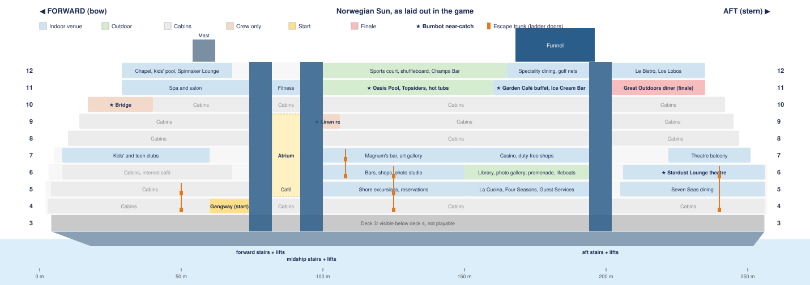

# Bumbusik — Game Design

A browser platformer about my wife, built as a gift for her to play. Sister game to
[mysterious_feline](../mysterious_feline) ("Bumbot"): also a browser game, with a different feel.

Status legend used throughout: **Decided** — agreed, build it this way. **Proposed** — a suggestion
waiting for a yes/no. **Open** — not discussed yet. **Later** — deliberately postponed until the
rest of the game is done.

---

## 1. Vision

| | |
|---|---|
| **Hero** | Bumbusik — my wife (§3). **Decided** |
| **World** | **The ship is the game.** One cruise ship, sailing on a sunny day over small waves, explored freely deck to deck. There are no levels. **Decided** |
| **Goal** | Catch Bumbot, our cat, who has stowed away. He shows up at five places on the ship and slips away each time; she finally catches him at the ice cream machine in the open diner on deck 11, aft. **Decided** |
| **Discovery** | The goal is **never stated**. She works out that she is chasing Bumbot by playing. **Decided** |
| **Player** | Her. It is a gift, and she wants a **real challenge** — Bumbot-level difficulty, not a gentle walk. **Decided** |
| **Tone rule** | **No death and no negativity.** Failing is a *scare*: she runs off, or bobs in a life ring, and pops back out of a crew cabin door (§5.6). **Decided** |

---

## 2. Platform

**Decided:** Bumbusik is a **browser game**, playable with keyboard or an **Xbox Series controller**,
and it has to work when **hosted on GitHub Pages**, as Bumbot does.

**Decided:** Bumbusik is its **own, much bigger project with a nicer look**. Bumbot's code and
lessons are **not** a constraint. We do whatever makes the most sense for Bumbusik.

### 2.1 Art

**Decided:** Bumbusik has to **look nicer than Bumbot**. Bumbot's code-drawn SVG sprites read as basic,
and in places ugly. Neither of us is an artist, so the art comes from somewhere other than our own
hands. Bumbot's sprite is **not** reused; he is redrawn in the new style.

What makes a game look good is mostly **consistency**: one style, one palette, one pixel scale,
everywhere.

**Options:**

| Option | How | For | Against |
|---|---|---|---|
| **A. AI pixel-art tools** (e.g. PixelLab, Retro Diffusion) | Describe or sketch a character, get it plus walk/run/jump/climb animations; tiles and props the same way. | Cheap, fast, unlimited iteration. Pixel art hides small flaws. Built for game sprites and animation frames. | Keeping a character identical across all animations takes effort; output needs cleanup (palette, alignment). |
| **B. Commission a pixel artist** (itch.io, Fiverr, r/gameDevClassifieds) | An artist draws her and Bumbot from photos, with animation sheets; maybe key tiles too. | Best likeness and charm; drawn by a person, which suits a gift. | Money (a few hundred dollars and up for two animated characters) and turnaround time. |
| **C. Asset packs** (Kenney, itch.io, CraftPix) | Ready-made tiles, props, UI, particles. | Instant and polished. | No side-view cruise ship packs to speak of; mixing packs clashes. Good for small generic pieces only. |
| **D. Code-drawn** (Bumbot's approach) | I draw shapes in code. | Free and instant. | The look we are moving away from. |

**Decided:**

- **Style: pixel art**, drawn at a low internal resolution (e.g. **480×270**) and scaled up crisply
  to fill the screen. At that resolution she is about 32px tall.
- **No artists.** Nobody outside the two of us should be able to block progress.
- **Sources:** her, Bumbot, ship tiles and props from an **AI pixel-art tool**. Small generic pieces
  (particles, UI) from free asset packs.
- **As cheap as possible.** I provide links; you choose what to use, subscribe to or buy.
- **One fixed palette** for everything, enforced by script, so pieces from different sources match.
- **Division of work:** I can't run image tools myself. I write the art specs and prompts, then take
  what comes out and do the technical side: palette enforcement, slicing sheets, alignment, hitboxes,
  animation setup in Phaser.
- **Reference photos** of her and Bumbot, for the AI tool, are **never committed**: the repo is public
  through GitHub Pages. They live outside the repo.
- **Placeholders first:** gameplay is built with simple placeholder art, so the ship is playable and
  tuned while the real art is made, then the art is swapped in.
- **Background decoration layer:** props behind the action are drawn in **muted, greyed-out colours**,
  so they never read as interactive (§5.8, the wet floor sign).
- **Everything is placed where it makes sense.** Nothing floats in the air: a tangerine sits on a
  table, a counter, a tray or in a fruit bowl; a key hangs on a hook; a card lies on a desk. Same for
  every object on the ship.

**Tools to evaluate** (prices from third-party listings, unverified; check each site):

| Tool | What for | Cost |
|---|---|---|
| [PixelLab](https://www.pixellab.ai/) | AI characters with animations (walk/run/jump), rotations, tilesets; Aseprite plugin | Subscription, reportedly from ~$12/mo; free trial reported. One month may be enough for the characters. |
| [Retro Diffusion](https://www.retrodiffusion.ai/) | AI pixel-art images, tiles, props | Pay per image (~$0.01–0.18), prepaid, no subscription, credits don't expire |
| [Pixelorama](https://pixelorama.org/) | Pixel editor for cleanup and small edits | Free, open source |
| [LibreSprite](https://libresprite.github.io/) | Pixel editor (free fork of an older Aseprite) | Free, open source |
| [Aseprite](https://www.aseprite.org/) | The standard pixel editor; needed for PixelLab's plugin | ~$20 one-off, or free if you compile it from its public source yourself |
| [Piskel](https://www.piskelapp.com/) | Browser pixel editor, nothing to install | Free |
| [Lospec palettes](https://lospec.com/palette-list) | Ready-made pixel-art palettes to pick our one palette from | Free |
| [Kenney](https://kenney.nl/assets) | UI, particles, generic props | Free (CC0) |
| [Tiled](https://www.mapeditor.org/) | The ship map editor (§7.2) | Free (pay-what-you-want) |

**Cheapest path:** placeholders first (free), a free editor, Retro Diffusion credits for tiles and
props, and **one month** of PixelLab when the characters are drawn, ideally all of them at once.

**Decided: PixelLab, connected to Claude Code** through its MCP server, so assets are generated,
checked and dropped into the game from here. Started on the free trial (40 generations).

**The palette is Resurrect 64** (`assets/palette/resurrect-64.hex`). PixelLab only draws in a fixed
palette in its expensive Pro mode, so everything is generated freely and converted afterwards by
`tools/palettize.py` (nearest colour by perceived difference, plus per-character colour swaps).

**Asset pipeline:** raw PixelLab frames are kept in `assets/source/<character>/`, and
`tools/build_sprites.py` converts and packs them into `assets/sprites/<character>.png` + `.json`.
Reference photos never enter the repo.

---

## 3. The heroine — Bumbusik

**Decided:**

- **Name:** Bumbusik is what I sometimes call her.
- **Story:** she **works on the ship**, and Bumbot has **stowed away**. That explains why she can use
  crew key cards and crew-only areas, and why the passengers and machinery around her are obstacles
  rather than villains. It is true to life: she worked on cruise ships for 11 years, managing
  personnel and doing QA, which is a good source of in-jokes and quirks.
- **Appearance:** Ukrainian, white skin. Dark straight hair, curled up at the ends, a little below
  shoulder length. Small earrings. No glasses.
- **Outfit:** the women's uniform of cruise ship personnel: white short-sleeved blouse with shoulder
  epaulettes, navy knee-length skirt, a small neck scarf, a name badge, dark flat shoes.
- **Personality / quirks:** to be added as we build. They will feed idle animations, reactions,
  the scare moments, and jokes on board.

- The hair curl and the earrings are what make her recognisable at sprite size, so they get
  exaggerated slightly. Redone if it doesn't look right.
- **Size:** **59px** tall at the 480×270 internal resolution, about 22% of the screen height: the
  size her PixelLab sprite came out at, kept rather than shrunk, because downscaling pixel art ruins
  it. Bumbot is stylised larger than a real cat would be next to her, or he would be a speck.
- **Her sprite (Decided):** generated with PixelLab (natural proportions, the most detailed of four
  tries), then edited for longer hair flipping outward at the ends and fair skin, and converted to
  Resurrect 64. Animations so far: run, jump (rise / apex / fall poses) and a ladder climb from
  behind, hands alternating, and climbing out of a hatch (hands on the rim at head, shoulder,
  then waist height as she rises). Run, climb and the idles use PixelLab's skeleton mode, which moves her standing
  sprite rather than redrawing it, so her hair stays the length it is when standing still.
- **Idle (Decided):** standing still is her plain side pose. After 4 seconds one idle plays once,
  then another every 6 to 10 seconds, never the same twice in a row; any move ends it at once.
  Two so far: hands on hips tapping a foot (the taps repeat), and looking back over her shoulder,
  held for about a second. More can join the rotation as her quirks come up. Tried and dropped: a
  nail-buffing idle, which read as checking her phone.

### 3.1 Controls

**Decided:**

| Action | Keyboard | Xbox controller |
|---|---|---|
| Run | ← / → | Left stick / D-pad |
| Jump (hold for full height, tap for a hop) | Space | A |
| Climb ladders | ↑ / ↓ | Left stick / D-pad up/down |
| Кісюнічка dash (§3.2) | Shift | B |
| Activate: doors, buttons, card readers, whatever we add as we build | E | X |

Activate has its own key rather than ↑, so standing at a ladder next to a door is never ambiguous.

**Controller testing waits until the rest of the game is done.** Keyboard is the reference until then.

No pause and no map, at least for now.

### 3.2 Special move — the "Кісюнічка!!!" dash

"Кісюнічка!!!" is what she happily screams every time she sees a random cat on the street, so
it is her battle cry here.

**Decided:**

- A dash with increased speed while she shouts **"Кісюнічка!!!"**, smashing through some obstacles and
  enemies in her path. Lasts **10 seconds**.
- **Fuel: tangerines.** Each dash costs one. There is **no cap** on how many she carries, but there are
  not many on the ship, so each one counts (§6.3).
- **Speed:** ~2× run speed. Bumbot's cheat dash was 4×, which is fine on an empty rooftop but
  uncontrollable for 10 seconds inside a ship full of corridors and ladders.
- **What it breaks:** enemies and anything marked *breakable* (crates, luggage, stacked deck chairs,
  room-service carts). It never breaks walls, floors, locked doors or the ship's structure, because
  those are what the key cards gate.
- **What it doesn't change:** falls still count (§5.6); jumps still work as normal during the dash,
  and she still **lands on** floors she runs over (Bumbot's early dash fell through every ledge).
- **Presentation:** a speech bubble with the exact text **"Кісюнічка!!!"** and a synthesised sound
  (no recording), a speed trail, and a HUD countdown so she can see the 10 seconds draining.

---

## 4. Bumbot — the runaway cat

**Decided:**

- Bumbot appears at **five places** on the ship, each one a **near-catch moment**: a mini-scene where
  she almost grabs him and he slips away with a funny animation, then play continues.
- Until she reaches him, he is **doing something cat-like** in his spot, and each spot gets something
  different: asleep in the warm towels, washing himself, catching a fly, and so on.
- A near-catch is a short scripted sequence with input locked: she lunges, he escapes — up a ladder
  she can't use yet, into a vent, onto a passing tray, behind a door that slams shut, or into an
  escape trunk she can't open yet (§5.1).
- **Each near-catch spot is also a checkpoint** (§5.5).
- **The five spots:**

  | Spot | What he is doing |
  |---|---|
  | Housekeeping linen room (a cabin deck) | Asleep in the warm towels |
  | Theatre stage | Washing himself under a spotlight |
  | Buffet | Eyeing a fish |
  | Pool deck | Catching a fly over a sunbed |
  | Bridge (behind the captain's card) | Batting at the ship's controls |

- **No fixed order.** The ship is freely explorable in any direction, more so as areas open up, so
  she can meet the five in whatever order her access allows.
- **The final catch:** the open diner on **deck 11, aft**, at the self-service ice cream machine.
  The diner is **inaccessible until she has seen all five near-catches**, so she never finds it
  early and wonders why it mattered. A proper win sequence: she scoops him up, hearts, purring, win
  screen, at sunset (§5.2).
- Until then the diner is **closed**: shutters down and a "Closed" sign.
- Each escape **points somewhere**: he runs off into an area she can't reach yet, as a hint toward
  where to go next. Whichever near-catch is her **fifth**, he runs toward deck 11 aft, and the diner
  opens.
- He is a black Bombay cat, redrawn in the game's art style (§2.1).
- **His sprite (Decided):** PixelLab pro mode designed him from a photo of the real Bumbot: slim,
  glossy black, pale yellow-green eyes, a small grey patch below the throat where a bow tie would
  be, no collar. It came out about 42px tall standing, too big next to her, and PixelLab's own
  smaller redraws lost his look, so we shrank it ourselves (box resampling to 2/3, snapped back to
  Resurrect 64): about **28px tall standing**, a little above her knee. Faint grey streaks from
  each ear to the outer corner of the eye were added by hand, as on the real cat.
- **His animations (Decided):** run (his escape), washing (theatre), a leap (the startle, and the
  fly at the pool), sitting down and staying sat (the fish at the buffet), eating (the ice cream
  machine, deck 11), batting with a paw (the bridge), and asleep (laundry), which breathes in code.
  Asleep is side-on, lying down with eyes closed and the tail out behind. A curled-up "bagel" was
  dropped: from the side it barely reads, and PixelLab drew it as a ball seen from above.
- **A near-catch (Decided):** she tries to **pick him up**: she walks up to him, bends down with
  both arms out, and just before her hands reach him he leaps away and runs. She stays bent a
  moment, straightens, and turns to the camera. Then play goes on.
- **For now (test slice):** he washes on deck 4 aft of the gangway and runs off the screen toward
  the stern. The real near-catch spots and escapes come with the ship layout.

**Decided:** between the five spots he also turns up in **background glimpses**: a tail vanishing
round a corner, a cat silhouette on the deck above, a shape passing a window. He can't be reached
there; they only remind her he's on board.

---

## 5. The ship

### 5.1 Structure

**Decided:**

- The game is **one ship, with all its decks**. No levels. It is meant to be a big game.
- **Free movement** in all directions: forward and back along a deck, up and down between decks.
- Some areas and doors are **locked** and open only once she finds the matching **magnet key card**
  or **key** (§6.2). It is the exploration/backtracking loop of a Metroidvania.
- **The ship is the Norwegian Sun**, used as the reference for its dimensions, layout, venues,
  stairwells, elevators and ladders. We have both been on it, so she can find her way **without a
  map**, from memory.
- **The name is never stated at the start.** She has to recognise the ship herself. Name markings
  may appear in areas she unlocks later. **Later**
- **She starts on the gangway, on deck 4**: in the gangway lobby, with the shell door closed, because
  the ship is already at sea.
- **She can go outside:** open decks, railings, the promenade, lifeboats.
- **Side view of a top-down plan:** the real deck plans are seen from above, but the game shows the
  ship from the side, so each deck shows one slice along its length. That slice follows the deck's
  **main route from bow to stern**, with venues at their real positions along it. **Doors** along
  the way lead into **small separate rooms** (cabins, offices, venues off that route).
- **Stairs** are walked **diagonally**, like normal stairs, at the real stairwells' positions. Tried
  in the first slice; it feels natural. ↑/↓ steps onto a flight, and holding the key carries her
  through a landing onto the next flight.
- **Ladders** only where real ones exist: crew and technical areas, the pool, lifeboat stations, the
  mast and funnel, emergency escape shafts. Guests don't climb ladders on a real ship.
- **Escape trunks (Decided, 2026-11-01):** some crew doors along the decks (not checkpoints) open
  onto a vertical ladder shaft, as a real ship's emergency escape trunks do: shortcuts up and down
  beside the stairs and elevators.
  - One ladder runs up the shaft past a door on each deck it serves. Most link two decks; a few
    link more, and a shaft may pass a deck with no door on it.
  - **Two small amber arrow lamps above the door, ▲ and ▼**: a lit arrow is a way she can go from
    that door, an unlit one a way she can't. They don't look like a checkpoint's green lamp.
  - **E opens the door**, revealing the ladder behind it; then ↑/↓ takes the ladder in a lit
    direction. A door closes by itself once she steps away from it.
  - **No cutaway and no fade:** inside, the walls and decks hide her naturally, seen only in an
    open doorway, and the camera follows her up or down.
  - She can stop at **any door along the shaft**: **reaching a door opens it** from inside, then
    ←/→ steps out, or she climbs on and it shuts behind her. Letting go of ↑/↓ just short of a
    door settles her level with it.
  - **One-way shortcuts, in a few places:** the lower doors stay shut from outside ("opens from
    the other side": the door rattles, its arrows unlit) until she has come down through the
    shaft once; from then on it works both ways for good.
  - **A few are card-locked**, like other locked doors: the card's colour shows on a reader beside
    the door (§6.2).
  - Bumbot can escape into one she can't use yet (§4).
  - **For now (blockout):** four test trunks, to try the mechanic: a two-deck one (deck 4–5,
    forward cabins), a three-deck one (decks 4–6, midships), a one-way shortcut from the theatre
    on deck 6 down to deck 4 (passing deck 5 with no door) and a Hotel-card one (decks 6–7). The
    real ones are placed when the interiors are filled. Listed in `tools/ship_layout.py`.
- **Elevators:** guest elevators are free to use; crew service elevators need cards. **An elevator
  never opens onto an area she can't reach yet.** She stands at the doors and presses **E**; they
  open and a button panel shows decks 4–12, the ones she can reach lit and the rest greyed out.
  ↑/↓ picks a deck, **E confirms** (changed from jump, 2026-11-01); the panel goes (the camera
  following the car shows the ride, 2026-11-01), the doors close, and they open on that deck.
- **Elevator details (Decided, 2026-11-01):** one elevator door in each of the three cores, aft
  of the stairs, with the deck number lit above it. ←/→ at the panel backs out, and the doors
  close once she steps away. She steps in and turns to face us; the car travels out of sight (the
  walls and decks hide it, as in an escape trunk) with the camera following; a ding, and the doors
  open. While the glass car comes to fetch her, the panel's display counts its decks. For now the decks she can reach are the
  same as the stairs': 4–6 with her crew card, the rest with the Hotel card.
- **Glass elevators (Decided, 2026-11-01):** the atrium's glass elevator works like the others,
  but its car is **seen**: it runs up and down rails on the atrium wall (decks 5–9), she rides
  visible inside it, and if it's on another deck when she presses E, it comes down or up to fetch
  her first.

### 5.2 At sea

**Decided:**

- The ship is **sailing** throughout the game. It is **sunny**, with **small waves**.
- The waves are **visual only**: a gentle swell on the water and a little sparkle. The ship does
  **not** rock under her, because tilting floors would fight precise platforming.
- **Midday sun** for the whole game. **Sunset only for the final catch scene.**

- Outside areas show open sea and sky behind the ship, the sea scrolling past slowly to sell the
  sailing. Indoors, portholes and windows show the same sea.
- Sound: a soft sea and engine ambience outdoors, quieter inside (synthesised, like everything else).

### 5.3 The reference ship — Norwegian Sun

Real-world figures ([NCL ship map](https://app.ncl.com/sites/default/files/Ship_Map_SUN_06142022.pdf),
[deck plans](https://www.ncl.com/cruise-ship/sun/deck-plans),
[CruiseMapper](https://www.cruisemapper.com/deckplans/Norwegian-Sun-735)):

- Length **258 m** (848 ft), gross tonnage 78,309, about 1,900 guests.
- Passenger decks are numbered **4 to 12**; the decks below are crew and machinery.
- Deck 11, aft: an open-air diner with a self-service ice cream machine (the final catch).

**The reference for real proportions** is NCL's ship map ([PDF](https://app.ncl.com/sites/default/files/Ship_Map_SUN_06142022.pdf)):
its lower half is a **side profile** of every deck, with the stair cores, the atrium and each
venue's position along the ship. Use it whenever a position or proportion needs checking.

- **It is drawn with the bow on the right. The game flips it: bow on the left.**
- A local copy is kept, not committed (it is NCL's artwork and the repo is public), in the
  git-ignored `reference/` folder: `norwegian-sun-ship-map.pdf`, a render of the profile
  (`norwegian-sun-profile.png`) and the same flipped to the game's orientation
  (`norwegian-sun-profile-flipped.png`; its text reads mirrored). If the folder is missing,
  download the PDF again and render the profile with PyMuPDF (`pip install pymupdf`), page 1,
  clip y 425–585 pt.
- Measured off the profile: the ship is ~1,620 px long at 150 dpi, so ~6.3 px per metre.

**Decided (layout, 2026-10-31):** from that profile.

- **The bow is on the left**, the stern on the right.
- Three stair-and-elevator cores: **forward** (~79 m from the bow), **midship** (~96 m) and **aft**
  (~198 m). The **atrium** spans decks 5–9 between the forward and midship cores, with glass
  elevators. The funnel stands over the aft half.
- **The gangway is on deck 4, forward**, beside the forward stairs. The game starts there.
- **Floors and open spaces (Decided, 2026-11-02, replacing "the atrium is a look, not a
  well"):** corridors and rooms have solid floors. Two places open up through the decks, as on
  the real ship, and both work the same way, as **side walks**:
  - **The atrium** is a real open space, its floor on deck 5 (Guest Services, the Atrium Café;
    the Atlantic Deck, confirmed by the user), open up through deck 9 to a
    domed skylight: oval balconies with cream fronts and glass-and-brass railings, burl-wood
    pillars with brass rings, the two glass elevators in the middle (§5.1), the curving
    staircase, which climbs level by level beside the glass elevator from deck 5 to deck 9.
  - **Deck 12 over deck 11's open area** is a side walk along the ship's side, its floor
    continuous (the hole in the blockout goes), with deck 11's pools below and behind it.
  - **The atrium is 20 m long, two screens** (the user, 2026-11-02): NCL's profile draws it about
    10 m, which looked narrow next to its five levels, so the midship core stands 10 m further aft
    than on the profile. (The profile's mezzanine, deck 6a, was tried and dropped by the user.)
  - **Side walks are level with their deck's floor** (the user, 2026-11-02): she simply runs
    along them, the look kept (balcony fronts, the glass railing, the open space below). A
    step-up onto them, with ↑/↓ and railings to jump over, was tried and dropped: it worked
    poorly in practice. **Deck 12's walk over the pools keeps the drop: ↓ there lets her down
    through it** into a pool (the fun part). Nowhere else does ↓ drop her; in the atrium it only
    ever takes the stairs.
  - **Open (the user, 2026-11-02):** on the real ship, the upper decks' corridors run along the
    ship's sides, while the middle above the atrium is the atrium itself and its glass dome. In
    the game, deck 10's cabin corridor runs straight over the atrium, under which the dome hangs.
    Revisit when the upper decks are laid out properly.
  - **The curving staircase winds round the glass elevator** (the user): each flight sweeps from
    one side of it to the other, alternately behind it and in front of it, and the elevator's
    dark column hides her while she is behind it.
  - **Drops keep the fall rule** (§5.6): one deck down is fine; longer, the camera lets her go,
    she falls out of the frame and comes back at the nearest checkpoint. (It is not a fright;
    overboard stays as it is.)
- **Decks 11 and 12 have glass side walls**: glass windbreak panels with a handrail along the
  ship's side, instead of open railings.
- **The pools:** she can jump into a pool, and swims a **side-on breaststroke, her head above the
  water** (the user's choice; a skeleton-v3 clip written as poses, 3 generations; a front crawl
  was made first by a misunderstanding and is kept in `assets/source/her/swim-crawl/`). Two pools on deck 11 (119-131 m and
  134-140 m), sunk two tiles into the deck; she walks or drops in with a splash, ←/→ swims, jump
  climbs out. Maybe game mechanics round the pools later. Not a scare. Bumbot's fly-catching spot
  moved beside them, to 146 m.
- **Below deck 4 is not playable.** Deck 3 shows at the bottom of the screen when she is on deck 4,
  as it naturally would, but she can't get there. There are no crew or engine decks to explore.
- **The map builder places venues by their real position** along the ship, deck by deck, from a
  list (`tools/ship_layout.py`); the art is placeholder until the real tiles come.

The schematic is drawn from `tools/ship_layout.py` (`python tools/draw_ship_profile.py`), the same
list the map builder reads: edit positions there, not in this picture. Spans are approximate,
true to the order and rough size of things on the real ship.

**The earlier deck list** (before the profile), kept for reference:

| Deck | Role in the game |
|---|---|
| 1–3 | Crew and engine decks: machinery, laundry, galley stores, crew corridors and cabins. Mostly key-card gated. |
| 4–5 | Lower guest decks: **gangway (start)**, reception, medical, cabins. |
| 6–7 | Public decks: atrium, restaurants, theatre, shops, casino; the outdoor promenade and lifeboats. |
| 8–10 | Cabin decks: long corridors, room-service and housekeeping carts. |
| 11 | Pool deck, buffet, and **the open diner aft with the ice cream machine (finale)**. |
| 12 | Sun / sports deck. |
| Bridge | Forward, behind the captain's key card. A Bumbot near-catch. |
| Top | Funnel and mast. |

**The real ship's look** (Decided, 2026-11-02): **authenticity first**; the ship should look and
feel like the Norwegian Sun as the user saw her in **summer 2026**. **The user's own photos come
first**: 64 of them, named by what they show, in the git-ignored `reference/photos/` (HEIC; small
JPEG copies in `reference/photos/small/`). Never commit them, and never upload ones with people in
them to an art tool. Public galleries
([Cruise Deck Plans](https://www.cruisedeckplans.com/ships/pictures.php?ship=Norwegian-Sun), 2015 to
2023; they may mix in the sister ship, Norwegian Sky) only fill gaps, where they agree with hers.

From her photos:

- **Cabin corridors** (`corridor`): light, not dark. Cream walls, a white panelled ceiling with
  round downlights, a wooden handrail along the wall, framed pictures. **Cabin doors: terracotta
  wood** (orange-brown) in a wood frame, a brass key-card lock and lever, a small number plate
  (e.g. 8259). **Carpet: blue-grey with a white wave pattern.** Occasional framed pictures on the
  walls. **Most cabin doors are plain; a few carry vacation stickers**, different on each door
  (the user's word, 2026-11-02).
- **Modern corridors near the lounges** (`corridor_near_bliss_lounge`): grey 3D-geometric
  wallpaper, black door frames and trim, dark carpet with grey and white dots, large framed art.
- **Crew area** (`view_via_an_open_door_into_the_crew_area`): white steel walls, pipes and ducts
  on the ceiling, fluorescent tubes, a **blue speckled floor**, hard hats on hooks, a steel
  watertight door. Crew doors are plain white steel.
- **Doors to the open deck** (`doors_to_outside_deck`): varnished wood with a round porthole, a
  yellow-and-black striped sill, a "WATCH YOUR STEP" sign.
- **Promenade, deck 6** (`deck_6_promenade`): **tan non-skid deck with blue WALKING / JOGGING
  markings** and arrows. White railings and stanchions; orange life rings hung on the railing;
  green assembly station signs. **White lifeboats hang overhead** on white davits, "NORWEGIAN
  SUN" on their hulls; white steel frames and ceiling.
- **Elevator lobbies** (`deck_6_elevators_on_the_left`, `deck_8_elevators`): mahogany panelling,
  **bronze-toned elevator doors**, a deck number lit above each, a cream panelled ceiling with
  downlights. Deck 6: purple-navy carpet with a gold pattern. Stair cores: blue carpet with a
  diamond pattern, brass handrails on dark wood (`stairs_aft`).
- **Bars and lounges:** Windjammer Bar: dark mahogany, coffered ceiling, brass lamps, **tufted
  teal-green leather club chairs**, tan leather bar stools, a ship model in a glass case (public
  photos agree). Library: dark wood shelves, a red-and-cream patterned carpet. Bliss: dark, a
  dotted carpet, a wooden dance floor. Spinnaker Lounge: cream armchairs with dark wood arms,
  tall windows.
- Not yet checked against her photos: the atrium (`central_area`, `glass_elevators_in_central_area`,
  `round_stairs_central_area`), the restaurants, deck 11 and 12, the outside of the ship.

**The outer shell (Decided, 2026-11-03, the user's idea):** the ship is seen **from outside**: an
off-white shell (plating `#e8eaec`, mostly white, a little grey) over every deck, its outline from
NCL's profile and the user's photos, with no square corners. **The deck she is on is cut away**
along its whole indoor length, like a cut-out in the wall; every other deck shows the outside.
The cut-away **crossfades with her height** on stairs, ladders, trunks and elevators, and eases
when she lands on another deck. The ship's very front and back always show the wall: every
indoor deck end stops short of the hull (2.7 m of structure, `STRUCTURE_COLS`), the cut's edge a
little shaded. **The cut-out's edges are in shadow** (the user, 2026-11-03: the cut wasn't
apparent): a soft dark gradient inside the opening wherever the shell goes on, deepest under the
deck above, fading in with the cut (`CUT_SHADOW` in `src/config.js`); no hard line.
Where a deck ends in the ship's wall, a 32 px strip of that wall is drawn over her (`END_COVER`),
so running into it she goes behind it; no window straddles or crowds the cut's edge, a cabin's
pair of windows both or neither; the old shaded edge tiles are gone. The venue-name signs are
placeholders: the gangway's is removed (2026-11-03), the rest go as each deck is furnished.
No line along each deck's floor and no rounded corner tiles on the shell (they read as stray
marks); all round windows (deck 5's and the lower hull's, in line) are 24 px across, every 160 px
(`PORTHOLE_R`, `PORTHOLE_PITCH`).
- **Built (branch `outer-shell`):** step 1, the shell and the cut-away (the `exterior` tile layer,
  `EXT` tiles cut, `EXT_FIXED` never; `updateCutaway` in the scene); the outline: where a deck
  steps back by up to 8 m the shell slopes across the step (`shell_slopes`), so the bow's
  superstructure front (measured row by row: 18.7 m at deck 7 to 25 m at the bridge; deck 11's
  wall at 29.5 m behind its open roof, `FRONT_WALL`) and the stern's tiers run smoothly; **two
  crew decks of hull (1-2) show above the waterline** (`HULL_DECKS_BELOW`), so the ship is ~7.6
  times as long as tall, near the profile's 7.8; the stern goes straight down to the water.
  Step 2, the details drawn on the shell (`shell_details`): round portholes on the lower hull, a
  navy waterline band, square windows on the cabin decks, balconies on decks 8-10 midships and
  aft, big windows on the public rooms, the bridge's window band, the white bulwark and glass
  windscreen on the open parts of decks 11-12, the roof's edge, the navy funnel with its grille,
  the white mast, three radar domes. The user approved the outline; step 2 shown.
- **Step 3, next: deck 6's promenade, two routes (Decided, 2026-11-03):** along deck 6 from about
  85 m to 225 m (the user's photo) she can walk **inside** (the rooms, cut away as on any deck;
  the open stretch at 150-194 m becomes indoor rooms, the library and photo gallery) **or
  outside on the promenade**, switching through varnished doors with porthole windows (the
  user's `doors_to_outside_deck`) at about five places: **E** at a door, a quick fade. On the
  promenade the rooms are hidden; she walks along the ship's white wall (its windows, the doors
  back in). **The promenade is two decks tall**: white columns between bays, **the lifeboats
  hanging high up** (deck 7's level), a white railing at the edge. Its fore and aft parts are
  enclosed by a wall with **large glassless window openings**, drawn in front of her, so she is
  partly concealed there. Its ends are closed: back in only through the doors.
  **Built (2026-11-03, `PROMENADE` in `tools/ship_layout.py`):** 102-226 m, enclosed ends 102-116
  and 212-226 m (white wall, 80 px openings between piers, a 30 px sill hiding her legs), doors
  at 111, 138, 162 and 186 m (E, a 140 ms fade; 218 m, in the theatre, removed by the user, as
  were the paper signs over them).
  On the promenade nothing on the deck is cut away (`route`, "inside" or "promenade"); the rooms'
  stairs, elevators, trunks and ladders are out of reach. A beige deck strip, a white railing
  with a wooden handrail and life rings, in front of her; white columns from deck 6 up past deck
  7, between the boats, holding the davit arms. The shell along it, the user's corrections: **only
  a few windows on the promenade's wall** (one every 4 m, clear of the doors), **none on deck 7
  where the boats hang**, and **deck 5's windows are round**, bigger (20 px) and few (every 160 px).
  The life rings hang from the railing's handrail between two posts (plain `life-ring`). 150-194 m inside is now the library
  and photo gallery (a few muted pieces; furnished properly with deck 6). `?at=promenade` starts
  on it, `?at=library` inside.
- **Lifeboats:** the real ones (the user's photos) have a **red-orange canopy roof over a white
  hull**, hanging from white davits; seen from below on the promenade, white undersides with
  propellers. Three PixelLab tries from text (1 generation each, `create_map_object` 400x100 side
  view, kept in `assets/source/ship/lifeboats/`) were all rejected; so were three
  `image_to_pixelart` tries from the user's photo crop (`photo-try-4..6`, 1 generation each: the
  crop is too soft, they came out as red and white stripes). **Approved (2026-11-03): drawn by
  hand**, `tools/draw_lifeboat.py` (free; writes `assets/ship/lifeboat.png`): 300x100, red canopy
  over a white hull, a row of small windows, the hatch amidships, the steering cupola aft, a
  release hook at each end. **Size approved**: 300 px, about five times her height. Ten hang
  over the promenade's open middle at deck 7's level, every 9 m, from davit arms on the white
  columns; they fade when she is inside deck 6 or 7. The photo crops
  (`reference/photos/lifeboat-ref*.png/jpg`) stay git-ignored.
- The sun livery stays on the bow for now (the user, "then we'll see"); on the real ship it sits
  about 40 m from the bow, low on the hull.

### 5.4 Scale

**Decided:**

- The ship has the **real Norwegian Sun's dimensions**, at one uniform scale.
- **The screen shows** her in the middle, the deck she is on, and a small part of the deck above and
  the deck below, where they exist.

That works out to (numbers to be tuned in testing):

- One deck (~3 m real) = **144px** at the 480×270 internal resolution, about 53% of the screen
  height, so the deck above and below still show at the edges.
- So 48px per metre, and the 258 m ship is **~12,400px long**, about **26 screen widths** per
  full-length deck. Including hull and funnel, it is roughly 2,900px tall.
- She is drawn at about **three quarters of true scale** against the ship, so a deck's ceiling sits
  at about 2.2× her height: close enough to feel like a ship's corridor, with room left to jump. (A
  first try at half scale made the decks feel like halls.)
- **Everything human-sized is sized to her, never to the ship**: doors (~1.25× her height), furniture,
  railings, counters, signs. Sizing some props to the ship and others to her made a gangway door
  twice the height of the crew cabin door beside it. The ship's overall dimensions stay real.

### 5.5 Checkpoints

**Decided:**

- A checkpoint is a **crew cabin door**. She is activated at it by passing it, and when she comes
  back after a scare she **steps out of that door**.
- **An activated checkpoint must be obvious** from across the deck, not a small indicator: the door
  stands ajar with the cabin light spilling out, and a green lamp above it glows. Activating one
  gives a short burst of light and a chime.
- Checkpoints sit where a crew cabin door plausibly would, following the real layout.
- There are a few across the ship, and **each Bumbot near-catch spot has one**.
- She comes back at the **closest one** to where she was scared, among the checkpoints she has
  **already activated**. Otherwise she could come back somewhere she has never been, possibly past a
  locked door.
- "Closest" follows the ship's layout rather than straight-line distance, or a checkpoint on the
  deck above could win over the one just down the corridor. First version: prefer checkpoints on the
  same deck, then the nearest deck.
- A scare keeps everything collected (cards, keys, opened doors). Only her position resets. Unlimited.
- The game **auto-saves at each checkpoint** (in the browser), so she can close it and continue later.

### 5.6 Scares (instead of death)

**Decided:** there is **no death and no death animation**, anywhere. One hit is still one failure,
which keeps the challenge, but it plays as a scare:

| What happens | What she does |
|---|---|
| Touches an enemy or a hidden trap | A fright **that fits what got her** (squeals at the vacuum robot, splashed by the water pistol, ...), then she **runs off the screen**. |
| Falls **one deck** | Nothing. She lands and carries on. |
| Falls **further than one deck** | The camera **stops following** once she passes one deck, and she drops out of the bottom of the screen, as Bumbot does. |
| Falls **overboard** | No drowning. A splash, then she bobs up **smiling in a life ring, waving one hand**, for about a second. |

Then she steps out of the closest activated crew cabin door (§5.5).

The word is **"scare"**, never "death", on screen and in the code alike.

### 5.7 Areas

**Decided:** all of these are on the ship.

| Area | Ideas |
|---|---|
| Gangway | The start, on deck 4. Ship's horn, luggage carts. |
| Crew decks / engine room | Pipes, steam vents, machinery; dark and warm-lit. Key-card heavy. |
| Cabin corridors | Long, repetitive halls, numbered doors, room-service carts, housekeeping trolleys. |
| Atrium / promenade | Multi-storey open space with glass elevators, shops, a grand staircase. |
| Restaurant / buffet | Waiters with trays, tables, rolling dessert carts. |
| Theatre | Stage lights, curtains, rows of seats. |
| Casino | Spinning lights, slot machines. |
| Pool deck | Water, slides, sunbeds, slippery wet tiles. |
| Open diner, deck 11 aft | The ice cream machine. The finale. |
| Sun deck / funnel | Wind, seagulls. |
| Bridge | Behind the captain's key card. Bumbot is here, and escapes. |
| Outside: lifeboats, railings, bow | The ship's exterior and the sea. The overboard risk lives here. |

### 5.8 Enemies, hazards and other people

**Decided:**

- **All of these are in:** seagulls, a kid with a water pistol, a robot vacuum cleaner, a strict
  security officer, a waiter with a tray who doesn't look where he's going, a sliding deck chair on
  wet tiles, steam vents in the engine room, an old lady guarding her sunbed. More may come later.
- **Hidden traps**, alongside visible hazards: a floor hatch that opens, a slippery wet patch, a towel
  stack that collapses, a sprinkler that triggers, a deck chair that snaps shut.
- The wet patch is **fair but hidden**: a "wet floor" sign stands in the **background decoration
  layer**, drawn in the same muted, greyed-out colours as the other background props, so it is just
  one of them unless she is paying attention.
- **Passengers and machinery are the obstacles. Fellow crew are friendly**, background characters
  at most, to begin with.
- **The colleague with the card:** an ordinary member of the ship's staff, not based on anyone real.
  He cannot leave his post, so she brings him lunch, and he gives her his access card. A trial of the
  mechanic; we see how it plays.
  - He comes **somewhere in the middle of the game**, and gives whichever card makes the most sense
    at that point.
  - His lunch is **waiting on a tray in one of the restaurant areas**. Nobody tells her; working out
    that the tray is his is part of the puzzle.
- **Secrets** exist, like Bumbot's SUSHI sign. Designed **Later**.

---

## 6. Progression

### 6.1 Overview

**Decided:** everything she needs is **found on the ship**, apart from at least one access card a
colleague gives her.

### 6.2 Keys and cards

**Decided:**

- She **starts with her own crew card**, which opens only her starting area: **decks 4–6**, the
  whole lower ship (the gangway, the deck 5 restaurant corridor with its doors locked, the deck 6
  promenade and lifeboats). The stairs and elevators above deck 6, and the venue doors, open with
  the Hotel card.
- Three more colour-coded **key cards**, one per tier:

  | Card | Opens |
  |---|---|
  | Hotel | Restaurants, theatre, galley, housekeeping |
  | Technical | The ship's technical spots: the mooring deck at the bow, the lifeboat winches, the funnel and mast ladders, the theatre's backstage and fly loft. (There are no engine decks to explore, §5.3.) |
  | Captain | The bridge |

- 2–3 physical **keys** for one-off locks: a lifeboat winch, a storeroom, a theatre backstage door.
  (The diner is not key-locked; it opens after the fifth near-catch, §4.)
- At least one card comes **from a colleague**, in exchange for bringing him lunch (§5.8).
- Locked doors are visibly locked with the card colour on the reader, so she can remember where to
  return. With no map, this and Bumbot's escape routes are what keep her oriented, so each area
  needs a strong, distinct look.
- **Proposed:** the card colours, as the placeholder readers show them: Hotel blue, Technical red,
  Captain gold.

### 6.3 Tangerines

**Decided:** no carrying cap, but scarce.

**Decided:** **10** on the ship to start with, tuned in testing.

The game can be **finished without using special abilities**; they help, but are never required.
Tangerines go where a dash is genuinely useful: a breakable shortcut, a cluster of enemies.

### 6.4 Later

- **Hidden extras** (photos/memories of the two of you). **Later**
- **Win screen** content, a personal message. **Later**

---

## 7. Technical approach

### 7.1 What the game needs

1. **2D camera:** follows her on both axes, with a dead zone, clamped to the ship, and **stops
   following on a long fall** (§5.6).
2. **A tile-based world:** the ship is decks, walls, floors and openings, not a ground line with pits.
3. **Ladders:** a climbing state with no gravity, ↑/↓ movement, and jumping or stepping off.
4. **Elevators:** moving platforms that carry her, with call/stop logic between decks.
5. **Doors, locks and an inventory:** cards and keys she carries, and locked doors that check for them.
6. **Breakables:** a solid type the dash destroys while walls stay solid.
7. **The Кісюнічка dash:** a 10s timer, tangerine fuel.
8. **Scripted Bumbot scenes:** five idle-then-escape scenes and the final catch.
9. **Checkpoints and scares:** crew cabin doors, closest-activated respawn, the scare animations
   (run off, fall out of frame, life ring).
10. **Keyboard + Xbox controller input**, both mapped to the same actions.
11. **Screens:** title ("Bumbusik" and Start, nothing else), play, win.
12. **Save:** auto-save at checkpoints to localStorage.
13. **The sea:** scrolling water and sky behind the ship, visible outside and through windows.
14. **Sound effects only**, synthesised. No music for now.

### 7.2 Stack

**Decided: Phaser + Tiled, plain JavaScript, no build step, hosted on GitHub Pages.**

- **[Phaser](https://phaser.io/)** (current stable version, checked at setup) covers most of §7.1
  out of the box: loading Tiled maps, tile collision, a camera that follows with bounds and a dead
  zone, gamepad input, scenes for the separate screens, tweens for part-by-part character animation,
  and particles.
- **[Tiled](https://www.mapeditor.org/)** is a free visual map editor. The ship is drawn as tile layers
  (hull, decks, walls, ladders) plus object layers (doors, checkpoints, enemies, tangerines, Bumbot
  spots). Changing the ship means editing a map, not coordinates in code.
- **No npm or bundler:** Phaser is one vendored `.js` file, like Bumbot's plain scripts.
- **Hosting: GitHub Pages**, like Bumbot, served from the root of the `main` branch, so she can play
  from a link on any computer. Nothing
  server-side: static files only, and every asset path **relative**, because a project page lives
  under `/<repo>/` rather than at the site root.
- **Running locally needs a static server**, because browsers won't load map files into a `file://`
  page: `python -m http.server` in the game folder. GitHub Pages behaves the same way, so what works
  locally works there.

### 7.3 Building order

**Decided:** start with a **first slice**: the deck 4 gangway area, one stairwell, and a bit of the
decks above and below, with placeholder art. It settles scale, jump feel, stairs, ladders, falls
and controls (keyboard and Xbox controller) before the rest of the ship is laid out. Then the ship
grows from there, area by area.

The first slice's **layout and checkpoint placement are test geometry** for trying the mechanics,
not the ship. The real layout, and everything placed in it, follows the Norwegian Sun's deck plans.

**Done (2026-10-31): the whole ship as a blockout.** The slice is retired. `tools/build_ship_map.py`
generates every deck 3–12 at real length (~13,300px) from `tools/ship_layout.py`, with placeholder
art:

- Floors per deck at their real extent; the upper decks step back into open **terraces** with
  railings at the bow and stern, a steel outer wall with a doorway where a terrace meets the indoors.
- **Stairs** zigzag through the three cores from deck 4 to 12. Flights up to decks 5–6 need only her
  crew card; flights above deck 6 need the Hotel card and show "🔒 Hotel card" when she tries.
- Back walls tinted by area (venues blue-grey, cabins cream, crew peach, atrium yellow, deck 3 dim);
  outdoor stretches open to the sky. Venue name signs, DECK n signs at every core, muted cabin
  doors every 4 m along cabin corridors.
- A roof over deck 12's indoor rooms, the funnel and mast on top, and a technical ladder from deck 12
  up to the roof beside the funnel. Deck 12 is open over the middle of the Oasis Pool.
- Placed: the gangway spawn (deck 4, 67 m), 10 checkpoints, Bumbot at his five spots, 10
  tangerines, a crate stack, the robot vacuum on deck 4.
- The sea lies beyond both ends; overboard works at either end.

### 7.4 Alternatives considered

| Option | Why not |
|---|---|
| Plain JS + Canvas + Tiled | Full control, zero dependencies, but we'd hand-write collision, camera, gamepad, scenes and asset loading, all of which Phaser already provides. |
| Plain JS + DOM/CSS (Bumbot's approach) | Thousands of DOM nodes across a whole ship; culling and 2D scrolling get awkward. |
| Godot, exported to web | Best tooling, but a heavier download and an editor-centric workflow. |

---

## 8. Open questions

Nothing blocks the start of the build. These get settled along the way:

**Next up** (as of 2026-11-03):

- [x] Climbing out of a hatch at the top of a ladder (§3)
- [x] Her idles: foot tap, look back (§3)
- [x] Bumbot's sprite and his five activities, plus run, leap and eating (§4)
- [ ] The finale's art: her holding Bumbot (a state of her character, ~10 generations, or her
      arms-out pose with his sprite on top), designed with the win sequence (§4)
- [x] The whole ship laid out as a blockout from the real profile (§5.3, §7.3)
- [x] The user's playtest of the blockout (2026-11-01): getting around, scale, venues, movement and
      camera all good; it feels empty, as expected for now. Only the vacuum scare tried so far;
      checkpoints get tuned once the interiors are filled
- [x] **Escape trunks** (§5.1): ladder doors between decks, four test ones in the blockout. Tried
      by the user and merged 2026-11-01. Serve with `python tools/serve.py` (no stale caching)
- [x] **Elevators** (§5.1): one per core (decks 4–12) and the atrium's glass one (decks 5–9), E to
      open and to confirm; the panel goes once a deck is chosen. Tried by the user 2026-11-01
- [x] **Art style test** (2026-11-02, 27 generations): two PixelLab object sheets in Resurrect 64,
      sidescroller view. **Doors** (16 at 85px) and **props** (64 at 32px) came out well and the
      user liked both; the two side-scroller **tilesets** did not (generic chunky platform blocks)
      and were dropped: floors, walls, ceilings and railings are hand-drawn from her photos
      instead. `tools/build_ship_art.py` packs the pieces into `assets/ship/ship.png`: doors fitted
      to 74px without resampling, **every closed door's lever at the same height** (the user's
      rule), and a muted `-bg` twin of every piece. In the game: cabin corridors (muted doors, a
      few with stickers, pictures, handrail, ceiling lights, blue wave carpet), the crew door for
      checkpoints and trunks, the gangway lobby, a Windjammer-style corner in the deck 6 bars and
      the promenade railing with life rings. **The user keeps the style** (2026-11-02), the
      background fade is right as it is
- [x] **Overboard scare** (user, 2026-11-02): no 👋 emoji; **she raises her hand and waves**
      herself (skeleton-v3's `wave` move facing the camera, 3 generations; frames 1-5 loop) from a
      **life ring seen from the side**, its far half behind her and its near half in front. The
      ring came from a second 32px props sheet (10 generations), whose other pieces went into the
      atlas too: Bumbot's fish on a plate, a key card on a lanyard, a captain's hat, poker chips,
      a suitcase, ice cream, a pool ladder and more
- [x] **Ship structure, part 1** (2026-11-02, merged): **(1) the atrium**, an open space 20 m long
      (the midship core moved 10 m aft), decks 6-9 crossing it on **side walks level with their
      floor** (no step-up: tried and dropped), a skylight dome under deck 10, burl-wood pillars;
      **(2) deck 12's side walk over deck 11**, where ↓ drops her through into a pool, glass side
      walls on decks 11-12, **two pools with swimming** (a side-on breaststroke; a crawl is kept in
      `assets/source/her/swim-crawl/`); **(3) the stairs** drawn from her photos (blue carpet,
      glass and brass balustrades, wooden rails), the atrium's **curving staircase winding round
      the wider glass elevator**, behind and in front of it. All approved by the user. Testing
      aid: `?at=<place>` starts her at a named place (`README.md`)
- [x] **(4) The bow and stern** (2026-11-03, merged; approved by the user): every deck's ends
      **measured off NCL's profile** (`tools/ship_layout.py` EXTENT). **Bow:** a raked stem from
      the waterline up to its tip at deck 7, its edge a smooth line; the hull forward of 20 m on
      decks 3-6 is drawn from outside, white plating painted with **the ship's sun as on the real
      bow**: concentric rings round a white centre, swirling flame rays with grey shadows, a gap
      round its rim, and two bands from the stem (red above, red-orange-yellow below) running
      behind it and parting after it, one up and one down; scaled to cover most of the bow's side
      (`assets/ship/livery.png`, built with the map; no lettering: the name stays hidden, §5.1).
      On top, the **open mooring deck** on deck 7 (2.5-20.5 m), reached through a doorway, with
      bollards, cleats and a side railing; **card-locked later** (Technical card, §6.2).
      **Bridge:** deck 10's front at 24 m with windows; Bumbot's bridge spot at 27 m. **Stern:** a
      near-upright transom on decks 3-6 (255 m), decks 7-11 stepping back in open tiers (254 down
      to 244 m). Deck ends are white outer plating; railings ending open decks look like the
      decks' side railings
- [x] **The bow view** (the user's idea, 2026-11-03): standing still on the mooring deck for 3 s,
      she walks to the very tip and, **facing the sea ahead (her left side to us)**, spreads her
      arms back into the wind, her hair blowing (a skeleton-v3 pose drawn facing west, 3
      generations; a first try facing the camera is kept in `assets/source/her/arms-wide-front/`),
      and the camera draws back to frame the whole bow, its sun included; any key brings it
      back. Bow only for now; other scenic spots (the stern terraces, deck 12 over the pools)
      maybe later
- [x] **Deck 4 furnished** (2026-11-03, merged): the gangway lobby after the user's photo (cream
      panelling, fire doors held open (folded flat against the wall, seen face on, each in its frame where the lobby meets the next part of the deck, so the wall changes at a doorway; the runner mat dropped, it read as a glitch side-on), exit sign, fire-hose cabinet); the stair
      and elevator lobbies on every deck (mahogany panelling, blue mosaic carpet, bronze elevator
      doors in brass frames, a brass deck plaque, a picture); cabin corridors on every deck
      (trolleys and room-service carts by doors, extinguishers, exit signs, brass cabin-number
      plaques by the cores, numbered from the bow; a faint diamond wallpaper, approved). Her
      speech bubble lives in the world now (it smeared on the screen camera). Testing aids:
      `?tangerines=infinite`, `?at=gangway`
- [x] **Elevators fetch smoothly** (2026-11-03, merged): a car on another deck comes to her
      first, out of sight in a core, the panel counting it in; no more jumps
- [x] **The outer shell** (2026-11-03, merged; §5.3 "The outer shell"): the ship seen from
      outside, the current deck cut away; its outline from the profile; windows, balconies,
      portholes, funnel, mast and domes; the hand-drawn lifeboats; deck 6's promenade with its
      doors (two routes), as the user corrected it
- [x] **Deck 5 furnished** (2026-11-03): from the user's photos. The atrium floor (blue-green
      carpet, the Atrium Café's marble tables and cane chairs, a pastry case; Guest Services: a
      counter, a desk, a brass plaque); shore excursions and reservations (desks, brochure stands,
      travel posters; no photo); **La Cucina** (the white marble portico with its name on a
      grey-blue wall, the dark wood beyond it (starting the wood in the portico's middle was tried;
      the user preferred it as first built); dark tables with lamps,
      windows with beige drapes, a wine barrel, an olive tree, a dark diamond carpet); **the Four
      Seasons** (cream, burl pillars with brass rings, chandeliers, white-cloth tables, beige
      chairs, sheer curtains, the ice swan, a dark floral carpet); **the Seven Seas** (its backlit
      blue wave panel between marble columns, white-cloth tables; it starts right off the aft lobby
      at 202 m with a welcome station, the host's counter, the menu lectern and a brass "Seven
      Seas" plaque (the user: make the entrance clear); the crew door at its far end). Windows on the back wall in the
      restaurants (the user: yes). A third PixelLab props sheet (64 at 32px, 10 generations,
      `assets/source/ship/props-3/`). The user's corrections: **chairs sit the same distance from
      their table on both sides** (props are placed exactly, not snapped to tiles; `around()` in
      the map builder); **no cabin door right beside a trunk or crew door** (100 px apart, centre
      to centre); the livery's bands run on past the bow onto the decks' fixed ends and **taper to
      a tip**. Placeholder venue signs are gone from decks 4 and 5 (`FURNISHED`)
- [x] **Deck 6 furnished** (2026-11-03, merged): laid out after
      **NCL's deck plan** (`reference/norwegian-sun-ship-map.pdf`: its profile lists each deck's
      rooms by part of the ship): the Photo Gallery is on deck 6 beside the Library (deck 7 has
      the Art Gallery); Restaurant Reservations is on deck 5 (its desk there now has the look of
      the user's photo: burl-wood walls, a curved grey counter with a black top, brass letters).
      Bow to stern: the Internet Café (64-74), the Bliss Ultra Lounge (110-124: near-black, a
      dotted carpet throughout, disco ball, DJ booth, purple velvet, a bar under a neon
      sign), the Gift Shops and Perspectives Photo Studio (124-136), **the Windjammer Bar**
      (136-150, the user's photos: dark green walls, a coffered mahogany ceiling, brass lamps,
      planks, teal club chairs, the back bar, a chesterfield, the lit cabinet with a model ship
      by the gallery), **the Photo Gallery** (150-160, white, its name in grey letters, photos in
      two rows), **the Library** (160-194: lit dark-wood bookcases, the red-and-white striped
      carpet, red reading chairs, a chess table, a globe), **the Stardust Lounge** (202-255:
      deep navy, rows of red velvet seats in profile facing the stage, the stage with red
      curtains, a valance, lamps and their pools of light, drums, piano, guitar, speakers). Deck
      6's lobbies: a purple-navy carpet with gold (her photo). Art: two PixelLab sheets (64 at
      32px, `props-4`; 16 at 64px, `tall-1`; 10 generations each) and a theatre seat
      (`create_map_object`, 2 tries, 1 generation each: both three-quarter views, try 1 used);
      front-facing armchairs and seats left out. The user's corrections: the crew door moved
      from the Windjammer to the Library's aft end by the lobby; **no "Promenade" signs** (the
      doors say it); **no promenade door in the theatre** (four doors: 111, 138, 162, 186); the
      Internet Café opens off the corridor through a wood doorway with a brass plaque; the
      theatre's entrance is a gilded portal with "STARDUST LOUNGE" in a marquee of bulbs; a brass
      "Windjammer Bar" plaque; **decks 3-7 all end at 254 m**, one straight wall at the stern (a
      deck sticking out past the one above left a strip of open terrace with half a wall), and the
      stage runs to it between its two curtains; at the promenade's ends she stops in the first
      opening, partly behind the end pier (she used to slip behind it with bits poking out)
- [ ] **Open: checkpoints, removed for now** (the user, 2026-11-03): some sat too close together;
      every checkpoint door is gone until the ship is split into unlockable areas (§5.5, key
      cards), when they are placed again, spaced out. Until then a scare always brings her back
      at the gangway. The last placements (deck, metres): gangway 4/71, d5-aft 5/250.2,
      d6-promenade 6/193.4, d6-theatre 6/209, d7-casino 7/152, d9-linen 9/115, d10-bridge 10/44,
      d11-pool 11/162, d11-buffet 11/191, d12-sports 12/175
- [x] **Deck 7 furnished** (2026-11-03, merged): after NCL's plan
      and the user's photos (`deck_7_central_area`). Bow to stern: **Splash Academy** (21-45:
      sunny walls, a blue dotted carpet, a play kitchen, toys, low tables), **Entourage** (45-74:
      deep teal, TV and console, beanbags, foosball, air hockey, darts, an arcade cabinet); **the
      atrium on deck 7**: burl-wood panels behind the side walk covered in the ports' plaques
      (her photos; the palm-leaf carpet is not drawn, the side walk has its own floor);
      **Magnum's** (110-130: dark wood, the back bar with chrome stools, leather club chairs
      round marble tables, art-deco lamps), **the Art Gallery** (130-150: white, paintings on
      walls and easels, benches, a marble dancer, track spotlights), **the Sun Club Casino**
      (150-172: deep red, slot machines, roulette and blackjack, a jackpot sign, the ATM),
      **Tradewinds** duty-free (172-186), **the Arcade** (186-194), **the Stardust Lounge
      balcony** (202-254: rows of red seats down to **a railing over the stage**: deck 7's floor
      is open above the stage, so she can hop the railing and drop onto it, no scare; the user's
      choice; a playtest, `balcony`). Rooms open off each other at wood posts with brass
      plaques. Art: two PixelLab sheets (`props-5`, `tall-2`, 10 generations each) and the
      roulette and blackjack tables (`create_map_object`, 1 each; the sheet's came out plain)
      The user's corrections (2026-11-03): **deck 7's front wall**, the ship's white wall 2 m
      thick between the mooring deck and Splash Academy, as at every deck's end, with a deck door
      and **no door drawn**: she passes straight through, hidden by the wall, a door implied (the
      user: the drawn door was dropped) (`bowdoor`); **the casino tables and the balcony's front drawn by hand in
      strict side view** (`tools/draw_casino.py`; PixelLab's tries, 6 generations in all, kept
      tilting to three-quarters): the front is a padded parapet with a rail seen end-on, as tall
      as the solid rail she hops, **in the floor's colours and contrast** (the user: the bright
      gold and red stood out); doorway plaques start just right of their post
- [x] **The bow, longer and from the user's photo** (2026-11-03): the stem is one smooth convex
      curve measured in deck heights off her side-view photo (NCL's diagram draws it short): tip
      at 0.5 m on deck 7, where the forecastle's deck edge meets it (the deck runs out to it), about 30 degrees below level there, steepening to about 60 at the
      waterline, which it meets near 26.5 m (`BOW["rake"]`); deck 3 starts at 21.5 m behind it.
      **The forward hull is plain white plating** with the livery, no windows forward of 30 m
      (`HULL_PLAIN_TO`, her photos). The sun moved 1.5 m aft to stay clear of the stem; it is to
      be moved and enlarged later (the user)
- [ ] **Open: key cards are off for now** (the user, 2026-11-03): every flight, trunk and
      elevator is open (`KEY_CARDS.required` in `src/config.js`; `?cards=locked` turns the locks
      back on, and the playtests use it). They come back with the unlockable areas, with the
      checkpoints
- [ ] **Next: populate the ship deck by deck, upward from deck 8** (the user: start at deck 4 and
      move up, deck by deck), from her photos (§5.3); more sheets where pieces are missing
      (restaurants, the pool deck), cost stated first. Then doors along the decks into small
      separate rooms (§5.1), hazards and people placed on the real decks (§5.8). People need new
      character art: later
- [ ] **Open, for when the upper decks are laid out properly:** on the real ship the upper decks'
      corridors run along the sides, the middle above the atrium being the atrium and its dome
      (§5.3); in the game deck 10's corridor runs straight over it
- [ ] **After the ship is populated** (decided 2026-11-01: these come more naturally once she can
      travel a furnished ship): the user tours it and decides, with suggestions from Claude welcome:
  - **Key cards in the world**: where the Hotel, Technical and Captain cards are found, card
    readers on venue doors, the colleague's lunch (§5.8, §6.2). Until then, `?cards=all` opens
    everything
  - **Near-catch progress**: remember which of the five she has seen, Bumbot's escapes pointing
    somewhere (into a trunk she can't open yet, among others), the diner opening after the fifth,
    the finale (§4)
  - Where the real escape trunks go (the four in the blockout are tests, §5.1); tangerines and
    checkpoints tuned in play
- [x] PixelLab: Tier 1 subscription bought 2026-10-31, 2000 generations until it renews on
      2026-11-30 (~1789 left on 2026-11-03). Skeleton-v3 clips cost 2 (3 frames),
      3 (4-14 frames) or 4 (15 frames); a 1-direction object sheet 10 (64 pieces at 32px) or 15
      (16 at 85px); a map object up to 400x100 (transparent) 1. Side-scroller tilesets came out
      unusable; draw floors by hand. **Show art for approval as pictures in the chat**

- [ ] Art: which tools you pick (§2.1)
- [ ] The colleague's post and card, once the mid-game is laid out (§5.8)
- [ ] Tangerine placement (§6.3)
- [ ] Her quirks: added as we build (§3)
- [ ] Secrets, ship name markings (§5.1, §5.8) — **Later**
- [ ] Hidden extras, win screen (§6.4) — **Later**
