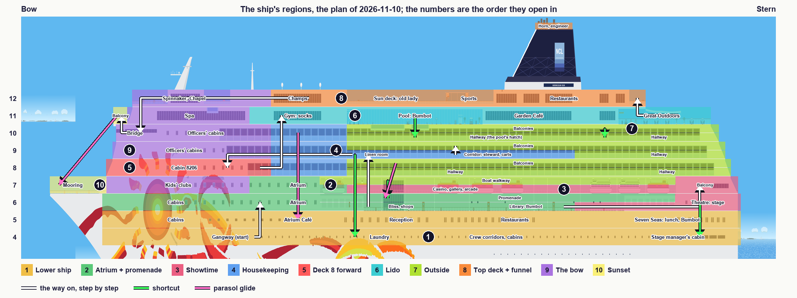
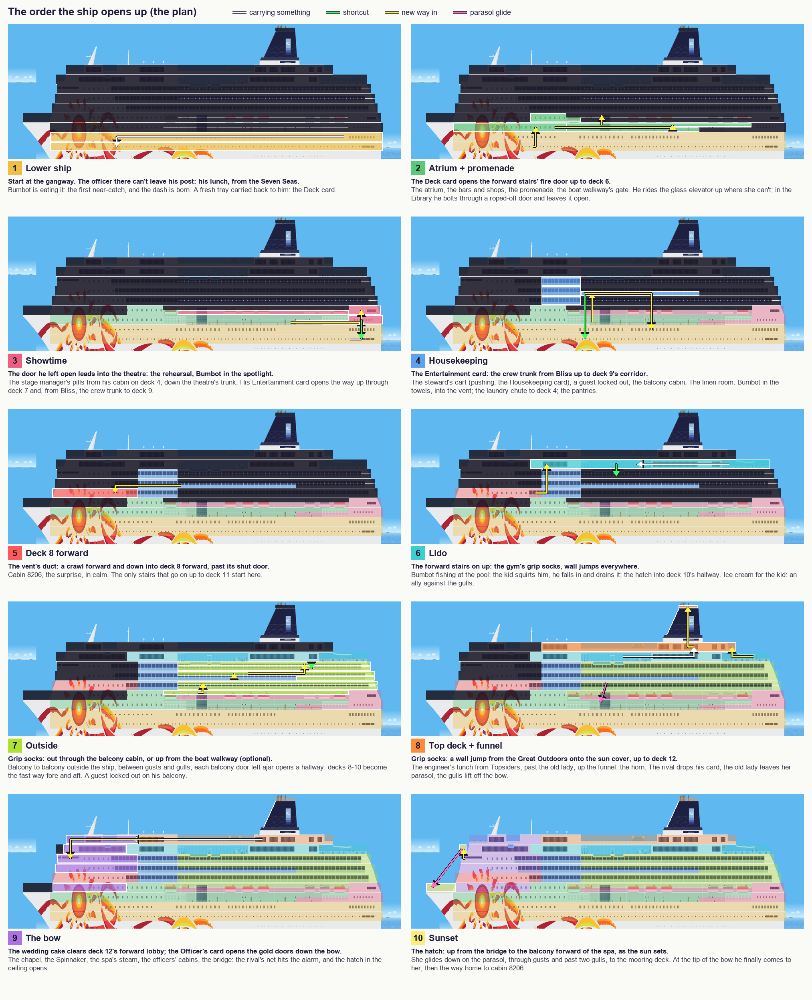
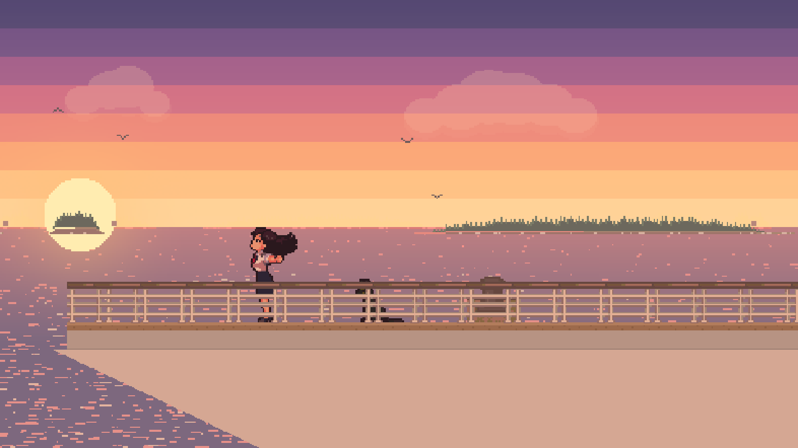

# Bumbusik — Game Design

A browser platformer about my wife, built as a gift for her to play. Sister game to
[mysterious_feline](../mysterious_feline) ("Bumbot"): also a browser game, with a different feel.

Status legend used throughout: **Decided** — agreed, build it this way. **Proposed** — a suggestion
waiting for a yes/no. **Open** — not discussed yet. **Later** — deliberately postponed until the
rest of the game is done.

---

## 1. Vision

| | |
|---|---|
| **Hero** | Bumbusik — my wife (§3). **Decided** |
| **World** | **The ship is the game.** One cruise ship, sailing on a sunny day over small waves, explored freely deck to deck. There are no levels. **Decided** |
| **Goal** | Catch Bumbot, our cat, who has stowed away. He shows up at places on the ship and slips away each time, until she finally catches him. **Decided.** Where he shows up and where she catches him: §6.1.8 |
| **Discovery** | The goal is **never stated**. She works out that she is chasing Bumbot by playing. **Decided** |
| **Player** | Her. It is a gift, and she wants a **real challenge** — Bumbot-level difficulty, not a gentle walk. **Decided** |
| **Tone rule** | **No death and no negativity.** Failing is a *scare*: she runs off, or bobs in a life ring, and pops back out of a crew cabin door (§5.6). **Decided** |

---

## 2. Platform

**Decided:** Bumbusik is a **browser game**, playable with keyboard or an **Xbox Series controller**,
and it has to work when **hosted on GitHub Pages**, as Bumbot does.

**Decided:** Bumbusik is its **own, much bigger project with a nicer look**. Bumbot's code and
lessons are **not** a constraint. We do whatever makes the most sense for Bumbusik.

### 2.1 Art

**Decided:** Bumbusik has to **look nicer than Bumbot**. Bumbot's code-drawn SVG sprites read as basic,
and in places ugly. Neither of us is an artist, so the art comes from somewhere other than our own
hands. Bumbot's sprite is **not** reused; he is redrawn in the new style.

What makes a game look good is mostly **consistency**: one style, one palette, one pixel scale,
everywhere.

**Options:**

| Option | How | For | Against |
|---|---|---|---|
| **A. AI pixel-art tools** (e.g. PixelLab, Retro Diffusion) | Describe or sketch a character, get it plus walk/run/jump/climb animations; tiles and props the same way. | Cheap, fast, unlimited iteration. Pixel art hides small flaws. Built for game sprites and animation frames. | Keeping a character identical across all animations takes effort; output needs cleanup (palette, alignment). |
| **B. Commission a pixel artist** (itch.io, Fiverr, r/gameDevClassifieds) | An artist draws her and Bumbot from photos, with animation sheets; maybe key tiles too. | Best likeness and charm; drawn by a person, which suits a gift. | Money (a few hundred dollars and up for two animated characters) and turnaround time. |
| **C. Asset packs** (Kenney, itch.io, CraftPix) | Ready-made tiles, props, UI, particles. | Instant and polished. | No side-view cruise ship packs to speak of; mixing packs clashes. Good for small generic pieces only. |
| **D. Code-drawn** (Bumbot's approach) | I draw shapes in code. | Free and instant. | The look we are moving away from. |

**Decided:**

- **Style: pixel art**, drawn at a low internal resolution (e.g. **480×270**) and scaled up crisply
  to fill the screen. At that resolution she is about 32px tall.
- **No artists.** Nobody outside the two of us should be able to block progress.
- **Sources:** her, Bumbot, ship tiles and props from an **AI pixel-art tool**. Small generic pieces
  (particles, UI) from free asset packs.
- **As cheap as possible.** I provide links; you choose what to use, subscribe to or buy.
- **One fixed palette** for everything, enforced by script, so pieces from different sources match.
- **Division of work:** I can't run image tools myself. I write the art specs and prompts, then take
  what comes out and do the technical side: palette enforcement, slicing sheets, alignment, hitboxes,
  animation setup in Phaser.
- **Reference photos** of her and Bumbot, for the AI tool, are **never committed**: the repo is public
  through GitHub Pages. They live outside the repo.
- **Placeholders first:** gameplay is built with simple placeholder art, so the ship is playable and
  tuned while the real art is made, then the art is swapped in.
- **Background decoration layer:** props behind the action are drawn in **muted, greyed-out colours**,
  so they never read as interactive (§5.8, the wet floor sign).
- **Everything is placed where it makes sense.** Nothing floats in the air: a tangerine sits on a
  table, a counter, a tray or in a fruit bowl; a key hangs on a hook; a card lies on a desk. Same for
  every object on the ship.

**Tools to evaluate** (prices from third-party listings, unverified; check each site):

| Tool | What for | Cost |
|---|---|---|
| [PixelLab](https://www.pixellab.ai/) | AI characters with animations (walk/run/jump), rotations, tilesets; Aseprite plugin | Subscription, reportedly from ~$12/mo; free trial reported. One month may be enough for the characters. |
| [Retro Diffusion](https://www.retrodiffusion.ai/) | AI pixel-art images, tiles, props | Pay per image (~$0.01–0.18), prepaid, no subscription, credits don't expire |
| [Pixelorama](https://pixelorama.org/) | Pixel editor for cleanup and small edits | Free, open source |
| [LibreSprite](https://libresprite.github.io/) | Pixel editor (free fork of an older Aseprite) | Free, open source |
| [Aseprite](https://www.aseprite.org/) | The standard pixel editor; needed for PixelLab's plugin | ~$20 one-off, or free if you compile it from its public source yourself |
| [Piskel](https://www.piskelapp.com/) | Browser pixel editor, nothing to install | Free |
| [Lospec palettes](https://lospec.com/palette-list) | Ready-made pixel-art palettes to pick our one palette from | Free |
| [Kenney](https://kenney.nl/assets) | UI, particles, generic props | Free (CC0) |
| [Tiled](https://www.mapeditor.org/) | The ship map editor (§7.2) | Free (pay-what-you-want) |

**Cheapest path:** placeholders first (free), a free editor, Retro Diffusion credits for tiles and
props, and **one month** of PixelLab when the characters are drawn, ideally all of them at once.

**Decided: PixelLab, connected to Claude Code** through its MCP server, so assets are generated,
checked and dropped into the game from here. Started on the free trial (40 generations).

**The palette is Resurrect 64** (`assets/palette/resurrect-64.hex`). PixelLab only draws in a fixed
palette in its expensive Pro mode, so everything is generated freely and converted afterwards by
`tools/palettize.py` (nearest colour by perceived difference, plus per-character colour swaps).

**Asset pipeline:** raw PixelLab frames are kept in `assets/source/<character>/`, and
`tools/build_sprites.py` converts and packs them into `assets/sprites/<character>.png` + `.json`.
Reference photos never enter the repo.

---

## 3. The heroine — Bumbusik

**Decided:**

- **Name:** Bumbusik is what I sometimes call her.
- **Story:** she **works on the ship**, and Bumbot has **stowed away**. That explains why she can go into
  crew-only areas, and why the passengers and machinery around her are obstacles
  rather than villains. It is true to life: she worked on cruise ships for 11 years, managing
  personnel and doing QA, which is a good source of in-jokes and quirks.
- **Appearance:** Ukrainian, white skin. Dark straight hair, curled up at the ends, a little below
  shoulder length. Small earrings. No glasses.
- **Outfit:** the women's uniform of cruise ship personnel: white short-sleeved blouse with shoulder
  epaulettes, navy knee-length skirt, a small neck scarf, a name badge, dark flat shoes.
- **Personality / quirks:** to be added as we build. They will feed idle animations, reactions,
  the scare moments, and jokes on board.

- The hair curl and the earrings are what make her recognisable at sprite size, so they get
  exaggerated slightly. Redone if it doesn't look right.
- **Size:** **59px** tall at the 480×270 internal resolution, about 22% of the screen height: the
  size her PixelLab sprite came out at, kept rather than shrunk, because downscaling pixel art ruins
  it. Bumbot is stylised larger than a real cat would be next to her, or he would be a speck.
- **Her sprite (Decided):** generated with PixelLab (natural proportions, the most detailed of four
  tries), then edited for longer hair flipping outward at the ends and fair skin, and converted to
  Resurrect 64. Animations so far: run, jump (rise / apex / fall poses) and a ladder climb from
  behind, hands alternating, and climbing out of a hatch (hands on the rim at head, shoulder,
  then waist height as she rises). Run, climb and the idles use PixelLab's skeleton mode, which moves her standing
  sprite rather than redrawing it, so her hair stays the length it is when standing still.
- **Idle (Decided):** standing still is her plain side pose. After 4 seconds one idle plays once,
  then another every 6 to 10 seconds, never the same twice in a row; any move ends it at once.
  Two so far: hands on hips tapping a foot (the taps repeat), and looking back over her shoulder,
  held for about a second. More can join the rotation as her quirks come up. Tried and dropped: a
  nail-buffing idle, which read as checking her phone.

### 3.1 Controls

**Decided:**

| Action | Keyboard | Xbox controller |
|---|---|---|
| Run | ← / → | Left stick / D-pad |
| Jump (hold for full height, tap for a hop) | Space | A |
| Climb ladders | ↑ / ↓ | Left stick / D-pad up/down |
| Кісюнічка dash (§3.2) | D (Shift until 2026-11-06) | B |
| Activate: doors, buttons, card readers, whatever we add as we build | E | X |

Activate has its own key rather than ↑, so standing at a ladder next to a door is never ambiguous.

**Controller testing waits until the rest of the game is done.** Keyboard is the reference until then.

No pause and no map, at least for now.

### 3.2 Special move — the "Кісюнічка!!!" dash

**Decided (the plan, 2026-11-10): the dash stays**, learned at her first sight of Bumbot and never
required: breakables hide shortcuts and secrets, and it tames a few hazards (§6.1.2). About 30
tangerines go back on the ship (§6.3).

"Кісюнічка!!!" is what she happily screams every time she sees a random cat on the street, so
it is her battle cry here.

**Decided:**

- A dash with increased speed while she shouts **"Кісюнічка!!!"**, smashing through some obstacles and
  enemies in her path. Lasts **10 seconds**.
- **Fuel: tangerines.** Each dash costs one. There is **no cap** on how many she carries, but there are
  not many on the ship, so each one counts (§6.3).
- **Speed:** ~2× run speed. Bumbot's cheat dash was 4×, which is fine on an empty rooftop but
  uncontrollable for 10 seconds inside a ship full of corridors and ladders.
- **What it breaks:** enemies and anything marked *breakable* (crates, luggage, stacked deck chairs,
  room-service carts). It never breaks walls, floors, locked doors or the ship's structure.
- **What it doesn't change:** falls still count (§5.6); jumps still work as normal during the dash,
  and she still **lands on** floors she runs over (Bumbot's early dash fell through every ledge).
- **Presentation:** a speech bubble with the exact text **"Кісюнічка!!!"** and a synthesised sound
  (no recording), a speed trail, and a HUD countdown so she can see the 10 seconds draining.

---

## 4. Bumbot — the runaway cat

**Status (the plan, 2026-11-10): his beats are decided in §6.1.8**: six near-catches, three glimpses
and the catch, one per region, each at the lock she cannot pass yet. None of it is in the game yet.
His sprite, his animations and the near-catch itself are in the code (a `bumbot` map point: activity
and escape direction).

**Decided (the mechanic and the look):**

- Bumbot appears at **a few places** on the ship, each one a **near-catch moment**: a mini-scene where
  she almost grabs him and he slips away with a funny animation, then play continues.
- Until she reaches him, he is **doing something cat-like** in his spot, and each spot gets something
  different: asleep in warm towels, washing himself, catching a fly, and so on.
- A near-catch is a short scripted sequence with input locked: she lunges, he escapes — up a ladder
  she can't use yet, into a vent, onto a passing tray, behind a door that slams shut, or into an
  escape trunk she can't open yet (§5.1).
- He is a black Bombay cat, redrawn in the game's art style (§2.1).
- **His sprite (Decided):** PixelLab pro mode designed him from a photo of the real Bumbot: slim,
  glossy black, pale yellow-green eyes, a small grey patch below the throat where a bow tie would
  be, no collar. It came out about 42px tall standing, too big next to her, and PixelLab's own
  smaller redraws lost his look, so we shrank it ourselves (box resampling to 2/3, snapped back to
  Resurrect 64): about **28px tall standing**, a little above her knee. Faint grey streaks from
  each ear to the outer corner of the eye were added by hand, as on the real cat.
- **His animations (Decided):** run (his escape), washing, a leap, sitting down and staying sat,
  eating, batting with a paw, and asleep, which breathes in code.
  Asleep is side-on, lying down with eyes closed and the tail out behind. A curled-up "bagel" was
  dropped: from the side it barely reads, and PixelLab drew it as a ball seen from above.
- **A near-catch (Decided):** she tries to **pick him up**: she walks up to him, bends down with
  both arms out, and just before her hands reach him he leaps away and runs. She stays bent a
  moment, straightens, and turns to the camera. Then play goes on.

**Decided:** between his spots he also turns up in **background glimpses**: a tail vanishing
round a corner, a cat silhouette on the deck above, a shape passing a window. He can't be reached
there; they only remind her he's on board.

---

## 5. The ship

### 5.1 Structure

**Decided:**

- The game is **one ship, with all its decks**. No levels. It is meant to be a big game.
- **Free movement** in all directions: forward and back along a deck, up and down between decks.
- The ship opens up as she plays: the exploration/backtracking loop of a Metroidvania. How it is
  split and locked: the plan in §6.1.
- **The ship is the Norwegian Sun**, used as the reference for its dimensions, layout, venues,
  stairwells, elevators and ladders. We have both been on it, so she can find her way **without a
  map**, from memory.
- **The name is never stated at the start.** She has to recognise the ship herself. Name markings
  may appear in areas she unlocks later. **Later**
- **She starts on the gangway, on deck 4**: in the gangway lobby, with the shell door closed, because
  the ship is already at sea.
- **She can go outside:** open decks, railings, the promenade, lifeboats.
- **Side view of a top-down plan:** the real deck plans are seen from above, but the game shows the
  ship from the side, so each deck shows one slice along its length. That slice follows the deck's
  **main route from bow to stern**, with venues at their real positions along it. **Doors** along
  the way lead into **small separate rooms** (cabins, offices, venues off that route).
- **Stairs** are walked **diagonally**, like normal stairs, at the real stairwells' positions. Tried
  in the first slice; it feels natural. ↑/↓ steps onto a flight, and holding the key carries her
  through a landing onto the next flight.
- **Ladders** only where real ones exist: crew and technical areas, the pool, lifeboat stations, the
  mast and funnel, emergency escape shafts. Guests don't climb ladders on a real ship.
- **Escape trunks (Decided, 2026-11-01):** some crew doors along the decks (not checkpoints) open
  onto a vertical ladder shaft, as a real ship's emergency escape trunks do: shortcuts up and down
  beside the stairs and elevators.
  - One ladder runs up the shaft past a door on each deck it serves. Most link two decks; a few
    link more, and a shaft may pass a deck with no door on it.
  - **Two small amber arrow lamps above the door, ▲ and ▼**: a lit arrow is a way she can go from
    that door, an unlit one a way she can't. They don't look like a checkpoint's green lamp.
  - **E opens the door**, revealing the ladder behind it; then ↑/↓ takes the ladder in a lit
    direction. A door closes by itself once she steps away from it.
  - **No cutaway and no fade:** inside, the walls and decks hide her naturally, seen only in an
    open doorway, and the camera follows her up or down.
  - She can stop at **any door along the shaft**: **reaching a door opens it** from inside, then
    ←/→ steps out, or she climbs on and it shuts behind her. Letting go of ↑/↓ just short of a
    door settles her level with it.
  - **One-way shortcuts, in a few places:** the lower doors stay shut from outside ("opens from
    the other side": the door rattles, its arrows unlit) until she has come down through the
    shaft once; from then on it works both ways for good.
  - **For now (blockout):** four test trunks, to try the mechanic: a two-deck one (deck 4–5,
    forward cabins), a three-deck one (decks 4–6, midships), a one-way shortcut from the theatre
    on deck 6 down to deck 4 (passing deck 5 with no door) and one between decks 6 and 7. The
    real ones are placed when the interiors are filled. Listed in `tools/ship_layout.py`.
- **Elevators:** guest elevators are free to use. **An elevator
  never opens onto an area she can't reach yet.** She stands at the doors and presses **E**; they
  open and a button panel shows decks 4–12, the ones she can reach lit and the rest greyed out.
  ↑/↓ picks a deck, **E confirms** (changed from jump, 2026-11-01); the panel goes (the camera
  following the car shows the ride, 2026-11-01), the doors close, and they open on that deck.
- **Elevator details (Decided, 2026-11-01):** one elevator door in each of the three cores, aft
  of the stairs, with the deck number lit above it. ←/→ at the panel backs out, and the doors
  close once she steps away. She steps in and turns to face us; the car travels out of sight (the
  walls and decks hide it, as in an escape trunk) with the camera following; a ding, and the doors
  open. While the glass car comes to fetch her, the panel's display counts its decks.
- **Glass elevators (Decided, 2026-11-01):** the atrium's glass elevator works like the others,
  but its car is **seen**: it runs up and down rails on the atrium wall (decks 5–9), she rides
  visible inside it, and if it's on another deck when she presses E, it comes down or up to fetch
  her first.

### 5.2 At sea

**Decided:**

- The ship is **sailing** throughout the game. It is **sunny**, with **small waves**.
- The waves are **visual only**: a gentle swell on the water and a little sparkle. The ship does
  **not** rock under her, because tilting floors would fight precise platforming.
- **Midday sun** for the whole game. **Sunset only for the final catch scene.**

- Outside areas show open sea and sky behind the ship, the sea scrolling past slowly to sell the
  sailing. Indoors, portholes and windows show the same sea.
- Sound: a soft sea and engine ambience outdoors, quieter inside (synthesised, like everything else).
- **The sea, drawn in code** (`src/sea.js`; approved by the user 2026-11-07): six rows of waves
  from the waterline down, the far ones small and slow, the near ones bigger and faster, each row
  gently rising and falling, sun glints on the crests, the deep water darkening under them; white
  foam along the waterline from the stem to the stern, **running on past the stern and breaking
  up into the wake** (the user: not cut off square); a bow wave heaped against the stem, with
  spray; the wake streaming aft from the stern, widening and fading. All of it streams toward the
  stern, also in the outside view (O). **Decided**
- **The background, drawn in code** (`src/background.js`; approved by the user 2026-11-08): a
  **Baltic archipelago** in two layers far away in the haze, the far one smaller and paler: low
  smooth granite skerries, most under a dense dark pine forest, now and then a red cottage with
  white corners in a clearing or a white lighthouse with a red band on a bare rock, surf at their
  feet. The far sea fades into the haze at the horizon, faint glints growing toward the near sea.
  Fair-weather clouds, heaps of round puffs with lumpy undersides, half see-through so they sit
  back in the sky, standing well up in it. **The horizon** is fixed to the screen from moment to
  moment, far away as it is: while she is in the air it holds still, so a jump doesn't move it;
  while she is on her feet (or on stairs, ladders, lifts) it glides to its place **58 px over the
  floor she stands on**, about the top of her head, so the camera's slack never leaves it out of
  place (the user, 2026-11-08). It shows past the railings, over the open decks and through the
  glass; the islands drift slowly aft (the far layer slower), shift a little as she runs, the
  clouds slower still. **The sea-view windows show the same live background** (the bridge, the
  Spinnaker, the dining rooms, the buffet, cabin 8206's picture window): a copy of it cut to their
  panes, its horizon level with the sea outside, curtains, mullions and glints over the glass.
  **Far gulls** (2026-11-08): four tiny dark "M"s, hazed, crossing the sky over the islands at
  their own heights and paces (30-80 s across the screen), flapping, now and then gliding; the
  same birds in the windows and the outside view. Closer, generated gulls: **Later**. **In the outside view** the horizon lies on the waterline, the ship and the
  horizon low in the frame (lowered by half the ship's height), the islands and clouds kept at a
  visible size on the screen, the clouds half way up the sky. **Decided**

### 5.3 The reference ship — Norwegian Sun

Real-world figures ([NCL ship map](https://app.ncl.com/sites/default/files/Ship_Map_SUN_06142022.pdf),
[deck plans](https://www.ncl.com/cruise-ship/sun/deck-plans),
[CruiseMapper](https://www.cruisemapper.com/deckplans/Norwegian-Sun-735)):

- Length **258 m** (848 ft), gross tonnage 78,309, about 1,900 guests.
- Passenger decks are numbered **4 to 12**; the decks below are crew and machinery.
- Deck 11, aft: an open-air diner with a self-service ice cream machine.

**The reference for real proportions** is NCL's ship map ([PDF](https://app.ncl.com/sites/default/files/Ship_Map_SUN_06142022.pdf)):
its lower half is a **side profile** of every deck, with the stair cores, the atrium and each
venue's position along the ship. Use it whenever a position or proportion needs checking.

- **It is drawn with the bow on the right. The game flips it: bow on the left.**
- A local copy is kept, not committed (it is NCL's artwork and the repo is public), in the
  git-ignored `reference/` folder: `norwegian-sun-ship-map.pdf`, a render of the profile
  (`norwegian-sun-profile.png`) and the same flipped to the game's orientation
  (`norwegian-sun-profile-flipped.png`; its text reads mirrored). If the folder is missing,
  download the PDF again and render the profile with PyMuPDF (`pip install pymupdf`), page 1,
  clip y 425–585 pt.
- Measured off the profile: the ship is ~1,620 px long at 150 dpi, so ~6.3 px per metre.

**Decided (layout, 2026-10-31):** from that profile.

- **The bow is on the left**, the stern on the right.
- Three stair-and-elevator cores: **forward** (~79 m from the bow), **midship** (~96 m) and **aft**
  (~198 m). The **atrium** spans decks 5–10 (deck 10 open over it since 2026-11-06; its glass elevator and staircase 5–9) between the forward and midship cores, with glass
  elevators. The funnel stands over the aft half.
- **The gangway is on deck 4, forward**, beside the forward stairs. The game starts there.
- **Floors and open spaces (Decided, 2026-11-02, replacing "the atrium is a look, not a
  well"):** corridors and rooms have solid floors. Two places open up through the decks, as on
  the real ship, and both work the same way, as **side walks**:
  - **The atrium** is a real open space, its floor on deck 5 (Guest Services, the Atrium Café;
    the Atlantic Deck, confirmed by the user), open up through deck 9 to a
    domed skylight: oval balconies with cream fronts and glass-and-brass railings, burl-wood
    pillars with brass rings, the two glass elevators in the middle (§5.1), the curving
    staircase, which climbs level by level beside the glass elevator from deck 5 to deck 9.
  - **Deck 12 over deck 11's open area** is a side walk along the ship's side, its floor
    continuous (the hole in the blockout goes), with deck 11's pools below and behind it.
  - **The atrium is 20 m long, two screens** (the user, 2026-11-02): NCL's profile draws it about
    10 m, which looked narrow next to its five levels, so the midship core stands 10 m further aft
    than on the profile. (The profile's mezzanine, deck 6a, was tried and dropped by the user.)
  - **Side walks are level with their deck's floor** (the user, 2026-11-02): she simply runs
    along them, the look kept (balcony fronts, the glass railing, the open space below). A
    step-up onto them, with ↑/↓ and railings to jump over, was tried and dropped: it worked
    poorly in practice. **Deck 12's walk over the pools keeps the drop: ↓ there lets her down
    through it** into a pool (the fun part). Nowhere else does ↓ drop her; in the atrium it only
    ever takes the stairs.
  - **Open (the user, 2026-11-02):** on the real ship, the upper decks' corridors run along the
    ship's sides, while the middle above the atrium is the atrium itself and its glass dome. In
    the game, deck 10's cabin corridor runs straight over the atrium, under which the dome hangs.
    Revisit when the upper decks are laid out properly.
  - **The curving staircase winds round the glass elevator** (the user): each flight sweeps from
    one side of it to the other, alternately behind it and in front of it, and the elevator's
    dark column hides her while she is behind it.
  - **Drops keep the fall rule** (§5.6): one deck down is fine; longer, the camera lets her go,
    she falls out of the frame and comes back at the nearest checkpoint. (It is not a fright;
    overboard stays as it is.)
- **Decks 11 and 12 have glass side walls**: glass windbreak panels with a handrail along the
  ship's side, instead of open railings.
- **The pools:** she can jump into a pool, and swims a **side-on breaststroke, her head above the
  water** (the user's choice; a skeleton-v3 clip written as poses, 3 generations; a front crawl
  was made first by a misunderstanding and is kept in `assets/source/her/swim-crawl/`). Two pools on deck 11 (119-131 m and
  134-140 m), sunk two tiles into the deck; she walks or drops in with a splash, ←/→ swims, jump
  climbs out. Maybe game mechanics round the pools later. Not a scare.
- **Below deck 4 is not playable.** Deck 3 shows at the bottom of the screen when she is on deck 4,
  as it naturally would, but she can't get there. There are no crew or engine decks to explore.
- **The map builder places venues by their real position** along the ship, deck by deck, from a
  list (`tools/ship_layout.py`); the art is placeholder until the real tiles come.

The schematic is drawn from `tools/ship_layout.py` (`python tools/draw_ship_profile.py`), the same
list the map builder reads: edit positions there, not in this picture. Spans are approximate,
true to the order and rough size of things on the real ship.

**The earlier deck list** (before the profile), kept for reference:

| Deck | Role in the game |
|---|---|
| 1–3 | Crew and engine decks: machinery, laundry, galley stores, crew corridors and cabins. |
| 4–5 | Lower guest decks: **gangway (start)**, reception, medical, cabins. |
| 6–7 | Public decks: atrium, restaurants, theatre, shops, casino; the outdoor promenade and lifeboats. |
| 8–10 | Cabin decks: long corridors, room-service and housekeeping carts. |
| 11 | Pool deck, buffet, and the open diner aft with the ice cream machine. |
| 12 | Sun / sports deck. |
| Bridge | Forward, on deck 10. |
| Top | Funnel and mast. |

**The real ship's look** (Decided, 2026-11-02): **authenticity first**; the ship should look and
feel like the Norwegian Sun as the user saw her in **summer 2026**. **The user's own photos come
first**: 64 of them, named by what they show, in the git-ignored `reference/photos/` (HEIC; small
JPEG copies in `reference/photos/small/`). Never commit them, and never upload ones with people in
them to an art tool. Public galleries
([Cruise Deck Plans](https://www.cruisedeckplans.com/ships/pictures.php?ship=Norwegian-Sun), 2015 to
2023; they may mix in the sister ship, Norwegian Sky) only fill gaps, where they agree with hers.

From her photos:

- **Cabin corridors** (`corridor`): light, not dark. Cream walls, a white panelled ceiling with
  round downlights, a wooden handrail along the wall, framed pictures. **Cabin doors: terracotta
  wood** (orange-brown) in a wood frame, a brass key-card lock and lever, a small number plate
  (e.g. 8259). **Carpet: blue-grey with a white wave pattern.** Occasional framed pictures on the
  walls. **Most cabin doors are plain; a few carry vacation stickers**, different on each door
  (the user's word, 2026-11-02).
- **Modern corridors near the lounges** (`corridor_near_bliss_lounge`): grey 3D-geometric
  wallpaper, black door frames and trim, dark carpet with grey and white dots, large framed art.
- **Crew area** (`view_via_an_open_door_into_the_crew_area`): white steel walls, pipes and ducts
  on the ceiling, fluorescent tubes, a **blue speckled floor**, hard hats on hooks, a steel
  watertight door. Crew doors are plain white steel.
- **Doors to the open deck** (`doors_to_outside_deck`): varnished wood with a round porthole, a
  yellow-and-black striped sill, a "WATCH YOUR STEP" sign.
- **Promenade, deck 6** (`deck_6_promenade`): **tan non-skid deck with blue WALKING / JOGGING
  markings** and arrows. White railings and stanchions; orange life rings hung on the railing;
  green assembly station signs. **White lifeboats hang overhead** on white davits, "NORWEGIAN
  SUN" on their hulls; white steel frames and ceiling.
- **Elevator lobbies** (`deck_6_elevators_on_the_left`, `deck_8_elevators`): mahogany panelling,
  **bronze-toned elevator doors**, a deck number lit above each, a cream panelled ceiling with
  downlights. Deck 6: purple-navy carpet with a gold pattern. Stair cores: blue carpet with a
  diamond pattern, brass handrails on dark wood (`stairs_aft`).
- **Bars and lounges:** Windjammer Bar: dark mahogany, coffered ceiling, brass lamps, **tufted
  teal-green leather club chairs**, tan leather bar stools, a ship model in a glass case (public
  photos agree). Library: dark wood shelves, a red-and-cream patterned carpet. Bliss: dark, a
  dotted carpet, a wooden dance floor. Spinnaker Lounge: cream armchairs with dark wood arms,
  tall windows.
- Not yet checked against her photos: the atrium (`central_area`, `glass_elevators_in_central_area`,
  `round_stairs_central_area`), the restaurants, deck 11 and 12, the outside of the ship.

**The outer shell (Decided, 2026-11-03, the user's idea):** the ship is seen **from outside**: an
off-white shell (plating `#e8eaec`, mostly white, a little grey) over every deck, its outline from
NCL's profile and the user's photos, with no square corners. **The deck she is on is cut away**
along its whole indoor length, like a cut-out in the wall; every other deck shows the outside.
The cut-away **crossfades with her height** on stairs, ladders, trunks and elevators, and eases
when she lands on another deck. The ship's very front and back always show the wall: every
indoor deck end stops short of the hull (2.7 m of structure, `STRUCTURE_COLS`), the cut's edge a
little shaded. **The cut-out's edges are in shadow** (the user, 2026-11-03: the cut wasn't
apparent): a soft dark gradient inside the opening wherever the shell goes on, deepest under the
deck above, fading in with the cut (`CUT_SHADOW` in `src/config.js`); no hard line.
**Around the deck she is on, the rest of the world is dimmed** (Decided, the user, 2026-11-08), as
round a room she is in (`ROOM_DIM`): the other decks, the sky and the sea, and the walls at the
deck's own ends, doorway walls included. **Out in the open nothing is dimmed**: wherever no ship's
side stands beside her at that deck's height (the bow's mooring deck, the terraces, the open parts
of decks 11 and 12, the pools), and on the promenade and in the outside view (O). It fades as she
comes out from behind a wall, and never falls on her on stairs.
Where a deck ends in the ship's wall, a 32 px strip of that wall is drawn over her (`END_COVER`),
so running into it she goes behind it; no window straddles or crowds the cut's edge, a cabin's
pair of windows both or neither; the old shaded edge tiles are gone. The venue-name signs are
placeholders: the gangway's is removed (2026-11-03), the rest go as each deck is furnished.
No line along each deck's floor and no rounded corner tiles on the shell (they read as stray
marks); all round windows (deck 5's and the lower hull's, in line) are 24 px across, every 160 px
(`PORTHOLE_R`, `PORTHOLE_PITCH`).
- **Built (branch `outer-shell`):** step 1, the shell and the cut-away (the `exterior` tile layer,
  `EXT` tiles cut, `EXT_FIXED` never; `updateCutaway` in the scene); the outline: where a deck
  steps back by up to 8 m the shell slopes across the step (`shell_slopes`), so the bow's
  superstructure front (measured row by row: 18.7 m at deck 7 to 25 m at the bridge; deck 11's
  wall at 29.5 m behind its open roof, `FRONT_WALL`) and the stern's tiers run smoothly; **two
  crew decks of hull (1-2) show above the waterline** (`HULL_DECKS_BELOW`), so the ship is ~7.6
  times as long as tall, near the profile's 7.8; the stern goes straight down to the water.
  Step 2, the details drawn on the shell (`shell_details`): round portholes on the lower hull, a
  navy waterline band, square windows on the cabin decks, balconies on decks 8-10 midships and
  aft, big windows on the public rooms, the bridge's window band, the white bulwark and glass
  windscreen on the open parts of decks 11-12, the roof's edge, the navy funnel with its grille,
  the white mast, three radar domes. The user approved the outline; step 2 shown.
- **Step 3, next: deck 6's promenade, two routes (Decided, 2026-11-03):** along deck 6 from about
  85 m to 225 m (the user's photo) she can walk **inside** (the rooms, cut away as on any deck;
  the open stretch at 150-194 m becomes indoor rooms, the library and photo gallery) **or
  outside on the promenade**, switching through varnished doors with porthole windows (the
  user's `doors_to_outside_deck`) at about five places: **E** at a door, a quick fade. On the
  promenade the rooms are hidden; she walks along the ship's white wall (its windows, the doors
  back in). **The promenade is two decks tall**: white columns between bays, **the lifeboats
  hanging high up** (deck 7's level), a white railing at the edge. Its fore and aft parts are
  enclosed by a wall with **large glassless window openings**, drawn in front of her, so she is
  partly concealed there. Its ends are closed: back in only through the doors.
  **Built (2026-11-03, `PROMENADE` in `tools/ship_layout.py`):** 102-226 m, enclosed ends 102-116
  and 212-226 m (white wall, 80 px openings between piers, a 30 px sill hiding her legs), doors
  at 111, 138, 162 and 186 m (E, a 140 ms fade; 218 m, in the theatre, removed by the user, as
  were the paper signs over them).
  On the promenade nothing on the deck is cut away (`route`, "inside" or "promenade"); the rooms'
  stairs, elevators, trunks and ladders are out of reach. A beige deck strip, a white railing
  with a wooden handrail and life rings, in front of her; white columns from deck 6 up past deck
  7, between the boats, holding the davit arms. The shell along it, the user's corrections: **only
  a few windows on the promenade's wall** (one every 4 m, clear of the doors), **none on deck 7
  where the boats hang**, and **deck 5's windows are round**, bigger (20 px) and few (every 160 px).
  The life rings hang from the railing's handrail between two posts (plain `life-ring`). 150-194 m inside is now the library
  and photo gallery (a few muted pieces; furnished properly with deck 6). `?at=promenade` starts
  on it, `?at=library` inside.
- **Lifeboats:** the real ones (the user's photos) have a **red-orange canopy roof over a white
  hull**, hanging from white davits; seen from below on the promenade, white undersides with
  propellers. Three PixelLab tries from text (1 generation each, `create_map_object` 400x100 side
  view, kept in `assets/source/ship/lifeboats/`) were all rejected; so were three
  `image_to_pixelart` tries from the user's photo crop (`photo-try-4..6`, 1 generation each: the
  crop is too soft, they came out as red and white stripes). **Approved (2026-11-03): drawn by
  hand**, `tools/draw_lifeboat.py` (free; writes `assets/ship/lifeboat.png`): 300x100, red canopy
  over a white hull, a row of small windows, the hatch amidships, the steering cupola aft, a
  release hook at each end. **Size approved**: 300 px, about five times her height. Ten hang
  over the promenade's open middle at deck 7's level, every 9 m, from davit arms on the white
  columns; they fade when she is inside deck 6 or 7. The photo crops
  (`reference/photos/lifeboat-ref*.png/jpg`) stay git-ignored.
- The sun livery is the real one (2026-11-07, §8): generated with PixelLab from the user's side
  photo, centred about 40 m from the bow on deck 6, its ribbons running aft to about 142 m.

### 5.4 Scale

**Decided:**

- The ship has the **real Norwegian Sun's dimensions**, at one uniform scale.
- **The screen shows** her in the middle, the deck she is on, and a small part of the deck above and
  the deck below, where they exist.

That works out to (numbers to be tuned in testing):

- One deck (~3 m real) = **144px** at the 480×270 internal resolution, about 53% of the screen
  height, so the deck above and below still show at the edges.
- So 48px per metre, and the 258 m ship is **~12,400px long**, about **26 screen widths** per
  full-length deck. Including hull and funnel, it is roughly 2,900px tall.
- She is drawn at about **three quarters of true scale** against the ship, so a deck's ceiling sits
  at about 2.2× her height: close enough to feel like a ship's corridor, with room left to jump. (A
  first try at half scale made the decks feel like halls.)
- **Everything human-sized is sized to her, never to the ship**: doors (~1.25× her height), furniture,
  railings, counters, signs. Sizing some props to the ship and others to her made a gangway door
  twice the height of the crew cabin door beside it. The ship's overall dimensions stay real.

### 5.5 Checkpoints

**Decided:**

- A checkpoint is a **crew cabin door**. She is activated at it by passing it, and when she comes
  back after a scare she **steps out of that door**.
- **An activated checkpoint must be obvious** from across the deck, not a small indicator: the door
  stands ajar with the cabin light spilling out, and a green lamp above it glows. Activating one
  gives a short burst of light and a chime.
- Checkpoints sit where a crew cabin door plausibly would, following the real layout.
- **Where they go: §6.1** (one at each region's entrance, a second at the foot of each long
  gauntlet, cabin 8206's door for deck 8 forward).
- She comes back at the **closest one** to where she was scared, among the checkpoints she has
  **already activated**. Otherwise she could come back somewhere she has never been, possibly past a
  locked door.
- "Closest" follows the ship's layout rather than straight-line distance, or a checkpoint on the
  deck above could win over the one just down the corridor. First version: prefer checkpoints on the
  same deck, then the nearest deck.
- A scare keeps everything collected (cards, keys, opened doors). Only her position resets. Unlimited.
- The game **auto-saves at each checkpoint** (in the browser), so she can close it and continue later.

### 5.6 Scares (instead of death)

**Decided:** there is **no death and no death animation**, anywhere. One hit is still one failure,
which keeps the challenge, but it plays as a scare:

| What happens | What she does |
|---|---|
| Touches an enemy or a hidden trap | A fright **that fits what got her** (squeals at the vacuum robot, splashed by the water pistol, ...), then she **runs off the screen**. |
| Falls **one deck** | Nothing. She lands and carries on. |
| Falls **further than one deck** | The camera **stops following** once she passes one deck, and she drops out of the bottom of the screen, as Bumbot does. |
| Falls **overboard** | No drowning. A splash, then she bobs up **smiling in a life ring, waving one hand**, for about a second. |

Then she steps out of the closest activated crew cabin door (§5.5).

The word is **"scare"**, never "death", on screen and in the code alike.

### 5.7 Areas

**Decided:** all of these are on the ship.

| Area | Ideas |
|---|---|
| Gangway | The start, on deck 4. Ship's horn, luggage carts. |
| Crew decks / engine room | Pipes, steam vents, machinery; dark and warm-lit. |
| Cabin corridors | Long, repetitive halls, numbered doors, room-service carts, housekeeping trolleys. |
| Atrium / promenade | Multi-storey open space with glass elevators, shops, a grand staircase. |
| Restaurant / buffet | Waiters with trays, tables, rolling dessert carts. |
| Theatre | Stage lights, curtains, rows of seats. |
| Casino | Spinning lights, slot machines. |
| Pool deck | Water, slides, sunbeds, slippery wet tiles. |
| Open diner, deck 11 aft | The ice cream machine. |
| Sun deck / funnel | Wind, seagulls. |
| Bridge | The ship's controls, forward on deck 10. |
| Outside: lifeboats, railings, bow | The ship's exterior and the sea. The overboard risk lives here. |

### 5.8 Enemies, hazards and other people

**Decided:**

- **All of these are in:** seagulls, a kid with a water pistol, a robot vacuum cleaner, a strict
  security officer, a waiter with a tray who doesn't look where he's going, a sliding deck chair on
  wet tiles, steam vents in the engine room, an old lady guarding her sunbed. More may come later.
- **Hidden traps**, alongside visible hazards: a floor hatch that opens, a slippery wet patch, a towel
  stack that collapses, a sprinkler that triggers, a deck chair that snaps shut.
- The wet patch is **fair but hidden**: a "wet floor" sign stands in the **background decoration
  layer**, drawn in the same muted, greyed-out colours as the other background props, so it is just
  one of them unless she is paying attention.
- **Passengers and machinery are the obstacles. Fellow crew are friendly**, background characters
  at most, to begin with.
- **The plan (2026-11-10, §6.1.6 and §6.1.7) places every one of them**, with its tell, its response
  and the verb that tames it. Two changes to the list above: the security officer is not a touch
  hazard but her comic rival, a cat-hunter whose blunders open the ship (crew never scare her); the
  waiter only spills a tray she carries. Added: the porter's luggage cart, the photo flash, the stage
  lights, the trap door, the chip cart, the swinging cabin door, gusts, basketballs, the sauna's
  steam, a toy car, a sunbather behind a "Do Not Disturb" sign. Passengers who are hazards become
  errand-givers.
- **Secrets** exist, like Bumbot's SUSHI sign. Designed **Later**.

---

## 6. Progression

### 6.1 The plan (Decided, 2026-11-10)

**How it came about.** The brainstorm of 2026-11-09/10 (ten regions, four kinds of lock, the cat as
the map, the ending at the bow) was reviewed as a metroidvania by Claude on 2026-11-10. Its structure
was sound: scattered locks, staggered stairs, the ship folding back on itself, the hidden parts, the
sunset finale. Its first half was flat: five regions played with only run, jump and E; four of the
nine transitions were key cards; both movement abilities came together at step 6; Bumbot had no
moment in six of the ten regions; the hazards were listed but not placed, and none answered to an
ability; the errands were walks. Claude proposed 24 changes, and **the user asked Claude to answer
them itself for the most fun and engagement, with no limit on new art, and to save the result as the
plan to build from.** So everything in this section is **Decided as the plan**: the user steers
during the build and can overrule any item; what then changes is recorded here. The maps come from
`python tools/draw_regions.py` (after `python tools/render_ship.py`).

Kept from the brainstorm, as agreed then: all four kinds of lock; staggered stairs; new ways to move
required to finish; a locked part hidden behind the closed ship's side until she enters it, the first
cut-away being the reward (`LOCKED_PARTS`, §6.2); the start at the gangway; no target for how long the
game takes; carrying things for colleagues; the laundry chute to deck 4; cabin 8206 unreachable until
its region, around the middle; the glass elevator's panel as the progress meter; the ending.

#### 6.1.1 The premise (never stated on screen)

A stowaway cat has been spotted at sea. The ship's **security officer**, a clumsy man with a net and a
pet carrier, has the ship in a soft lockdown for his search: the fire doors in the stair cores are
shut deck by deck, each department's card opens its own, and "SEARCH IN PROGRESS" signs hang on the
ropes. Bumbusik is crew, doing her colleagues' rounds for them, and she wants the cat for herself.
**Every way on into the ship is a crew way** (a card, a trunk, a pantry), **a cat way** (a door he
leaves open, a hatch he trips) **or an outside way** (the balconies, the boats); **the guest stairs
catch up behind her** and reopen as shortcuts as the ship goes on with its day. The security officer
is her comic rival: his blunders open the ship, and at the end his card is the master key.

#### 6.1.2 The rules of the world

**The four kinds of lock:**

| Kind | How it reads | The rule |
|---|---|---|
| **Department cards** | A coloured reader beside a fire door in a stair core, or on a crew door | Deck (blue), Entertainment (red), Housekeeping (green), Officer's (gold). Each opens things on several decks (§6.1.5). The Officer's card opens every reader. **A fire door opens freely from its escape side** (from above in a stairwell, from inside a corridor), so every card door is also a one-way shortcut once she has come through it the long way |
| **New ways to move** | A pickup with a key glyph shown once | Four verbs, one per quarter: the dash (region 1), pushing carts and crawling (4), grip socks (6), the parasol (8). Each makes old places new, and each tames a hazard (§6.1.7) |
| **Bumbot changes the ship** | A scripted scene | The doors he leaves open, the pool he drains, the alarm he trips (§6.1.8) |
| **People and the ship's routine** | A person or a crowd on a flight, with a rope and a sign | A cleaner mopping, a photographer, an art auction, a yoga class, a painter, a crowd, a wedding party. Each block lifts on an event: the next region opening, or an errand done. The flight then stays open: that is how the guest stairs become shortcuts (§6.1.4) |

**Carrying.** Two classes of thing. **Pocket items** (cards, pills, a key) have no rules. **Trays**
(a lunch, a cone, a cocktail, a cake box) follow tray rules: **stairs and elevators only** (no
ladders, trunks, wall jumps, crawling, swimming or the dash), **a low hop instead of a jump**, and **a
bump from a hazard or a person spills it** with a clatter, never a scare: she fetches another from the
same place, which always has more. Some trays **melt or cool** (a meter on the HUD) so her fastest
known route is the test. E hands the thing over. Her hands full show in her sprite.

**People.** Fellow crew are friendly and never scare her. Passengers and machinery are the
obstacles, and **a passenger who is a hazard can become an errand-giver**: service is a crew member's
superpower, and each sprite is used twice. Every request is **a speech bubble with a pictogram** (a
tray, a wrench, a pill bottle, a cake), never words, so the goal is never stated and nothing needs
translating. People stand or walk where they plausibly would; blocks on flights have a rope and a sign.

**Hazards.** Every hazard has **a tell** (a shadow before a swoop, a handle turning before a door
swings, a wet-floor sign in the muted background), **a response** (jump, wait, crawl, go round) and
**a verb that tames it** on the way back (§6.1.7). One hit is a scare that fits what got her (§5.6).
The long cabin corridors are where risk lives: a gauntlet of a few hazards between two checkpoints.

**Checkpoints.** One crew door at each region's entrance, a second at the foot of each long gauntlet,
and **after region 5 the door she steps out of anywhere forward on deck 8 is cabin 8206's own** (it is
a respawn door, not a hub: the "no home base" ruling stands). Listed per region below.

**The dash and the tangerines (Decided, replacing the open point in §3.2 and §6.3).** The dash stays.
It is **learned, not given**: at her first sight of Bumbot she screams "Кісюнічка!!!", and from then
on D dashes, fuelled by tangerines as §3.2 says. It is **never required**: breakables (stacked
luggage, a jammed trolley, stacked deck chairs, crates, a piñata) hide shortcuts and secrets, never
the way on; it also shoves the vacuum aside, scares the kid off and passes the sprinkler. **About 30
tangerines** on the ship, each where food plausibly is (fruit bowls, buffet counters, trays, pantry
crates, a cabin's welcome basket), a few as rewards from people. Scarce enough that each one counts.

**The glass elevator's panel is the progress meter:** it lights the decks she can reach (5 in region 1;
5-7 in region 2; 5-10 from region 4). The cores' elevators do the same (4-5, then 4-7, 4-10, 4-11,
4-12). An elevator never opens onto a place she can't reach yet (§5.1).

**Hidden extras** (§6.4, the user's photos) get **slots**: a framed picture in a secret place that E
opens full screen. The places are fixed here; the pictures come from the user, later.

#### 6.1.3 The regions and the order they open in

| Step | Region | What it covers | What opens it | The verb it gives | Bumbot |
|---|---|---|---|---|---|
| 1 | Lower ship | Decks 4 and 5 | The start, at the gangway | The dash | Eating the officer's lunch at the Seven Seas: near-catch 1 |
| 2 | Atrium + promenade | Deck 6 from the bow to the Library, the promenade, the atrium on 6-7, the boat walkway's gate | The Deck card, at the forward stairs' fire door 5-6 | | Rides the glass elevator up where she can't; in the Library, near-catch 2: he bolts through a roped-off door and leaves it open |
| 3 | Showtime | The theatre, its balcony, deck 7 from Magnum's to the Arcade | The door he left open | | On stage in the spotlight: near-catch 3, up a fly rope |
| 4 | Housekeeping | Deck 9 midships round the linen room, the atrium's walks and midship lobbies on 8-10 | The Entertainment card, on the crew trunk from Bliss up to deck 9 | Pushing carts, crawling | Asleep in the towels: near-catch 4, into the vent |
| 5 | Deck 8 forward | Deck 8 forward of the atrium, cabin 8206 | The vent's duct, dropping her past the corridor's shut door | | A glimpse: his tail up the forward stairs |
| 6 | Lido | Deck 11 from the forward lobby aft: gym, pool deck, Garden Café, Great Outdoors | The forward stairs on up from deck 8 | Grip socks (wall jumps) | Fishing at the pool: near-catch 5, he falls in and drains it; the hatch into deck 10 |
| 7 | Outside | The balconies of decks 8-10, the boat walkway, the hallways inside | Grip socks, out through the balcony cabin on deck 9 or up from the boat walkway | | A glimpse: washing on a rail two decks up; his balcony door is ajar |
| 8 | Top deck + funnel | Deck 12 from Champs aft, the roof, the funnel's stairway and top | Grip socks: a wall jump from the Great Outdoors onto the sun cover and up to deck 12's aft terrace | The parasol (a glide) | A silhouette on the funnel; at the horn he bolts for the bow |
| 9 | The bow | Deck 12 forward (chapel, kids' pool, Spinnaker), the spa, the officers' cabins, the bridge, the kids' clubs | The wedding cake clears deck 12's forward lobby; the Officer's card opens the gold doors down the bow | | On the bridge: near-catch 6, the rival hits the alarm, the hatch opens |
| 10 | Sunset | The balcony forward of the spa, the air, the mooring deck, the tip of the bow | The hatch | | The catch |

Wide in the middle: region 6 opens regions 7 and 8 at once; **region 7 is optional** for the finish
(its hallways are the fast way fore and aft, and its cat glimpse, guest and secrets are the lure).
Everything else is in order. Each region below: what it covers, the way in, its blocks, the people,
the hazards, the cat beat, the shortcuts it opens, its checkpoints and its secrets. Positions are in
metres from the bow and approximate; the build sets them exactly.

**Region 1: Lower ship (decks 4 and 5).**

- **The way in:** the start, at the gangway (deck 4, 67 m), the shell door shut.
- **The errand:** the **gangway officer** at his post by the shell door can't leave it; his bubble
  shows a tray. His lunch waits at the pass by the Seven Seas' crew door (deck 5 aft, 250 m). **Bumbot
  is on the counter eating it** (his `eating` clip). **Near-catch 1:** she lunges with the scream
  that becomes her battle cry; he bolts along the counter, knocks the fruit bowl over (three
  tangerines roll onto the floor, the D glyph shows: the dash is hers) and is out of the door forward.
  She takes a fresh tray (the pass always has more) and carries it the length of deck 5 or deck 4 to
  the gangway: the first carry, under tray rules. He eats and hands her his **Deck card**: she is
  doing his rounds now. As the reader at the forward stairs lights, a glimpse: Bumbot's tail going up
  those stairs.
- **Blocks:** the forward core's 5-6 fire door (blue: the way on); the midship core's 5-6 flight (a
  cleaner mopping, a cone); the aft core's 5-6 flight (a rope, "REHEARSAL IN PROGRESS"); the atrium's
  staircase 5-6 (the photographer's session, a backdrop across the stairs). The glass elevator's panel
  lights deck 5 only.
- **Hazards:** the robot vacuum on deck 4's long corridor (110-194); the porter's luggage cart rolling
  back and forth in the gangway lobby; the waiter in the Four Seasons' doorway (deck 5, 168-194), a
  tray hazard only.
- **Shortcuts:** the forward-cabins trunk (deck 4-5, 50 m) is free from the start: the trunk lesson.
- **Checkpoints:** the gangway lobby's crew door (deck 4, 62 m); deck 4 aft (235 m).
- **Secrets:** the galley pass behind the Seven Seas' crew door (a crate of tangerines, breakable);
  the Four Seasons' ice swan (E: she shivers, a quirk). Tangerines: the bowl (3), the Atrium Café
  (1), La Cucina (1), the crate (2).

**Region 2: Atrium + promenade.**

- **Covers:** deck 6 from the bow to the Library (cabins, the Internet Café, the forward lobby, the
  atrium walk, the midship lobby, Bliss, the shops, the Windjammer, the Photo Gallery, the Library,
  20-194 m); the promenade (100-231 m) through its four doors; deck 7's forward and midship lobbies
  and its atrium walk (74-110 m); the glass elevator to deck 7; **the boat walkway's gate** on the
  promenade (a lifeboat station's ladder at 125 m, blue), a dead-end foothold up at deck 7's height
  under the boats, with the lifeboat secret, until the socks.
- **The way in:** the Deck card at the forward stairs' fire door 5-6.
- **Bumbot:** a glimpse in the atrium: **he rides the glass car up** past deck 7 to deck 9, seen
  through the glass while the panel's upper decks are dark (the cat is the map). **Near-catch 2 in
  the Library:** he is batting the chess pieces off the chess table; she lunges; he bolts aft through
  the Library's aft door, knocking the "QUIET PLEASE" rope stand over into it, and the door stays
  ajar: the way into region 3. The **rival** is glimpsed on the promenade peering under the lifeboats
  with his net.
- **Blocks:** the Library's aft door (the rope, until Bumbot); deck 7's midship lobby door into
  Magnum's (red); deck 7's forward lobby door into Entourage (gold); the forward core's 7-8 door
  (green); the atrium's staircase 7-8 (the art auction's easels on the landing).
- **Hazards:** gentle. The vacuum in deck 6's forward cabins; the gulls on the promenade's railing
  flap up (harmless, a lesson in their tell); **the Photo Studio's flash**: she stops and poses for a
  second, the screen whites (a gag now, a hazard later when paired with a cart).
- **Shortcuts opened:** the forward stairs 5-6 for good; the midships trunk's deck 6 door in Bliss
  (125 m) opens from the Bliss side, then both ways.
- **Checkpoints:** the Library's crew door (deck 6, 194 m); deck 6 forward (the cabins, 40 m).
- **Secrets:** **a lifeboat** (E at a boat's hatch from the walkway: inside, benches, an oar, a photo
  slot, two tangerines); Bliss's dance floor (standing still on it, she dances: a quirk). Tangerines:
  the Windjammer's bar (1), the lifeboat (2).

**Region 3: Showtime.**

- **Covers:** the theatre (deck 6, 202-255 m) and its foyer, the Stardust balcony (deck 7, 202-254 m),
  deck 7 from the Arcade forward to Magnum's (110-194 m), the aft core's flights 5-7, the theatre's
  one-way trunk down to deck 4 (240 m).
- **The way in:** the Library's aft door, left open by Bumbot.
- **The rehearsal:** the **stage manager** (crew, a headset) and two dancers are rehearsing; Bumbot sits
  centre stage in the spotlight washing himself; the stage manager sneezes and flaps (his allergy);
  his bubble shows a pill bottle. **Near-catch 3 on the stage:** she lunges; the rival barges in from
  the wings with his net and trips over a cable; the stage lights swing; Bumbot leaps onto a fly rope
  and rides it up to the lighting bridge under deck 8, out of reach for good; the rival ends up in the
  orchestra pit (a one-deck drop, so no harm). **The errand:** the pills are in his cabin on deck 4 aft
  (a crew cabin door with his name plate, 232 m): down the theatre's trunk (she comes down it, so it
  works both ways after) or the aft stairs 5-6, which open now, the rehearsal stopped; back with the
  pills (a pocket item; the vacuum on deck 4 is the test). He hands her the **Entertainment card**
  (he is cruise staff).
- **Then:** the aft stairs 6-7 (open) to the balcony; forward through the Arcade, Tradewinds, the
  casino, the Art Gallery, Magnum's; the midship lobby's red door opens with her card: the shortcut
  back to the atrium on deck 7. **The way on to region 4:** the crew trunk at 118 m (the layout's
  `magnums` trunk, now decks 6-7-9: doors in Bliss and Magnum's, none on 8, one in deck 9's corridor
  beside the linen room), red.
- **Blocks:** the aft core's 7-8 door (green).
- **Hazards:** the stage lights swinging after the rival trips them (a timed hazard over the stage);
  **the trap door** in the stage (hidden, a square seam: she drops one deck into the Seven Seas'
  galley, no scare, and finds a shortcut out through its crew door); the croupier's chip cart in the
  casino (a moving obstacle); the art auctioneer's easels (the atrium staircase block, 7-8).
- **Checkpoints:** the theatre's foyer crew door (deck 6, 200 m); deck 7's aft lobby crew door (196 m).
- **Secrets:** **the casino jackpot** (one slot machine with a glint; E: lights, a ding, tangerines
  pour out); **the lighting bridge** (the balcony's lighting booth is a red crew door: a catwalk over
  the stage, a photo slot, the view of the stage); the spotlight (standing centre stage for three
  seconds, she bows: a quirk). Tangerines: the jackpot (3), Tradewinds (1).

**Region 4: Housekeeping.**

- **Covers:** deck 9's midships corridor (110-194 m) and the linen room (112 m); deck 9's midship lobby
  and atrium walk; the atrium walks and midship lobbies of decks 8 and 10 (82-110 m); the atrium's
  staircase up to 9 and its elevator to 10; the midship core's green doors 7-8, 8-9, 9-10 once she has
  the card.
- **The way in:** the Entertainment card on the Bliss/Magnum's trunk, up to deck 9.
- **The corridor's life:** the **steward's cart** jammed in a cabin's doorway: the push glyph; she pushes
  it free along the corridor (the push verb: E at a cart's end, then walk); he is grateful and hands
  her the **Housekeeping card**. **A guest locked out** (his bubble: a key card): the green card's first
  use, on his door; two tangerines from his welcome basket. **The balcony cabin** (150 m): a cabin
  with a balcony, its door green; inside, a balcony door out: a view, and a dead end until the socks;
  from its balcony she sees Bumbot washing on a rail two decks up. A cabin mid-cleanup (its door open,
  the vacuum inside, towels stacked in the doorway). A "Do Not Disturb" door (opening it, a startled
  guest: a scare). A cabin door that swings open as she passes (its handle turns first).
- **The linen room:** **Bumbot asleep in the towel heap** (the heap is drawn). **Near-catch 4:** he
  squeezes into the low vent whose grille hangs open. The laundry cart in the room: she pushes it under
  the vent, climbs onto it and crawls in (the crawl glyph: ↓ then ←/→). **The duct** is a room of its
  own shown in the corridor's place (as the linen room is): a dark crawlspace with grilles that show
  the corridors' light and glimpses down into cabins, running forward and down for about twenty
  seconds, ending at a grille she kicks out, dropping her into deck 8's forward corridor at 66 m, past
  its lobby door, which then opens from inside for good (region 5).
- **Also here:** **the laundry chute** (a hatch in the linen room's wall, green): a slide down to the
  **laundry** on deck 4 (a new crew room at 112 m: machines, carts, steam; she lands in a cart of
  towels; its door opens onto deck 4's corridor). One-way, down. **The pantries** (green crew doors
  by the restaurants on decks 4 and 5): small rooms with tangerine crates, one of them a passage
  between La Cucina's and the Four Seasons' kitchens, a shortcut past the waiter.
- **Blocks:** the lobbies' doors into the corridors of decks 8 and 10 (shut from the lobby side); the
  midship core's 10-11 flight (a yoga class on the landing); the forward lobbies of decks 9 and 10
  (gold, the officers' area).
- **Blocks lifted now:** the atrium staircase's art auction (7-8): the atrium's stairs run 5-9 for good.
- **Hazards:** standing carts to hop; the swinging door; **the towel stack** (hidden: it falls on her
  as she runs past the mid-cleanup cabin); **the sprinkler** (hidden, in a doorway, its wet-floor sign
  in the muted background); the vacuum in the mid-cleanup cabin.
- **Checkpoints:** deck 9, a crew door at the corridor's aft end (190 m); the laundry's door (deck 4).
- **Secrets:** the duct's grilles (peeks into cabins: a snoring passenger, a cabin full of balloons);
  the pantries' crates. Tangerines: the locked-out guest (2), the pantries (2 and 2), the balcony
  cabin's basket (1).

**Region 5: Deck 8 forward.**

- **Covers:** deck 8's forward corridor (21.4-74 m), its forward lobby, the forward terrace at the bow
  end, **cabin 8206** (41.4 m) with its door open and the steward's cart outside, its shower (§8).
- **The way in:** the duct's grille. Then the lobby door from inside, the forward core's 7-8 door
  (free from above) and the atrium walk on 8 all connect.
- **Calm:** no hazards, no people. The cabin is the surprise, as agreed: nothing gives it away before.
- **Bumbot:** a glimpse at the lobby: his tail up the forward stairs 8-9.
- **The way on:** the forward core's flights 8-9, 9-10 and 10-11 are open; the lobbies of decks 9 and
  10 are the officers' area (their doors fore and aft gold), so she passes through them on the stairs
  without leaving the stairwell; deck 11's lobby opens aft onto the gym.
- **Checkpoint:** cabin 8206's door.
- **Secrets:** the shower (built). Tangerines: the cabin's welcome basket (2).

**Region 6: Lido.**

- **Covers:** deck 11 from the forward lobby aft (74-244 m): Fitness, the pool deck, the Garden Café,
  the Sports Bar, the Great Outdoors; the pool's hatch into deck 10's midships corridor.
- **The way in:** up the forward core from deck 8.
- **Grip socks:** on the rack by the yoga mats in the gym (a glyph: jump at a wall). From now she
  wall-jumps: up the atrium's pillars from deck 5 to 10 in the open shaft; up the stern tiers outside;
  up the balcony partitions; off deck 12's end wall. Wet tiles no longer slide her.
- **Bumbot:** **fishing at the pool's edge** (batting at the water); the kid squirts him; he falls in
  (a splash), scrambles up the pool ladder onto the drain's lever, shakes himself (a new clip) and bolts
  aft. The lever drops: **the pool drains** over five seconds, gurgling, and **a maintenance hatch
  shows in the tank's floor**: E and she drops into deck 10's corridor at 135 m (one-way); its lobby
  doors open from inside, so deck 10 midships is the first hallway, the early taste of region 7.
  **Near-catch 5** is at the pool's edge before he falls: she lunges, he leaps, she topples into the
  pool (a splash, a swim out, no scare).
- **People:** **the kid with the water pistol** patrols the pool deck's aft half (135-160 m) and
  squirts when she is in front of him within a few metres (the "splashed" scare); hop over him, or
  the dash scares him off. His bubble: a soft serve. **The ice cream errand:** the machine at the
  Great Outdoors (E: a cone on a tray; it melts in about 45 seconds, a meter on the HUD); the way
  back along the Garden Café (waiters) and across the pool deck's open gap, where gulls dive at
  food. He eats, and from then on **he squirts the gulls** on the pool deck for her: an ally. The
  waiters in the Garden Café (a tray hazard). The rival, searching under the loungers: a glimpse,
  and the kid squirts him too.
- **Hazards:** **the wet patch** by the showers (its wet-floor sign in the muted background; she slides
  with her momentum into the pool, fine, or into **the sliding deck chair**, which slides at her on
  the wet patch: a scare); the kid; gulls over the Great Outdoors and the pool's open gap (they dive
  at food, the shadow tells); the Sports Bar's crowd spilling onto the aft stairs (a block).
- **Blocks:** the midship core's 11-12 flight (wet paint, a painter); the aft core's 10-11 and 11-12
  flights (the Sports Bar's crowd); the forward core's 11-12 flight (the wedding party in deck 12's
  forward lobby); the spa's door at 74 m (gold). **Lifted now:** the yoga class (midship 10-11).
- **The ways on:** **region 7**, the balcony cabin on deck 9 or the boat walkway, with the socks;
  **region 8**, from the Great Outdoors a wall jump off deck 12's end wall onto the canvas sun cover's
  low end, then up its curve to deck 12's aft terrace.
- **Checkpoints:** the gym's crew door (the forward lobby, 80 m); the Garden Café's service door (192 m).
- **Secrets:** **the hot tub** (E: she sits in it, steam rising, a relax idle); **the ice cream
  machine** with no errand on (E: she eats one, a quirk); the giant chess set (E: she moves a piece).
  Tangerines: the Garden Café's fruit counter (2), Topsiders' bar (1), the Great Outdoors' service
  station behind stacked crates (breakable, 2).

**Region 7: Outside (optional).**

- **Covers:** the balconies of decks 8-10, midships and aft (the rows start about 73, 66 and 63 m);
  the boat walkway at deck 7's height (100-231 m) and the promenade below; **the hallways** inside:
  deck 8 midships (110-194) and aft (202-251.5), deck 9 aft (202-249.5), deck 10 aft (202-247); the
  decks' aft terraces, reached through the aft hallways; deck 7's stern strip (a secret, with the
  socks).
- **The way in:** the socks, out through the balcony cabin on deck 9, or up from the boat walkway (a
  wall jump up the recess's wall onto deck 8's balconies).
- **The climb:** along a deck, she jumps onto a balcony's rail and along the rails from balcony to
  balcony, between gusts; up a deck, a wall jump off a partition onto the balcony above. Down is a
  drop: one deck lands on the balcony or the walkway below; further is the long-fall scare onto the
  promenade, or the overboard scare into the sea below deck 8.
- **The hallways:** on each corridor stretch **one balcony door stands ajar**, housekeeping airing the
  cabin: in through the cabin, out its corridor door, and the hallway's lobby doors open from inside
  for good. With all of them open, decks 8-10 are the fast way fore and aft, through the cores' green
  doors.
- **Bumbot:** a glimpse: washing on a rail two decks up, then gone inside; when she reaches that
  balcony its door is ajar: his door is one of the hallway entries.
- **People:** **a guest locked out on his own balcony** (deck 10 aft; his bubble: a door): she enters
  the hallway by another balcony, comes to his cabin door inside and opens it with the green card;
  his balcony door becomes an entry too, and three tangerines. A sunbather behind a "Do Not Disturb"
  sign (entering his balcony: the startled scare). The rival on the boat walkway, looking into a boat.
- **Hazards:** **gusts** (every few seconds a gust sweeps aft along the ship's side: the towels on the
  rails flap first, then a line of spray; in the air she is pushed aft about a metre: jump between
  gusts); **gulls** perched on the rails, a swoop when she lingers (the shadow tells); the drop.
- **Shortcuts opened:** the hallways; the boat walkway's ladder both ways once she has come down to
  it; with the parasol, a glide from any balcony down to the promenade.
- **Checkpoints:** the balcony cabin (deck 9); the station locker on the boat walkway (deck 7's height).
- **Secrets:** the lifeboat (region 2); **deck 7's stern strip** (dropping from deck 8's stern terrace,
  back up with a wall jump: a framed photo slot, and the funnel's telescope points at it). Tangerines:
  the balcony guest (3), balcony tables (2).

**Region 8: Top deck + funnel.**

- **Covers:** deck 12 from Champs to the aft terrace (82-220 m); the roof over its rooms (the ladder
  beside the funnel); **the funnel's stairway** up its sloped front and **its top**: the engineer's
  platform, the horn's cord, the telescope.
- **The way in:** the socks: the wall jump from the Great Outdoors onto the sun cover and up to the
  aft terrace. **Lifted now:** the painter (midship 11-12) and the Sports Bar's crowd (aft 10-11,
  11-12): shortcuts.
- **People:** **the old lady** on the sun deck (128 m): her sunbed, towels and bags across the walk, a
  glare; passing her is a jump over the sunbed, or ↓ through the walk into the pool below, neither of
  which a tray allows: with a tray the way is the aft stairs. Her cocktail (optional: Topsiders' bar,
  a mojito on a tray): she dozes off, two tangerines. **The engineer** at the "TECHNICAL, CREW ONLY"
  door by Teppanyaki (190 m, the roof ladder's foot); his bubble: a tray. **His lunch** waits at
  Topsiders' bar on the pool deck (140 m): the direct way up the midship stairs meets the old lady, so
  the way is along deck 11 aft through the Garden Café and up the aft stairs. He eats, waves her up,
  and climbs the ladder; she follows (no tray now): the roof, the stairway up the funnel's front, the
  top. **The ship's horn:** he lets her pull the cord (E; the screen shakes, the smoke puffs, the sound
  once sound is on). **The cascade**, shown from up there by the camera: the rival on the sun deck jumps,
  **drops his card** and runs forward for the bridge; the old lady bolts, **her parasol left** at her
  sunbed; the gulls lift off the kids' pool and the Spinnaker's windscreen in a cloud over the bow.
  Also up there: **the telescope** (E: the view swings to deck 7's stern strip, the secret's hint).
- **The card and the parasol:** the **Officer's card** glints on the sun deck where he dropped it;
  the **parasol** stands at the empty sunbed (a glyph: hold jump in the air). The parasol **opens only
  while she holds jump in the air**: she drifts down slowly and steers; gusts push her; falling without
  it is still the long-fall scare. It shields her from gulls and sprinklers while open. New glides:
  down the atrium from deck 10's walk to 5; from the balconies to the promenade; off deck 12's end
  onto the Great Outdoors; the finale.
- **Bumbot:** silhouetted on the funnel's lattice as she climbs (sitting); at the blast he shoots down
  it and forward along the roof toward the bow.
- **Hazards:** gusts and gulls on the funnel's stairway (a slip onto the roof is one storey, fine; from
  the top, the long fall); **basketballs** bouncing out of the sports court's cage (146-164 m), one
  every few seconds (a "bonked" scare); the old lady (a block); gusts on the aft terrace.
- **Checkpoints:** the crew door by Teppanyaki (the ladder's foot); the engineer's locker at the top.
- **Secrets:** the telescope; Los Lobos' piñata (the dash breaks it: tangerines); the Sushi Bar's SUSHI
  sign (Bumbot's secret from the sister game; what it does is the user's); the sports court (E with a
  ball: she scores, a quirk). Tangerines: the piñata (3), Cagney's (1), the old lady (2).

**Region 9: The bow.**

- **Covers:** deck 12 forward of Champs (31-82 m: the forward lobby, the chapel lobby and the chapel,
  the kids' pool, the Spinnaker and its balcony); the forward core's gold doors 12-11-10-9; the spa
  (deck 11, 29-74 m); the officers' cabins (deck 10, 40-74; deck 9, 23.6-74); **the bridge** (deck 10,
  25-40 m); deck 7's kids' clubs (21.4-74 m) through the forward lobby's gold door.
- **The way in:** **the wedding.** The party fills deck 12's forward lobby and the chapel lobby; the
  **wedding planner** (crew, a clipboard) has a bubble with a cake. Cagney's kitchen (deck 12, 164-174
  m; a crew door to the pass) has the cake box: tray rules, and a bump drops it (the pastry chef sighs
  and brings another). The way: the sports court's balls, the sun deck (the old lady is gone), Champs,
  the lobby. The party goes into the chapel; the lobby clears. Then **the Officer's card** opens the
  gold doors: the forward core's lobbies on 11 (the spa's door at 74), 10 (the officers' corridor and
  the bridge's door at 40) and 9, and the kids' clubs' door on deck 7.
- **Bumbot:** **on the bridge, near-catch 6.** He sits on the main console; the rival, who ran up here
  at the horn, creeps at him with the net from the other side; she lunges, the rival lunges, the cat
  leaps, and **the net hits the alarm panel**: the alarm, and the emergency hatch in the ceiling
  releases, its ladder at the bridge's forward end. Bumbot shoots up it and out. The rival, tangled in
  his net on the captain's chair, waves her on.
- **Hazards:** the sauna's steam puffing from its door every few seconds (a "fogged" scare, she fans
  herself); the kids' clubs' toys (a toy car rolling underfoot: a slip); the Spinnaker and the
  officers' corridor are calm.
- **Checkpoints:** an officer's cabin door in deck 10's corridor (60 m); the chapel lobby's crew door.
- **Secrets:** **the chapel** (E at its door: the ceremony seen from the back, a moment; a photo slot);
  the Spinnaker's piano (E: she plays a few notes); the kids' pool's slide (she rides it); the
  captain's cabin door (a name plate: the user's in-joke). Tangerines: the spa's reception (1), the
  Spinnaker's bar (2), Splash Academy's snack table (1).

**Region 10: Sunset.** The balcony forward of the spa (deck 11, 24-29.5 m) through the bridge's hatch;
the air; the mooring deck (deck 7, 0.5-21.4 m); the tip of the bow. The ending (§6.1.9). The mooring
deck's door into deck 7 opens from the mooring side after the catch, for the way home.

#### 6.1.4 The stair cores, every flight

Fire doors with readers open freely from above (the escape side). Routine blocks lift on the event
named and stay open. "Open" flights are open from the start.

| Flight | Forward core (74-82 m) | Midship core (102-110 m) | Aft core (194-202 m) | Atrium staircase (82-102 m) |
|---|---|---|---|---|
| 4-5 | Open | Open | Open | (floor on 5) |
| 5-6 | **Blue** (region 1's way on) | The cleaner, lifts at region 3 | "REHEARSAL" rope, lifts at region 3 | The photographer, lifts at region 3 |
| 6-7 | Open | Open | Open | Open |
| 7-8 | Green | Green | Green | The art auction, lifts at region 4 |
| 8-9 | Open (lobby doors gold) | Green | Green | Open |
| 9-10 | Open (lobby doors gold) | Green | Green | (top at 9; the glass elevator to 10) |
| 10-11 | Open | The yoga class, lifts at region 6 | The Sports Bar's crowd, lifts at region 8 | |
| 11-12 | The wedding party, lifts at region 9 | Wet paint, lifts at region 8 | The Sports Bar's crowd, lifts at region 8 | |

The other vertical ways: the forward-cabins trunk (4-5, 50 m, free); the midships trunk (4-5-6, 125 m;
its deck 6 door in Bliss opens from Bliss first); the theatre's trunk (6 to 4, 240 m, one-way then
both ways); the Bliss/Magnum's trunk (6-7-9, 118 m, red, the way into region 4); the boat walkway's
ladder (blue gate on the promenade, free from above); the laundry chute (9 to 4, green, down only);
the vent's duct (9 to 8, one-way); the pool's hatch (11 to 10, one-way); the sun cover (11 to 12 with
the socks, down any time); the bridge's hatch (10 to 11, after the alarm); the funnel's ladder and
stairway (12 to the top). Elevators: free, each panel lighting the decks she can reach.

#### 6.1.5 The cards

| Card | Colour | Who gives it | What it opens |
|---|---|---|---|
| Deck | Blue | The gangway officer, for his lunch (region 1) | The forward stairs' fire door 5-6; the boat walkway's gate on the promenade |
| Entertainment | Red | The stage manager, for his pills (region 3) | The Bliss/Magnum's trunk up to deck 9; deck 7's midship lobby door into Magnum's; the lighting booth on the theatre's balcony |
| Housekeeping | Green | The steward, for his cart (region 4) | The cabin decks' fire doors (7-8, 8-9, 9-10 at all three cores) from below; marked guest cabin doors (the locked-out guests, the balcony cabin); the pantries on decks 4 and 5; the laundry chute and the laundry's door |
| Officer's | Gold | Dropped by the rival at the horn (region 8) | Every reader: the officers' lobbies on decks 9 and 10, the spa's door, the bridge's door, the kids' clubs' door |

#### 6.1.6 The people

Crew are friendly and never scare her; passengers and machinery are the obstacles. Every person needs
new character art (a PixelLab character and a few clips each; the count is the art budget: about 25
people, built in batches, the block people from two or three shared bodies recoloured).

| Who | Where | Role | She brings | She gets | Clips |
|---|---|---|---|---|---|
| The gangway officer | Deck 4, the shell door | The first errand | Lunch (tray) | The Deck card | Idle, eat |
| The stage manager | The theatre's stage | Errand | His pills from his cabin on deck 4 | The Entertainment card | Sneeze, flap, talk |
| Two dancers | The stage | Rehearsal, scenery | | | A short dance loop |
| The steward | Deck 9's corridor | Errand, the push lesson | His cart pushed free | The Housekeeping card | Push, idle |
| The engineer | Deck 12's technical door, the funnel's top | Errand, the horn | His lunch from Topsiders (tray) | The horn; the telescope | Idle, eat, climb, wave |
| The wedding planner | Deck 12's forward lobby | Errand | The cake from Cagney's (tray) | The lobby clears | Idle, clipboard |
| The pastry chef | Cagney's pass | Hands out cakes | | | Sigh |
| **The rival security officer** | Regions 2, 3, 6, 7, 8, 9 | The comic rival: his blunders open the ship | | His card, at the horn | Walk with net, lunge, trip, tangled, run, slump |
| The kid with the water pistol | The pool deck | Hazard, then ally | A soft serve (melting tray) | Gulls squirted off the pool deck | Walk, squirt, run, eat |
| The waiter | Deck 5's restaurants, the Garden Café | A tray hazard, walks a loop | | | Walk with tray |
| The old lady | The sun deck, deck 12 | A block; leaves at the horn | A cocktail (optional, tray) | Two tangerines; her parasol after the horn | Sit, glare, doze, bolt |
| The guest locked out | Deck 9's corridor | The green card's lesson | His door opened | Two tangerines | Idle, relief |
| The balcony guest | Deck 10 aft, on his balcony | Errand | His door opened from inside | Three tangerines, his balcony door | Idle, wave |
| The sunbather | A "Do Not Disturb" balcony | A startle | | | Lounge, sit up |
| The cleaner | The midship stairs 5-6 | Block until region 3 | | | Mop |
| The photographer | The atrium stairs 5-6 | Block until region 3 | | | Pose, flash |
| The auctioneer | The atrium stairs 7-8 | Block until region 4 | | | Gesture |
| The yoga instructor | The midship stairs 10-11 | Block until region 6 | | | A pose loop |
| The painter | The midship stairs 11-12 | Block until region 8 | | | Paint |
| Three fans | The aft stairs 10-12 | Block until region 8 | | | Cheer, drink |
| Four wedding guests | Deck 12's forward lobby | Block until the cake | | | Chat |
| The croupier | The casino | A moving obstacle (the chip cart) | | | Push cart |
| The porter | The gangway lobby | A moving obstacle (the luggage cart) | | | Push cart |

#### 6.1.7 The hazards and obstacles

| Hazard | Where | How it gets her | The tell | The response | Tamed by | Fright |
|---|---|---|---|---|---|---|
| The robot vacuum | Decks 4 and 6 corridors, a cabin mid-cleanup | Contact | Its hum, its path | Jump over, wait in a doorway | The dash shoves it aside | "Іііі!" (built) |
| The luggage cart | The gangway lobby | Contact | The porter pushing | Hop it | The dash topples the stack | Bumped |
| The waiter | Deck 5, the Garden Café | A bump spills her tray | His loop | Step round, hop | | None (a spill) |
| The photo flash | The Photo Studio, deck 6 | She stops to pose a second | The camera raised | Pass between flashes | | None (a pose) |
| Swinging stage lights | The stage, after the rival trips | Contact | The swing | Time it | | Bonked |
| The trap door | The stage | A drop of one deck into the galley | A square seam | None needed | | None (a shortcut) |
| The chip cart | The casino | Contact | The croupier | Hop it | | Bumped |
| Standing carts | Decks 8-10 corridors | An obstacle | | Hop | The push verb moves them | |
| The swinging cabin door | Corridors | Contact | The handle turns | Wait or run past early | | Bonked |
| The towel stack | A mid-cleanup doorway | Falls on her | A wobble | Walk, don't run, past it | The dash blows through it | Buried |
| The sprinkler | A corridor doorway | A drench | A wet-floor sign in the background | Run through between bursts | The open parasol | Drenched |
| The "Do Not Disturb" cabin | Corridors, balconies | A startled guest | The sign | Leave it shut | | Covers her eyes, backs out |
| The wet patch | The pool deck, by the showers | An uncontrolled slide | The wet-floor sign | Walk onto it, or jump it | Grip socks | Slipped |
| The sliding deck chair | On the wet patch | Slides into her | It rocks first | Keep clear of the patch | Grip socks | Bumped |
| The kid with the water pistol | The pool deck | A squirt in range | He raises it | Hop over him | The dash scares him; the ice cream turns him | Splashed |
| Gulls | Open decks, balconies, the funnel | A swoop; they snatch food | A shadow sweeps the deck | Move on; crawl under it where she can | The open parasol; the kid on the pool deck; the horn clears the bow | Swooped |
| Gusts | The balconies, deck 12, the funnel's stairway, the finale | A push aft in the air | Towels flap, a line of spray | Jump between gusts | | None (a fall if unlucky) |
| The Sports Bar's crowd | The aft stairs | A block | | Wait for region 8 | | |
| Basketballs | The sports court, deck 12 | Contact | The bounce | Time it | | Bonked |
| The sauna's steam | The spa | Contact with a puff | The door's hiss | Time it | | Fogged |
| The toy car | The kids' clubs | A slip | It rolls | Hop it | | Slipped |
| The old lady | The sun deck | A block | | Jump the sunbed, or drop into the pool; not with a tray | The horn moves her | |
| A long fall, overboard | Everywhere open | §5.6 | | | The parasol, opened in time | Built |

#### 6.1.8 Bumbot's beats

Each region has one, placed at the lock she cannot pass yet, so that he is literally the map. Six
near-catches, each with a different escape, three glimpses, and the catch. Between them, the
background glimpses of §4 (a tail round a corner, a shape past a window) go on.

| Region | Where | What he is doing (his clip) | The beat | His escape |
|---|---|---|---|---|
| 1 | The Seven Seas' pass | Eating the lunch (`eating`) | Near-catch 1; the scream; the fruit bowl | Along the counter and out forward; a tail up the forward stairs |
| 2 | The atrium; the Library | Sitting in the glass car; batting the chess pieces (`batting`) | A glimpse up the glass elevator; near-catch 2 | Through the Library's aft door, knocking the rope over |
| 3 | The stage | Washing in the spotlight (`washing`) | Near-catch 3, the rival trips | Up a fly rope to the lighting bridge (new clip: hanging on a rope) |
| 4 | The linen room | Asleep in the towels (`asleep`) | Near-catch 4 | Into the vent (new clip: a squeeze) |
| 5 | Deck 8's forward lobby | | A glimpse | A tail up the stairs |
| 6 | The pool's edge | Fishing (`batting` over the rim) | Near-catch 5; the kid squirts him | Into the pool, up the ladder (new clip: the wet shake), the drain lever |
| 7 | A balcony rail | Washing | A glimpse | Inside; his door is ajar |
| 8 | The funnel's lattice | Sitting | A glimpse; the horn | Down the lattice, forward along the roof |
| 9 | The bridge's console | Sitting, then a run across it | Near-catch 6; the rival's net hits the alarm | Up the hatch's ladder |
| 10 | The tip of the bow | Sitting, looking out | The catch: she stands still, he comes; she bends, he jumps into her arms (new clip) | None |

#### 6.1.9 The ending (the end goal: catching Bumbot)

1. **On the bridge** the rival's net hits the alarm; the emergency hatch in the ceiling releases (it
   stays shut until then, so she can't go early). Bumbot shoots up through it. A ladder at the bridge's
   forward end leads to it; ladders and climbing out of a hatch are already in the game.
2. **Out on the balcony forward of the spa**, right above the bridge, the sun starts to set: sunset
   appears nowhere else in the game (§5.2). The camera slides forward and down at normal zoom to
   show him settling at the tip of the bow, then comes back to her. So she can't get lost: there is
   one way forward from the moment he escapes.
3. **She glides down on the parasol**, about four decks, to the mooring deck, **through gusts and past
   two gulls** that cross her path: the parasol's test. A miss is the overboard scare, then back at the
   bridge's crew door to try again: a short loop.
4. **At the very tip of the bow** she stands in the wind, arms spread (the arms-wide pose stays in her
   sprites from the user's earlier bow view, §8). All game she lunged and he ran. If she runs at him
   he backs off; if she stands still he comes to her, and when she bends with her arms out, the same
   pose as every near-catch, this time he jumps into them.
5. **The way home:** a fade, then she carries him from the mooring deck through its door into deck 7
   (it opens from the mooring side now), up through the ship she opened, back to cabin 8206, where he
   curls up on the bed; the win screen and the personal message (§6.4) come there. The walk is hers to
   make, at her pace, with him on her arms (a new state of her character: holding him, walking,
   standing); nothing can scare her on it.

What it takes: the balcony closed off from deck 12 by the tall glass windscreen along the front of the
Spinnaker balcony (a real, visible barrier); the bridge's ladder and hatch; the sunset version of the
sky and sea; her holding Bumbot. Bumbot comes through to her side of the railing in the scene: in the
mock-up the railing hides him.

Checked in the game (2026-11-09): the balcony forward of the spa
(`docs/brainstorm/balcony-forward-of-the-spa.png`, deck 11's open strip, about 24-29.5 m) can only be
reached today by jumping off the front of deck 12; she lands on it, and its back wall has no door.
The plan keeps it so: the windscreen stops the jump, and the hatch is the only way.

#### 6.1.10 The funnel's top (Decided)

A steel stairway up the funnel's sloped front (about 45 degrees, so the game's normal stairs work),
starting where the existing ladder from deck 12 comes up on the roof. Up there: **the engineer** at
the horn's cord, **the horn** (one blast that changes three places she knows: §6.1.3, region 8) and
**the lookout telescope** (a look at deck 7's stern strip, the secret). From deck 12 she can't see the
top (about 640 px over the floor; the camera shows about 135 px over her): the climb is a discovery.
Mock-ups from when the top was the catch's place: `docs/brainstorm/funnel-top-close.png`,
`docs/brainstorm/funnel-top-where.png`. The exhaust damper idea is dropped.

#### 6.1.11 Secrets and quirks

The hidden extras of §6.4 get slots here (a framed picture E opens full screen; the pictures are the
user's, later): the lifeboat, the lighting bridge, deck 7's stern strip, the chapel. The rest are
quirks: a moment that happens when she stands somewhere, her personality showing (§3). All free of
reward except the tangerines named.

| Place | What happens | Needs |
|---|---|---|
| A lifeboat (from the boat walkway) | Inside: benches, an oar, a photo slot, two tangerines | The boat's inside, drawn by hand |
| The lighting bridge over the stage | The catwalk, the view down onto the stage, a photo slot | The red card; drawn by hand |
| Deck 7's stern strip | A framed photo slot on the stern structure; the telescope points at it | The socks to climb back |
| The chapel | The ceremony seen from the back; a photo slot | After the cake |
| The casino's jackpot | One machine with a glint: lights, a ding, three tangerines | |
| Los Lobos' piñata | The dash breaks it: three tangerines | |
| The galley pass, the pantries, the service station | Tangerine crates, some behind breakables | |
| Cabin 8206's shower | Built (§8) | |
| The hot tub | She sits in it, steam rising, a relax idle | A clip |
| The ice cream machine | She eats a soft serve | A clip |
| Bliss's dance floor | Standing still, she dances | A clip |
| The spotlight, centre stage | Standing three seconds, she bows | A clip |
| The Four Seasons' ice swan | She shivers | A clip |
| The Spinnaker's piano | She plays a few notes | A clip |
| The kids' pool's slide | She rides it into the pool | |
| The sports court | E with a ball: she scores | A clip |
| The giant chess set | She moves a piece | |
| The duct's grilles | Peeks into cabins: a snoring passenger, a cabin full of balloons | Drawn by hand |
| The captain's cabin door | A name plate: the user's in-joke | |
| The Sushi Bar's SUSHI sign | Bumbot's secret from the sister game: the user decides | |
| The tip of the bow | Standing still before he comes: the arms-wide pose | Built |

#### 6.1.12 Art to make

No limit on art (the user, 2026-11-10), but generations are stated before they are spent, and the
Tier 1 month renews on 2026-11-30 (§8). Rough counts; the build prices each batch.

- **Her new moves** (skeleton-v3 clips, 2-4 generations each): push, crawl, wall jump and wall slide,
  the parasol opening, gliding and closing, the tray walk and hop, the hand-over, the spill, the horn
  pull, the wave; the frights: splashed, slipped, drenched, buried, bonked, startled, swooped, fogged,
  posed; the quirks: the hot tub, the ice cream, the dance, the bow, the shiver, the piano, the
  score. About 30 clips, about 90 generations. **A new state of her character holding Bumbot** (10),
  with its walk and stand (6).
- **Bumbot's new clips:** hanging on a rope, the squeeze into the vent, the wet shake, the jump into
  her arms; the rest reuse his clips. About 12 generations.
- **People:** about 25 characters (§6.1.6), the crew first; a character and its few clips each.
  The block people from shared bodies, recoloured.
- **Hazards and props:** the gulls (after the user's herring gull photo: perched, flap, swoop, glide),
  the luggage and chip carts, the sliding deck chair, the toy car, the basketball, the parasol (an
  object and her state), the grip socks, the tray and its loads (lunch, cone, cocktail, cake box),
  the pill bottle, the net and the pet carrier, the telescope, the horn's cord. Hand-drawn: the
  swinging door, the towel stack, the sprinkler, the stage lights, the trap door, the steam, the gusts.
- **Rooms and places, drawn by hand or from sheets:** the laundry (deck 4), the pantries, the duct, the
  lifeboat's inside, the galley pass, the stage's wings and the lighting bridge, the balcony cabins
  (the cabin drawing reused), the funnel's stairway and top, the bridge's hatch and ladder, the pool's
  hatch, the chapel's ceremony, the balcony rails as platforms.
- **The finale:** the sunset sky and sea; her holding him.
- **HUD and glyphs:** the card slots, the carried thing with its melt meter, the key glyphs, the
  pictogram bubbles.

#### 6.1.13 How we proceed: the build order

Each phase ends with screenshots and the user's review, playtests once gameplay changes, a commit per
approved round (the working rules in `CLAUDE.md`). Phases run bow to stern, deck by deck, where it
matters.

1. **The skeleton of the progression, placeholder art.** `LOCKED_PARTS` and the cards on; the regions'
   walls, doors and readers; the lockdown's signs; the routine blocks as ropes and cones; every flight
   as §6.1.4; the Bliss/Magnum's trunk to deck 9; the duct and the crawl; the push on carts; the socks'
   wall jump; the parasol's glide; the carrying rules; the pool's drain and hatch; the chute and the
   laundry; the bridge's hatch and ladder; the funnel's stairway and top; the sun cover's climb; the
   balcony climb (rails as platforms, partitions as walls) and the hallways' balcony doors; the glass
   elevator's panel as the meter; the checkpoints; the tangerines; Bumbot's beats as scripted scenes
   with his existing clips; the horn's cascade; the people as placeholder figures with bubbles; the
   finale's route. **A headless golden-path playtest** from the gangway to the catch, and **a sweep for
   sequence breaks** (every lock tried from the wrong side).
2. **Her new moves' art:** push, crawl, wall jump, glide, the tray clips, the horn pull, the catch.
3. **The people:** the crew and the rival first, then the passengers, then the block people; their
   clips; the pictograms.
4. **The hazards and obstacles, region by region,** with their art and frights; the gulls.
5. **The rooms and places the plan adds** (§6.1.12).
6. **Secrets and quirks;** the photo slots (the user supplies the pictures).
7. **The finale:** the sunset, the glide with gusts and gulls, the catch, the way home, the win screen.
8. **Tuning and her playtest:** difficulty, the checkpoints' spacing, sound on, the controller.

#### 6.1.14 Considered and dropped

- **The funnel's top as the place of the catch:** not romantic (the user). With it went its stairway as
  a finale, a gold gate on the roof and a gold card on the bridge.
- **Cabin 8206 as a home base, as the last region, or as the place of the catch:** it is a surprise
  around the middle of the game; it is a respawn door for deck 8 forward only.
- **A whole-ship camera pull-back to show where he went:** the same kind of pull-back was removed from
  the bow view because it didn't work visually (§8).
- **Other places for the catch:** the antenna mast (narrow, no room for a scene), the theatre stage
  (she has been there since region 3), the ice cream machine at the Great Outdoors (little drama).
- **Gliding down from the Spinnaker balcony:** replaced by the balcony reached from inside the bridge.
- **Fire doors dropping all over the ship after the alarm:** with one way forward from the bridge they
  have no job; the routine blocks and the lockdown's card doors do it instead.
- **Both abilities at step 6:** the parasol moved to region 8, from the old lady's sunbed.
- **The parasol surviving any long drop:** it opens only while she holds jump, so the long fall stays.
- **The Entertainment card driving the glass elevator up to decks 8-10:** an elevator mirrors her
  access, it is never a lock; the red trunk from Bliss does it.
- **Cards opening guest stairs by department logic:** every stair lock is a lockdown fire door with a
  reader, or a person; the colour is the rule.
- **The medical centre as the stage manager's pills' place:** NCL's plan has it on deck 3, which is not
  playable; the pills are in his cabin on deck 4.
- **The engineer's lunch carried up the funnel's ladder:** a tray can't take a ladder; he eats at the
  ladder's foot and she follows him up empty-handed.
- **The exhaust damper** (the funnel's top): dropped for the horn and the telescope.
- **The strict security officer as a touch hazard:** crew never scare her; he is the rival instead.
- **Wet paint as the reason for every closed flight:** kept once, as a joke, on the midship 11-12 flight.

#### 6.1.15 Still open (the user's)

1. The pictures for the photo slots (the lifeboat, the lighting bridge, the stern strip, the chapel),
   and whether the chapel's wedding is anyone in particular.
2. What the SUSHI sign does; the name on the captain's cabin door; the names on crew doors.
3. Whether the rival has a name.
4. The win screen's message (§6.4, Later).
5. Exact positions, set during the build; the user corrects from screenshots.

### 6.2 What the code can already do

Mechanisms from the blockout, there to be used or dropped as the design needs. They are not plans.

- **A wall with a door between every two parts of the ship:** each room, stair lobby, cabin
  corridor stretch, the atrium (one part over all its decks; so is the theatre with its balcony),
  and the ways out to open decks. All of them open with E for now.
- **A locked-out part** can have its own piece of the ship's side, cut open only while she is in
  it, and dimmed from the other side of its wall. The bridge and the spa have such a piece, not in
  use for now (`LOCKED_PARTS` in `src/config.js` is off); until it is on, the deck she is on is cut
  open whole.
- **Card locks** on stairs, escape trunks and elevators, with a coloured reader beside them: off
  for now (`KEY_CARDS.required`; `?cards=locked` turns them on, and the playtests use it).

### 6.3 Tangerines

**Decided (the plan, 2026-11-10):** the dash stays (§3.2), so about 30 tangerines go back on the ship,
each where food plausibly is, a few as rewards from people (listed per region in §6.1.3). No carrying
cap, scarce, and the game can be finished without the dash.

### 6.4 Later

- **Hidden extras** (photos/memories of the two of you). **Later**
- **Win screen** content, a personal message. **Later**

---

## 7. Technical approach

### 7.1 What the game needs

1. **2D camera:** follows her on both axes, with a dead zone, clamped to the ship, and **stops
   following on a long fall** (§5.6).
2. **A tile-based world:** the ship is decks, walls, floors and openings, not a ground line with pits.
3. **Ladders:** a climbing state with no gravity, ↑/↓ movement, and jumping or stepping off.
4. **Elevators:** moving platforms that carry her, with call/stop logic between decks.
5. **Doors, locks and an inventory:** things she carries, and locked doors that check for them.
6. **Breakables:** a solid type the dash destroys while walls stay solid.
7. **The Кісюнічка dash:** a 10s timer, tangerine fuel.
8. **Scripted Bumbot scenes:** idle-then-escape scenes and the final catch (the near-catch is
   built; where he appears and the final catch are being designed, §6).
9. **Checkpoints and scares:** crew cabin doors, closest-activated respawn, the scare animations
   (run off, fall out of frame, life ring).
10. **Keyboard + Xbox controller input**, both mapped to the same actions.
11. **Screens:** title ("Bumbusik" and Start, nothing else), play, win.
12. **Save:** auto-save at checkpoints to localStorage.
13. **The sea:** scrolling water and sky behind the ship, visible outside and through windows.
14. **Sound effects only**, synthesised. No music for now.

### 7.2 Stack

**Decided: Phaser + Tiled, plain JavaScript, no build step, hosted on GitHub Pages.**

- **[Phaser](https://phaser.io/)** (current stable version, checked at setup) covers most of §7.1
  out of the box: loading Tiled maps, tile collision, a camera that follows with bounds and a dead
  zone, gamepad input, scenes for the separate screens, tweens for part-by-part character animation,
  and particles.
- **[Tiled](https://www.mapeditor.org/)** is a free visual map editor. The ship is drawn as tile layers
  (hull, decks, walls, ladders) plus object layers (doors, checkpoints, enemies, tangerines, Bumbot
  spots). Changing the ship means editing a map, not coordinates in code.
- **No npm or bundler:** Phaser is one vendored `.js` file, like Bumbot's plain scripts.
- **Hosting: GitHub Pages**, like Bumbot, served from the root of the `main` branch, so she can play
  from a link on any computer. Nothing
  server-side: static files only, and every asset path **relative**, because a project page lives
  under `/<repo>/` rather than at the site root.
- **Running locally needs a static server**, because browsers won't load map files into a `file://`
  page: `python -m http.server` in the game folder. GitHub Pages behaves the same way, so what works
  locally works there.

### 7.3 Building order

**Decided:** start with a **first slice**: the deck 4 gangway area, one stairwell, and a bit of the
decks above and below, with placeholder art. It settles scale, jump feel, stairs, ladders, falls
and controls (keyboard and Xbox controller) before the rest of the ship is laid out. Then the ship
grows from there, area by area.

The first slice's **layout and checkpoint placement are test geometry** for trying the mechanics,
not the ship. The real layout, and everything placed in it, follows the Norwegian Sun's deck plans.

**Done (2026-10-31): the whole ship as a blockout.** The slice is retired. `tools/build_ship_map.py`
generates every deck 3–12 at real length (~13,300px) from `tools/ship_layout.py`, with placeholder
art:

- Floors per deck at their real extent; the upper decks step back into open **terraces** with
  railings at the bow and stern, a steel outer wall with a doorway where a terrace meets the indoors.
- **Stairs** zigzag through the three cores from deck 4 to 12.
- Back walls tinted by area (venues blue-grey, cabins cream, crew peach, atrium yellow, deck 3 dim);
  outdoor stretches open to the sky. Venue name signs, DECK n signs at every core, muted cabin
  doors every 4 m along cabin corridors.
- A roof over deck 12's indoor rooms, the funnel and mast on top, and a technical ladder from deck 12
  up to the roof beside the funnel. Deck 12 is open over the middle of the Oasis Pool.
- Placed: the gangway spawn (deck 4, 67 m), a crate stack, the robot vacuum on deck 4.
- The sea lies beyond both ends; overboard works at either end.

### 7.4 Alternatives considered

| Option | Why not |
|---|---|
| Plain JS + Canvas + Tiled | Full control, zero dependencies, but we'd hand-write collision, camera, gamepad, scenes and asset loading, all of which Phaser already provides. |
| Plain JS + DOM/CSS (Bumbot's approach) | Thousands of DOM nodes across a whole ship; culling and 2D scrolling get awkward. |
| Godot, exported to web | Best tooling, but a heavier download and an editor-centric workflow. |

---

## 8. Open questions

Nothing blocks the start of the build. These get settled along the way:

**Next up** (as of 2026-11-03):

- [x] Climbing out of a hatch at the top of a ladder (§3)
- [x] Her idles: foot tap, look back (§3)
- [x] Bumbot's sprite and his activities, plus run, leap and eating (§4)
- [ ] The finale's art: her holding Bumbot (a state of her character, ~10 generations, or her
      arms-out pose with his sprite on top), designed with the win sequence (§4)
- [x] The whole ship laid out as a blockout from the real profile (§5.3, §7.3)
- [x] The user's playtest of the blockout (2026-11-01): getting around, scale, venues, movement and
      camera all good; it feels empty, as expected for now. Only the vacuum scare tried so far
- [x] **Escape trunks** (§5.1): ladder doors between decks, four test ones in the blockout. Tried
      by the user and merged 2026-11-01. Serve with `python tools/serve.py` (no stale caching)
- [x] **Elevators** (§5.1): one per core (decks 4–12) and the atrium's glass one (decks 5–9), E to
      open and to confirm; the panel goes once a deck is chosen. Tried by the user 2026-11-01
- [x] **Art style test** (2026-11-02, 27 generations): two PixelLab object sheets in Resurrect 64,
      sidescroller view. **Doors** (16 at 85px) and **props** (64 at 32px) came out well and the
      user liked both; the two side-scroller **tilesets** did not (generic chunky platform blocks)
      and were dropped: floors, walls, ceilings and railings are hand-drawn from her photos
      instead. `tools/build_ship_art.py` packs the pieces into `assets/ship/ship.png`: doors fitted
      to 74px without resampling, **every closed door's lever at the same height** (the user's
      rule), and a muted `-bg` twin of every piece. In the game: cabin corridors (muted doors, a
      few with stickers, pictures, handrail, ceiling lights, blue wave carpet), the crew door for
      checkpoints and trunks, the gangway lobby, a Windjammer-style corner in the deck 6 bars and
      the promenade railing with life rings. **The user keeps the style** (2026-11-02), the
      background fade is right as it is
- [x] **Overboard scare** (user, 2026-11-02): no 👋 emoji; **she raises her hand and waves**
      herself (skeleton-v3's `wave` move facing the camera, 3 generations; frames 1-5 loop) from a
      **life ring seen from the side**, its far half behind her and its near half in front. The
      ring came from a second 32px props sheet (10 generations), whose other pieces went into the
      atlas too: Bumbot's fish on a plate, a key card on a lanyard, a captain's hat, poker chips,
      a suitcase, ice cream, a pool ladder and more
- [x] **Ship structure, part 1** (2026-11-02, merged): **(1) the atrium**, an open space 20 m long
      (the midship core moved 10 m aft), decks 6-9 crossing it on **side walks level with their
      floor** (no step-up: tried and dropped), a skylight dome under deck 10 (under deck 11 since 2026-11-06, deck 10 opened over the atrium), burl-wood pillars;
      **(2) deck 12's side walk over deck 11**, where ↓ drops her through into a pool, glass side
      walls on decks 11-12, **two pools with swimming** (a side-on breaststroke; a crawl is kept in
      `assets/source/her/swim-crawl/`); **(3) the stairs** drawn from her photos (blue carpet,
      glass and brass balustrades, wooden rails), the atrium's **curving staircase winding round
      the wider glass elevator**, behind and in front of it. All approved by the user. Testing
      aid: `?at=<place>` starts her at a named place (`README.md`)
- [x] **(4) The bow and stern** (2026-11-03, merged; approved by the user): every deck's ends
      **measured off NCL's profile** (`tools/ship_layout.py` EXTENT). **Bow:** a raked stem from
      the waterline up to its tip at deck 7, its edge a smooth line; the hull forward of 20 m on
      decks 3-6 is drawn from outside, white plating painted with **the ship's sun as on the real
      bow**: concentric rings round a white centre, swirling flame rays with grey shadows, a gap
      round its rim, and two bands from the stem (red above, red-orange-yellow below) running
      behind it and parting after it, one up and one down; scaled to cover most of the bow's side
      (`assets/ship/livery.png`, built with the map; no lettering: the name stays hidden, §5.1).
      On top, the **open mooring deck** on deck 7 (2.5-20.5 m), reached through a doorway, with
      bollards, cleats and a side railing.
      **Bridge:** deck 10's front at 24 m with windows. **Stern:** a
      near-upright transom on decks 3-6 (255 m), decks 7-11 stepping back in open tiers (254 down
      to 244 m). Deck ends are white outer plating; railings ending open decks look like the
      decks' side railings
- [x] **The bow view** (the user's idea, 2026-11-03): standing still on the mooring deck for 3 s,
      she walks to the very tip and, **facing the sea ahead (her left side to us)**, spreads her
      arms back into the wind, her hair blowing (a skeleton-v3 pose drawn facing west, 3
      generations; a first try facing the camera is kept in `assets/source/her/arms-wide-front/`),
      and the camera draws back to frame the whole bow, its sun included; any key brings it
      back. Bow only for now; other scenic spots (the stern terraces, deck 12 over the pools)
      maybe later. **Removed (2026-11-07, the user):** drawn back to the whole ship after 2 s it
      didn't work visually, so it is gone, its test too; the user may think of something else
      **Later**. Her arms-wide pose stays in her sprites
- [x] **Deck 4 furnished** (2026-11-03, merged): the gangway lobby after the user's photo (cream
      panelling, fire doors held open (folded flat against the wall, seen face on, each in its frame where the lobby meets the next part of the deck, so the wall changes at a doorway; the runner mat dropped, it read as a glitch side-on), exit sign, fire-hose cabinet); the stair
      and elevator lobbies on every deck (mahogany panelling, blue mosaic carpet, bronze elevator
      doors in brass frames, a brass deck plaque, a picture); cabin corridors on every deck
      (trolleys and room-service carts by doors, extinguishers, exit signs, brass cabin-number
      plaques by the cores, numbered from the bow; a faint diamond wallpaper, approved). Her
      speech bubble lives in the world now (it smeared on the screen camera). Testing aids:
      `?tangerines=infinite`, `?at=gangway`
- [x] **Elevators fetch smoothly** (2026-11-03, merged): a car on another deck comes to her
      first, out of sight in a core, the panel counting it in; no more jumps
- [x] **The outer shell** (2026-11-03, merged; §5.3 "The outer shell"): the ship seen from
      outside, the current deck cut away; its outline from the profile; windows, balconies,
      portholes, funnel, mast and domes; the hand-drawn lifeboats; deck 6's promenade with its
      doors (two routes), as the user corrected it
- [x] **Deck 5 furnished** (2026-11-03): from the user's photos. The atrium floor (blue-green
      carpet, the Atrium Café's marble tables and cane chairs, a pastry case; Guest Services: a
      counter, a desk, a brass plaque); shore excursions and reservations (desks, brochure stands,
      travel posters; no photo); **La Cucina** (the white marble portico with its name on a
      grey-blue wall, the dark wood beyond it (starting the wood in the portico's middle was tried;
      the user preferred it as first built); dark tables with lamps,
      windows with beige drapes, a wine barrel, an olive tree, a dark diamond carpet); **the Four
      Seasons** (cream, burl pillars with brass rings, chandeliers, white-cloth tables, beige
      chairs, sheer curtains, the ice swan, a dark floral carpet); **the Seven Seas** (its backlit
      blue wave panel between marble columns, white-cloth tables; it starts right off the aft lobby
      at 202 m with a welcome station, the host's counter, the menu lectern and a brass "Seven
      Seas" plaque (the user: make the entrance clear); the crew door at its far end). Windows on the back wall in the
      restaurants (the user: yes). A third PixelLab props sheet (64 at 32px, 10 generations,
      `assets/source/ship/props-3/`). The user's corrections: **chairs sit the same distance from
      their table on both sides** (props are placed exactly, not snapped to tiles; `around()` in
      the map builder); **no cabin door right beside a trunk or crew door** (100 px apart, centre
      to centre); the livery's bands run on past the bow onto the decks' fixed ends and **taper to
      a tip**. Placeholder venue signs are gone from decks 4 and 5 (`FURNISHED`)
- [x] **Deck 6 furnished** (2026-11-03, merged): laid out after
      **NCL's deck plan** (`reference/norwegian-sun-ship-map.pdf`: its profile lists each deck's
      rooms by part of the ship): the Photo Gallery is on deck 6 beside the Library (deck 7 has
      the Art Gallery); Restaurant Reservations is on deck 5 (its desk there now has the look of
      the user's photo: burl-wood walls, a curved grey counter with a black top, brass letters).
      Bow to stern: the Internet Café (64-74), the Bliss Ultra Lounge (110-124: near-black, a
      dotted carpet throughout, disco ball, DJ booth, purple velvet, a bar under a neon
      sign), the Gift Shops and Perspectives Photo Studio (124-136), **the Windjammer Bar**
      (136-150, the user's photos: dark green walls, a coffered mahogany ceiling, brass lamps,
      planks, teal club chairs, the back bar, a chesterfield, the lit cabinet with a model ship
      by the gallery), **the Photo Gallery** (150-160, white, its name in grey letters, photos in
      two rows), **the Library** (160-194: lit dark-wood bookcases, the red-and-white striped
      carpet, red reading chairs, a chess table, a globe), **the Stardust Lounge** (202-255:
      deep navy, rows of red velvet seats in profile facing the stage, the stage with red
      curtains, a valance, lamps and their pools of light, drums, piano, guitar, speakers). Deck
      6's lobbies: a purple-navy carpet with gold (her photo). Art: two PixelLab sheets (64 at
      32px, `props-4`; 16 at 64px, `tall-1`; 10 generations each) and a theatre seat
      (`create_map_object`, 2 tries, 1 generation each: both three-quarter views, try 1 used);
      front-facing armchairs and seats left out. The user's corrections: the crew door moved
      from the Windjammer to the Library's aft end by the lobby; **no "Promenade" signs** (the
      doors say it); **no promenade door in the theatre** (four doors: 111, 138, 162, 186); the
      Internet Café opens off the corridor through a wood doorway with a brass plaque; the
      theatre's entrance is a gilded portal with "STARDUST LOUNGE" in a marquee of bulbs; a brass
      "Windjammer Bar" plaque; **decks 3-7 all end at 254 m**, one straight wall at the stern (a
      deck sticking out past the one above left a strip of open terrace with half a wall), and the
      stage runs to it between its two curtains; at the promenade's ends she stops in the first
      opening, partly behind the end pier (she used to slip behind it with bits poking out)
- [ ] **Open: no checkpoints in the game for now** (the user, 2026-11-03): a scare always brings
      her back at the gangway until they are placed, spaced well apart (§5.5; their places: §6.1)
- [x] **Deck 7 furnished** (2026-11-03, merged): after NCL's plan
      and the user's photos (`deck_7_central_area`). Bow to stern: **Splash Academy** (21-45:
      sunny walls, a blue dotted carpet, a play kitchen, toys, low tables), **Entourage** (45-74:
      deep teal, TV and console, beanbags, foosball, air hockey, darts, an arcade cabinet); **the
      atrium on deck 7**: burl-wood panels behind the side walk covered in the ports' plaques
      (her photos; the palm-leaf carpet is not drawn, the side walk has its own floor);
      **Magnum's** (110-130: dark wood, the back bar with chrome stools, leather club chairs
      round marble tables, art-deco lamps), **the Art Gallery** (130-150: white, paintings on
      walls and easels, benches, a marble dancer, track spotlights), **the Sun Club Casino**
      (150-172: deep red, slot machines, roulette and blackjack, a jackpot sign, the ATM),
      **Tradewinds** duty-free (172-186), **the Arcade** (186-194), **the Stardust Lounge
      balcony** (202-254: rows of red seats down to **a railing over the stage**: deck 7's floor
      is open above the stage, so she can hop the railing and drop onto it, no scare; the user's
      choice; a playtest, `balcony`). Rooms open off each other at wood posts with brass
      plaques. Art: two PixelLab sheets (`props-5`, `tall-2`, 10 generations each) and the
      roulette and blackjack tables (`create_map_object`, 1 each; the sheet's came out plain)
      The user's corrections (2026-11-03): **deck 7's front wall**, the ship's white wall 2 m
      thick between the mooring deck and Splash Academy, as at every deck's end, with a deck door
      and **no door drawn**: she passes straight through, hidden by the wall, a door implied (the
      user: the drawn door was dropped) (`bowdoor`); **the casino tables and the balcony's front drawn by hand in
      strict side view** (`tools/draw_casino.py`; PixelLab's tries, 6 generations in all, kept
      tilting to three-quarters): the front is a padded parapet with a rail seen end-on, as tall
      as the solid rail she hops, **in the floor's colours and contrast** (the user: the bright
      gold and red stood out); doorway plaques start just right of their post
- [x] **The bow, longer and from the user's photo** (2026-11-03): the stem is one smooth convex
      curve measured in deck heights off her side-view photo (NCL's diagram draws it short): tip
      at 0.5 m on deck 7, where the forecastle's deck edge meets it (the deck runs out to it), about 30 degrees below level there, steepening to about 60 at the
      waterline, which it meets near 26.5 m (`BOW["rake"]`); deck 3 starts at 21.5 m behind it.
      **The forward hull is plain white plating** with the livery, no windows forward of 30 m
      (`HULL_PLAIN_TO`, her photos). The sun moved 1.5 m aft to stay clear of the stem; it is to
      be moved and enlarged later (the user)
- [ ] **Open: the locks are off for now** (the user, 2026-11-03): every flight, trunk and
      elevator is open until the plan's phase 1 turns them on (§6.1.4, §6.2)
- [x] **Deck 8 furnished** (2026-11-06, merged): NCL's plan has
      only cabins there and the atrium. **Cabin 8206, the user's own cabin on the cruise**
      (`OUR_CABIN` in `tools/ship_layout.py`): an oceanview with a picture window, starboard,
      forward, the fourth cabin aft of the Sky Suite (cruisedeckplans.com's deck 8 plan, kept in
      `reference/web/deck8/`). Its door stands open with a brass "8206" and the steward's linen
      cart; **E at it and she is inside** (a third route, like the promenade's): the room, drawn by hand
      from her photo, shows where the corridor was, the deck around it dimmed almost to black (the
      user, 2026-11-06, as deck 9's linen room; it was first shown in a hole cut in the ship's side)
      (`tools/draw_cabin.py`: mirrored wardrobe (the shower room's door since 2026-11-08), the door back out, the wood desk unit, TV and
      pouf, the window in its wood surround with grey curtains, the grey sofa with teal cushions,
      the painting over it, the bed with its teal runner). The user's corrections: the door stands
      on the same line as the wardrobe and desk; **the painting is the one in her photo**, cropped
      from it and converted by PixelLab (`image_to_pixelart`, faithful, 1 generation; a version
      remapped to blues was tried, the user preferred the first); everything but the bed washed
      out a little; **she can jump onto the bed** and stand on it. **Standing still on the bed for a second,
      she bounces on it for joy** (the user's idea): turned to us, in place, from one foot to the
      other, hopping a little off the bed onto the other foot, her arms waving up and down; any
      key stops it (skeleton-v3 custom poses facing the camera, 3 generations,
      `assets/source/her/bed-bounce/`, drawn as PixelLab made them, the user's choice; PixelLab
      kept her feet down, so the hops are the game's, frames and hops run off one clock, a hop on
      each foot every 0.64 s, `BED_JOY` in `src/config.js`). A first try, skeleton-v3's `cheer` with the game hopping her side to side,
      was not what the user meant (kept in `bed-cheer/`). `?at=cabin` starts her inside by its
      door, where she comes in. The user's corrections to the rest of the deck: **deck 8's two
      terraces** (its ends past deck 9, fore and aft) are reached behind a stretch of the ship's
      white wall, 2 m thick, as deck 7's mooring deck is (`end_walls()` in the map builder);
      **railings at a deck's end lean in along the slope of the ship's side under them**, carrying
      it on up over the deck (a first try leaned them out, mirroring it), drawn in front of her, so she
      stands behind them, stopping a little short of them, their outer foot where the floor ends
      (on every deck: the user, 2026-11-06); the walls before the other decks' terraces (deck 9
      fore and aft, deck 10 aft) come as those decks are furnished; **the lifeboats hang from
      deck 7's ceiling**, the underside of deck 8's floor (their davits had hung from deck 8's
      carpet), **washed out a little like every background piece**, boats, davits, cables and
      columns alike, each cable down to its own hook. **Deck 7's stern strip** (dropping from deck
      8's stern terrace lands on it): no way in to the theatre's balcony (a solid wall), and while
      she is on it the ship's side stays closed, deck 7's sloped stern plating in front of her,
      hiding her (see the reminder in "After the ship is populated"). Cabins are numbered as on the real
      ship: the corridor's back wall is the starboard side, `d2xx` one by one from the bow. The
      lobbies (the user's deck 8 photo): the panelling lighter, a warm terracotta, on every deck
      (the user's choice); a red disc with the deck's number beside every elevator; on deck 8 the
      blue directory board and an exit sign over the stairs. The atrium's walk on deck 8:
      downlights, a warm cove light, paintings. 7 generations (the painting, two tries at the bounce)
- [x] **Deck 9 furnished** (2026-11-06): NCL's plan and cruisedeckplans.com's (kept in
      `reference/web/deck9/`) have only cabins and the atrium's top there; no photos, the user
      remembers it **like deck 8**, so it is built the same way: the lobbies' directory boards and
      exit signs, the atrium walk's downlights, cove and paintings, the ship's wall before both
      terraces. No extras (terrace furniture, a penthouse door, corridor details: offered, left out
      for now). Deck 9's aft cabins start where the lobby ends (a cabin door had stood behind the
      elevator). **The linen room is a room she can enter** (the user): a white crew door held
      open off the corridor (`LINEN_ROOM` in `tools/ship_layout.py`) with a "LINEN" plate; E and she
      is inside (`tools/draw_linen.py`, drawn by hand, no generations): pale painted steel, a
      fluorescent tube, grey-green vinyl, a laundry cart, a clipboard, chrome racks of folded
      towels, bath mats, sheets, pillows, toilet rolls and toiletries; a heap of
      fresh towels on the floor and a low vent, its grille hanging open.
      **A room she enters shows in the corridor's place, the deck around it dimmed almost to
      black** (`ROOM_DIM`; the user chose this over a hole in the hull or a scene of its own, and
      cabin 8206 changed to match). **The aft terraces of decks 8-10 and deck 7's stern strip**
      (the user): the ship's side stays closed while she is on them, and the sloped stern plating
      and the floor's edge stay drawn at all times, deck cut open or not: she is always hidden
      behind them. Deck 10's aft terrace got its wall now too. Also (the user): **sound is off for
      now** (`SOUND.on` in `src/config.js`; `?sound` turns it on), and **the dash is D** (was
      Shift). `?at=linen` starts in the linen room; a `linen` playtest
- [x] **Deck 10 furnished** (2026-11-06): cruisedeckplans.com's plan (`reference/web/deck10/`):
      balcony cabins, inside cabins, aft-facing suites, the atrium open below; no photos, the user
      remembers it like deck 8, so its lobbies and corridors are deck 8's. **The atrium is open
      through deck 10** as on the real ship (the user's choice): a side walk with the glass railing,
      the dome moved up under deck 11; the curving staircase and the glass elevator still run 5-9
      (`ATRIUM["lift"]`). **The bridge** (25-40 m; its inside starts about 28.5 m, the deck's front
      being structure): one PixelLab sheet (`bridge-1`, 16 at 64px, 10 generations, all kept),
      shrunk to her scale in the art packer (a new `height` option; the main console was drawn
      across two frames and is joined whole): the main console, the helm, the engine telegraph,
      the captain's chair, the compass binnacle,
      the radar, the chart display, the chart table, the alarm panel, the clock and barometer and
      three monitors on the wall; real side windows, big panes with the sky over the sea, in two
      runs; pale grey-blue steel walls, a dark grey floor. Spare for later: a radio desk, a joystick
      console, a coffee counter, a logbook lectern. **Its back wall across the deck at 40 m** with a
      crew door seen from the side (`BRIDGE_WALL_M`), a red "BRIDGE / CREW ONLY" sign: shut, it
      stops her; **E opens it**, swung flat against the wall on the bridge side, seen face on; it
      shuts once she is away. **The bridge has its
      own piece of the ship's side** (`shell_rooms()` in the map builder): out of sight from the
      corridor, and on the bridge only it is cut open, the rest of the deck closed, with the cut's
      shadowed edges (the user chose this over dimming the deck there; since 2026-11-08 the bridge
      opens with its deck for now, `LOCKED_PARTS`, §5.5). **Deck 11's pools, from deck
      10**: their tanks reach below deck 11's floor into deck 10's ceiling; seen from deck 10 or
      below they are not drawn, and she passes through them (the user: not moved). A `bridge`
      playtest
- [x] **Deck 11 furnished** (2026-11-06): after NCL's plan, cruisedeckplans.com's
      (`reference/web/deck11/`) and the user's photos; three PixelLab sheets (`tall-3`, `tall-4`,
      `props-6`, 30 generations, all 96 pieces kept, each shrunk to its real size next to her) and
      two sauna tries (2 generations, both outdoor huts, unused). Bow to stern: **the open front**
      (teak; its white bulwark and glass windscreen drawn in front of her, she is hidden behind the
      white and seen through the glass; like the stern terraces the ship's side stays closed while
      she is on it, the sloped plating and the floor's edge always there), the ship's wall before
      the spa (`END_WALL_FORE_ONLY`); **the Spa & Salon**: reception (orchid desk, bamboo, towel
      shelf), massage & sauna (pine walls, massage tables, a robe and slippers by each sauna door;
      **the sauna built into the spa**, drawn by the game: cedar, its front cut away, a lamp, the
      two-tier benches and stove, **a glass door at each end opening with E**), the salon (lit
      mirrors, salon chairs, hood dryer, manicure table), aerobics; rooms open at wood posts with
      plaques; **its wall by the forward lobby with a door, its own piece of the ship's side**, as
      the bridge's (`SPA_WALL_M`, `shell_rooms()`); **Fitness** over the atrium's dome (machines
      before big windows); **the pool deck** (teak; the giant chess set from the user's photo,
      loungers, a parasol, the hot tub between the pools under a canopy, ladders into the pools,
      the towel cart, a shower in a frosted cubicle, palms, Topsiders' bar); the pools' tiled tanks
      drawn over the hull so their floor shows from deck 11, still hidden and passable from deck 10;
      **the Garden Café** (buffet counters, light blue chairs at wood tables, windows in runs,
      the Ice Cream Bar with its sign between windows, wicker window
      seats); **the Sports Bar** inside by the aft lobby; **the Great Outdoors** (the self-service
      station: coffee machines and the soft serve ice cream machine, then round
      white tables in wicker chairs, palms, parasols where the sky is open). The glass elevator
      runs to deck 10 now, its column up to the dome (the user). **After a scare she reappears
      with her deck already cut open** (the view no longer slides over from where she fell).
      `?at=spa`, `?at=gym`; `?at=diner` is at the Great Outdoors' tables
- [x] **Walls with a door between every part of the ship** (the user, 2026-11-06; done
      2026-11-07): between every two indoor parts of decks 4-12 (rooms, stair lobbies, cabin
      corridor stretches, the atrium as one part over its decks) a wall across the deck with a
      **glass door in a steel frame** seen from the side, E to open it, shut again once she is away
      (70 of them, `part_doors()`); each swings away from a stair lobby. Ways out to open decks:
      **wooden deck doors** (with the porthole) on all of deck 12's and, the user's choice from
      screenshots, deck 11's to the pool deck, the Garden Café and the Great Outdoors
      (`DOOR_PASSAGES`); the others (deck 7's front, the small terraces of decks 8-10, deck 11's
      open front) keep their white end walls she passes through. The bridge's crew door and the
      spa's stay. Doorway posts gave way to the walls, their plaques kept; the gangway lobby's
      drawn fire doors went. **All doors open for now** (§6.2). The rest of the bridge and spa rule (each part's own piece of the ship's side, cut
      open only while she is in it) waits for the locked-out areas (the user)
- [x] **Deck 12 furnished** (2026-11-07): after NCL's plan (the Spinnaker is on deck 12 there and
      on cruisedeckplans.com's, `reference/web/deck12/`) and the user's photos; three PixelLab sheets
      (`tall-5`, `tall-6`, `props-7`, 30 generations, all 96 pieces kept; `tall-5` wrote each piece's
      name into its frame, blanked by `caption`). **Deck 12 now ends at 220 m** as on the plan, its
      restaurants then a small open terrace; the Great Outdoors below is open to the sky past it.
      Bow to stern: **the Spinnaker's balcony** (31-44 m), the curved open deck in front of the
      lounge (the user remembered it), with deck 11's front's treatment: she is hidden behind the
      white bulwark, seen through the glass; **the Spinnaker Lounge** (44-57.5 m): its own windows
      from the user's photos (white-framed panes, beige curtains tied back under a wood pelmet, a
      white sill, a brass handrail), ceiling fans, cream armchairs at marble tables, a navy sofa,
      the piano (its far legs mended to the floor, `legs`), a bar; the mast moved onto its roof (it
      stood on nothing over the kids' pool); **the kids' pool** (57.5-67 m), open to the sky: a
      splash pool she can swim in (the pools are per deck now, each hidden and passable from the
      deck under it), the slide's chute on its rim, a mushroom fountain, the hot tub, toys; **the
      Chapel lobby** (67-74 m) with the restrooms and **the Chapel behind its door**, shown in the
      lobby's place with the deck dimmed like the linen room (`tools/draw_chapel.py`, from the
      user's photo: red carpet, cane-back chairs facing the round altar table, white flowers, amber
      glass doors); **Champs Bar** over the atrium (the bar, TVs, trophies, high tables by the
      windows; the radar domes on its roof); **the sun deck** round the walk over the pools;
      **sports**: the basketball and volleyball court in its net cage, shuffleboard lanes, a
      putting green (a golf driving net read as a football goal, dropped); **Cagney's**, **the
      Sushi Bar**, **Teppanyaki** (more of it after the user found it empty), **Le Bistro**, **Los
      Lobos Cantina** (paper flags, a pinata), **the aft terrace**. **Every passage between deck
      12's indoors and an open deck has a deck door**, seen from the side, E to open it, as the
      spa's (`DOOR_PASSAGES_12`). Deck 11, seen again from deck 12 (the user's photo): **glass walls
      along the pool deck**, from its floor up to deck 12's, behind everything on it, and white pipes
      on blue posts over the chess set; **the Great Outdoors keeps a glass railing** on its far side
      (no stub at its end), and **a canvas sun cover** from deck 12's end over the first tables,
      **which she can walk on**: from deck 12's terrace she hops the rail onto it, walks its curve
      and drops off its end (a curved floor of its own, `coverTopAt`). `?at=spinnaker`, `chapel`,
      `champs`, `court`, `sushi`, `bistro`
- [x] **Decided: deck 11's front stays as NCL's 2022 map has it** (the spa forward; the user,
      2026-11-08). cruisedeckplans.com's 2025 plan (`deck11-2025`, kept in `reference/web/deck11/`:
      suites forward with a curved hot-tub terrace, the spa further aft) is not followed
- [ ] **The outside of the ship, after the user's photos and videos** (in progress, 2026-11-07,
      branch `exterior`; references: the side photo `reference/photos/side-full.jpg`, two videos and
      a photo in `reference/videos/`, frames in `reference/videos/frames/`). Done, zone by zone
      from the bottom: **the hull** (no windows below deck 3; a few tiny portholes on deck 3; one
      row of round portholes on deck 4; two-pane cabin windows with curtains in runs on deck 5;
      the stern block's rows on decks 4-7); **the lifeboat deck** (a shaded recess two decks tall,
      100-231 m, rounded at its ends, the promenade lengthened to match; the real boats, drawn by
      hand at 85% of life: lifeboats, two tenders, a rescue boat, on davit arms and cables under deck
      8's overhang; white columns, the walkway at deck 7's height, portholes and a glazed bay on its
      back wall; life rings only on the open railing; the end columns behind the enclosed walls);
      **the forward block** (single cabin windows in a grid on decks 6-10); **the balconies** on
      decks 8-10 (about 2.6 m each: dark door in a shaded recess, pale blue glass front with a white
      rail, white partitions; the rows stepped, starting about 73, 66 and 63 m). **O shows the whole
      ship from outside** (paused, the window filled with sky and sea, the wheel zooms toward the
      pointer, the movement keys do nothing there). **Tried and dropped:** moving the
      superstructure's front aft into a slope as in the photos (decks 8-12 shortened at the front):
      too much broke inside (the user); the fronts stay where NCL's profile has them, and the photos'
      front face (its bridge band and window hoods) is not drawn on the side. **Decks 11 and 12:**
      bands of tall dark panes between white mullions in runs by the rooms behind them (the spa,
      fitness, the Garden Café, the Sports Bar; the Spinnaker, Champs Bar, the restaurants), the
      open decks open. **On top:** the funnel after the photos (drawn by the game: a taller white
      base with the NORWEGIAN SUN name board, a navy casing, the open navy lattice raked back at the
      front, the NCL logo, exhaust pipes, white smoke drifting aft, still drifting in the outside
      view); the real ship's angled radar mast on the Spinnaker's roof, the antenna mast moved to
      the roof over the forward lobby (75 m). **Next:** the livery and the ship's movement and
      background (the user)
- [x] **The livery, the real one** (2026-11-07). The user's side photo (from across the water,
      no quay in front) straightened into game pixels: calibrated on the deck rows, the boats and
      the bow, the ship's name and its hull door painted out (`tools/livery_photo.py`; the photo
      never leaves `reference/`). Cut into eight
      tiles at a third of the game's scale and generated with PixelLab's `create_image_pixflux` in
      two passes (img2img at 150 from the photo, which kept its windows; then at 120 from that,
      the windows painted over from the paint round them): `assets/source/livery/gen-*`, `p2-*`
      (24 generations with the tries). `python tools/build_livery.py` sorts each tile's few dozen
      exact colours into the livery's (dark red, red, red-orange, orange, amber, yellow, lemon,
      the grey strokes; Resurrect 64), enlarges each colour smoothly to full size, keeps grey only
      as long strokes along the paint, merges spots left by windows into their band, smooths the
      bow's swooshes hard, and draws the sun's disc as exact rings. **Placement (the user):** the
      sun moved forward 30 m from where the photo has it, centred about 40 m on deck 6, filling the
      forward block's plain side; the bow's bands squeezed between the stem and the sun; the whole
      livery a deck lower than the photo. The map builder cuts it by the wall each part is painted
      on (`livery_pieces()`: each deck's side, the fixed ends, the hull below deck 3, the walls at
      the decks' ends; none over the balconies or the promenade's opening) into an atlas
      (`assets/ship/livery.png` + `.json`), so it fades with each deck's cut-away like the windows,
      which are drawn over it; the game draws it over the strips of wall at the decks' ends too.
      **Railings:** the forecastle's side railing is in front of her; the leaning railings at the
      decks' fronts hide behind their sloped walls unless she is on that deck. **The bow view is
      removed** (entry above)
- [x] **The sea** (2026-11-07, approved by the user): waves, foam, the bow wave and the wake,
      drawn in code (§5.2). With it: the upright railings at deck 7's ends are in front of her; a
      jump from a deck's end bulwark (32px over its floor) down one deck no longer counts as a long
      fall (`LONG_FALL_MARGIN` 56, was 24: the user fell through at deck 9's stern)
- [x] **The background** (2026-11-08, approved by the user): the Baltic archipelago, the far sea,
      the clouds, the horizon fixed on the screen, the outside view's framing (§5.2)
- [x] **The windows** (2026-11-08, approved by the user): every sea-view window shows the live
      background, level with the sea outside; the horizon tied to her floor, still through jumps;
      fixed with it: the outside view now returns with the camera as it was (its follow offset was
      lost), and a stray white wedge at deck 4's forward end (the bow plating's outline crossed
      itself) is gone
- [x] **Far gulls** (2026-11-08, approved by the user): drawn in code, crossing the sky (§5.2)
- [x] **Cabin 8206's shower, a secret** (2026-11-08, approved by the user): the mirrored wardrobe by
      the cabin's door is now **the shower room's door**, frosted glass in an aluminium frame, a
      lighter band across its top. **E at it**: it slides open, she walks to the opening, turns her
      back and steps in; the door closes and through its glass **she washes her hair** (lather on
      it), her head and hands softly seen through the top band, **from her chin down only a faint
      body-coloured silhouette**, never her clothes (the user); steam curls up over the door and
      **small notes rise as she sings**, no sound; 4.5 s (`SHOWER` in `src/config.js`). She steps
      out facing us **with a towel wrapped round her head**, and keeps it in the cabin (walking,
      jumping, both idles, the bed bounce). **On her way out (E at the cabin's door) the towel goes
      from her head onto the shower door's handle**, a moment to see it, and she leaves as usual
      (she doesn't walk over: the user); it stays there (in the save) until her next shower,
      sliding aside with the door, and goes back to her head as she steps out. A respawn elsewhere
      hangs it there too. No reward: the scene is the secret. Art (about 32 generations):
      PixelLab's "Towel turban" state of her character (10; its profile's far eye and lower face
      mended by hand to match hers, `assets/source/her-towel/rotations/east.png`, PixelLab's as
      `east-raw.png`), her run and jump redone with the same skeleton-v3 templates, her idles and
      bed bounce redone with their own poses read off their frames (`tools/estimate_skeleton.py`),
      the shower clip (skeleton-v3 custom poses facing us); sheet `assets/sprites/her-towel.png`.
      The door, the stall, the slid-open door, the see-through glass and the hung towel drawn by
      hand (`tools/draw_cabin.py`). Also: the window seen through the cabin's open door, from the
      corridor, shows the live sea (§5.2)
- [x] **The world dimmed around the deck she is on** (2026-11-08, approved by the user; §5.3):
      other decks, sky, sea and the deck's end walls, as round a room; nothing dimmed out in the
      open. The bridge and the spa open with their decks for now (`LOCKED_PARTS` off). The picture
      by the spa's wall on deck 11 moved clear of its sign
- [ ] **Start the next session here: build the progression plan** (§6.1, decided 2026-11-10: the
      user asked Claude to settle the brainstorm's questions for the most fun and save the result as
      the plan). Its build order is §6.1.13: phase 1 first, the skeleton of the progression with
      placeholder art, ending in a headless golden-path playtest from the gangway to the catch and a
      sweep for sequence breaks. The maps come from `python tools/draw_regions.py`. The plan is on
      branch `progression-design`, committed, not merged to `main` yet: merge when the user approves
- [ ] **The outside of the ship is done** (the sea, the background,
      the windows, the far gulls). **Later** (the user, 2026-11-08): closer gulls generated after
      the user's herring gull photo (`reference/photos/european_herring_gull_on_a_railing.heic`;
      a glide, a flap, perched on a railing; about 12 generations), and gulls as a hazard (§5.8).
      Pick the next piece of work from the candidates below with the user. The whole ship:
      `python tools/render_ship.py`, or O in the game; pictures of the outside work go in
      `%TEMP%/bumbusik-playtest/exterior` (the user's wish). Other candidates, after the outside: **the progression plan
      (§6.1, decided 2026-11-10)**: how the ship is split, what locks it, Bumbot and the
      checkpoints; doors along the decks into small separate rooms
      (§5.1); hazards and people placed on the real decks (§5.8; people need new character art).
      NCL's map has no cabin numbers: cruisedeckplans.com's deck plans do
      (`https://www.cruisedeckplans.com/ships/deckbydeck.php?ship=Norwegian-Sun&deck=N`; decks 8
      to 12 are kept in `reference/web/`). The way each deck went: read NCL's plan for it
      (`reference/norwegian-sun-ship-map.pdf`) and the user's photos of it
      (`reference/photos/small/`), propose the rooms bow to stern as a numbered list with the art
      and its cost (usually two PixelLab sheets, 64 pieces at 32px and 16 at 64px, 10 generations
      each; strict side views drawn by hand when PixelLab tilts to three-quarters), build on a
      branch, show screenshots, take the user's circled corrections, merge when approved.
      **Populate the ship deck by deck** (the user: start at deck 4 and move up, deck by deck), from her photos (§5.3); more sheets where pieces are missing
      (restaurants, the pool deck), cost stated first. Then doors along the decks into small
      separate rooms (§5.1), hazards and people placed on the real decks (§5.8). People need new
      character art: later
- [ ] **Later: move and enlarge the sun emblem on the bow** (the user, 2026-11-03), now that the
      bow is longer
- [ ] **Open: the `stairs` playtest is flaky** ("with every card she climbs on past deck 6" fails
      now and then, on `main` before deck 8 too): a timing margin in the test, not the game; fix
      when convenient. So is `balcony`, now and then (2026-11-07). (`bridge`'s "the door shuts behind
      her" failed every time, on `main` too: it walked her to just the shutting distance; fixed.)
- [x] **Settled (2026-11-06):** on the real ship deck 10 is open over the atrium; in the game too
      now, crossed on a side walk, the dome under deck 11
- [ ] **After the ship is populated** (decided 2026-11-01: these come more naturally once she can
      travel a furnished ship): the user tours it and decides, with suggestions from Claude welcome:
  - Where the real escape trunks go (the four in the blockout are tests, §5.1)
  - **Deck 7's stern strip** (the user, 2026-11-06; **remind the user when placing gameplay
    items, NPCs and the like**): the open strip at deck 7's level behind deck 8's end, on the stern
    structure, is kept, reachable only by dropping from deck 8's stern terrace; its wall into the
    Stardust balcony is solid. Maybe a secret place later. For now she can only leave it by
    jumping off the ship (a scare)
- [x] PixelLab: Tier 1 subscription bought 2026-10-31, 2000 generations until it renews on
      2026-11-30 (~1710 left on 2026-11-07). Skeleton-v3 clips cost 2 (3 frames),
      3 (4-14 frames) or 4 (15 frames); a 1-direction object sheet 10 (64 pieces at 32px) or 15
      (16 at 85px); a map object up to 400x100 (transparent) 1. Side-scroller tilesets came out
      unusable; draw floors by hand. **Show art for approval as pictures in the chat**

- [ ] Art: which tools you pick (§2.1)
- [ ] Her quirks: added as we build (§3)
- [ ] Secrets, ship name markings (§5.1, §5.8) — **Later**
- [ ] Hidden extras, win screen (§6.4) — **Later**
