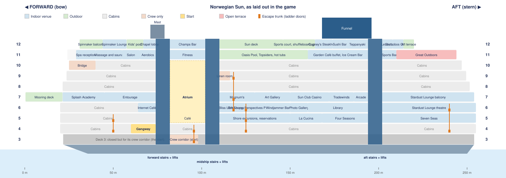
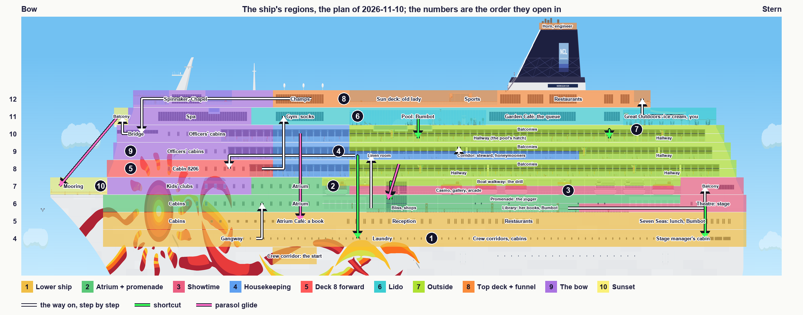
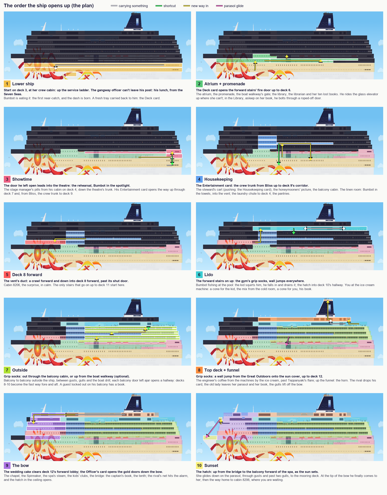
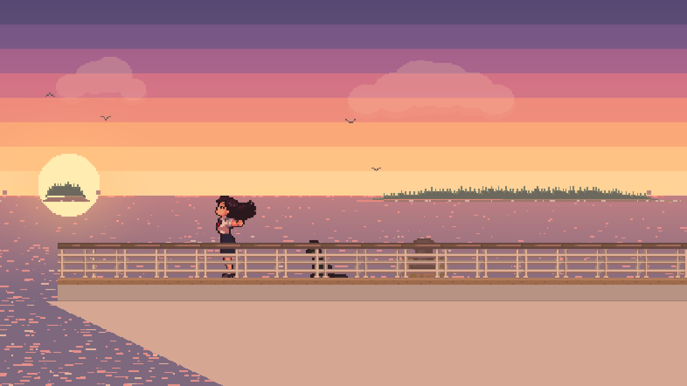

# Bumbusik — Game Design

A browser platformer about my wife, built as a gift for her to play. Sister game to
[mysterious_feline](../mysterious_feline) ("Bumbot"): also a browser game, with a different feel.

Status legend used throughout: **Decided** — agreed, build it this way. **Proposed** — a suggestion
waiting for a yes/no. **Open** — not discussed yet. **Later** — deliberately postponed until the
rest of the game is done.

---

## 1. Vision

| | |
|---|---|
| **Hero** | Bumbusik — my wife (§3). **Decided** |
| **World** | **The ship is the game.** One cruise ship, sailing on a sunny day over small waves, explored freely deck to deck. There are no levels. **Decided** |
| **Goal** | Catch Bumbot, our cat, who has stowed away. He shows up at places on the ship and slips away each time, until she finally catches him. **Decided.** Where he shows up and where she catches him: §6.1.8 |
| **Discovery** | The goal is **never stated**. She works out that she is chasing Bumbot by playing. **Decided** |
| **Player** | Her. It is a gift, and she wants a **real challenge** — Bumbot-level difficulty, not a gentle walk. **Decided** |
| **Tone rule** | **No death and no negativity.** Failing is a *scare*: she runs off, or bobs in a life ring, and pops back out of a crew cabin door (§5.6). **Decided** |

---

## 2. Platform

**Decided:** Bumbusik is a **browser game**, playable with keyboard or an **Xbox Series controller**,
and it has to work when **hosted on GitHub Pages**, as Bumbot does.

**Decided:** Bumbusik is its **own, much bigger project with a nicer look**. Bumbot's code and
lessons are **not** a constraint. We do whatever makes the most sense for Bumbusik.

### 2.1 Art

**Decided:** Bumbusik has to **look nicer than Bumbot**. Bumbot's code-drawn SVG sprites read as basic,
and in places ugly. Neither of us is an artist, so the art comes from somewhere other than our own
hands. Bumbot's sprite is **not** reused; he is redrawn in the new style.

What makes a game look good is mostly **consistency**: one style, one palette, one pixel scale,
everywhere.

**Options:**

| Option | How | For | Against |
|---|---|---|---|
| **A. AI pixel-art tools** (e.g. PixelLab, Retro Diffusion) | Describe or sketch a character, get it plus walk/run/jump/climb animations; tiles and props the same way. | Cheap, fast, unlimited iteration. Pixel art hides small flaws. Built for game sprites and animation frames. | Keeping a character identical across all animations takes effort; output needs cleanup (palette, alignment). |
| **B. Commission a pixel artist** (itch.io, Fiverr, r/gameDevClassifieds) | An artist draws her and Bumbot from photos, with animation sheets; maybe key tiles too. | Best likeness and charm; drawn by a person, which suits a gift. | Money (a few hundred dollars and up for two animated characters) and turnaround time. |
| **C. Asset packs** (Kenney, itch.io, CraftPix) | Ready-made tiles, props, UI, particles. | Instant and polished. | No side-view cruise ship packs to speak of; mixing packs clashes. Good for small generic pieces only. |
| **D. Code-drawn** (Bumbot's approach) | I draw shapes in code. | Free and instant. | The look we are moving away from. |

**Decided:**

- **Style: pixel art**, drawn at a low internal resolution (e.g. **480×270**) and scaled up crisply
  to fill the screen. At that resolution she is about 32px tall.
- **No artists.** Nobody outside the two of us should be able to block progress.
- **Sources:** her, Bumbot, ship tiles and props from an **AI pixel-art tool**. Small generic pieces
  (particles, UI) from free asset packs.
- **As cheap as possible.** I provide links; you choose what to use, subscribe to or buy.
- **One fixed palette** for everything, enforced by script, so pieces from different sources match.
- **Division of work:** I can't run image tools myself. I write the art specs and prompts, then take
  what comes out and do the technical side: palette enforcement, slicing sheets, alignment, hitboxes,
  animation setup in Phaser.
- **Reference photos** of her and Bumbot, for the AI tool, are **never committed**: the repo is public
  through GitHub Pages. They live outside the repo.
- **Placeholders first:** gameplay is built with simple placeholder art, so the ship is playable and
  tuned while the real art is made, then the art is swapped in.
- **Background decoration layer:** props behind the action are drawn in **muted, greyed-out colours**,
  so they never read as interactive (§5.8, the wet floor sign).
- **Rooms she enters are washed out a little, and every door she can use stands out** (Decided, the
  user, 2026-11-15, after cabin 8206): inside every enterable room (the cabins, the crew rooms, the
  linen room, the chapel, the lifeboat, the nook) everything above the floor is faded 30% toward the
  room's wall, as in 8206. **Every door she can use is drawn in its full colours, never washed or
  muted**, so it stands out a little as something to use, the way her crew cabin's door does: the
  doors back out of rooms, 8206's shower door, the balcony doors, the rooms' doors in the corridors,
  the side-on doors in the walls across the decks. What else in a room she uses keeps its colours
  too (her mirror, the linen room's chute hatch, the nook's way out). The drawing tools
  carry it (`Room.full` in `tools/draw_rooms.py`, `keep` in the others).
- **Everything is placed where it makes sense.** Nothing floats in the air: a tangerine sits on a
  table, a counter, a tray or in a fruit bowl; a key hangs on a hook; a card lies on a desk. Same for
  every object on the ship.

**Tools to evaluate** (prices from third-party listings, unverified; check each site):

| Tool | What for | Cost |
|---|---|---|
| [PixelLab](https://www.pixellab.ai/) | AI characters with animations (walk/run/jump), rotations, tilesets; Aseprite plugin | Subscription, reportedly from ~$12/mo; free trial reported. One month may be enough for the characters. |
| [Retro Diffusion](https://www.retrodiffusion.ai/) | AI pixel-art images, tiles, props | Pay per image (~$0.01–0.18), prepaid, no subscription, credits don't expire |
| [Pixelorama](https://pixelorama.org/) | Pixel editor for cleanup and small edits | Free, open source |
| [LibreSprite](https://libresprite.github.io/) | Pixel editor (free fork of an older Aseprite) | Free, open source |
| [Aseprite](https://www.aseprite.org/) | The standard pixel editor; needed for PixelLab's plugin | ~$20 one-off, or free if you compile it from its public source yourself |
| [Piskel](https://www.piskelapp.com/) | Browser pixel editor, nothing to install | Free |
| [Lospec palettes](https://lospec.com/palette-list) | Ready-made pixel-art palettes to pick our one palette from | Free |
| [Kenney](https://kenney.nl/assets) | UI, particles, generic props | Free (CC0) |
| [Tiled](https://www.mapeditor.org/) | The ship map editor (§7.2) | Free (pay-what-you-want) |

**Cheapest path:** placeholders first (free), a free editor, Retro Diffusion credits for tiles and
props, and **one month** of PixelLab when the characters are drawn, ideally all of them at once.

**Decided: PixelLab, connected to Claude Code** through its MCP server, so assets are generated,
checked and dropped into the game from here. Started on the free trial (40 generations).

**The palette is Resurrect 64** (`assets/palette/resurrect-64.hex`). PixelLab only draws in a fixed
palette in its expensive Pro mode, so everything is generated freely and converted afterwards by
`tools/palettize.py` (nearest colour by perceived difference, plus per-character colour swaps).

**Asset pipeline:** raw PixelLab frames are kept in `assets/source/<character>/`, and
`tools/build_sprites.py` converts and packs them into `assets/sprites/<character>.png` + `.json`.
Reference photos never enter the repo.

---

## 3. The heroine — Bumbusik

**Decided:**

- **Name:** Bumbusik is what I sometimes call her.
- **Story:** she **works on the ship**, and Bumbot has **stowed away**. That explains why she can go into
  crew-only areas, and why the passengers and machinery around her are obstacles
  rather than villains. It is true to life: she worked on cruise ships for 11 years, managing
  personnel and doing QA, which is a good source of in-jokes and quirks.
- **Appearance:** Ukrainian, white skin. Dark straight hair, curled up at the ends, a little below
  shoulder length. Small earrings. No glasses.
- **Outfit:** the women's uniform of cruise ship personnel: white short-sleeved blouse with shoulder
  epaulettes, navy knee-length skirt, a small neck scarf, a name badge, dark flat shoes.
- **Personality / quirks:** to be added as we build. They will feed idle animations, reactions,
  the scare moments, and jokes on board.

- The hair curl and the earrings are what make her recognisable at sprite size, so they get
  exaggerated slightly. Redone if it doesn't look right.
- **Size:** **59px** tall at the 480×270 internal resolution, about 22% of the screen height: the
  size her PixelLab sprite came out at, kept rather than shrunk, because downscaling pixel art ruins
  it. Bumbot is stylised larger than a real cat would be next to her, or he would be a speck.
- **Her sprite (Decided):** generated with PixelLab (natural proportions, the most detailed of four
  tries), then edited for longer hair flipping outward at the ends and fair skin, and converted to
  Resurrect 64. Animations so far: run, jump (rise / apex / fall poses) and a ladder climb from
  behind, hands alternating, and climbing out of a hatch (hands on the rim at head, shoulder,
  then waist height as she rises). Run, climb and the idles use PixelLab's skeleton mode, which moves her standing
  sprite rather than redrawing it, so her hair stays the length it is when standing still.
- **Idle (Decided):** standing still is her plain side pose. After 4 seconds one idle plays once,
  then another every 6 to 10 seconds, never the same twice in a row; any move ends it at once.
  Two so far: hands on hips tapping a foot (the taps repeat), and looking back over her shoulder,
  held for about a second. More can join the rotation as her quirks come up. Tried and dropped: a
  nail-buffing idle, which read as checking her phone.

### 3.1 Controls

**Decided:**

| Action | Keyboard | Xbox controller |
|---|---|---|
| Run | ← / → | Left stick / D-pad |
| Jump (hold for full height, tap for a hop) | Space | A |
| Climb ladders | ↑ / ↓ | Left stick / D-pad up/down |
| "Кісюнічка!!!": the cry, and the lunge with it once learned (§3.2); one tangerine each press | D (Shift until 2026-11-06) | B |
| Throw a tangerine (§3.2): a roll; with ↑ held, a lob | F, ↑ + F | Y, ↑ + Y |
| Activate: doors, buttons, card readers, whatever we add as we build | E | X |
| The welcome menu: choose, press | ↑ / ↓, Enter or Space | Left stick / D-pad, A or Menu |
| Skip the intro | Esc | Menu or B |
| The whole ship from outside (§5.3) | O; Esc leaves it | Right stick click; again or B leaves it |
| Zoom in that view | + / − | RT / LT |
| Sound off and on | M | (keyboard only, the user, 2026-11-15) |

Activate has its own key rather than ↑, so standing at a ladder next to a door is never ambiguous.

**The Xbox controller in full (the user, 2026-11-15; `src/controls.js`):** the mapping above; on
the stick, up and down count only while it points mostly up or down, so running with it tilted a
little down never crawls her or drops her through a walk; whichever connected controller was
touched last is read, whatever slot the browser gives it. The `gamepad` playtest drives a fake one
(headless Chrome has none); the user's real one is the final check. Browsers start a page's sound
only after a key or a click: with the controller alone the game may stay silent until one.

**Rumble (the user, 2026-11-15; `src/rumble.js`):** only while she plays with the controller, and
only at these moments, so that a rumble always means something: a scare (a bump, bonk or splash: a
short sharp jolt; a long fall: a heavy thud; overboard: a big splash that fades); landing on her
feet a deck or so down (a tiny thud; not after a glide); the lunge starting (a short burst); a tray
spilled (a light tick); Bumbot bolting at a near-catch (two quick light pulses); the ship's horn (a
deep rumble for the length of the blast); the bridge's alarm (four pulses with its lights); the
pool draining (a faint low rumble for its five seconds); a gust pushing her on the balconies, the
funnel's stairway and over the bow (a faint tremor while it blows); the catch (two soft pulses, a
heartbeat).

**M** switches the sound off and on (step 12, 2026-11-14); the choice is remembered in the browser.

No pause and no map, at least for now.

### 3.2 Special move — "Кісюнічка!!!": the cry, and the lunge

"Кісюнічка!!!" is what she happily screams every time she sees a random cat on the street, so
it is her battle cry here.

**Decided (the user, 2026-11-15; `docs/plan-three-uses.md` §1 and §2, which has what each
person, animal and hazard does): a tangerine has three uses**, and the ten-second dash is gone.
D (B on the controller) is the first, the pocket the second (step 2), the throw (F, Y on the
controller) the third (step 3). **Built (step 1, 2026-11-15):**

- **Every D costs one tangerine, whatever it does.** With none on her nothing happens, and the
  HUD's count blinks once. (`?tangerines=infinite` never uses one up, for testing.)
- **The cry, from the start:** "Кісюнічка!!!" in her bubble, her sound, and the people and animals
  within 4.5 m on her deck are startled for three seconds: a walker in her way (the porter, the
  waiter, the jogger) stops and stands aside with a "!", the buffet queue turns aside, the steward
  on his rounds pulls his cart in, the gulls go up (a dive still in its tell is called off), the
  kid with the water pistol turns and squirts at her at once, the winchman holds the boat a beat,
  Teppanyaki's chef flares late, the librarian shushes her and her rope's sign rattles, Bumbot
  looks up at his spot (the beat is what it was), and at the tip of the bow he backs off. A "Do
  Not Disturb" door within 3 m opens on someone not dressed for visitors: "Startled". Anyone else
  standing about turns to look; a heart over the few who like cats, a finger to the lips in a
  quiet place (`hear` in `tools/population.py`). Machines do not hear; no door or venue answers
  it. Each person startled is deaf to the next cry for eight seconds.
- **The lunge, with the cry, once learned at the Seven Seas** (near-catch 1, "she lunges with
  the scream"; the save's verb `dash`): one second at twice her speed the way she faces, the
  trail behind her. During it and a breath after, **nothing frightens her by contact**: what
  touched her gives way in its own manner (the porter's cart rolls off and he runs after it, the
  jogger spins like a top, a basketball is headed back onto the court, a sprinkler leaves a few
  drops on her, a flare a wisp of smoke); the luggage, the crates and the piñata break, the
  vacuums spin, the towels topple; trays on a hallway's floor scatter and their door flies open
  after she has gone. A jump taken in it carries about twice as far. Falls and the sea are what
  they are; solid things stay solid.
- **With a tray in her hands, or before the lunge is learned: the cry alone**, still one
  tangerine. Not while she crawls, climbs, swims, or holds Bumbot.
- Numbers in `src/config.js` (`CRY`, `LUNGE`), to be tuned in play. The lunge stays under
  Bumbot's 300 px a second.

**Decided (the user, 2026-11-19), built the same day (`docs/plan-the-rest.md` §3, 1.2a): the pocket is
the gulls' only.** After playing: "losing a tangerine on hit almost never fits visually and in
terms of gameplay. I want to play the respawn gags in most of the cases, tangerines or no."
Losing one fits only where someone takes it. So: a gull that comes down on her (the balcony
rails', the funnel's on the stairway, one across her glide) takes a tangerine and she keeps her
place; **every other hit is its gag and her checkpoint whatever she carries, and none is lost**;
a "Do Not Disturb" door and the occupied balcony are the "Oh, sorry!" gag always; a bump with a
tray, a cone or a delivery in her hands is always a spill. A tangerine is otherwise spent only
by her own choice (the cry, the lunge, a throw), and the lunge is the one way a tangerine gets
her through a hit. What is written below of the pocket, and in §5.6 of a hit "with a tangerine
on her", was built before that step, and holds now for the three gulls only. **Built
(2026-11-19):** `pocket: true` on 20, 21 and 22 in `MISHAP_SCENES`, the rest give their gag; nothing
is knocked out of her pocket (`loose.knock` gone); a tray is spilled whatever she carries; a rail
gull that comes down on her with a tray (not food) in her hands takes a tangerine and she keeps the
tray (the user: "Let the gull steal a tangerine"); the flag `?pocket=off` is gone (the user: "it
always confused me").

**Built (step 2, 2026-11-15): the pocket, and the tangerine a real thing.**

- **A hit that would be a fright or a spilled tray, with a tangerine on her, is forgiven**: she
  flinches (her `her-hit` clip, a third of a second), is pushed back a step, and blinks for a
  second and a half during which nothing touches her; she keeps her place and her tray. A walker
  who bumped into her stops and stands aside, as at her cry. Falls, the sea, and a load that
  goes over by her own feet (the cake swayed over, a tray into a pool) are never forgiven.
- **The tangerine is knocked out of her pocket** and flies off the way she was pushed: it
  bounces, rolls about four metres, off steps and edges, against anything solid it bounces back,
  and lies where it stops, kept in the save (`save.loose`), hers again by walking over it. Off
  the hull it falls into the sea, gone; in a pool it floats, to be swum to. Whatever wants it
  may take it first (`world.offered()`; the takers come with step 3).
- ~~`?pocket=off` switches it off (to see a fright with tangerines on her); the playtests run with
  it off unless a scenario names it.~~ (Gone, 2026-11-19.) Numbers: `POCKET` and `LOOSE` in `src/config.js`.
- **Revised (2026-11-16, `docs/plan-three-uses.md` §1.6, §1.7):** her reaction is the hit's
  own, by its side and who was moving, and the tangerine goes the way she is thrown (§5.6). A
  gull takes it from her; at a "Do Not Disturb" door or the occupied balcony she hands it over.
  **A tangerine she gets flies to the HUD's count** (0.4 s, on an arc, one after another): the
  save has it at once, the number changes as it lands, and the icon bumps (`TALLY`).

**Built (step 3, 2026-11-15): the throw.**

- **F throws one tangerine underarm the way she faces: a roll**, low, one bounce, about six
  metres. **With ↑ held, a lob**, high and short: its top is about 2.3 m ahead, a hand under a
  corridor's ceiling. On her feet only, hands free (not with a tray, crawling, gliding, in a lunge
  or with Bumbot); with none on her the count blinks. She stands for half a second while she
  throws (her `toss` clip, the tangerine in her fist until it leaves her hand).
- **What it meets answers it** (`plan-three-uses.md` §2's fourth column, every one built today):
  the porter stops for it and peels it by the wall (10 s clear), the waiter pockets it, the
  jogger hops it; the steward on his rounds puts it on his cart, hers again with E; the kid
  catches it and eats it, his back turned 15 s; anyone standing about turns to look. Deck 4's
  and deck 9's vacuums swallow it and choke, dead until she has left the deck. Gulls go for it:
  at the pool (her cone left alone 10 s), on a balcony's rail (that balcony safe until she is
  past), on the promenade's rail (clear 8 s), round the funnel (no swoop 10 s), in the bow's
  flocks. Rolled into the trays outside a "Do Not Disturb" door: the clatter, the door opens,
  the guest looks about at nobody, and the trays are safe to cross meanwhile. A lob brings the
  piñata down (three for one), scores through the court's hoop, plays a note on the
  Spinnaker's keys. On the delivery robot's top it rides along. **Bumbot at a spot bats it
  straight back to her**; at the tip of the bow he backs off. What nothing takes lies where it
  stops, hers again by walking over it.
- The things of later steps (the dog, the paper round, the runaway suitcase, the gull with the
  bell, the shelf of the climb) answer it when they are built. Numbers: `THROW` in
  `src/config.js`.

**Superseded:** the dash of 2026-11-10 (ten seconds at twice her speed, a HUD countdown), and
before it the open question of 2026-11-14 (`docs/brainstorm/dash-rework.md`).

---

## 4. Bumbot — the runaway cat

**Status (the plan, 2026-11-10): his beats are decided in §6.1.8**: six near-catches, three glimpses
and the catch, one per region, each at the lock she cannot pass yet. None of it is in the game yet.
His sprite, his animations and the near-catch itself are in the code (a `bumbot` map point: activity
and escape direction).

**Decided (the mechanic and the look):**

- Bumbot appears at **a few places** on the ship, each one a **near-catch moment**: a mini-scene where
  she almost grabs him and he slips away with a funny animation, then play continues.
- Until she reaches him, he is **doing something cat-like** in his spot, and each spot gets something
  different: asleep in warm towels, washing himself, catching a fly, and so on.
- A near-catch is a short scripted sequence with input locked: she lunges, he escapes — up a ladder
  she can't use yet, into a vent, onto a passing tray, behind a door that slams shut, or into an
  escape trunk she can't open yet (§5.1).
- He is a black Bombay cat, redrawn in the game's art style (§2.1).
- **His sprite (Decided):** PixelLab pro mode designed him from a photo of the real Bumbot: slim,
  glossy black, pale yellow-green eyes, a small grey patch below the throat where a bow tie would
  be, no collar. It came out about 42px tall standing, too big next to her, and PixelLab's own
  smaller redraws lost his look, so we shrank it ourselves (box resampling to 2/3, snapped back to
  Resurrect 64): about **28px tall standing**, a little above her knee. Faint grey streaks from
  each ear to the outer corner of the eye were added by hand, as on the real cat.
- **His sprite, made again (Decided, the user, 2026-11-24; plan-the-rest §7a):** the one above "doesn't look like
  him": "Head and his face look disproportional to me". Of seven looks generated at the game's size, realistic and
  stylised, the user chose the realistic one and its warm brown-black coat as it came. He stands 26 px tall and 36
  long, **in his own colours, not the palette's** (on it he is a flat purple silhouette). In her arms he is drawn as he
  was (the user: "the only thing that I actually like") and wears the new coat, a tone darker than its main one
  (the user's choice of two, seen in the game at the bow: "B it is").
- **His animations, made again (Decided, 2026-11-24):** every clip animated from that one picture, all approved: a
  standing idle (tail, ear, blink), walk, run, his jump with its landing, a look back over his shoulder, a turn
  round, a stretch with a yawn, a shake (its drops in water colours), eating, a flat crawl (into the vent), the
  catch of the stage's fly rope; sitting down, sitting (tail sweep, ear, blink), up again, washing, batting, fishing
  with a paw over a rim (the pool: he batted the air with the lever behind him, and it read as scratching a pole);
  down into a loaf, the loaf at rest, up out of it; lying down, asleep (breathing in its own frames), waking. Placed
  so far: what his scenes already asked of him, plus the rope, the crawl, the fishing, the sleep and the waking, and
  at near-catch 1 his look back over his shoulder and his turn (2026-11-24). The standing idle, walk, stretch and
  loaf are made and not yet placed. **The near-catch scenes themselves
  are the user's to go over in the general QA** ("there are a lot of issues with the near-catch scenes in general, I
  will fix them separately").
- **His animations as first decided:** run (his escape), washing, a leap, sitting down and staying sat,
  eating, batting with a paw, and asleep, which breathes in code.
  Asleep is side-on, lying down with eyes closed and the tail out behind. A curled-up "bagel" was
  dropped: from the side it barely reads, and PixelLab drew it as a ball seen from above.
- **A near-catch (Decided):** she tries to **pick him up**: she walks up to him, bends down with
  both arms out, and just before her hands reach him he leaps away and runs. She stays bent a
  moment, straightens, and turns to the camera. Then play goes on.

**Decided:** between his spots he also turns up in **background glimpses**: a tail vanishing
round a corner, a cat silhouette on the deck above, a shape passing a window. He can't be reached
there; they only remind her he's on board.

---

## 5. The ship

### 5.1 Structure

**Decided:**

- The game is **one ship, with all its decks**. No levels. It is meant to be a big game.
- **Free movement** in all directions: forward and back along a deck, up and down between decks.
- The ship opens up as she plays: the exploration/backtracking loop of a Metroidvania. How it is
  split and locked: the plan in §6.1.
- **The ship is the Norwegian Sun**, used as the reference for its dimensions, layout, venues,
  stairwells, elevators and ladders. We have both been on it, so she can find her way **without a
  map**, from memory.
- **The name is never stated at the start.** She has to recognise the ship herself. Name markings
  may appear in areas she unlocks later. **Later**
- **She starts on deck 3, at her crew cabin's door** (the user, 2026-11-14; until then on the
  gangway, on deck 4): in the crew corridor, the ship already at sea. The service ladder behind
  its door takes her up to deck 4, where the gangway lobby is, its shell door closed.
- **She can go outside:** open decks, railings, the promenade, lifeboats.
- **Side view of a top-down plan:** the real deck plans are seen from above, but the game shows the
  ship from the side, so each deck shows one slice along its length. That slice follows the deck's
  **main route from bow to stern**, with venues at their real positions along it. **Doors** along
  the way lead into **small separate rooms** (cabins, offices, venues off that route).
- **Stairs** are walked **diagonally**, like normal stairs, at the real stairwells' positions. Tried
  in the first slice; it feels natural. ↑/↓ steps onto a flight, and holding the key carries her
  through a landing onto the next flight.
- **Ladders** only where real ones exist: crew and technical areas, the pool, lifeboat stations, the
  mast and funnel, emergency escape shafts. Guests don't climb ladders on a real ship.
- **Escape trunks (Decided, 2026-11-01):** some crew doors along the decks (not checkpoints) open
  onto a vertical ladder shaft, as a real ship's emergency escape trunks do: shortcuts up and down
  beside the stairs and elevators.
  - One ladder runs up the shaft past a door on each deck it serves. Most link two decks; a few
    link more, and a shaft may pass a deck with no door on it.
  - **Two small amber arrow lamps above the door, ▲ and ▼**: a lit arrow is a way she can go from
    that door, an unlit one a way she can't. They don't look like a checkpoint's green lamp.
  - **E opens the door**, revealing the ladder behind it; then ↑/↓ takes the ladder in a lit
    direction. A door closes by itself once she steps away from it.
  - **No cutaway and no fade:** inside, the walls and decks hide her naturally, seen only in an
    open doorway, and the camera follows her up or down.
  - She can stop at **any door along the shaft**: **reaching a door opens it** from inside, then
    ←/→ steps out, or she climbs on and it shuts behind her. Letting go of ↑/↓ just short of a
    door settles her level with it.
  - **One-way shortcuts, in a few places:** the lower doors stay shut from outside ("opens from
    the other side": the door rattles, its arrows unlit) until she has come down through the
    shaft once; from then on it works both ways for good.
  - **For now (blockout):** four test trunks, to try the mechanic: a two-deck one (deck 4–5,
    forward cabins), a three-deck one (decks 4–6, midships), a one-way shortcut from the theatre
    on deck 6 down to deck 4 (passing deck 5 with no door) and one between decks 6 and 7. The
    real ones are placed when the interiors are filled. Listed in `tools/ship_layout.py`.
- **Elevators:** guest elevators are free to use. **An elevator
  never opens onto an area she can't reach yet.** She stands at the doors and presses **E**; they
  open and a button panel shows decks 4–12, the ones she can reach lit and the rest greyed out.
  ↑/↓ picks a deck, **E confirms** (changed from jump, 2026-11-01); the panel goes (the camera
  following the car shows the ride, 2026-11-01), the doors close, and they open on that deck.
- **Elevator details (Decided, 2026-11-01):** one elevator door in each of the three cores, aft
  of the stairs, with the deck number lit above it. ←/→ at the panel backs out, and the doors
  close once she steps away. She steps in and turns to face us; the car travels out of sight (the
  walls and decks hide it, as in an escape trunk) with the camera following; a ding, and the doors
  open. While the glass car comes to fetch her, the panel's display counts its decks.
- **Glass elevators (Decided, 2026-11-01):** the atrium's glass elevator works like the others,
  but its car is **seen**: it runs up and down rails on the atrium wall (decks 5–9), she rides
  visible inside it, and if it's on another deck when she presses E, it comes down or up to fetch
  her first.

### 5.2 At sea

**Decided:**

- The ship is **sailing** throughout the game. It is **sunny**, with **small waves**.
- The waves are **visual only**: a gentle swell on the water and a little sparkle. The ship does
  **not** rock under her, because tilting floors would fight precise platforming.
- **Midday sun** for the whole game. **Sunset only for the final catch scene.** (Built, step 10: it comes on the balcony forward of the spa, and lasts through the catch and the way home, until the day after.)

- Outside areas show open sea and sky behind the ship, the sea scrolling past slowly to sell the
  sailing. Indoors, portholes and windows show the same sea.
- Sound: a soft sea and engine ambience outdoors, quieter inside (synthesised, like everything else).
  **Built (step 12, 2026-11-14):** five layers set by where she stands (`src/world/soundscape.js`):
  the sea's wash (out on deck, most on the low open decks), the engines' throb (most low in the
  ship), the wind (the open decks, more the higher), the ventilation's hush indoors, water lapping
  by a full pool. Not heard by anyone yet: the user's ears decide.
- **The sea, drawn in code** (`src/sea.js`; approved by the user 2026-11-07): six rows of waves
  from the waterline down, the far ones small and slow, the near ones bigger and faster, each row
  gently rising and falling, sun glints on the crests, the deep water darkening under them; white
  foam along the waterline from the stem to the stern, **running on past the stern and breaking
  up into the wake** (the user: not cut off square); a bow wave heaped against the stem, with
  spray; the wake streaming aft from the stern, widening and fading. All of it streams toward the
  stern, also in the outside view (O). **Decided**
- **The background, drawn in code** (`src/background.js`; approved by the user 2026-11-08): a
  **Baltic archipelago** in two layers far away in the haze, the far one smaller and paler: low
  smooth granite skerries, most under a dense dark pine forest, now and then a red cottage with
  white corners in a clearing or a white lighthouse with a red band on a bare rock, surf at their
  feet. The far sea fades into the haze at the horizon, faint glints growing toward the near sea.
  Fair-weather clouds, heaps of round puffs with lumpy undersides, half see-through so they sit
  back in the sky, standing well up in it. **From outside (O) the sky stands in the world, not
  on the screen** (the user, 2026-11-14, on a picture of the whole ship stitched from many
  views, which had a strip of sky and a row of clouds for each row of views): it deepens over a
  fixed stretch up from the horizon, and the clouds are in three rows, small and faint low over
  the horizon, bigger higher up. **The horizon** is fixed to the screen from moment to
  moment, far away as it is: while she is in the air it holds still, so a jump doesn't move it;
  while she is on her feet (or on stairs, ladders, lifts) it glides to its place **58 px over the
  floor she stands on**, about the top of her head, so the camera's slack never leaves it out of
  place (the user, 2026-11-08). It shows past the railings, over the open decks and through the
  glass; the islands drift slowly aft (the far layer slower), shift a little as she runs, the
  clouds slower still. **The sea-view windows show the same live background** (the bridge, the
  Spinnaker, the dining rooms, the buffet, cabin 8206's picture window): a copy of it cut to their
  panes, its horizon level with the sea outside, curtains, mullions and glints over the glass.
  **Far gulls** (2026-11-08): four tiny dark "M"s, hazed, crossing the sky over the islands at
  their own heights and paces (30-80 s across the screen), flapping, now and then gliding; the
  same birds in the windows and the outside view. Closer, generated gulls: **Later**. **In the outside view** the horizon lies on the waterline, the ship and the
  horizon low in the frame (lowered by half the ship's height), the islands and clouds kept at a
  visible size on the screen, the clouds half way up the sky. **Decided**

### 5.3 The reference ship — Norwegian Sun

Real-world figures ([NCL ship map](https://app.ncl.com/sites/default/files/Ship_Map_SUN_06142022.pdf),
[deck plans](https://www.ncl.com/cruise-ship/sun/deck-plans),
[CruiseMapper](https://www.cruisemapper.com/deckplans/Norwegian-Sun-735)):

- Length **258 m** (848 ft), gross tonnage 78,309, about 1,900 guests.
- Passenger decks are numbered **4 to 12**; the decks below are crew and machinery.
- Deck 11, aft: an open-air diner with a self-service ice cream machine.

**The reference for real proportions** is NCL's ship map ([PDF](https://app.ncl.com/sites/default/files/Ship_Map_SUN_06142022.pdf)):
its lower half is a **side profile** of every deck, with the stair cores, the atrium and each
venue's position along the ship. Use it whenever a position or proportion needs checking.

- **It is drawn with the bow on the right. The game flips it: bow on the left.**
- A local copy is kept, not committed (it is NCL's artwork and the repo is public), in the
  git-ignored `reference/` folder: `norwegian-sun-ship-map.pdf`, a render of the profile
  (`norwegian-sun-profile.png`) and the same flipped to the game's orientation
  (`norwegian-sun-profile-flipped.png`; its text reads mirrored). If the folder is missing,
  download the PDF again and render the profile with PyMuPDF (`pip install pymupdf`), page 1,
  clip y 425–585 pt.
- Measured off the profile: the ship is ~1,620 px long at 150 dpi, so ~6.3 px per metre.

**Decided (layout, 2026-10-31):** from that profile.

- **The bow is on the left**, the stern on the right.
- Three stair-and-elevator cores: **forward** (~79 m from the bow), **midship** (~96 m) and **aft**
  (~198 m). The **atrium** spans decks 5–10 (deck 10 open over it since 2026-11-06; its glass elevator and staircase 5–9) between the forward and midship cores, with glass
  elevators. The funnel stands over the aft half.
- **The gangway is on deck 4, forward**, beside the forward stairs. The game started there until
  2026-11-14; it starts a deck below now, in deck 3's crew corridor (below).
- **Floors and open spaces (Decided, 2026-11-02, replacing "the atrium is a look, not a
  well"):** corridors and rooms have solid floors. Two places open up through the decks, as on
  the real ship, and both work the same way, as **side walks**:
  - **The atrium** is a real open space, its floor on deck 5 (Guest Services, the Atrium Café;
    the Atlantic Deck, confirmed by the user), open up through deck 9 to a
    domed skylight: oval balconies with cream fronts and glass-and-brass railings, burl-wood
    pillars with brass rings, the two glass elevators in the middle (§5.1), the curving
    staircase, which climbs level by level beside the glass elevator from deck 5 to deck 9.
  - **Deck 12 over deck 11's open area** is a side walk along the ship's side, its floor
    continuous (the hole in the blockout goes), with deck 11's pools below and behind it.
  - **The atrium is 20 m long, two screens** (the user, 2026-11-02): NCL's profile draws it about
    10 m, which looked narrow next to its five levels, so the midship core stands 10 m further aft
    than on the profile. (The profile's mezzanine, deck 6a, was tried and dropped by the user.)
  - **Side walks are level with their deck's floor** (the user, 2026-11-02): she simply runs
    along them, the look kept (balcony fronts, the glass railing, the open space below). A
    step-up onto them, with ↑/↓ and railings to jump over, was tried and dropped: it worked
    poorly in practice. **Deck 12's walk over the pools keeps the drop: ↓ there lets her down
    through it** into a pool (the fun part). Nowhere else does ↓ drop her; in the atrium it only
    ever takes the stairs.
  - **Open (the user, 2026-11-02):** on the real ship, the upper decks' corridors run along the
    ship's sides, while the middle above the atrium is the atrium itself and its glass dome. In
    the game, deck 10's cabin corridor runs straight over the atrium, under which the dome hangs.
    Revisit when the upper decks are laid out properly.
  - **The curving staircase winds round the glass elevator** (the user): each flight sweeps from
    one side of it to the other, alternately behind it and in front of it, and the elevator's
    dark column hides her while she is behind it.
  - **Drops keep the fall rule** (§5.6): one deck down is fine; longer, the camera lets her go,
    she falls out of the frame and comes back at the nearest checkpoint. (It is not a fright;
    overboard stays as it is.)
- **Decks 11 and 12 have glass side walls**: glass windbreak panels with a handrail along the
  ship's side, instead of open railings.
- **The pools:** she can jump into a pool, and swims a **side-on breaststroke, her head above the
  water** (the user's choice; a skeleton-v3 clip written as poses, 3 generations; a front crawl
  was made first by a misunderstanding and is kept in `assets/source/her/swim-crawl/`). Two pools on deck 11 (119-131 m and
  134-140 m), sunk two tiles into the deck; she walks or drops in with a splash, ←/→ swims, jump
  climbs out. Maybe game mechanics round the pools later. Not a scare.
  **Enriched 2026-11-25 (Decided, the user: "I want her swimming animation enriched"; approved in play):** that first
  stroke moved one arm and her legs never kicked. Now a full stroke of sixteen frames (her arms pull in, her knees
  draw up, the kick, the glide); **at rest she comes upright**, kneeling on the pool's floor with her head out of the
  water, bobbing with her arms sculling, and goes back down into her stroke when a way is pressed; rings go out along
  the surface from where she breaks it, a short trail behind her while she moves; the stroke's splash sounds on the
  kick's frame. Generated from her old stroke's first frame (`assets/source/her/swim-rich/`, 12 generations); in the
  game `swimShow`, `swimY`, `swimRings` in the ship scene, `SWIM` in the config.
- **Below deck 4 only deck 3's crew corridor is played** (Decided, the user, 2026-11-14: "a
  relatively small section of deck 3 where the game will now start", her crew cabin in it and
  "a service ladder (with the door) to the deck 4"). NCL's plan names one place on deck 3, the
  Medical Center, just aft of the forward stairs: the corridor is there, 82 to 98 m, under deck
  4's cabins between the forward and the midship stairs (`CREW_DECK` in `tools/ship_layout.py`).
  Bow to stern: the fire point (hose cabinet, extinguisher), **the Medical Center's door** with
  its plaque, a first-aid cabinet and a seat to wait on, the crew's notice board, **the door
  marked CREW** (her cabin, a room she can go into: patterned wallpaper, a desk under a
  mirror, a porthole, her bed, for one, and over it a picture of Bumbot lying by a bowl of fruit, made from the user's own photo of him, as the user set them
  the same day; its door is the first checkpoint, lit from the start), a clock and the water
  cooler, the way out's sign, **the service ladder's door** (an escape trunk, decks 3 and 4) and
  the deck's plaque. It is a working corridor, plainer than the guests' decks: painted panels
  over a green dado, a steel handrail, a pipe, the fire main and a cable tray under the deck
  above, tube lights, vinyl on the floor. A bulkhead closes each end, and the forward stairs
  and lifts do not come down to it: the ladder is the only way up. The rest of deck 3 stays
  closed, and shows at the bottom of the screen when she is on deck 4, as it naturally would.
  There are no other crew or engine decks to explore. All of it from art already in the atlas
  and drawn in code, but for the picture in her cabin, which is PixelLab's pixel art of the
  user's photo (11 generations in all for the tries the user chose from).
- **The map builder places venues by their real position** along the ship, deck by deck, from a
  list (`tools/ship_layout.py`); the art is placeholder until the real tiles come.

The schematic is drawn from `tools/ship_layout.py` (`python tools/draw_ship_profile.py`), the same
list the map builder reads: edit positions there, not in this picture. Spans are approximate,
true to the order and rough size of things on the real ship.

**The earlier deck list** (before the profile), kept for reference:

| Deck | Role in the game |
|---|---|
| 1–3 | Crew and engine decks: machinery, laundry, galley stores, crew corridors and cabins. |
| 3 | Closed but for its crew corridor: **the start**, her crew cabin, the Medical Center's door, the service ladder up. |
| 4–5 | Lower guest decks: gangway, reception, cabins. |
| 6–7 | Public decks: atrium, restaurants, theatre, shops, casino; the outdoor promenade and lifeboats. |
| 8–10 | Cabin decks: long corridors, room-service and housekeeping carts. |
| 11 | Pool deck, buffet, and the open diner aft with the ice cream machine. |
| 12 | Sun / sports deck. |
| Bridge | Forward, on deck 10. |
| Top | Funnel and mast. |

**The real ship's look** (Decided, 2026-11-02): **authenticity first**; the ship should look and
feel like the Norwegian Sun as the user saw her in **summer 2026**. **The user's own photos come
first**: 64 of them, named by what they show, in the git-ignored `reference/photos/` (HEIC; small
JPEG copies in `reference/photos/small/`). Never commit them, and never upload ones with people in
them to an art tool. Public galleries
([Cruise Deck Plans](https://www.cruisedeckplans.com/ships/pictures.php?ship=Norwegian-Sun), 2015 to
2023; they may mix in the sister ship, Norwegian Sky) only fill gaps, where they agree with hers.

From her photos:

- **Cabin corridors** (`corridor`): light, not dark. Cream walls, a white panelled ceiling with
  round downlights, a wooden handrail along the wall, framed pictures. **Cabin doors: terracotta
  wood** (orange-brown) in a wood frame, a brass key-card lock and lever, a small number plate
  (e.g. 8259). **Carpet: blue-grey with a white wave pattern.** Occasional framed pictures on the
  walls. **Most cabin doors are plain; a few carry vacation stickers**, different on each door
  (the user's word, 2026-11-02).
- **Modern corridors near the lounges** (`corridor_near_bliss_lounge`): grey 3D-geometric
  wallpaper, black door frames and trim, dark carpet with grey and white dots, large framed art.
- **Crew area** (`view_via_an_open_door_into_the_crew_area`): white steel walls, pipes and ducts
  on the ceiling, fluorescent tubes, a **blue speckled floor**, hard hats on hooks, a steel
  watertight door. Crew doors are plain white steel.
- **Doors to the open deck** (`doors_to_outside_deck`): varnished wood with a round porthole, a
  yellow-and-black striped sill, a "WATCH YOUR STEP" sign.
- **Promenade, deck 6** (`deck_6_promenade`): **tan non-skid deck with blue WALKING / JOGGING
  markings** and arrows. White railings and stanchions; orange life rings hung on the railing;
  green assembly station signs. **White lifeboats hang overhead** on white davits, "NORWEGIAN
  SUN" on their hulls; white steel frames and ceiling.
- **Elevator lobbies** (`deck_6_elevators_on_the_left`, `deck_8_elevators`): mahogany panelling,
  **bronze-toned elevator doors**, a deck number lit above each, a cream panelled ceiling with
  downlights. Deck 6: purple-navy carpet with a gold pattern. Stair cores: blue carpet with a
  diamond pattern, brass handrails on dark wood (`stairs_aft`).
- **Bars and lounges:** Windjammer Bar: dark mahogany, coffered ceiling, brass lamps, **tufted
  teal-green leather club chairs**, tan leather bar stools, a ship model in a glass case (public
  photos agree). Library: dark wood shelves, a red-and-cream patterned carpet. Bliss: dark, a
  dotted carpet, a wooden dance floor. Spinnaker Lounge: cream armchairs with dark wood arms,
  tall windows.
- Not yet checked against her photos: the atrium (`central_area`, `glass_elevators_in_central_area`,
  `round_stairs_central_area`), the restaurants, deck 11 and 12, the outside of the ship.

**The outer shell (Decided, 2026-11-03, the user's idea):** the ship is seen **from outside**: an
off-white shell (plating `#e8eaec`, mostly white, a little grey) over every deck, its outline from
NCL's profile and the user's photos, with no square corners. **The deck she is on is cut away**
along its whole indoor length, like a cut-out in the wall; every other deck shows the outside.
The cut-away **crossfades with her height** on stairs, ladders, trunks and elevators, and eases
when she lands on another deck. The ship's very front and back always show the wall: every
indoor deck end stops short of the hull (2.7 m of structure, `STRUCTURE_COLS`), the cut's edge a
little shaded. **The cut-out's edges are in shadow** (the user, 2026-11-03: the cut wasn't
apparent): a soft dark gradient inside the opening wherever the shell goes on, deepest under the
deck above, fading in with the cut (`CUT_SHADOW` in `src/config.js`); no hard line.
**Around the deck she is on, the rest of the world is dimmed** (Decided, the user, 2026-11-08), as
round a room she is in (`ROOM_DIM`): the other decks, the sky and the sea, and the walls at the
deck's own ends, doorway walls included. **Out in the open nothing is dimmed**: wherever no ship's
side stands beside her at that deck's height (the bow's mooring deck, the terraces, the open parts
of decks 11 and 12, the pools), and on the promenade and in the outside view (O). It fades as she
comes out from behind a wall, and never falls on her on stairs.
Where a deck ends in the ship's wall, a 32 px strip of that wall is drawn over her (`END_COVER`),
so running into it she goes behind it; no window straddles or crowds the cut's edge, a cabin's
pair of windows both or neither; the old shaded edge tiles are gone. The venue-name signs are
placeholders: the gangway's is removed (2026-11-03), the rest go as each deck is furnished.
No line along each deck's floor and no rounded corner tiles on the shell (they read as stray
marks); all round windows (deck 5's and the lower hull's, in line) are 24 px across, every 160 px
(`PORTHOLE_R`, `PORTHOLE_PITCH`).
- **Built (branch `outer-shell`):** step 1, the shell and the cut-away (the `exterior` tile layer,
  `EXT` tiles cut, `EXT_FIXED` never; `updateCutaway` in the scene); the outline: where a deck
  steps back by up to 8 m the shell slopes across the step (`shell_slopes`), so the bow's
  superstructure front (measured row by row: 18.7 m at deck 7 to 25 m at the bridge; deck 11's
  wall at 29.5 m behind its open roof, `FRONT_WALL`) and the stern's tiers run smoothly; **two
  crew decks of hull (1-2) show above the waterline** (`HULL_DECKS_BELOW`), so the ship is ~7.6
  times as long as tall, near the profile's 7.8; the stern went straight down to the water until 2026-11-14, when the
  user asked for it to be like the real ship's without touching the playable decks: **under
  deck 3's floor the transom curves forward down to the waterline** (a counter, as in the side
  photo: plumb at its top, raking in more toward the water; `COUNTER`, `stern_x` in the map
  builder).
  Step 2, the details drawn on the shell (`shell_details`): round portholes on the lower hull, a
  navy waterline band, square windows on the cabin decks, balconies on decks 8-10 midships and
  aft, big windows on the public rooms, the bridge's window band, the white bulwark and glass
  windscreen on the open parts of decks 11-12, the roof's edge, the navy funnel with its grille,
  the white mast, three radar domes. The user approved the outline; step 2 shown.
- **Step 3, next: deck 6's promenade, two routes (Decided, 2026-11-03):** along deck 6 from about
  85 m to 225 m (the user's photo) she can walk **inside** (the rooms, cut away as on any deck;
  the open stretch at 150-194 m becomes indoor rooms, the library and photo gallery) **or
  outside on the promenade**, switching through varnished doors with porthole windows (the
  user's `doors_to_outside_deck`) at about five places: **E** at a door, a quick fade. On the
  promenade the rooms are hidden; she walks along the ship's white wall (its windows, the doors
  back in). **The promenade is two decks tall**: white columns between bays, **the lifeboats
  hanging high up** (deck 7's level), a white railing at the edge. Its fore and aft parts are
  enclosed by a wall with **large glassless window openings**, drawn in front of her, so she is
  partly concealed there. Its ends are closed: back in only through the doors.
  **Built (2026-11-03, `PROMENADE` in `tools/ship_layout.py`):** 102-226 m, enclosed ends 102-116
  and 212-226 m (white wall, 80 px openings between piers, a 30 px sill hiding her legs), doors
  at 111, 138, 162 and 186 m (E, a 140 ms fade; 218 m, in the theatre, removed by the user, as
  were the paper signs over them).
  On the promenade nothing on the deck is cut away (`route`, "inside" or "promenade"); the rooms'
  stairs, elevators, trunks and ladders are out of reach. A beige deck strip, a white railing
  with a wooden handrail and life rings, in front of her; white columns from deck 6 up past deck
  7, between the boats, holding the davit arms. The shell along it, the user's corrections: **only
  a few windows on the promenade's wall** (one every 4 m, clear of the doors), **none on deck 7
  where the boats hang**, and **deck 5's windows are round**, bigger (20 px) and few (every 160 px).
  The life rings hang from the railing's handrail between two posts (plain `life-ring`). 150-194 m inside is now the library
  and photo gallery (a few muted pieces; furnished properly with deck 6). `?at=promenade` starts
  on it, `?at=library` inside.
- **Lifeboats:** the real ones (the user's photos) have a **red-orange canopy roof over a white
  hull**, hanging from white davits; seen from below on the promenade, white undersides with
  propellers. Three PixelLab tries from text (1 generation each, `create_map_object` 400x100 side
  view, kept in `assets/source/ship/lifeboats/`) were all rejected; so were three
  `image_to_pixelart` tries from the user's photo crop (`photo-try-4..6`, 1 generation each: the
  crop is too soft, they came out as red and white stripes). **Approved (2026-11-03): drawn by
  hand**, `tools/draw_lifeboat.py` (free; writes `assets/ship/lifeboat.png`): 300x100, red canopy
  over a white hull, a row of small windows, the hatch amidships, the steering cupola aft, a
  release hook at each end. **Size approved**: 300 px, about five times her height. Ten hang
  over the promenade's open middle at deck 7's level, every 9 m, from davit arms on the white
  columns; they fade when she is inside deck 6 or 7. The photo crops
  (`reference/photos/lifeboat-ref*.png/jpg`) stay git-ignored.
- The sun livery is the real one (2026-11-07, §8): generated with PixelLab from the user's side
  photo, centred about 40 m from the bow on deck 6, its ribbons running aft to about 142 m. Two round
  spots left where the photo's portholes had been painted over were filled on 2026-11-14 (the
  user), and **the user's own touches to it go into `assets/source/livery/livery-by-hand.png`**,
  a hand-edited copy of `livery.png` that the map builder uses in its place while it is there. Its
  ragged lines were smoothed on 2026-11-14 (the user): each outline evened out along its length,
  the ribbons' tips kept.
- **The side is plated, not one flat white (step 11, 2026-11-14, the user's wish):** seams along
  it every metre and a half, between the floors and the windows; the plates' butts staggered
  across them, a plate here and there a shade off the rest; shade under the forecastle and the
  roofs; faint streaks under some portholes, under the scuppers along the promenade's foot and
  the outlets low on the hull; a dull band over the boot topping; two shell doors on deck 3, the
  draught marks, the bow thrusters' marks, the load line. Painted by rules
  (`tools/shell_paint.py`) and cut into the map's tiles; nothing over the livery.

### 5.4 Scale

**Decided:**

- The ship has the **real Norwegian Sun's dimensions**, at one uniform scale.
- **The screen shows** her in the middle, the deck she is on, and a small part of the deck above and
  the deck below, where they exist.

That works out to (numbers to be tuned in testing):

- One deck (~3 m real) = **144px** at the 480×270 internal resolution, about 53% of the screen
  height, so the deck above and below still show at the edges.
- So 48px per metre, and the 258 m ship is **~12,400px long**, about **26 screen widths** per
  full-length deck. Including hull and funnel, it is roughly 2,900px tall.
- She is drawn at about **three quarters of true scale** against the ship, so a deck's ceiling sits
  at about 2.2× her height: close enough to feel like a ship's corridor, with room left to jump. (A
  first try at half scale made the decks feel like halls.)
- **Everything human-sized is sized to her, never to the ship**: doors (~1.25× her height), furniture,
  railings, counters, signs. Sizing some props to the ship and others to her made a gangway door
  twice the height of the crew cabin door beside it. The ship's overall dimensions stay real.

### 5.5 Checkpoints

**Decided:**

- A checkpoint is a **crew cabin door**. She is activated at it by passing it, and when she comes
  back after a scare she **steps out of that door**.
- **An activated checkpoint must be obvious** from across the deck, not a small indicator: the door
  stands ajar with the cabin light spilling out, and a green lamp above it glows. Activating one
  gives a short burst of light and a chime.
- Checkpoints sit where a crew cabin door plausibly would, following the real layout.
- **Where they go: §6.1** (one at each region's entrance, a second at the foot of each long
  gauntlet, cabin 8206's door for deck 8 forward).
- She comes back at the **closest one** to where she was scared, among the checkpoints she has
  **already activated**. Otherwise she could come back somewhere she has never been, possibly past a
  locked door.
- "Closest" follows the ship's layout rather than straight-line distance, or a checkpoint on the
  deck above could win over the one just down the corridor. First version: prefer checkpoints on the
  same deck, then the nearest deck.
- A scare keeps everything collected (cards, keys, opened doors). Only her position resets. Unlimited.
- The game **auto-saves at each checkpoint** (in the browser), so she can close it and continue later.

**Decided (the user, 2026-11-19; built 2026-11-26, approved in play: `docs/plan-the-rest.md` §7e):** nineteen places, from
twenty-six (23 checkpoints as the game counts them, from 32: a balcony cabin has one on each side). "I feel
like that is too many checkpoints in the game"; on the nineteen: "Yes, let's try those 19", to be judged in
play. **A checkpoint stays only if a scare sends her back to it, and taking it away would cost her hazards to
do again, not only an empty walk:** none inside a run of hazards, none on a calm stretch. Fourteen on the main
way (her crew cabin; the gangway lobby and the laundry on deck 4; the Library and the theatre's foyer on deck
6; the Arcade on deck 7; cabin 8206; deck 9's crew trunk, its own door, and the corridor's aft end; the
bridge; the gym, the pool's hut and the Garden Café on deck 11; the technical door on deck 12) and the five
balcony cabins of the outside region. Gone: deck 6 forward, deck 4 aft, the officer's door, the guest's
cabin, the chapel lobby, the funnel's top, the boat walkway's station, and the balcony cabin's lamp on deck
9's corridor side. None is added in deck 10's midships hallway ("No, don't add"). **She never comes back
behind a door that is shut to her.** **A checkpoint's door is its place's own** (padded theatre doors, burgundy in the
foyer and navy in the Arcade; dark wood ones, walnut in the Library and mahogany at Cagney's: the user's four
tries, 2026-11-26, "let's use all"; the white crew door in corridors and lobbies; the pool's hut; on deck 9 the
lamp over the crew trunk's own door, above its arrows); the green lamp over it is what says checkpoint everywhere.
Lit, each door stands ajar with its own lit twin (`tools/build_checkpoint_doors.py`). The funnel's top has none:
a scare on its stairway or its top brings her back at the technical door, the climb again (the user, 2026-11-26).

### 5.6 Scares (instead of death)

**Decided:** there is **no death and no death animation**, anywhere. One hit is still one failure,
which keeps the challenge, but it plays as a scare:

| What happens | What she does |
|---|---|
| Touches an enemy or a hidden trap | **A mishap of that obstacle's own** (2026-11-16, `docs/plan-three-uses.md` §1.6): which one is read from the side of her it is on and from who was moving, she or it (into the porter's cart, she goes over it; it pushes into her as she stands facing it, she sits down; it reaches her back, she sits into the luggage). Then the fade and her checkpoint. During it the keys do nothing; a hit in the air plays it when she lands. At a "Do Not Disturb" door she covers her eyes, blushing, and tiptoes off (gag 23, 2026-11-19); on an occupied balcony the same, to its partition (gag 24, 2026-11-19). Until each mishap's own gag is drawn, the built fall on its side stands in (on her bottom, or flat on her front, dazed). A slow thing she stands looking at (a paper sliding at her shoe, the suitcase rolling at her) does not knock her over. |
| Falls **one deck** | Nothing. She lands and carries on. |
| Falls **further than one deck** | The camera **stops following** once she passes one deck, and she drops out of the bottom of the screen, as Bumbot does. |
| Falls **overboard** | No drowning. A splash, then she bobs up **smiling in a life ring, waving one hand**, for about a second. |

Then she steps out of the closest activated crew cabin door (§5.5).

**Built (2026-11-19, `docs/plan-the-rest.md` §3 1.3):** every hazard, its scenarios, its gag, its sounds
and the playtests that check it are one table, `docs/population.md` §2.9. A gag has sounds of its own on
its clips' frames (`GAGS[...].sounds`); the `mishaps` playtest makes each hit through the thing's own
code, with none on her and with two. 7b and 13b cannot happen as built (the chair stands, a door hits her
only facing it) and stay in the table.

**In a lunge** (§3.2, since 2026-11-15) nothing frightens her by contact, for its second and a
breath after: she is through. Falls and the sea are what they are. Her own cry at a "Do Not
Disturb" door is no contact: that fright stands, lunge or not.

**(Decided and built 2026-11-19, §3.2: the next paragraph holds for the three gulls only; every
other hit is its gag and her checkpoint whatever she carries.)**

**With a tangerine on her** (the pocket, §3.2, since 2026-11-15) a hit by contact, or a hit
under the parasol, is forgiven for one tangerine, and she keeps her place. Since 2026-11-16 her
short reaction is the hit's own, by the same two facts (`MISHAP_SCENES` in `src/config.js`):
thrown back she reels a step and the tangerine rolls off behind her; pushed on she stumbles and it
rolls on ahead; a door in her face, she rubs her nose; water in her face, a splutter, down her
back, she arches; a flare, a yelp; from above, she ducks. A gull that comes down on her takes the
tangerine and is gone with it; at a "Do Not Disturb" door or the occupied balcony she holds it
out in both hands, head bowed, and a hand takes it (spent, not rolling). Never is she sat onto a
thing or carried off with a tangerine on her. Falls and the sea are never forgiven.

The word is **"scare"**, never "death", on screen and in the code alike.

### 5.7 Areas

**Decided:** all of these are on the ship.

| Area | Ideas |
|---|---|
| Gangway | On deck 4 (the start until 2026-11-14; it is on deck 3 now). Ship's horn, luggage carts. |
| Crew decks / engine room | Pipes, steam vents, machinery; dark and warm-lit. |
| Cabin corridors | Long, repetitive halls, numbered doors, room-service carts, housekeeping trolleys. |
| Atrium / promenade | Multi-storey open space with glass elevators, shops, a grand staircase. |
| Restaurant / buffet | Waiters with trays, tables, rolling dessert carts. |
| Theatre | Stage lights, curtains, rows of seats. |
| Casino | Spinning lights, slot machines. |
| Pool deck | Water, slides, sunbeds, slippery wet tiles. |
| Open diner, deck 11 aft | The ice cream machine. |
| Sun deck / funnel | Wind, seagulls. |
| Bridge | The ship's controls, forward on deck 10. |
| Outside: lifeboats, railings, bow | The ship's exterior and the sea. The overboard risk lives here. |

### 5.8 Enemies, hazards and other people

**Decided:**

- **All of these are in:** seagulls, a kid with a water pistol, a robot vacuum cleaner, a strict
  security officer, a waiter with a tray who doesn't look where he's going, a sliding deck chair on
  wet tiles, steam vents in the engine room, an old lady guarding her sunbed. More may come later.
- **Hidden traps**, alongside visible hazards: a floor hatch that opens, a slippery wet patch, a towel
  stack that collapses, a sprinkler that triggers, a deck chair that snaps shut.
- The wet patch is **fair but hidden**: a "wet floor" sign stands in the **background decoration
  layer**, drawn in the same muted, greyed-out colours as the other background props, so it is just
  one of them unless she is paying attention.
- **Passengers and machinery are the obstacles. Fellow crew are friendly**, background characters
  at most, to begin with.
- **The plan (2026-11-10, §6.1.6 and §6.1.7) places every one of them**, with its tell, its response
  and the verb that tames it. Two changes to the list above: the security officer is not a touch
  hazard but her comic rival, a cat-hunter whose blunders open the ship (crew never scare her); the
  waiter only spills a tray she carries. Added: the porter's luggage cart, a delivery robot, a jogger
  on the promenade, the photo flash, the stage lights, the trap door, the casino's chip spills, the
  swinging cabin door, room-service trays on the floor, laundry lines, a boat drill, the buffet queue,
  gusts, basketballs, Teppanyaki's flare, the sauna's steam, a pillow fort and a ball pit, a sunbather
  behind a "Do Not Disturb" sign. Passengers who are hazards become errand-givers, and nothing is
  used twice (the user, 2026-11-10; **the rule dropped by the user, 2026-11-21**, below).
- **Decided (the user, 2026-11-21; not built yet: `docs/plan-the-rest.md` §7f, part 11): ten obstacles on
  the walks where nothing could catch her**, "All of them" of the design session's proposal. Seven are
  things already built, placed anew, each changed in one way and never next to itself on her way: the
  towel stack on deck 4 (about 170 m); a second vacuum in deck 4's aft pocket by the stage manager's door,
  the pills' test; a second runaway suitcase at Shore excursions (deck 5); the plates and trays Bumbot
  knocks down on his way out of the Seven Seas, from near-catch 1 until the lunch is delivered; the DJ's
  fog machine in Bliss (the sauna's steam); two gulls on the boat walkway's rail, one by the drill, and
  the balconies' gusts reaching down to it; gusts over deck 12's sun deck, which also rock the cake. Two
  need one small picture or person: a gym ball rolling with the ship in the gym (the suitcase's code); the
  night watch asleep behind a "Do Not Disturb" door, his tray outside, in deck 10's officers' corridor.
  One is new: two handlers carrying a large painting to and fro in the Art Gallery, through whose canvas
  she goes. Left calm: Magnum's, the aft ends of decks 9 and 10, the Spinnaker's balcony, behind the
  flares, deck 8 forward, the Library, the theatre's aisle, deck 9's officers' corridor, deck 6's forward
  cabins. **No checkpoint is added or kept for them** ("As decided": deck 4's aft one goes, §5.5; a hit
  by the two on deck 4 aft is the walk from the gangway again).
- **Decided the same day, a second round (not built: §7f): every long run has obstacles, and every end a
  purpose.** The user: "I do not agree leaving empty ends. Every long corridor run has to have obstacles
  ... and a purpose", planned things counted as built. So the "left calm" list above is gone but for the
  Library and deck 6's forward cabins. **Six more obstacles:** a crowd shuffling along the Photo Gallery's
  wall (the buffet queue's people); popcorn spilled in the theatre's aisle (the chips' slip); a second
  swinging lamp over the Stardust balcony after near-catch 3; the birthday party's balloons across deck 8's
  forward corridor (new: a wade, no fright, gone by the evening of the catch); a second delivery robot in
  deck 9's officers' corridor; a stack of pool towels by the kids' pool. The plates in the Seven Seas lie
  there from the start. **Six ends given a purpose:** the promenade's aft end, a ladder up to the walkway
  beyond the drill, unlatched only from above, the hidden last 19 m chained off; the Spinnaker's balcony,
  the forward look-out moved there from deck 9, she drawn in front of its glass; deck 10's first balcony,
  his sleep mask; deck 9 aft's last door, its tangerine moved there and the pillow delivery's cabin; deck
  8's forward terrace, its corridor's tangerine moved onto a table there; behind deck 7's pillow fort,
  the snack table and its tangerine. Three tangerines move; 56 stays.
- **Decided (the user, 2026-11-21; not built: `docs/plan-the-rest.md` §7g): "Washie, washie, happy, happy!"** The
  user's and his wife's own joke, from the real ship: a crewman at the Garden Café's door by the aft lifts (deck 11,
  about 193 m) who sanitizes everyone's hands, singing. "His was an Asian crew member, maybe Philippine guy. Happy
  face, black hair. Standard waiter crew uniform." Not an obstacle. Five pieces, "All five": the first meeting holds
  her about three seconds (he squirts, she rubs her hands, and both sing the whole line, the user: "they should both
  do 'Washie, washie, happy, happy!'"); after that he never holds her, and with her hands full he only sings and
  waves her through; ~~Bumbot's paw prints turn foamy past him (from near-catch 5 until the table scene; only this
  stretch of prints is built)~~ (dropped 2026-11-24 with every paw print: the user, "None of those looks like his prints.
  Let's drop the prints entirely"); a tangerine thrown to him comes back washed, the count unchanged; and once she has met
  him, now and then an idle of hers comes with "♪ washie, washie…" over her. The words are the same in both
  languages. No melody ("No tune, he was just singing those words").
- **Secrets** exist: §6.1.11. (Bumbot's SUSHI sign had leaked in from the Bumbot game; dropped, the
  user, 2026-11-10.)
- **As built (2026-11-19):** each hazard with what its hit does, its sounds and its checks:
  `docs/population.md` §2.9.

---

## 6. Progression

### 6.1 The plan (Decided, 2026-11-10)

**How it came about.** The brainstorm of 2026-11-09/10 (ten regions, four kinds of lock, the cat as
the map, the ending at the bow) was reviewed as a metroidvania by Claude on 2026-11-10. Its structure
was sound: scattered locks, staggered stairs, the ship folding back on itself, the hidden parts, the
sunset finale. Its first half was flat: five regions played with only run, jump and E; four of the
nine transitions were key cards; both movement abilities came together at step 6; Bumbot had no
moment in six of the ten regions; the hazards were listed but not placed, and none answered to an
ability; the errands were walks. Claude proposed 24 changes, and **the user asked Claude to answer
them itself for the most fun and engagement, with no limit on new art, and to save the result as the
plan to build from.** The same day the user added three wishes, mixed in below: **the library, used
in a lovely and fun way** (she loves reading); **more variety of people and obstacles, less reuse** of
a sprite or an idea already met; and **the user himself on the ship**, with **mechanics round the ice
cream machine** at the Great Outdoors' entrance, which he loved. So everything in this section is
**Decided as the plan**: the user steers during the build and can overrule any item; what then
changes is recorded here. The maps come from `python tools/draw_regions.py` (after
`python tools/render_ship.py`). **Every entity in place, with its position and behaviour, is in
`docs/population.md`** (2026-11-10): the spec the build populates the ship from; where it is finer
than this section, it is the later word.

Kept from the brainstorm, as agreed then: all four kinds of lock; staggered stairs; new ways to move
required to finish; a locked part hidden behind the closed ship's side until she enters it, the first
cut-away being the reward (`LOCKED_PARTS`, §6.2); the start at the gangway; no target for how long the
game takes; carrying things for colleagues; the laundry chute to deck 4; cabin 8206 unreachable until
its region, around the middle; the glass elevator's panel as the progress meter; the ending.

#### 6.1.1 The premise (never stated on screen)

A stowaway cat has been spotted at sea. The ship's **security officer**, a clumsy man with a net and a
pet carrier, has the ship in a soft lockdown for his search: "SEARCH IN PROGRESS" ropes across the
guest stairs, while the crew go about by their own ways, each department's card opening its own.
Bumbusik is crew, doing her colleagues' rounds for them, and she wants the cat for herself.
**Every way on into the ship is a crew way** (a card, a trunk, a pantry), **a cat way** (a door he
leaves open, a hatch he trips) **or an outside way** (the balconies, the boats); **the guest stairs
catch up behind her** and reopen as shortcuts as the ship goes on with its day. The security officer
is her comic rival: his blunders open the ship, and at the end his card is the master key.

Two more threads run through the ship. **She reads whenever she can:** the library's lost books are
scattered over the ship, and bringing them home, one by one, is her own quiet game inside the game
(§6.1.2). **Her husband is aboard as a guest**, at his table by the ice cream machine at the Great
Outdoors, where he was in real life; the machine is his, and it has its own mechanics (§6.1.3,
region 6). At the very end he is in the cabin when she brings the cat home.

#### 6.1.2 The rules of the world

**The four kinds of lock:**

| Kind | How it reads | The rule |
|---|---|---|
| **Department cards** | A coloured reader on a crew way: a crew door, a crew trunk, a crew room | Deck (blue), Entertainment (red), Housekeeping (green), Officer's (gold). Each opens things on several decks (§6.1.5). The Officer's card opens every reader. **Public stairs and public doors are never card-locked** (the user, 2026-11-11: a fire door can't appear on a public staircase, and an escape route never locks): they are roped off by people or the ship's routine (below). A card door may open freely from one side (the officers' corridors from inside). **Fire-exit doors** with a push bar on one side only are the one-way doors (**built 2026-11-18**, docs/plan-three-uses.md, step 4a's second revision: shut, seen edge on, the bar's end and a door closer on the free side, nothing on the other; open, the leaf with a plain steel push bar across it; it swings away from its free side, as it is pushed; once she has come through from its free side it stays propped open for good, so it never opens from its plain side) |
| **New ways to move** | A pickup (no glyph and no hint since 2026-11-14: how a verb is used is hers to find out) | Four verbs, one per quarter: the lunge (region 1; the cry is hers from the start), pushing carts and crawling (4), grip socks (6), the parasol (8). Each makes old places new, and each tames a hazard (§6.1.7) |
| **Bumbot changes the ship** | A scripted scene | The doors he leaves open, the pool he drains, the alarm he trips (§6.1.8) |
| **People and the ship's routine** | A person, a crowd or a thing on a flight, with a rope and a sign | A cleaner mopping, a photographer, a carpet being relaid, a table of towel animals, a painter, a crowd of fans, a wedding party. Each block lifts on an event: the next region opening, or an errand done. The flight then stays open: that is how the guest stairs become shortcuts (§6.1.4) |

**Carrying.** Two classes of thing. **Pocket items** (cards, books) have no rules. **Trays**
(a lunch, a cone, a coffee, a cocktail, a cake box, the ice cream mix's canister, the stage manager's pills since
2026-11-26, the bottle alone in her hands) follow tray rules:
**stairs and elevators only** (no ladders, trunks, wall jumps, crawling, swimming or the dash), **a low
hop instead of a jump**, and **a bump from a hazard or a person spills it** with a clatter, never a
scare: she fetches another from the same place, which always has more. Some trays **melt or cool** (a
meter on the HUD) so her fastest known route is the test. E hands the thing over. Her hands full show
in her sprite.

**Books (her own thread).** Fourteen of the library's books (ten at first) are out on the ship, each in a place and a
situation of its own (the list is in §6.1.3; the titles are the user's: real books she loves). A book
is a pocket item; the HUD counts the ones she carries. **The library's return trolley** takes them
(E), and **the librarian shelves each one into its gap** on the shelf behind her desk, so the shelf
shows how far the collection is. **Reading (Decided, the user, 2026-11-21; built):** E at any of the
Library's seven armchairs or on her bed in cabin 8206 sits her down (facing us in an armchair, up against the
pillows on the bed); **the books she carries show in a row** over a soft dark backdrop, in the order she got them;
← and → choose, E reads, Esc gets her up. **The page is the book's real first page**: its opening, readable, in its
own language and script, whole sentences covering the page ("Text only for all the books"; until 2026-11-21 a
drawing that hinted at a hidden thing, §6.1.11, and the ten drawings are gone). Any book she carries, as often as
she likes; a hint says how, once. **Since 2026-11-22 (the user): the row shows every book she has found**, a book she
has given back greyed with a green check stamp and RETURNED beside its title, not to be read; the HUD's count never goes
down. **At the return trolley** with more than one book on her the row opens and she chooses which goes back, one at a
time, until none is left or she keeps the rest. **The reading nook:** when all fourteen are shelved, E at the odd book
on the bookcase's top shelf: it tips and clicks, the bookcase shudders with puffs of dust at both its sides and slides
to the right behind its neighbour (the screen still), leaving the nook's entrance, a wooden casing round a washed view
of its lamp and armchair. Inside: the armchair, where **all fifteen books are hers to read again**, a lamp, a
porthole, a picture of a black cat asleep on a book, and a photo slot, her own armchair at home (the user's photo).

**The books' titles and where they show. Decided (the user, 2026-11-18); not built.** The books are
fourteen (docs/plan-three-uses.md §4.1), and their titles are real books of hers, read off two
photos of her bookshelf (`reference/photos/Books/`, git-ignored). **Each is written in its own
language and script**, whatever the game's language, with its author. A title shows in two places,
and nowhere else:

- **When she gets a book** (picked up, or handed to her as thanks): the screen is dimmed slightly
  and **the book's cover is shown in the centre of the screen, its title and author on it**, until a
  key is pressed. **Every book has a generated cover of its own**, so that the fourteen look
  different. A naming, not a hint (§7.1).
- ~~**The shelf seen close:** E at the shelf behind the librarian's desk shows it over the whole
  screen, **a generated picture**: the books that are back as spines with their titles, the gaps of
  those still out. Any time, with or without a book on her.~~ **Dropped 2026-11-22** (the user: "no need
  for that"): a title shows on its cover only.

The lettering on covers and spines is drawn in by the build, not by the generator and not by the
game's pixel lettering (which has Latin and Ukrainian capitals only): these titles need lower case,
Polish letters, Russian and Ukrainian Cyrillic, and Hebrew, right to left.

| Book | Title | Author | Where it is found |
|---|---|---|---|
| 1 | Atomic Habits | James Clear | Her husband's, at the table (since 2026-11-23, the user's swap with 6) |
| 2 | Harry Potter and the Chamber of Secrets | J.K. Rowling | The lifeboat |
| 3 | Танґо смерті | Юрій Винничук | The dancers' dressing room |
| 4 | Unexpected Lessons in Love | Lucy Dillon | The honeymoon couple's thanks |
| 5 | Її війна | Євгенія Подобна | **Her own, on the bed in cabin 8206 (the user)** |
| 6 | Harry Potter and the Philosopher's Stone | J.K. Rowling | Deck 5, the shore excursions' brochure stand, its bottom row's middle pocket (2026-11-23, the user; the Atrium Café's table turned down) |
| 7 | Понаїхали | Артем Чапай | The balcony guest's thanks |
| 8 | Niebieskie nitki | Małgorzata Gutowska-Adamczyk | The old lady's sunbed, after the horn |
| 9 | Двор | Аркадий Львов | The engineer's, at the funnel's top |
| 10 | Боря, выйди с моря | Рафаил Гругман | The captain's, on the bridge's chart table |
| 11 | נערה במעיל כחול | מוניקה הסה | The boat walkway's end, beyond the boat drill |
| 12 | Poczwarka | Dorota Terakowska | Deck 8 midships, the thanks for the flowers |
| 13 | Daughters of Warsaw | Maria Frances | Deck 10 midships, the thanks for the tea |
| 14 | Pachinko | Min Jin Lee | Deck 9 forward, the end of the officers' corridor |

The fourteen titles and book 5's are the user's ("The order is random"). **Which title lies where
is Decided** (proposed by what each name fits: the tango with the dancers, the sea with the captain,
the chamber of secrets in the hidden lifeboat; the user, 2026-11-18: "Good"). Each spelling is checked against
her copy's cover when its cover is made. Book 11's author is written as on her Hebrew copy (the
user gave the spelling).

**Ice cream (his machine).** The soft serve machine at the Great Outdoors' entrance is worked by her:
**hold E and the swirl grows; release in the green band** for a perfect cone, early for a stub, late
and it topples onto the deck (the gulls pounce). A cone is a melting tray (about 45 seconds). It runs
empty after the first cone until the mix's canister is fetched from the Garden Café's cold room
(region 6); from then on it never runs out, and her husband keeps it. **A cone is gull bait:** held up
as the shadow comes, the gull takes the cone and leaves her be.

**People.** Fellow crew are friendly and never scare her. Passengers and machinery are the
obstacles, and **a passenger who is a hazard can become an errand-giver**: service is a crew member's
superpower. ~~**No person, hazard, errand or reward is used twice** (the user, 2026-11-10): each place
has its own, and where the plan had a repeat it was swapped (§6.1.14).~~ **Dropped (the user, 2026-11-21):**
"Drop the rule, it is no longer relevant, we are doing refinements manually now." Asked for: the empty
stretches filled "by reusing the current ones (in a smart way, so that they aren't repeated one after the
other)", §5.8 and `docs/plan-the-rest.md` §7f. Every request is **a speech
bubble with a pictogram** (a tray, a cup, a pill bottle, a cake, a canister), never words, so the goal
is never stated and nothing needs translating. People stand or walk where they plausibly would;
blocks on flights have a rope and a sign.

**Hazards.** Every hazard has **a tell** (a shadow before a swoop, a handle turning before a door
swings, a wet-floor sign in the muted background), **a response** (jump, wait, crawl, go round) and
**a verb that tames it** on the way back (§6.1.7). One hit is a scare that fits what got her (§5.6).
The long cabin corridors are where risk lives: a gauntlet of a few hazards between two checkpoints.

**Checkpoints.** One crew door at each region's entrance, a second at the foot of each long gauntlet,
and **after region 5 the door she steps out of anywhere forward on deck 8 is cabin 8206's own** (it is
a respawn door, not a hub: the "no home base" ruling stands). Listed per region below.

**The lunge and the tangerines (Decided; the lunge since 2026-11-15, §3.2).** The cry is hers from
the start; the lunge is **learned, not given**: at her first sight of Bumbot she screams
"Кісюнічка!!!", and from then on D lunges with the cry, one tangerine each, as §3.2 says. It is
**never required**: breakables (stacked
luggage, a jammed trolley, stacked deck chairs, crates, a piñata) hide shortcuts and secrets, never
the way on; it also shoves the vacuum aside, scares the kid off and passes the sprinkler. **About 40
tangerines** on the ship, each where food plausibly is (fruit bowls, buffet counters, trays, pantry
crates, a cabin's welcome basket), two of them a person's thanks. Scarce enough that each one counts.

**The glass elevator's panel is the progress meter:** it lights the decks she can reach (5 in region 1;
5-7 in region 2; 5-10 from region 4). The cores' elevators do the same (4-5, then 4-7, 4-10, 4-11,
4-12). An elevator never opens onto a place she can't reach yet (§5.1).

**Hidden extras** (§6.4, the user's photos) get **slots**: a framed picture in a secret place that E
opens full screen. Six places are fixed here (§6.1.11); the pictures come from the user, later.

#### 6.1.3 The regions and the order they open in

| Step | Region | What it covers | What opens it | The verb it gives | Bumbot |
|---|---|---|---|---|---|
| 1 | Lower ship | Decks 4 and 5, deck 3's crew corridor | The start, at her crew cabin's door on deck 3 | The dash | Eating the officer's lunch at the Seven Seas: near-catch 1 |
| 2 | Atrium + promenade | Deck 6 from the bow to the Library, the promenade, the atrium on 6-7, the boat walkway's gate | The Deck card, on the midships crew trunk up into Bliss | | Rides the glass elevator up where she can't; in the Library, near-catch 2: asleep on the return trolley, he bolts through a roped-off door and leaves it open |
| 3 | Showtime | The theatre, its balcony, deck 7 from Magnum's to the Arcade | The door he left open | | On stage in the spotlight: near-catch 3, the rival on the lamp, he up the fly rope |
| 4 | Housekeeping | Deck 9 midships round the linen room, the atrium's walks and midship lobbies on 8-10 | The Entertainment card, on the crew trunk from Bliss up to deck 9 | Pushing carts, crawling | Asleep on the linen room's shelf: near-catch 4, into the vent, the cart's pillows scattered |
| 5 | Deck 8 forward | Deck 8 forward of the atrium, cabin 8206 | The ventilation shaft from the linen room, dropping her past the corridor's shut door | | A glimpse: his tail up the forward stairs |
| 6 | Lido | Deck 11 from the forward lobby aft: gym, pool deck, Garden Café, Great Outdoors and his ice cream machine | The forward stairs on up from deck 8 | Grip socks (wall jumps) | Fishing at the pool: near-catch 5, he falls in and drains it; the hatch into deck 10 |
| 7 | Outside | The balconies of decks 8-10, the boat walkway, the hallways inside | Grip socks, out through the balcony cabin on deck 9 or up from the boat walkway | | A glimpse: swiping at a gull on a rail a deck up; his balcony door is ajar |
| 8 | Top deck + funnel | Deck 12 from Champs aft, the roof, the funnel's stairway and top | Grip socks: a wall jump from the Great Outdoors onto the sun cover and up to deck 12's aft terrace | The parasol (a glide) | A silhouette on the funnel; at the horn he bolts for the bow |
| 9 | The bow | Deck 12 forward (chapel, kids' pool, Spinnaker), the spa, the officers' cabins, the bridge, the kids' clubs | The wedding cake clears deck 12's forward lobby; the Officer's card opens the gold doors down the bow | | On the bridge: near-catch 6, the rival hits the alarm, the hatch opens |
| 10 | Sunset | The balcony forward of the spa, the air, the mooring deck, the tip of the bow | The hatch | | The catch |

Wide in the middle: region 6 opens regions 7 and 8 at once; **region 7 is optional** for the finish
(its hallways are the fast way fore and aft, and its cat glimpse, guest, book and secrets are the
lure). Everything else is in order. Each region below: what it covers, the way in, its blocks, the
people, the hazards, the cat beat, its book, the shortcuts it opens, its checkpoints and its secrets.
Positions are in metres from the bow and approximate; the build sets them exactly.

**Region 1: Lower ship (decks 4 and 5).**

- **The way in:** the start, at her crew cabin's door on deck 3 (90 m), and up the service
  ladder (95.6 m) to deck 4; forward through the stair lobby to the gangway (67 m), the shell
  door shut.
- **The errand:** the **gangway officer** at his post by the shell door can't leave it; his bubble
  shows a tray. His lunch waits at the pass by the Seven Seas' crew door (deck 5 aft, 250 m). **Bumbot
  is on the counter eating it** (his `eating` clip). **Near-catch 1:** she lunges with the scream
  that becomes her battle cry; he bolts along the counter, knocks the fruit bowl over (three
  tangerines roll onto the floor, the D glyph shows: the dash is hers) and is out of the door forward.
  **Remade 2026-11-24 (the user's; `docs/near-catch-1-remake-log.md`):** the pass is a serving counter by the galley's
  door (a walnut one, generated), he on it at a plate of the lunch, the fruit bowl on its forward end, a covered lunch
  beside him from the start. 110 px from him she stops and cries, and after a little pause dashes at him ("She has to
  learn the dash here"); he looks back, turns and bolts along the counter behind her into the bowl, which falls off
  the end, its three tangerines rolling out; he leaps down and is off through the restaurant; she turns after him,
  shrugs, and is free, one plate over her: "D to dash". Held 2.4 s (it was 8.3).
  She takes the covered tray off the counter (one tray: gone from it while she has it, a fresh one there if she spills it, none once he has his; the user, 2026-11-24) and carries it the length of deck 5 or deck 4 to
  the gangway: the first carry, under tray rules. He eats and hands her his **Deck card**: she is
  doing his rounds now. As the midships crew trunk's reader lights, a glimpse: Bumbot's tail going up
  the forward stairs, right past the security officer at his rope, who doesn't notice.
- **The book:** in the shore excursions' brochure stand (deck 5; the Atrium Café's table till 2026-11-23, the user): the first one,
  found before she knows what it is for; the HUD shows it, and the library explains it.
- **Blocks:** the forward core's 5-6 flight (the security officer's "SEARCH IN PROGRESS" rope, **with
  him at it** (the user, 2026-11-13): net in hand, peering up the stairs, his first appearance, so the
  sign means something; if she tries the flight he shakes his head. Once region 2 opens he has moved
  on, and she next glimpses him on the promenade. The way on is the midships crew trunk, blue); the
  midship core's 5-6 flight (a
  cleaner mopping, a cone); the aft core's 5-6 flight (a rope, "REHEARSAL IN PROGRESS"); the atrium's
  staircase 5-6 (the photographer's session, a backdrop across the stairs). The glass elevator's panel
  lights deck 5 only.
- **Hazards:** the robot vacuum on deck 4's long corridor (110-194); the porter's luggage cart rolling
  back and forth in the gangway lobby; the waiter in the Four Seasons' doorway (deck 5, 168-194), a
  tray hazard only, the only waiter in the game.
- **Shortcuts:** the forward-cabins trunk (deck 4-5, 50 m) is free from the start: the trunk lesson.
- **Checkpoints:** her crew cabin's door (deck 3, 90 m), lit from the start; the gangway
  lobby's crew door (deck 4, 72 m). (Deck 4 aft went, §5.5.)
- **Secrets:** the galley pass behind the Seven Seas' crew door (a crate of tangerines, breakable);
  the Four Seasons' ice swan (E: she shivers, a quirk). Tangerines: the bowl (3), the Atrium Café
  (1), La Cucina (1), the crate (2).

**Region 2: Atrium + promenade.**

- **Covers:** deck 6 from the bow to the Library (cabins, the Internet Café, the forward lobby, the
  atrium walk, the midship lobby, Bliss, the shops, the Windjammer, the Photo Gallery, the Library,
  20-194 m); the promenade (100-231 m) through its four doors; deck 7's forward and midship lobbies
  and its atrium walk (74-110 m); the glass elevator to deck 7; **the boat walkway's gate** on the
  promenade (a lifeboat station's ladder at 125 m, blue), a dead-end foothold up at deck 7's height
  under the boats, with the lifeboat secret, until the socks.
- **The way in:** the Deck card on the midships crew trunk (4-5-6, 125 m), up into Bliss.
- **The library (160-194 m), her place on the ship:** the **librarian** at her desk, a shelf with ten
  gaps behind her, the return trolley with a "RETURN" pictogram, the red reading chair by the window,
  the rolling ladder on the bookcase, the chess table and the globe. Her bubble: a book and the gapped
  shelf. The first book goes onto the trolley; she shelves it; the chair shows its page (§6.1.2).
- **Bumbot:** a glimpse in the atrium: **he rides the glass car up** past deck 7 to deck 9, seen
  through the glass while the panel's upper decks are dark (the cat is the map). **Near-catch 2 in
  the Library** (remade 2026-11-24, `docs/near-catch-2-remake-log.md`): **he is asleep on top of the return
  trolley** by the librarian's desk (the user: "He sleeps on top of the book return basket"; he was on a reading
  table 12.6 m from the door, and what he did there was never seen), he, the rope and the door in one picture. 64 px
  from him she is taken; the librarian's finger goes to her lips; she creeps up on tiptoe and reaches for him at his
  height; he wakes, leaps off the trolley and bolts aft straight through the "QUIET PLEASE" rope: the stand goes
  over into the Library's aft door, which swings open away from the knock and stays so, the stand lying in its
  doorway: the way into region 3. The librarian starts and looks at the door; she shrugs; held 2.6 s. The
  **rival** is glimpsed on the promenade peering under the lifeboats with his net.
- **Blocks:** the Library's aft door (the rope, until Bumbot); deck 7's midship lobby door into
  Magnum's (red); deck 7's forward lobby door into Entourage (gold); the forward core's 7-8 door
  (green); the atrium's staircase 7-8 (the carpet being relaid: a roll of carpet across the flight,
  the fitter's tools).
- **Hazards:** gentle. **The delivery robot** in deck 6's forward cabins (a tall tray-carrying robot
  that trundles the corridor, stops and beeps when she is in its way, and carries her along if she
  hops onto its top: a slow platform, never a scare); **the jogger** on the promenade, running laps
  on the JOGGING lane without looking (a moving obstacle: hop him, or step onto the WALKING lane
  by the wall as he passes); **the Photo Studio's flash**: she stops and poses for a second, the
  screen whites (a gag now, a hazard later when paired with a cart).
- **Shortcuts opened:** the forward stairs 5-6 for good (the search rope lifts as region 2 opens).
- **Checkpoints:** the Library's walnut door beside its promenade door (deck 6, 160.9 m). (Deck 6 forward went, §5.5.)
- **The book:** **in the lifeboat** (someone has been reading in there: a book on the bench).
- **Secrets:** **a lifeboat** (E at a boat's hatch from the walkway: inside, benches, an oar, the book,
  a photo slot); **the reading chair** and, in the end, **the reading nook** (§6.1.2); Bliss's dance
  floor (standing still on it, she dances: a quirk). Tangerines: the Windjammer's bar (1).

**Region 3: Showtime.**

- **Covers:** the theatre (deck 6, 202-255 m) and its foyer, the Stardust balcony (deck 7, 202-254 m),
  deck 7 from the Arcade forward to Magnum's (110-194 m), the aft core's flights 5-7, the theatre's
  one-way trunk down to deck 4 (240 m).
- **The way in:** the Library's aft door, left open by Bumbot.
- **The rehearsal:** the **stage manager** (crew, a headset) and two dancers in their show costumes are
  rehearsing at the stage's aft curtain, he turned to them; behind his back Bumbot sits centre stage in a
  spotlight, washing himself, the fly rope's loop over him. **Near-catch 3 on the stage** (remade 2026-11-24,
  `docs/near-catch-3-remake-log.md`; the stage one generated picture since): in front of the forward curtain,
  154 px from him, she is taken and starts toward him on tiptoe; the stage manager turns, starts and thrusts his
  clipboard at the cat, which stops her mid-step and brings Bumbot's head up; the dancers stop; the rival bursts out
  of the forward wing ahead of her with his net, and she starts back; Bumbot leaps into the loop; under the hanging
  lamp the rival leaps at him, his net swung overhead, and the net catches the lamp: he dangles on it, and the
  lamp, the other end of the rope's line, comes down as the loop takes Bumbot up behind the valance, out of reach
  for good; the rival drops onto the stage's hatch, which gives way, and is gone into the galley's flour (a
  one-deck drop, so no harm); the lamp, let go, hangs low and swings from then on; she looks up after Bumbot and
  shrugs, free in 4.35 s; the stage manager sneezes for the first time (his allergy: not before he has seen the
  cat), and his bubble shows a pill bottle. **The errand:** the pills are in his cabin on deck 4 aft
  (a crew cabin door with his name plate, 232 m): down the theatre's trunk (she comes down it, so it
  works both ways after) or the aft stairs 5-6, which open now, the rehearsal stopped; back with the
  pills. **Decided (the user, 2026-11-26): the pills are a load, the bottle alone in her hands**, on his shelf once
  near-catch 3 is over: not up the trunk's ladder with them (her hands full), so back by the aft stairs, 4 to 6, past
  deck 4's second vacuum (a hit spills the bottle, her gag and her checkpoint, a fresh one on his shelf) and under
  the stage's swinging lamp, which stays the last test (the user: "Keep it"). He hands her the **Entertainment card**
  (he is cruise staff).
- **Then:** the aft stairs 6-7 (open) to the balcony; forward through the Arcade, Tradewinds, the
  casino, the Art Gallery, Magnum's; the midship lobby's red door opens with her card: the shortcut
  back to the atrium on deck 7. **The way on to region 4:** the crew trunk at 118 m (the layout's
  `magnums` trunk, now decks 6-7-9: doors in Bliss and Magnum's, none on 8, one in deck 9's corridor
  beside the linen room), red.
- **Blocks:** the aft core's 7-8 door (green).
- **Hazards:** the stage lights swinging after the rival trips them (a timed hazard over the stage);
  **the trap door** in the stage (hidden, a square seam: she drops one deck into the Seven Seas'
  galley, no scare, and finds a shortcut out through its crew door); **the casino's chip spills** (a
  slot machine's lights race, then it pays out onto the floor: chips underfoot are a slip; the glinting
  machine is the jackpot instead, §6.1.11).
- **Checkpoints:** the theatre's foyer, its burgundy padded door (deck 6, 205.3 m); the Arcade's navy padded door (deck 7, 189.15 m).
- **The book:** **in the dancers' dressing room** backstage, on the make-up table (the stage door at
  the stage's stern end, red).
- **Secrets:** **the casino jackpot** (one slot machine with a glint; E: lights, a ding, tangerines
  pour out); **the lighting bridge** (the balcony's lighting booth is a red crew door: a catwalk over
  the stage, a photo slot, the view of the stage); the spotlight (standing centre stage for three
  seconds, she bows: a quirk). Tangerines: the jackpot (3), Tradewinds (1).

**Region 4: Housekeeping.**

- **Covers:** deck 9's midships corridor (110-194 m) and the linen room (112 m); deck 9's midship lobby
  and atrium walk; the atrium walks and midship lobbies of decks 8 and 10 (82-110 m); the atrium's
  staircase up to 9 and its elevator to 10; the midship and aft cores' flights 7-10 (their 7-8 blocks
  lift as region 4 opens).
- **The way in:** the Entertainment card on the Bliss/Magnum's trunk, up to deck 9.
- **The corridor's life:** the **steward's cart** jammed across the corridor at its aft end (185.2 m,
  since 2026-11-18, below): the push glyph; she pushes it free along the corridor (the push verb: E at
  a cart's end, then walk); he is grateful and tosses her the **Housekeeping card** (short, turned to
  her if she goes on). **The honeymoon couple** at their door (their bubble: a camera): E
  and she takes their picture with it (they pose, the flash); their thanks is **the book** they found
  in their cabin. **The balcony cabin** (150 m): a cabin with a balcony, its door green, the card's
  first use; inside, a balcony door out: a view, and a dead end until the socks; from its balcony she
  sees Bumbot a deck up, on deck 10's rail. A cabin mid-cleanup (its door open, the vacuum inside, towels stacked in
  the doorway). A "Do Not Disturb" door (opening it, a startled guest: a scare). A cabin door that
  swings open as she passes (its handle turns first).
- **The "Do Not Disturb" doors** (seven, decks 8 to 10; 2026-11-19): the sign is a white hanger with a half-round top
  and a crossed red circle, hung on the lever where it is mounted (the user's design); it swings round with the door,
  and once the leaf is past edge-on it is behind it, its edge peeking past. Cabin 8206's door has the same inside, the
  occupied balconies' partitions the same. Opened with no tangerine on her, **gag 23** (built 2026-11-19): "Oh, sorry!",
  a startled hop, both hands over her eyes, blushing; she turns away from the door and tiptoes off, quick, to the next
  wall or door across the deck, or out of the screen; then her checkpoint. `?at=dnd9`. Vaulting onto an occupied balcony
  with none on her, **gag 24** (built 2026-11-19): the same, away from its guests to the partition ahead. `?at=occupied8`.
- **The linen room:** ~~Bumbot asleep in the towel heap~~ **Bumbot asleep on the second rack's bottle shelf** (the user,
  2026-11-23: the heap is gone). **Near-catch 4, a scene of its own:** ~~the moment she, or the laundry cart she pushes, all
  but touches him (2 px), he leaps at the cover on the mouth of the ventilation shaft (generated, closed over its end), it
  drops to the floor with a clang, and he squeezes in; her walk-up and reach are not played. The laundry cart (the
  generated one, region 1's, since 2026-11-23; the drawn one is retired) stands in her way, solid: she cannot walk past
  it, she pushes it up to the mouth, climbs onto its rim and crawls in (↓, then ←).~~
  **Remade 2026-11-24 on the user's own structure (Decided; `docs/near-catch-4-remake-log.md`):** "The laundry cart has
  stack of pillows on top of it. We cannot jump past it, or on top of it. We only have to push it. When we push it,
  Bumbot jumps (like now), the pillows scatter, and we are able to jump on top of the cart and enter the vent." The cart
  is the empty one (`laundry-cart-empty`), four generated pillows in it, a wall to the ceiling while they are there.
  Pushed, it bumps his shelf (its front 6 px past his nose) and he is off as before, she not held: his spring knocks
  the top two pillows aft, over her, to the aft rack; the lower two ride the cart 0.7 s more (the push goes on by
  itself that long) and slide off behind it, low under the chute's hatch, the door clear. The cover begins its fall as
  his paws reach it and he goes in over it, at the opening's own height (he was in the mouth with the cover still on,
  and showed under its box); the cover lies 4 px lower on the floor. **The one hint of crawling** ("↓ to crawl", both
  languages, the controller's) shows the first time she stands on the cart once he is gone (the user: "only when we
  jump on top of the cart"). Then as before: the cart on to the mouth, up onto its rim, ↓ and ←.
  **The room mirrored, and the shaft remade (the user, 2026-11-23; the whole record: `docs/shaft-remake-log.md`).**
  ~~**The duct** is a room of its own shown in the corridor's place: a dark crawlspace with grilles that show the
  corridors' light and glimpses down into cabins, about twenty seconds, ending at a grille she kicks out.~~ She had
  gone into the vent facing aft and was then shown facing forward in a strip laid over the atrium, with looks down
  into cabins that are not there. Now:
  - **The linen room is mirrored:** its door at its aft end, the wide rack and Bumbot's shelf forward of it, the
    shaft's mouth on its forward wall; its corridor door one cabin door aft (the slot at 115.4 m), so that the room
    stands clear of the lift hall. She comes in, pushes the cart forward, and goes on forward: one way throughout.
  - **The chute's hatch stands straight over the laundry's cart on deck 4** (between the wide rack and the door; the
    room's second rack is a narrow one aft of the door). The laundry cart starts parked in front of the hatch.
  - **The mouth** is the end of a duct standing out of the forward wall, seen from the side, its louvred cover on its
    end until Bumbot knocks it off (it ends by the wall under the mouth). Its floor is level with the laundry cart's
    rim: the cart, pushed to its stop, ends against it; ↓ on the rim puts her on hands and knees, ← takes her in. No
    cut: the room stays in view behind her. Standing, the mouth's end is a wall to her (she does not run off the
    cart's end under it).
  - **The shaft is at its true place and length:** behind the wall a slope down into the slab between decks 9 and 8
    (her slide, one way), then forward for 2,200 px (about 25 s) to a grille at 66.2 m over deck 8's forward corridor.
  - **The looks down are the ship itself, each one a landmark** (the user, 2026-11-23: over bare wall they "show
    nothing, only empty corridors"; "make the cut away black, and place the peek-outs in appropriate place for us to
    orient ourselves: showing signs, or recognizable parts of the deck below"). Everything round the shaft is black; a
    cone of light under each grille shows deck 8 as it is there, and each grille stands straight over a thing that says
    where she is, one to a place and well apart (two close together "look weird", the user): the midship lift hall's
    DECK 8 plaque and lift (108.7 m), the midship stairs' exit sign and directory (103.7 m), the atrium's glass lift
    and curving staircase (92.7 m), the forward lift hall's plaque and lift (80.7 m), the forward stairs' exit sign
    (75.7 m), the party's door with its balloons (71.6 m). **Only the grille she is over opens its view**; every other
    one is its lit slats in the shaft's floor (the user). Between them it is dark.
  - **On hands and knees at the mouth she is behind its near side** (the user: "the shaft should obscure us, to give
    us a feeling that we are getting inside of it"): she goes into it, and shows again past the room's wall. The four framed pictures (a lobby light, a dome, a cabin of balloons, a snoring passenger) are retired.
  - **Nothing of Bumbot in the shaft** (the user, 2026-11-23: "Bumbot is long gone when we're crawling in the shaft"):
    no eyes ahead of her, none of his sounds.
  - **The last grille gives way under her** (sprung: it clapped shut behind Bumbot): a creak, and she drops out feet
    first where the shaft ends, into deck 8's forward corridor, past its lobby door, which then opens from inside for
    good (region 5). It hangs open after.
- **Also here:** **the laundry chute** (a hatch in the linen room's wall, green): a slide down to the
  **laundry** on deck 4 (a new crew room at 112 m: machines, carts, steam; she lands in a cart of
  towels; its door opens onto deck 4's corridor). One-way, down. **Built as a scene, 2026-11-24 (the user's):** E at
  the hatch: she turns her back to us, crouches, pushes the flap in and slides in head first (a generated clip on the
  room's own hatch); the room fades into the ship's closed side (0.15 s) and the view drops with her down the hull for
  2 s, nothing of her shown; the laundry fades in a moment before she shows, she falls head first out of the chute's
  outlet in its ceiling (generated, joined to the ceiling, straight over the cart) into the cart heaped with towels
  (generated) and is gone in it; she stands up in it with a towel on her head and climbs out over its side; the towel
  slides off the moment she moves or jumps and falls like cloth to lie flat (a generated fall), then fades. **The pantries** (green crew doors
  by the restaurants on decks 4 and 5): small rooms with tangerine crates, one of them a passage
  between La Cucina's and the Four Seasons' kitchens, a shortcut past the waiter.
- **Blocks:** the lobbies' doors into the corridors of decks 8 and 10, and deck 9's aft one (2026-11-18) (shut from the lobby side); the
  midship core's 10-11 flight (a table of towel animals across the landing, "PLEASE DO NOT TOUCH");
  the forward lobbies of decks 9 and 10 (gold, the officers' area).
- **Blocks lifted now:** the atrium staircase's carpet (7-8): the atrium's stairs run 5-9 for good.
- **Hazards:** standing carts to hop; the swinging door; **the towel stack** (hidden: it falls on her
  as she runs past the mid-cleanup cabin); **the sprinkler** (hidden, in a doorway, its wet-floor sign
  in the muted background); the vacuum in the mid-cleanup cabin, its second and last place.
- **The corridor is the way. Decided (the user, 2026-11-18); built the same day.** The steward had
  stood at 122 m, four metres from the trunk's door, so the card was hers before the vacuum, the
  towel stack and the sprinkler, and everything aft of him was optional. **The steward and his
  jammed trolley move to the corridor's aft end** (the trolley jammed at 185.2 m, rolling to
  189.0 m, 3.8 m instead of 7.4; he at its handle as now), between the adjoining cabins' aft door
  (184 m) and the checkpoint's crew door (drawn at 191.6 m). The route plan does not change (the
  trunk up to 118 m, the card, the linen room (at 115.4 m since 2026-11-23), the shaft): what changes is where the card
  is earned. She goes down the whole corridor (the honeymoon couple, the vacuum, the towel stack,
  the sprinkler, the balcony cabin's green door still locked, the swinging door, the "Do Not
  Disturb" door, the cart to hop, the luggage stack), frees the trolley, is tossed the card, and
  comes back to the linen room.
  - **The luggage stack stays as it is**, full height, with its two answers (the lunge, or the way
    through the adjoining cabins): the one puzzle on this deck's way.
  - **The way back is the corridor changed, not the corridor again:** the towel stack stays
    fallen and the luggage stays broken if she broke it; the door, the vacuum and the sprinkler
    reach her from the other side (other scenarios of docs/plan-three-uses.md §1.6); the balcony
    cabin at 150 m opens to the card now: its tangerine, Bumbot's glimpse (its checkpoint is on its balcony side only since §5.5's nineteen).
  - **The glass door at 194 m is shut from the aft lobby's side** until she opens it from the
    corridor, like the same doors on decks 8 and 10: she cannot come up behind him by deck 7 and
    the aft stairs. Opened once, it stays open (propped open for good, 2026-11-18), and that loop is a
    second way back.
  - **At his new place:** the wall picture the freed trolley and he would stand over is hung in
    the nearest empty gap; the small housekeeping cart by the cabin door at 188 m is taken out.
  - **To judge in play (Proposed):** on the way out nothing is lit between her arrival
    (`cp_9_arrive`, the lamp over the trunk's own door, 118 m) and the steward. If that proves harsh, one crew-door checkpoint just
    past the sprinkler.
- **Checkpoints:** deck 9, the lamp over the crew trunk's door (118 m) and a crew door at the corridor's aft end (190 m); the laundry's door (deck 4). (The balcony cabin's corridor side went, §5.5.)
- **The book:** the honeymooners' (above).
- **Secrets:** the shaft's grilles (looks down at deck 8 as it is under them: the lift halls, the atrium, the party's door);
  the pantries' crates. Tangerines: the pantries (2 and 2), the balcony cabin's basket (1).

**Region 5: Deck 8 forward.**

- **Covers:** deck 8's forward corridor (21.4-74 m), its forward lobby, the forward terrace at the bow
  end, **cabin 8206** (41.4 m) with its door open and the steward's cart outside, its shower (§8).
- **The way in:** the shaft's last grille, which gives way under her. Then the lobby door from inside, the forward core's 7-8 door
  (free from above) and the atrium walk on 8 all connect.
- **Calm:** no hazards, no people. The cabin is the surprise, as agreed: nothing gives it away before.
- **The book:** **her own, on the bed in cabin 8206**, the one she was reading on the cruise (the title
  is the user's). Standing still with it on the bed she reads there, instead of the bounce.
- **Bumbot:** a glimpse at the lobby: his tail up the forward stairs 8-9.
- **The way on:** the forward core's flights 8-9, 9-10 and 10-11 are open; the lobbies of decks 9 and
  10 are the officers' area (their doors fore and aft gold), so she passes through them on the stairs
  without leaving the stairwell; deck 11's lobby opens aft onto the gym.
- **Checkpoint:** cabin 8206's door.
- **Secrets:** the shower (built). Tangerines: the cabin's welcome basket (2).

**Region 6: Lido.**

- **Covers:** deck 11 from the forward lobby aft (74-244 m): Fitness, the pool deck, the Garden Café,
  the Sports Bar, the Great Outdoors; the pool's hatch into deck 10's midships corridor.
- **The way in:** up the forward core from deck 8.
- **Grip socks:** on the rack by the yoga mats in the gym (a glyph: jump at a wall). From now she
  wall-jumps: up the atrium's pillars from deck 5 to 10 in the open shaft; up the stern tiers outside;
  up the balcony partitions; off deck 12's end wall. Wet tiles no longer slide her.
- **Bumbot:** **fishing at the pool's edge** (batting at the water). **The scene as remade (the user, 2026-11-24;
  the whole record: `docs/pool-remake-log.md`):** ~~she swims to the rim under him, looks up out of the water and
  stretches an arm up after him (her own generated clip, `swim-reach`), her hand a few px short of him~~ **from the
  water it is watched (Decided, the user, 2026-11-25; the log's §8): it starts when Bumbot and the hot tub behind him
  are both in the picture, 81 px short of the rim; she stops there, comes upright with her head out of the water and
  calls, a hand by her mouth; he fishes on until he hears her, then sits up; he comes down in the water in front of
  her, not behind her; she is not moved, and is hers again, still upright, as he goes** (the reach is still hers
  after her dive from the deck beside him); the kid stands
  up in the hot tub behind him (he is in it, behind its near wall, his cap peeking over it before) and squirts him in
  the back with his water pistol (light green with blue lines: golden, it was "hard to distinguish from his ice
  cream"); out over her head he goes and into the water behind her, in sight under it, tinted as she is; he paddles
  back past her to the rim, hops out, shakes himself dry, and is away aft by the nearest high thing: up onto the grip
  of **the drain's lever** (a generated valve on a stand, knee-high, by the rim), which goes over under him toward
  the hot tub and throws him across it; he runs off along the second pool's far side (~~wet prints after him, heading
  aft, on the planks~~: dropped in the merge, the user, 2026-11-24, every print of his goes). **The pool drains** over five seconds down a grate in the tank's floor at its aft end: a funnel
  in its surface, the tank's wall wet above it, puddles as the last of it goes. **A maintenance hatch lies on the
  tank's floor**, seen a little from above, 2.5 m from the aft rim (128.5 m): there from the start, washed out under
  the water, in view as the water leaves her. E: she bends to its ring and heaves the lid up against the tank's
  wall, goes down its ladder (before the lid, behind the hatch's near edge), and drops out of a ceiling panel in
  deck 10's hallway (one-way, no fade); its lobby
  doors open from inside, so deck 10 midships is the first hallway, the early taste of region 7.
  In the dry tank her picture is drawn 5 px lower than her body, on the floor's strip of pale tiles; the pools' water
  is drawn down to the foot of the tank's wall; the pool ladders reach the tanks' floors; deck 10's laundry line is
  not shown from deck 11.
  **The hatch is the only way into that hallway** (checked 2026-11-23): its lobby doors are shut from the lobbies'
  side until she has walked out through each, and none of its balcony doors is ajar. So everything in it hangs on
  this beat: delivery 2 (the tea, book 13), its hazards and its tangerines. Not on the way to the finale, but not a
  mere shortcut either. The lifts stop at deck 10's lobbies from region 4 on, at the hallway's shut doors.
  **The kid hangs on it too:** he stays in the hot tub until the beat and patrols the aft pool deck only after it, so
  his cone errand and the machine's chain after it start there.
  **Near-catch 5** is at the pool's edge before he falls: from the deck beside him she dives at him flat, he hops
  over her dive and comes down where he sat, and she is in the pool (a splash, no scare); she comes up under him
  and the scene goes on as from the water.
- **The Great Outdoors' entrance, his place:** **her husband** (the user; his sprite from his photo,
  as hers was) sits at the first table by the self-service station, in holiday clothes, a cone in
  hand, looking at the wake. **The ice cream machine** is worked by her (§6.1.2: the swirl). The first
  cone is for **the kid with the water pistol**, who patrols the pool deck's aft half (135-160 m) and
  squirts when she is in front of him within a few metres (the "splashed" scare; hop over him, or the
  dash scares him off); his bubble: a soft serve. Only a perfect cone will do (a stub and he squirts
  her anyway); it melts in about 45 seconds, and the way back crosses the pool deck's open gap, where
  gulls dive at food (the first use of a cone as bait, or of the covered stretch under deck 12's
  walk). He eats (since 2026-11-19 his own clip with the cone, from a step away, she free at once), and from then on **he squirts the gulls** on the pool deck for her (they wheel in the sky over deck 12 since 2026-11-19, and dive past its band with no shadow). **The machine
  runs empty** after that cone; **her husband's bubble shows the canister**: the mix is in the Garden
  Café's cold room (a green crew door at 185 m); the canister is a heavy tray (no jumps at all),
  carried back past the buffet queue; E at the machine refills it, and **it never runs out again**:
  he keeps it. **A perfect cone for him:** she sits down with him and they eat looking at the wake (a
  quirk; its photo slot, the two of them at La Cucina's window table, hangs on La Cucina's wall on deck 5 after, the user,
  2026-11-23), and **he gives her the book** (*Atomic Habits*) he borrowed from the
  library. The rival, searching under the loungers: a glimpse, and the kid squirts him too.
- **Hazards:** **the wet patch** by the showers (its wet-floor sign in the muted background; since
  2026-11-19 the shower over it runs, its tray brims over, and a puddle lies on the floor's face; she
  slides with her momentum into the pool, fine, or into **the deck chair** standing at its aft end: a
  scare, gag 7a, face first onto it, it folds flat and she sleds on it. It slid at her once; the user:
  "unclear why either she or the chair is sliding", so it stands); the kid; **the buffet queue** in the Garden Café (a shuffling line of
  passengers with trays along the counter, a moving block to hop or to wait out at its gaps); gulls
  over the Great Outdoors and the pool's open gap (they dive at food, the shadow tells); the Sports
  Bar's crowd spilling onto the aft stairs (a block).
- **Blocks:** the midship core's 11-12 flight (wet paint, a painter); the aft core's 10-11 and 11-12
  flights (the Sports Bar's crowd); the forward core's 11-12 flight (the wedding party in deck 12's
  forward lobby); the spa's door at 74 m (gold). **Lifted now:** the towel animals (midship 10-11).
- **The ways on:** **region 7**, the balcony cabin on deck 9 or the boat walkway, with the socks;
  **region 8**, a platforming run from the service station's roof over the first table's parasol to a
  wall jump off deck 12's end wall onto the canvas sun cover's low end, then up its curve to deck 12's
  aft terrace: the climb to the top deck starts at his machine.
- **Checkpoints:** the gym's crew door (the forward lobby, 80 m); the Garden Café's service door (192 m).
- **The book:** her husband's (above).
- **Secrets:** **the hot tub** (E: she sits in it, steam rising, a relax idle); **the ice cream machine**
  with no errand on (E: a cone for herself, eaten where she stands, a quirk); the giant chess set (E:
  she moves a piece); **the table with him** (its photo slot on La Cucina's wall, deck 5). Tangerines: the Garden Café's fruit
  counter (2), Topsiders' bar (1), the Great Outdoors' service station behind stacked crates
  (breakable, 2).

**Region 7: Outside (optional).**

- **Covers:** the balconies of decks 8-10, midships and aft (the rows start about 73, 66 and 63 m);
  the boat walkway at deck 7's height (100-231 m) and the promenade below; **the hallways** inside:
  deck 8 midships (110-194) and aft (202-251.5), deck 9 aft (202-249.5), deck 10 aft (202-247); the
  decks' aft terraces, reached through the aft hallways; deck 7's stern strip (a secret, with the
  socks).
- **The way in:** the socks, out through the balcony cabin on deck 9, or up from the boat walkway by one of its
  white columns between the boats (↑ and Space at its foot: the same climb as a partition's, below).
- **The climb** (remade 2026-11-25, `docs/balconies-remake-log.md`, `src/world/balcony.js`; the user: "I feel like
  things are broken there"): a balcony has no wall to kick off, and the only way from one to another is outside its
  rail. A partition is a panel from the floor to the ceiling, seen edge on, with a fin that runs on up the slab to
  the balcony above. In the socks, three moves of her own, each drawn: **Space at a partition** takes her round its
  outer edge onto the next balcony (0.6 s); **↑ or ↓ with Space**, from anywhere on a balcony, takes her to its
  nearest partition with that way, onto the rail on her own side, onto the fin, and up or down it to the rail of the
  next balcony and in off it (about 2.3 s; once begun it runs through). Between deck 8 and the boat walkway the
  ways are the walkway's columns, climbed the same way. **Her picture's layer is a rule of the rail's top:** what of
  her is under the top of the rail of the balcony she is inside of is behind its glass, its rail and its partition;
  what is over it, and all of her on the fin, is in front. Nothing takes her through a balcony's floor or out over
  its rail (the kick's vault, the climb up a "pole" that was not drawn and the drop through the floor are gone, and
  with the drop the parasol's glide from the balconies). At a row's end there is no way on. Without the socks a
  balcony is a dead end. **She wears the grip socks while she is on a balcony** (the user: "it is very unclear that
  she actually uses them here"): her sheet's own frames in the socks, by rule (`assets/sprites/her-socks.png`). One
  hint each, the first time she can use it: "Space at a partition to climb round it", then, after a crossing,
  "↑ or ↓ with Space to climb up or down". **The look:** the rail at her waist (32 px, as every other railing; it was
  at her eyes), each recess with its cabin's sliding glass door (plain glass), the doors she can use the same door
  slid open on the lit cabin.
- **The hallways:** on each corridor stretch **one balcony door stands ajar**, housekeeping airing the
  cabin: in through the cabin, out its corridor door, and the hallway's lobby doors open from inside
  for good. With all of them open, decks 8-10 are the fast way fore and aft, through the cores' green
  doors.
- **Bumbot:** a glimpse, from the balcony cabin's balcony: **on the next balcony's rail, swiping at a gull beside
  him** (the gull flaps off), then off along the rails out of the picture. No fade (he sat on a partition's top and
  faded out over it until 2026-11-25).
- **People:** **a guest locked out on his own balcony** (deck 10 aft; his bubble: a door): she enters
  the hallway by another balcony, comes to his cabin door inside and opens it with the green card;
  his balcony door becomes an entry too, and his thanks is **the book** he was reading out there. A
  sunbather behind a "Do Not Disturb" sign (entering his balcony: the startled scare). **The boat
  drill** on the walkway: two crew lowering a lifeboat on its davits, the boat swinging out across the
  walkway and back (a timed obstacle; a rope and a "DRILL" sign). The rival on the walkway, looking
  into another boat.
- **Hazards:** **gusts** (every few seconds a gust sweeps aft along the ship's side: the towels on the
  rails flap first, then a line of spray; in the air she is pushed aft about a metre: jump between
  gusts); **gulls** perched on the rails, a swoop when she lingers (it rising over her tells; the shadow on the floor removed 2026-11-19); **laundry
  lines** on two poles across some balconies, two made one (she hops them; she crawled under flat bars hung from the ceiling until 2026-11-25); **room-service trays** left on the hallways'
  floors (step on one and it clatters, and the nearest "Do Not Disturb" door opens on a startled
  guest: hop them, or walk); the drop.
- **Shortcuts opened:** the hallways; the boat walkway's ladder both ways once she has come down to
  it. (The parasol's glide from the balconies went with the drop through their floors, 2026-11-25.)
- **Checkpoints:** the five balcony cabins (deck 9's at its balcony door; the four hallways' cabins both sides). (The walkway's station and the guest's cabin went, §5.5.)
- **The book:** the balcony guest's (above).
- **Secrets:** the lifeboat (region 2); **deck 7's stern strip** (dropping from deck 8's stern terrace,
  back up with a wall jump: a framed photo slot, and the funnel's telescope points at it). Tangerines:
  balcony tables (2).

**Region 8: Top deck + funnel.**

- **Covers:** deck 12 from Champs to the aft terrace (82-220 m); the roof over its rooms (the ladder
  beside the funnel); **the funnel's stairway** up its sloped front and **its top**: the engineer's
  platform, the horn's cord, the telescope.
- **The way in:** the socks: the climb from his machine onto the sun cover and up to the aft terrace.
  **Lifted now:** the painter (midship 11-12) and the Sports Bar's crowd (aft 10-11, 11-12): shortcuts.
- **People:** **the old lady** on the sun deck (128 m): her sunbed, towels and bags across the walk, a
  glare, a book in her hands; passing her is a jump over the sunbed, or ↓ through the walk into the
  pool below, neither of which a tray allows: with a tray the way is the aft stairs. Her cocktail
  (optional: Topsiders' bar, a mojito on a tray): she dozes off, two tangerines, the only tangerines
  anyone gives. **The engineer** at the "TECHNICAL, CREW ONLY" door at Cagney's forward end (165 m, the
  roof ladder's foot: the funnel's base is solid and its stairway climbs the forward face, so the
  ladder comes up forward of it); his bubble: a steaming cup. **His coffee** comes from the coffee machines beside the
  ice cream at the Great Outdoors (deck 11, 212 m): a hot tray with a "keep it hot" meter, the opposite
  of the cone; the way is up the aft stairs and through Teppanyaki past the chef's flare. He drinks,
  **hands her his book** with his thanks, waves her up, unhooks the ladder's chain and goes back to his door, where he
  stays (the user, 2026-11-27: "Remove the engineer from there"; "let him give us his book when we bring him the
  coffee. Because a lot of books are picked up"). She climbs (no tray now): the roof, the stairway up the funnel's
  front, the top. **The ship's horn** (remade 2026-11-27, `docs/horn-remake-log.md`): nobody is up there. Bumbot sits
  on the horn's top bar out of her reach, the cord hangs beside her and pulses where E would pull: the pull is her own
  try at getting him down, a near-catch of its own. The blast is 1.5 s (the top shakes, the pipes cough, she claps her
  hands over her ears); it sends only Bumbot off: straight up in a fright, down onto the platform behind her, away down
  the stairway. **What follows is his doing, not the horn's** (the user), shown by the camera, which pans to the sun
  deck, on to the bow and back to her: on the sun deck the security officer, on his knees at the loungers, is off them
  into the air as Bumbot shoots under him, and **his card flies out of his pocket**; Bumbot leaps the old lady's
  sunbed and she is up and away with her book, **her parasol, another book, her bags and her towel left** where they
  were; the officer goes after him, over the sunbed in his stride. At the bow he runs by the kids' pool and its gulls
  go up one by one as he reaches each; the windscreen's go a moment later. She shrugs, and is hers: 13 s. After that
  the cord gives a toot. Also up there: **the telescope** (E: the view swings to deck 7's stern strip, the secret's
  hint), his toolbox and his lunch box.
- **The card and the parasol:** the **Officer's card** glints on the sun deck where he dropped it;
  the **parasol** stands at the empty sunbed (a glyph: hold jump in the air). The parasol **opens only
  while she holds jump in the air**, a press made in the air (2026-11-19, the user: "it should open only on
  the second jump press (when we're in the air)": a jump from the floor held on does not open it); letting
  go shuts it: she drifts down slowly and steers; gusts push her; falling without
  it is still the long-fall scare. It shields her from gulls and sprinklers while open. New glides:
  down the atrium from deck 10's walk to 5; ~~from the balconies to the promenade~~ (gone with the balconies' remake, 2026-11-25); off deck 12's end
  onto the Great Outdoors; the finale.
- **Bumbot:** on the horn's top bar, against the sky, as she comes up; at the blast he shoots straight up, comes down
  behind her and is gone down the stairway, through the sun deck and by the kids' pool toward the bow.
- **Hazards:** gusts and gulls on the funnel's stairway (2026-11-18: in a gust she crouches and holds on
  to the rail until it drops; a gull dives straight at her from its flight, every few seconds between
  gusts; with no tangerine on her it is gag 21, built 2026-11-18: "Ow-ow-ow!", she sits down hard and bumps
  down on her bottom step by step to the foot, dizzy there with butterflies over her head; a slip onto the roof is one storey, fine; from
  the top, the long fall); **basketballs** bouncing out of the sports court's cage (146-164 m), one
  every few seconds (a "bonked" scare); **Teppanyaki's flare** (the chef's grill flames up every few
  seconds as she passes the counter: a "singed" scare, she pats her hair); the old lady (a block);
  gusts on the aft terrace.
- **Checkpoints:** the technical door at 165 m (the ladder's foot), its mahogany door; none on the top (§5.5).
- **The books:** the old lady's, after the horn; the engineer's, from his hand with his thanks for the coffee.
- **Secrets:** the telescope; Los Lobos' piñata (the dash breaks it: tangerines); the sports court (E with a
  ball: she scores, a quirk). Tangerines: the piñata (3), Cagney's (1), the old lady (2).

**Region 9: The bow.**

- **Covers:** deck 12 forward of Champs (31-82 m: the forward lobby, the chapel lobby and the chapel,
  the kids' pool, the Spinnaker and its balcony); the forward core's gold doors 12-11-10-9; the spa
  (deck 11, 29-74 m); the officers' cabins (deck 10, 40-74; deck 9, 23.6-74); **the bridge** (deck 10,
  25-40 m); deck 7's kids' clubs (21.4-74 m) through the forward lobby's gold door.
- **The way in:** **the wedding.** The party fills deck 12's forward lobby and the chapel lobby; the
  **wedding planner** (crew, a clipboard) has a bubble with a cake. Cagney's kitchen (deck 12, 164-174
  m; a crew door to the pass) has the cake box: tray rules, and a bump drops it (the pastry chef sighs
  and brings another). The way: the sports court's balls, the sun deck (the old lady is gone), Champs,
  the lobby. The party goes into the chapel; the lobby clears. Then **the Officer's card** opens the
  gold doors: the forward core's lobbies on 11 (the spa's door at 74), 10 (the officers' corridor and
  the bridge's door at 40) and 9, and the kids' clubs' door on deck 7.
- **Bumbot:** **on the bridge, near-catch 6** (remade 2026-11-25, `docs/near-catch-6-remake-log.md`, `src/world/bridge.js`).
  He washes on the console's aft end, the alarm station beside him (one big red button, a beacon); behind him, in front of the console, the security officer, who ran up here at the horn, frozen mid-creep with his net raised; under the ceiling at the forward end the escape hatch, shut. At the sight of them she is taken: she goes down on her heels, holds out a hand and calls him softly ("Pss-pss-pss", never her cry); he gets up and hops onto the station, over its button, toward her hand; the officer hurries after him on tiptoe and swings; Bumbot springs, and **the hoop comes down on the alarm's button**: it goes down, the beacon lights, the alarm. The hatch's lid drops and its ladder comes down; Bumbot, back on the console behind the officer, runs, leaps onto the ladder and climbs it into the hatch. The officer tugs his net free and goes over backward, the net over his own head; he sits so until the end. It is the one near-catch where he answers her: the ending is his coming to her when she stands still.
- **Hazards:** the sauna's steam puffing from its door every few seconds (a "fogged" scare, she fans
  herself); **the kids' clubs**: a pillow fort across Splash Academy (crawl through it) and the ball
  pit in Entourage (she sinks to her waist and wades, slow, no scare); the Spinnaker and the officers'
  corridor are calm.
- **Checkpoints:** the crew door by the bridge (deck 10, 43 m). (The officer's door and the chapel lobby's went, §5.5.)
- **The book:** **the captain's, on the bridge's chart table** (a sea story), the tenth: the shelf is
  full, and the reading nook can open (§6.1.2).
- **Secrets:** **the chapel** (E at its door: the ceremony seen from the back, a moment; a photo slot);
  the Spinnaker's piano (E: she plays a few notes); the kids' pool's slide (she rides it); the
  captain's cabin door (a name plate: the user's in-joke). Tangerines: the spa's reception (1), the
  Spinnaker's bar (2), Splash Academy's snack table (1).
- **As built (Decided by the build, 2026-11-14; the reasons are in `docs/progress-decisions.md`,
  "Step 9"):** the planner stands at the rope on Champs' side of the lobby's door, the bride and
  groom wait with the guests behind its glass; the cake is a three-tier cake on a tray that
  **sways** with every start, stop, turn and landing and goes over if it sways too far (no
  clock: patience); on the bridge (as remade 2026-11-25) the alarm station stands at the console's aft end and the
  security officer comes at Bumbot from the forward end, and ends sat on the floor under his own net; the ball pit is a padded box
  she hops into, with one tangerine among its balls; the reading nook opens by an odd book on
  the Library's bookcase once all ten are back.

**Region 10: Sunset.** The balcony forward of the spa (deck 11, 24-29.5 m) through the bridge's hatch;
the air; the mooring deck (deck 7, 0.5-21.4 m); the tip of the bow. The ending (§6.1.9). The mooring
deck's door into deck 7 opens from the mooring side after the catch, for the way home.
- **The two gulls across the glide** (2026-11-18): each flies level to and fro; with her ahead of it and near
  its height it cries and darts straight at where her drift takes her (170 px/s, no homing: she can steer
  away or let the parasol go), then climbs back to its line. Flown into with no tangerine on her, **gag 22**
  (built 2026-11-18): the parasol turns inside out, she looks up at it kicking her legs and drops out of the
  screen, softer than a closed parasol's fall, "Whoa-whoa-whoa!"; back on the balcony.
- **The mooring deck stays closed** (2026-11-18, the user: "closed always"): like deck 11's open front, the
  ship's side under its railing and the plate sloping over its forward end are drawn whether she is on it or
  not (she is hidden behind the plate by deck 7's door); landing on it from the glide changes nothing.

#### 6.1.4 The stair cores, every flight

No flight is card-locked (the user, 2026-11-11). Routine blocks lift on the event named and stay open.
"Open" flights are open from the start.

| Flight | Forward core (74-82 m) | Midship core (102-110 m) | Aft core (194-202 m) | Atrium staircase (82-102 m) |
|---|---|---|---|---|
| 4-5 | Open | Open | Open | (floor on 5) |
| 5-6 | "SEARCH IN PROGRESS" rope, lifts at region 2 | The cleaner, lifts at region 3 | "REHEARSAL" rope, lifts at region 3 | The photographer, lifts at region 3 |
| 6-7 | Open | Open | Open | Open |
| 7-8 | The florist's buckets of flowers for the wedding, lift at region 5 | The Art Gallery's auction crates, lift at region 4 | The theatre's scenery flats, lift at region 4 | The carpet being relaid, lifts at region 4 |
| 8-9 | Open (lobby doors gold) | Open | Open | Open |
| 9-10 | Open (lobby doors gold) | Open | Open | (top at 9; the glass elevator to 10) |
| 10-11 | Open | The towel animals, lift at region 6 | The Sports Bar's crowd, lifts at region 8 | |
| 11-12 | The wedding party, lifts at region 9 | Wet paint, lifts at region 8 | The Sports Bar's crowd, lifts at region 8 | |

The other vertical ways: the forward-cabins trunk (4-5, 50 m, free); the midships crew trunk (4-5-6,
125 m, blue: region 1's way on); the theatre's trunk (6 to 4, 240 m, one-way then
both ways); the Bliss/Magnum's trunk (6-7-9, 118 m, red, the way into region 4); the boat walkway's
ladder (blue gate on the promenade, free from above); the laundry chute (9 to 4, green, down only);
the ventilation shaft from the linen room (9 to 8, one-way); the pool's hatch (11 to 10, one-way; the only way into deck 10's midships hallway, region 6); the sun cover (11 to 12 with
the socks, down any time); the bridge's hatch (10 to 11, after the alarm); the funnel's ladder and
stairway (12 to the top); the library's rolling ladder (to the top shelf). Elevators: free, each panel
lighting the decks she can reach.

#### 6.1.5 The cards

| Card | Colour | Who gives it | What it opens |
|---|---|---|---|
| Deck | Blue | The gangway officer, for his lunch (region 1) | The midships crew trunk (4-5-6) up into Bliss; the boat walkway's gate on the promenade |
| Entertainment | Red | The stage manager, for his pills (region 3) | The Bliss/Magnum's trunk up to deck 9; the stage door to the dressing room; the lighting booth on the theatre's balcony |
| Housekeeping | Green | The steward, for his cart (region 4) | **The linen room's crew door** (so the shaft and region 5 need it); guest cabin doors, a steward's master key (the balcony cabin, the balcony guest's); the pantries on decks 4 and 5; the laundry chute and the laundry's door; the Garden Café's cold room |
| Officer's | Gold | Dropped by the rival at the horn (region 8) | Every reader: the officers' corridors on decks 9 and 10, the bridge's door, the kids' clubs' staff door |

Public doors are roped, not carded (2026-11-11): Magnum's door from deck 7's midship lobby ("CLOSED",
lifts at region 3) and the spa's door ("CLOSED", lifts at region 9).

#### 6.1.6 The people

**Decided (the user, 2026-11-13): everyone is drawn to her proportions**, about three and a half
heads tall (a head of 14 to 20 px on a figure about 60 px; hers is 17 of 59), seated figures
shrunk so that a seated head comes to her shoulder. Twenty-four of the first 113 were redrawn for
it; how it is kept and checked is in `tools/cast.py` and `tools/check_people.py`. **Nine more on
2026-11-25** (the user saw big heads in the game again): six that review had passed (the lost tourist,
the Windjammer's barmaid, the model ship's guest, the casino's cowboy, the spa guest behind deck 9's
"Do Not Disturb" door, deck 8 aft's door guest) and three placed after it without the check (the two
in the step class, deck 10's officer). The model ship's guest no longer wears a captain's cap and
blazer ("looks like a captain to me"); deck 8 aft's door guest is an elderly lady woken in her
nightgown (she was a lady in a sun hat and a beach dress, "out of place").
**Decided (the user, 2026-11-26): a seated person sits in the room's own chair, as her husband sits at his table
in the Great Outdoors** (the user's reference): the chair drawn side-on, the back 1 to 2 px in front of its
backrest, the thighs on its seat, and what is nearer us drawn again over them (his chair's arm; the diners' tables at
La Cucina and the Seven Seas, the office chair's armrest and the desk's legs at the Internet Café). A check of every
placed person (163) found twelve placements to tune; all done that day. The diners who had chairs of their own drawn
over the room's are new people (an elderly East Asian woman and a young bearded man at La Cucina, a plump red-haired
woman in navy and a young man in a white dinner jacket at the Seven Seas, a silver-haired woman, her dress navy, and a
bald man in tweed in Cagney's booths, a girl in braids and headphones at the Internet Café, a young man with a bun and
an older Japanese woman at the Sushi Bar). La Cucina's, the Seven Seas' (and the Four Seasons'), the Internet Café's and
the Sushi Bar's furniture is redrawn side-on and bigger; La Cucina and Cagney's are unwashed (their own colours); the
step class steps up onto its boards; the Garden Café's queue goes along the buffet, its tables at the forward end.

Crew are friendly and never scare her; passengers and machinery are the obstacles. Nobody appears
twice in the same role. Every person needs new character art (a PixelLab character and a few clips
each; the count is the art budget: about 35 people, built in batches, the crowds from two or three
shared bodies recoloured).

| Who | Where | Role | She brings | She gets | Clips |
|---|---|---|---|---|---|
| The gangway officer | Deck 4, the shell door | The first errand | Lunch (tray) | The Deck card | Idle, eat |
| **The librarian** | The library, deck 6 | Her thread: the ten lost books | Each book, onto the trolley | The shelf filling; the nook at the end | Shelve, idle, a finger to her lips |
| The stage manager | The theatre's stage | Errand | His pills from his cabin on deck 4 | The Entertainment card | Sneeze, flap, talk |
| Two dancers | The stage | Rehearsal, scenery | | | A short dance loop |
| The steward | Deck 9's corridor | Errand, the push lesson | His cart pushed free | The Housekeeping card | Push, idle |
| **The honeymoon couple** | Deck 9's corridor, at their door | A one-press errand | Their picture taken | A book | Pose, kiss |
| **Her husband (the user)** | The Great Outdoors' entrance, by the ice cream machine; cabin 8206 at the end | The machine's keeper; the quiet moment | The mix's canister; a perfect cone | The machine never empty; a book; the photo slot | Sit with a cone, eat, wave, the moment together |
| The engineer | Deck 12's technical door (he stays there) | Errand: the way up the funnel | His coffee from the machines by the ice cream (hot tray) | His book, the ladder's chain unhooked | Idle, drink, wave, walk |
| The wedding planner | Deck 12's forward lobby | Errand | The cake from Cagney's (tray) | The lobby clears | Idle, clipboard |
| The pastry chef | Cagney's pass | Hands out cakes | | | Sigh |
| **The rival security officer** | Regions 1 (at his search rope), 2, 3, 6, 7, 8, 9 | The comic rival: his blunders open the ship | | His card, at the horn | Peer, shake his head, walk with net, lunge, trip, tangled, run, slump |
| The kid with the water pistol | The pool deck | Hazard, then ally | A perfect cone (melting tray) | Gulls squirted off the pool deck | Walk, squirt, run, eat |
| The waiter | The Four Seasons' doorway, deck 5 | A tray hazard, walks a loop | | | Walk with tray |
| **The jogger** | The promenade's JOGGING lane | A moving obstacle | | | Run |
| **The delivery robot** | Deck 6's forward cabins | A slow platform that beeps and waits | | | Trundle, beep (an object) |
| **The buffet queue** | The Garden Café's counter | A shuffling line to hop or wait out | | | Shuffle (shared bodies) |
| The old lady | The sun deck, deck 12 | A block; leaves as Bumbot leaps her sunbed (the horn's scene) | A cocktail (optional, tray) | Two tangerines; her parasol and a book after the horn; her bags and towel stay | Sit, read, glare, doze, bolt, hurry |
| The balcony guest | Deck 10 aft, on his balcony | Errand | His door opened from inside | His balcony door; a book | Idle, wave |
| The sunbather | A "Do Not Disturb" balcony | A startle | | | Lounge, sit up |
| **The boat drill crew** | The boat walkway | A timed obstacle (the swinging boat) | | | Winch, signal |
| **The Teppanyaki chef** | Teppanyaki's counter, deck 12 | A timed hazard (the flare) | | | Cook, flare |
| The cleaner | The midship stairs 5-6 | Block until region 3 | | | Mop |
| The photographer | The atrium stairs 5-6 | Block until region 3 | | | Pose, flash |
| **The carpet fitter** | The atrium stairs 7-8 | A thing on the flight (the carpet roll), until region 4 | | | Kneel, hammer |
| The painter | The midship stairs 11-12 | Block until region 8 | | | Paint |
| Three fans | The aft stairs 10-12 | Block until region 8 | | | Cheer, drink |
| Four wedding guests | Deck 12's forward lobby | Block until the cake | | | Chat |
| The porter | The gangway lobby | A moving obstacle (the luggage cart) | | | Push cart |

#### 6.1.7 The hazards and obstacles

(What the cry and the lunge do to each, since 2026-11-15: §3.2, and `docs/plan-three-uses.md` §2 in
full; "Tamed by" below names the main ones.)

(What the cry and the lunge do to each, since 2026-11-15: §3.2, and `docs/plan-three-uses.md` §2 in
full; "Tamed by" below names the main ones.)

| Hazard | Where | How it gets her | The tell | The response | Tamed by | Fright |
|---|---|---|---|---|---|---|
| The robot vacuum | Deck 4's corridor; the mid-cleanup cabin on deck 9 | Contact | Its hum, its path | Jump over, wait in a doorway | The lunge sends it spinning | "Іііі!" (built) |
| The luggage cart | The gangway lobby | Contact | The porter pushing | Hop it | The cry: he stands aside; the lunge: his cart rolls off | Bumped |
| The waiter | The Four Seasons' doorway | A bump spills her tray | His loop | Step round, hop | The cry: he freezes, she passes with her tray | None (a spill) |
| The delivery robot | Deck 6's forward cabins | An obstacle that stops and waits | Its beep | Hop onto it and ride, or pass it at a door | | None |
| The jogger | The promenade | Contact | The JOGGING lane's arrows, his footfalls | Hop him; keep to the WALKING lane | The cry: he jogs on the spot; the lunge: spun round | Bumped |
| The photo flash | The Photo Studio, deck 6 | She stops to pose a second | The camera raised | Pass between flashes | | None (a pose) |
| Swinging stage lights | The stage, after the rival trips | Contact | The swing | Time it | | Bonked |
| The trap door | The stage | A drop of one deck into the galley | A square seam | None needed | | None (a shortcut) |
| The chip spill | The casino | A slip on chips | A machine's lights race first | Keep off the floor by a paying machine | | Slipped |
| Standing carts | Deck 9's corridor | An obstacle | | Hop | The push verb moves them | |
| The swinging cabin door | Deck 9's corridor | Contact | The handle turns | Wait or run past early | | Bonked |
| The towel stack | A mid-cleanup doorway | Falls on her | A wobble | Walk, don't run, past it | The lunge blows through it | Buried |
| The sprinkler | A corridor doorway | A drench | A wet-floor sign in the background | Run through between bursts | The open parasol | Drenched |
| The "Do Not Disturb" cabin | Deck 9's corridor; a balcony | A startled guest | The sign | Leave it shut | | Covers her eyes, backs out |
| The wet patch | The pool deck, by the showers | An uncontrolled slide | The wet-floor sign | Walk onto it, or jump it | Grip socks | Slipped |
| The deck chair | At the wet patch's aft end | She slides into it (it stands still since 2026-11-19) | Seen standing in the puddle | Jump it, or come from aft | Grip socks | Bumped |
| The kid with the water pistol | The pool deck | A squirt in range | He raises it | Hop over him | The lunge scares him (the cry alone draws his fire); the cone turns him | Splashed |
| The buffet queue | The Garden Café | A shuffling block | The line's gaps | Hop it at a gap | | None |
| Gulls | Open decks, balconies, the funnel | A swoop; they snatch food | A shadow sweeps the deck | Move on; crawl under it where she can | A cone as bait; the open parasol; the kid on the pool deck; the horn clears the bow | Swooped |
| Gusts | The balconies, deck 12, the funnel's stairway, the finale | A push aft in the air | Towels flap, a line of spray | Jump between gusts | | None (a fall if unlucky) |
| Laundry lines | Some balconies | A block across the balcony | The clothes flapping | Crawl under | | |
| Room-service trays | The hallways' floors | A clatter opens the nearest "Do Not Disturb" door | The trays by the doors | Hop them, or walk | | Startled |
| The boat drill | The boat walkway | The boat swings across the walkway | The winch's whine, the crew's signal | Time it | | Bumped |
| The Sports Bar's crowd | The aft stairs | A block | | Wait for region 8 | | |
| Basketballs | The sports court, deck 12 | Contact | The bounce | Time it | | Bonked |
| Teppanyaki's flare | Teppanyaki's counter | A flame as she passes | The chef's flourish | Time it | | Singed |
| The sauna's steam | The spa | Contact with a puff | The door's hiss | Time it | | Fogged |
| The pillow fort, the ball pit | The kids' clubs | A crawl; a wade | | Crawl; wade | | None |
| The old lady | The sun deck | A block | | Jump the sunbed, or drop into the pool; not with a tray | The horn moves her | |
| A long fall, overboard | Everywhere open | §5.6 | | | The parasol, opened in time | Built |

#### 6.1.8 Bumbot's beats

Each region has one, placed at the lock she cannot pass yet, so that he is literally the map. Six
near-catches, each with a different escape, three glimpses, and the catch. Between them, the
background glimpses of §4 (a tail round a corner, a shape past a window) go on.

| Region | Where | What he is doing (his clip) | The beat | His escape |
|---|---|---|---|---|
| 1 | The Seven Seas' pass, on its counter | Eating the lunch (`eat`) | Near-catch 1 (remade 2026-11-24): her cry, a pause, her dash; the fruit bowl off the counter's end | Along the counter behind her and out forward; a tail up the forward stairs |
| 2 | The atrium; the Library | Sitting in the glass car; asleep on the return trolley (`asleep`) | A glimpse up the glass elevator; near-catch 2 (remade 2026-11-24): her tiptoe and her reach, his leap off the trolley | Through the rope stand, which goes over into the Library's aft door |
| 3 | The stage | Washing in the spotlight (`wash`) | Near-catch 3 (remade 2026-11-24): the rival out of the wing, his net on the hanging lamp | Into the fly rope's loop (`rope`), and up with it as the lamp comes down under the rival |
| 4 | The linen room | Asleep on the bottle shelf (`asleep`; in the towels until 2026-11-23) | Near-catch 4 (remade 2026-11-24): off as the cart she pushes bumps his shelf, the cart's stack of pillows scattered by his spring | Into the shaft's mouth, its cover knocked off as his paws reach it; nothing of him in the shaft after |
| 5 | Deck 8's forward lobby | | A glimpse | A tail up the stairs |
| 6 | The pool's edge | Fishing (`batting` over the rim) | Near-catch 5; the kid squirts him | Into the pool over her head, a paddle back to the rim, out, the wet shake, up onto the drain lever's grip, thrown across the hot tub |
| 7 | A balcony rail | Swiping at a gull (`batting`) | A glimpse | Inside; his door is ajar |
| 8 | The funnel's lattice | Sitting | A glimpse; the horn | Down the lattice, forward along the roof |
| 9 | The bridge's console | Washing; he comes to her call onto the alarm station | Near-catch 6; the officer's net comes down on the alarm's button | Up the hatch's ladder |
| 10 | The tip of the bow | Sitting, looking out | The catch: she stands still, he comes; she bends, he jumps into her arms (new clip) | None |

#### 6.1.9 The ending (the end goal: catching Bumbot)

1. **On the bridge** the rival's net hits the alarm; the emergency hatch in the ceiling releases (it
   stays shut until then, so she can't go early). Bumbot shoots up through it. A ladder at the bridge's
   forward end leads to it; ladders and climbing out of a hatch are already in the game.
2. **Out on the balcony forward of the spa**, right above the bridge, the sun starts to set: sunset
   appears nowhere else in the game (§5.2). The camera slides forward and down at normal zoom to
   show him settling at the tip of the bow, then comes back to her. So she can't get lost: there is
   one way forward from the moment he escapes.
3. **She glides down on the parasol**, about four decks, to the mooring deck, **through gusts and past
   two gulls** that cross her path: the parasol's test. A miss is the overboard scare, then back at the
   bridge's crew door to try again: a short loop.
4. **At the very tip of the bow** she stands in the wind, arms spread (the arms-wide pose stays in her
   sprites from the user's earlier bow view, §8). All game she lunged and he ran. If she runs at him
   he backs off; if she stands still he comes to her, and when she bends with her arms out, the same
   pose as every near-catch, this time he jumps into them.
5. **The way home:** a fade, then she carries him from the mooring deck through its door into deck 7
   (it opens from the mooring side now), up through the ship she opened, back to cabin 8206, where
   **her husband is waiting** (he has left his table for the evening) and Bumbot curls up on the bed
   between them; the win screen and the personal message (§6.4) come there, the three of them in the
   cabin. The walk is hers to make, at her pace, with him on her arms (a new state of her character:
   holding him, walking, standing); nothing can scare her on it.

What it takes: the balcony closed off from deck 12 by the tall glass windscreen along the front of the
Spinnaker balcony (a real, visible barrier); the bridge's ladder and hatch; the sunset version of the
sky and sea; her holding Bumbot. Bumbot comes through to her side of the railing in the scene: in the
mock-up the railing hides him.

Checked in the game (2026-11-09): the balcony forward of the spa
(`docs/brainstorm/balcony-forward-of-the-spa.png`, deck 11's open strip, about 24-29.5 m) can only be
reached today by jumping off the front of deck 12; she lands on it, and its back wall has no door.
The plan keeps it so: the windscreen stops the jump, and the hatch is the only way.

**As built (2026-11-14, step 10; the changes and their reasons: `docs/progress-decisions.md`):**

- The sunset is a second sky and sea faded over the day's, the sun half sunk ahead of the bow,
  and one warm light over the whole ship; from the balcony's scene until the day after the catch.
- A miss (a gull flown into, the parasol closed too high, the sea past the tip) brings her back
  onto the balcony itself. A short glide is caught by deck 8's forward terrace: not a miss.
- Bumbot sits on our side of the mooring deck's railing. Coming at him she drives him back along
  the deck, and cornered he darts past her; standing still within a few metres, he comes, and
  after three seconds the scene plays (arms wide, he comes to her feet, she bends, he jumps).
- With him in her arms: a calm walk, a lower jump, no hands for anything but doors and
  elevators, and nothing scares her. The kids' fort is put away for the night; four of those she
  helped stand outside cabin 8206 and clap her in.
- In the cabin her husband (still the stand-in) sits by the desk; she steps onto the bed, Bumbot
  curls up on it between them, she sits by him; the win screen comes over the scene, with a place
  for the personal message (`WIN_MESSAGE` in `src/config.js`, §6.4).
- **The day after (an addition):** a key, a fade, and the game goes on at midday, Bumbot asleep
  on the bed for good, so everything left to find can still be found.
- The mooring deck can be reached from deck 8's forward terrace (a jump down) at any time: before
  the sunset there is nothing there and the only way off is over the rail, which puts her back
  on the terrace; after it, that is a way round the glide.

#### 6.1.10 The funnel's top (Decided)

A steel stairway up the funnel's sloped front (about 45 degrees, so the game's normal stairs work),
starting where the existing ladder from deck 12 comes up on the roof. Up there: Bumbot on the horn's bar, **the horn** (her pull sends him off through three places she knows: §6.1.3,
region 8; the engineer stays at his door since 2026-11-27) and
**the lookout telescope** (a look at deck 7's stern strip, the secret). From deck 12 she can't see the
top (about 640 px over the floor; the camera shows about 135 px over her): the climb is a discovery.
Mock-ups from when the top was the catch's place: `docs/brainstorm/funnel-top-close.png`,
`docs/brainstorm/funnel-top-where.png`. The exhaust damper idea is dropped.

#### 6.1.11 Secrets and quirks

The hidden extras of §6.4 get slots here (a framed picture E opens full screen; the pictures are the
user's, later): the lifeboat, the lighting bridge, deck 7's stern strip, the chapel, the reading nook,
the table with her husband. The rest are quirks: a moment that happens when she stands somewhere, her
personality showing (§3). All free of reward except the tangerines named. The books' pages (§6.1.2)
each hint at one of the hidden ones, drawn, no words.

| Place | What happens | Needs |
|---|---|---|
| **The reading chair** | With a book in hand: she reads, feet tucked up; the book's page shows its hint | A clip; ten drawn pages |
| **The reading nook** | All fifteen books shelved (fourteen until 2026-11-27), E at the odd book: the bookcase slides aside on an armchair (all fifteen to read), a lamp, a porthole, a photo slot (her armchair at home) | Drawn by hand; its pictures generated |
| **The table with her husband** | A perfect cone for him: they eat looking at the wake; his book; a photo slot on La Cucina's wall (deck 5) | A clip for each |
| A lifeboat (from the boat walkway) | Inside: benches, an oar, a book, a photo slot | The boat's inside, drawn by hand |
| The lighting bridge over the stage | The catwalk, the view down onto the stage, a photo slot | The red card; drawn by hand |
| Deck 7's stern strip | A framed photo slot on the stern structure; the telescope points at it | The socks to climb back |
| The chapel | The ceremony seen from the back; a photo slot | After the cake |
| The casino's jackpot | One machine with a glint: lights, a ding, three tangerines | |
| Los Lobos' piñata | The dash breaks it: three tangerines | |
| The galley pass, the pantries, the service station | Tangerine crates, some behind breakables | |
| Cabin 8206's shower | Built (§8) | |
| ~~Reading anywhere~~ | ~~Standing still with a book: she opens it where she stands~~ **Dropped 2026-11-22** (the user): she reads in the Library's armchairs, on her bed and in the nook's armchair | ~~A clip~~ |
| The hot tub | She sits in it, steam rising, a relax idle | A clip |
| The ice cream machine | A cone for herself, eaten where she stands | A clip |
| Bliss's dance floor | Standing still, she dances | A clip |
| The spotlight, centre stage | Standing three seconds, she bows | A clip |
| The Four Seasons' ice swan | She shivers | A clip |
| The Spinnaker's piano | She plays a few notes | A clip |
| The kids' pool's slide | She rides it into the pool | |
| The sports court | E with a ball: she scores | A clip |
| The giant chess set | She moves a piece | |
| The shaft (the linen room's mouth to deck 8 forward) | Its steel generated from a flat drawing, its grilles' looks the ship itself (2026-11-23) | `tools/build_shaft.py` |
| The captain's cabin door | A name plate: the user's in-joke | |
| The tip of the bow | Standing still before he comes: the arms-wide pose | Built |

**The things to find (Decided, the user, 2026-11-15; `docs/plan-three-uses.md` §4.1): twenty, of
four kinds** (Bumbot's eight, four more books, four of hers, four of her husband's). **Built
(step 4, 2026-11-16), the first four:** Bumbot's tennis ball (deck 4: three fetches for the dog on
a lead, and its owner hands it over), his ball of wool (deck 5, the knitting lady's basket), his
feather on a stick (deck 4, the shelf at the top of a climb: from up there, or knocked down by a
lob), and her little flag of Ukraine (deck 5, among the port flags on the Shore excursions desk).
The HUD counts each kind found of all (🐾 Bumbot's, 🌸 hers, 🎸 his) from its first find. Deck 4
also has a suitcase rolling to and fro to hop and the dog's lead to hop. Deck 5 has the knitting
lady in her armchair by her open door, two paper rounds (a steward and a stewardess skimming folded
papers along the carpet to the doors, both ways; one sliding or lying at a door is slippery until
a hand takes it in) and a breakfast round (a stewardess carrying trays from her trolley to the
doors; walked into, a crash; her trolley a low thing to hop, which a lunge goes past). **Her falls
(the user, 2026-11-16):** a slip (papers, wet floor) with a tangerine on her is caught backwards and
costs the tangerine; without one she sits down hard, dazed, butterflies over her head, and is back
at her checkpoint. A trip on the lead with a tangerine: she is stopped short and stumbles on, the
tangerine flying ahead; without: flat on her belly, dazed, back at her checkpoint. Someone thrown
a tangerine eats it from the hand, bite by bite (`people.eat()`). Data: `KEEPS`, `ROLLERS`,
`DOGS`, `SKIMMERS`, `BREAKFASTS`, `CLIMB`, `KNITTER`, `DESK_FLAGS` and the `keep_*` lines of
`ITEMS` in `tools/population.py`.

#### 6.1.12 Art to make

No limit on art (the user, 2026-11-10), but generations are stated before they are spent, and the
Tier 1 month renews on 2026-11-30 (§8). Rough counts; the build prices each batch.

- **Her new moves** (skeleton-v3 clips, 2-4 generations each): push, crawl, wall jump and wall slide,
  the parasol opening, gliding and closing, the tray walk and hop, the hand-over, the spill, the horn
  pull, the wave, the camera (the honeymooners' picture), the swirl at the machine; the frights:
  splashed, slipped, drenched, buried, bonked, startled, swooped, fogged, singed, posed; the quirks:
  reading in the chair, reading standing, eating with him, the hot tub, the ice cream, the dance, the
  bow, the shiver, the piano, the score, the wade. About 36 clips, about 110 generations. **A new state
  of her character holding Bumbot** (10), with its walk and stand (6).
- **Bumbot's new clips:** hanging on a rope, the squeeze into the vent, the wet shake, the jump into
  her arms; the rest reuse his clips. About 12 generations.
- **People:** about 35 characters (§6.1.6), the crew first; a character and its few clips each. **Her
  husband from the user's photo**, as her own sprite was made, if the user wants it so. The crowds
  from shared bodies, recoloured.
- **The books:** ten small covers (the titles the user's), the shelf with its gaps, the trolley, the
  rolling ladder, the odd book, the swinging bookcase, ten hint pages (drawn by hand, or PixelLab
  images at the page's size).
- **The ice cream machine:** its swirl meter and the three cones (perfect, stub, toppled), the
  canister, the coffee cup, the gulls pouncing on a toppled cone.
- **Hazards and props:** the gulls (after the user's herring gull photo: perched, flap, swoop, glide),
  the luggage cart, the delivery robot, the sliding deck chair, the basketball, the swinging lifeboat
  on its davits, the parasol (an object and her state), the grip socks, the tray and its loads (lunch,
  cone, coffee, cocktail, cake box, canister), the pill bottle, the camera, the net and the pet
  carrier, the telescope, the horn's cord, the towel animals, the carpet roll. Hand-drawn: the
  swinging door, the towel stack, the sprinkler, the stage lights, the trap door, the chip spill, the
  steam, the flare, the gusts, the laundry lines, the room-service trays, the pillow fort, the ball
  pit.
- **Rooms and places, drawn by hand or from sheets:** the laundry (deck 4), the pantries and the cold
  room, the duct, the lifeboat's inside, the galley pass, the stage's wings, the dressing room and the
  lighting bridge, the reading nook, the balcony cabins (the cabin drawing reused), the funnel's
  stairway and top, the bridge's hatch and ladder, the pool's hatch, the chapel's ceremony, the
  balcony rails as platforms.
- **The finale:** the sunset sky and sea; her holding him; her husband in the cabin.
- **HUD:** the card slots, the carried thing with its melt or heat meter, the books' count,
  the pictogram bubbles. (The key glyphs were taken out with every hint, 2026-11-14: §7.1.)
  **Decided (the user, 2026-11-26): her two utilities, the grip socks and the parasol, show at the HUD's top right
  once hers**, on the counts' line, 11 px in from the right edge (as the tangerine's rim from the left), from the
  right in the order she gets them, each with the counts' pop as its close-up closes. Their pictures are the user's
  own Paint files (`assets/source/hud/socks-by-hand.png`, `parasol-by-hand.png`): the socks a pair made from a
  generated sock with white grip dots on a dark sole (the dots must read), the parasol open (furled it was a red
  stick at that size). The sound's sign (M) flashes under them now. **The pills are carried, not pocketed (the user, 2026-11-26):** the bottle in her hands (the errand below).

#### 6.1.13 How we proceed: the build order

**Decided (the user, 2026-11-11): the step-by-step plan is `docs/build-plan.md`.** A short skeleton
step first (the locks, the new vertical ways, the verbs bare, the beats as flags, a golden-path
playtest and a sequence-break sweep), then one step per region in play order, each populating its
whole area from `docs/population.md` with the systems that first appear there, its art priced before
spending, its own playtest, the user's review, a commit and a §8 update; the ambient figures built
with each region; sound, the controller and the tuning after the regions. The earlier order by kind
(all systems, then all art, then all people) was dropped for it: it would have left the whole ship
half-dressed with nothing finished to review.

#### 6.1.14 Considered and dropped

- **The funnel's top as the place of the catch:** not romantic (the user). With it went its stairway as
  a finale, a gold gate on the roof and a gold card on the bridge.
- **Cabin 8206 as a home base, as the last region, or as the place of the catch:** it is a surprise
  around the middle of the game; it is a respawn door for deck 8 forward only.
- **A whole-ship camera pull-back to show where he went:** the same kind of pull-back was removed from
  the bow view because it didn't work visually (§8).
- **Other places for the catch:** the antenna mast (narrow, no room for a scene), the theatre stage
  (she has been there since region 3), the ice cream machine at the Great Outdoors (little drama).
- **Gliding down from the Spinnaker balcony:** replaced by the balcony reached from inside the bridge.
- **Fire doors dropping all over the ship after the alarm:** with one way forward from the bridge they
  have no job; the routine blocks and the lockdown's card doors do it instead.
- **Both abilities at step 6:** the parasol moved to region 8, from the old lady's sunbed.
- **The parasol surviving any long drop:** it opens only while she holds jump, so the long fall stays.
- **The Entertainment card driving the glass elevator up to decks 8-10:** an elevator mirrors her
  access, it is never a lock; the red trunk from Bliss does it.
- **Cards opening guest stairs by department logic:** every stair lock is a lockdown fire door with a
  reader, or a person; the colour is the rule.
- **Lockdown fire doors with card readers on the guest stairs** (built in step 0 and taken out,
  2026-11-11): a door can't appear on a public staircase, and an escape route never locks (the user).
  Cards open crew ways only; public stairs and doors are roped off by people or routine.
- **The medical centre as the stage manager's pills' place:** NCL's plan has it on deck 3, which is not
  playable; the pills are in his cabin on deck 4.
- **The engineer's lunch carried up the funnel's ladder:** a tray can't take a ladder; he drinks at the
  ladder's foot and she follows him up empty-handed. His lunch became coffee from the machines by the
  ice cream, so that lunch is carried once, not twice.
- **The exhaust damper** (the funnel's top): dropped for the horn and the telescope.
- **The strict security officer as a touch hazard:** crew never scare her; he is the rival instead.
- **Wet paint as the reason for every closed flight:** kept once, as a joke, on the midship 11-12 flight.
- **Bumbot's SUSHI sign:** it had leaked in from the Bumbot game and is irrelevant here; dropped entirely
  (the user, 2026-11-10).
- **Repeats swapped for variety (the user, 2026-11-10):** the vacuum on deck 6 forward (the delivery
  robot instead), gulls as the promenade's hazard (the jogger), the waiters in the Garden Café (the
  buffet queue), the croupier's chip cart (the chip spill), the art auction and the yoga class on the
  flights (the carpet roll and the towel animals), the locked-out guest on deck 9 (the honeymoon
  couple's picture), a rolling toy car in the kids' clubs (the pillow fort and the ball pit), Bumbot
  washing twice (he swipes at a gull on the balcony), tangerines as everyone's thanks (books instead;
  only the old lady's cocktail pays in tangerines), Bumbot batting the chess pieces (he sleeps on her
  book).

#### 6.1.15 Still open (the user's)

1. The pictures for five of the six photo slots (the lifeboat, the lighting bridge, the stern
   strip, the chapel, the table at the Great Outdoors), and whether the chapel's wedding is anyone
   in particular. **The reading nook's is given (the user, 2026-11-18):** her own reading armchair
   at home (`reference/photos/Books/reading-nook.heic`), as the picture in the nook's frame, not as
   the nook's look ("The nook is at home, and cabin 8206 is not home in that sense"). Made into
   pixel art from a cutout on a flat ground, the candidates shown first. Not made yet.
2. ~~The books' titles~~ **Given (the user, 2026-11-18): §6.1.2's table.** Still open there:
   whether the four new books' pages get a hint drawing each, and which.
3. **The user's own sprite**: from his photo through PixelLab, as hers was, or described in words.
4. The name on the captain's cabin door; the names on crew doors.
5. Whether the rival has a name.
6. The win screen's message (§6.4, Later).
7. Exact positions, set during the build; the user corrects from screenshots.

### 6.2 What the code can already do

Mechanisms from the blockout, there to be used or dropped as the design needs. They are not plans.

- **A wall with a door between every two parts of the ship:** each room, stair lobby, cabin
  corridor stretch, the atrium (one part over all its decks; so is the theatre with its balcony),
  and the ways out to open decks. All of them open with E for now.
- **A locked-out part** can have its own piece of the ship's side, cut open only while she is in
  it, and dimmed from the other side of its wall. The bridge and the spa have such a piece, not in
  use for now (`LOCKED_PARTS` in `src/config.js` is off); until it is on, the deck she is on is cut
  open whole.
- **The locks of §6.1** (`src/progression.js`, data in `tools/ship_layout.py`): on since step 0
  (`KEY_CARDS.required`; `?cards=all` opens everything and gives every verb, for testing round the
  ship).
- **The plan's world** (`src/world/`, data in `tools/population.py`, since step 0): rooms behind
  doors with several ways out and their own locks; the outside route; grips for wall jumps; things
  placed on decks and in rooms that appear on a flag; flags that give verbs or other flags.

### 6.3 Tangerines

**Decided (the plan, 2026-11-10):** about 30 tangerines go back on the ship, each where food
plausibly is, a few as rewards from people (listed per region in §6.1.3). No carrying cap, scarce,
and the game can be finished without them.

**Decided (the user, 2026-11-15): 56.** The 53 on the ship are not moved and none is added on the
decks; the three painted in the bowl on her crew cabin's desk on deck 3 are real ones now
(`tan_3_bowl_*`, each where it was painted), so all but the lunge is hers from the first minute.
Every D costs one (§3.2).

**Decided (the user, 2026-11-19; built 2026-11-25: `docs/plan-the-rest.md` §7d, `SEATS` in `tools/population.py`): the number stays 56, and a
tangerine lies on food service or in a fruit bowl** (a tray, a trolley's plate, a bar, a bowl, a crate in a
store, a balcony table), or where the story put it; never on bare furniture, balanced on a thing, in the air or
behind someone. An audit of all 56 in the running game found twelve spots that break this (one floating over the
spa's desk, one in the air by Topsiders' bar, one behind the laundress, the Garden Café's pair under the buffet
queue, three balanced on trolleys' domes, five on the placeholder side table in the corridors). They are mended
with three generated props (a room-service tray on a folding stand, a small fruit bowl, a side plate on the
trolleys); only the Garden Café's pair moves, about 6 m. The number, against what a run spends since a hit no
longer takes one: typically 25 to 30 of the about 42 a first player finds.

### 6.4 Later

- **Hidden extras** (photos/memories of the two of you). **Later**
- **Win screen** content, a personal message. **Later** (the screen itself is built, step 10:
  the message goes into `WIN_MESSAGE` in `src/config.js`)

---

## 7. Technical approach

### 7.1 What the game needs

1. **2D camera:** follows her on both axes, with a dead zone, clamped to the ship, and **stops
   following on a long fall** (§5.6).
2. **A tile-based world:** the ship is decks, walls, floors and openings, not a ground line with pits.
3. **Ladders:** a climbing state with no gravity, ↑/↓ movement, and jumping or stepping off.
4. **Elevators:** moving platforms that carry her, with call/stop logic between decks.
5. **Doors, locks and an inventory:** things she carries, and locked doors that check for them.
6. **Breakables:** a solid type the dash destroys while walls stay solid.
7. **The Кісюнічка dash:** a 10s timer, tangerine fuel.
8. **Scripted Bumbot scenes:** idle-then-escape scenes and the final catch (the near-catch is
   built; where he appears and the final catch are being designed, §6).
9. **Checkpoints and scares:** crew cabin doors, closest-activated respawn, the scare animations
   (run off, fall out of frame, life ring).
10. **Keyboard + Xbox controller input**, both mapped to the same actions.
11. **Screens:** the welcome screen, play, win. **The welcome screen and the intro** (Decided,
    the user's `docs/intro.md`; built 2026-11-14, `src/intro.js`), all of it the ship scene's own
    picture, so one runs into the next without a cut:
    - **The welcome screen:** "Bumbusik" (the game's name, not her figure: the user) in the
      middle; behind it, dimmed and out of focus, the sun in the middle of the sky with a few
      clouds; under it two big buttons, PLAY and LANGUAGE (the second switches between
      English, the default, and Ukrainian: every word on the screen changes with it, so it does
      not spell the language out). ↑/↓ and Enter, Space or E, or the mouse. **Its look** (the
      user: "The text looks too plain now", then chose from three mock-ups): the name in
      pixel lettering in the sun livery's yellows and oranges with a navy outline;
      the buttons ship's name plates, riveted brass round navy enamel, their letters cream and
      gold on the one chosen, a tangerine beside it. All in capitals. **Decided (2026-11-21,
      the user's choice of five fonts set over the menu):** the lettering is the pixel font
      Press Start 2P, with its own Ukrainian capitals (it was a generated Latin lettering, the
      Ukrainian built from its shapes), the name at twice the font's pixels, the plates' words
      at its own (`tools/build_menu.py`); and the whole menu stands 60 px higher than at
      first, a little above the middle of the screen (the user's 3 of four).
    - **The start sequence:** the menu melts away, the sky comes into focus and to the game's
      brightness.
    - **The intro** (about 28 s): the camera moves down to the sea and the Baltic shore (gulls,
      the sun's glitter on the water), then right until the whole ship has come in from the
      right; it zooms in on deck 3, whose side opens on the crew corridor (the rest of the
      ship going dim round it as it opens), and **stops there at
      the game's own scale, on the door marked CREW**. The door opens, she steps out and stands
      by it, straightens her name badge, and turns to go; the HUD comes up, the controls are
      the player's, and a word over her says **"E to interact"** for a few seconds (item 15).
      (The doc's close-up of her at her mirror was built first, with a finer portrait; the user
      saw it and had it dropped: "The transition scene doesn't work at all".)
    - A game already under way gets the same welcome and a shorter way in (sky, sea, ship, then
      in toward wherever she is and over to the game through a short fade). Esc ends the intro
      at once. `?play` goes past both; `?intro=<part>` starts at a part of it.
    - **Her cabin's mirror** (the user): she stops in front of it (an unseen wall); E there turns
      her to it and she runs a hand over her hair, once a press (the user, 2026-11-23: on E, no
      longer by standing there).
12. **Save:** auto-save at checkpoints to localStorage.
13. **The sea:** scrolling water and sky behind the ship, visible outside and through windows.
14. **Sound effects only**, synthesised. No music for now. **Built (step 12, 2026-11-14):**
    `src/sfx.js`, about 130 effects, one for each entity, each heard from where its source is
    (`sfx.at(x, y)`), and the ambience of §5.2; on by default, M mutes. Every one of them is
    written from a recipe and measured (`tools/check_sound.py`), none has been heard: the user
    listens on `tools/soundboard.html`.
15. **No hints** (Decided, the user, 2026-11-14: "Remove every hint popup with text that we have
    in the game. Part of the game is figuring things out. Labels and namings are not considered
    hints"). Nothing pops up to say what to press or what to do: not how a new verb is used, not
    a key's cap over a cart, a vent or a machine, not "stand still" at the catch nor where home
    is after it. What stays: the ship's own signs and plates, the people's pictogram bubbles, a
    lock's popup naming the card it wants, her own exclamations, and the win screen's "Press E"
    line (the popup and that line asked about and kept by the user, 2026-11-14). The controls
    are in `README.md`. **One hint, by the user's own word the same day:** "E to interact", over
    her for a few seconds as the intro hands her over at a new game's start (item 11). No other.
16. **Two languages** (Decided, the user, 2026-11-14): **English, the default, and Ukrainian**;
    "every text shall have two versions. The art text (e.g. La Cucina) stays as it is". All of
    the game's own words are in `src/lang.js` (`t(key)`): the title, the win screen, a lock's
    popup and the cards' names, her frights and exclamations (which were Ukrainian only until
    then). The same in both: the ship's signs and plates, which are part of the picture of an
    English-speaking ship (La Cucina, DECK 5, LINEN, a rope's QUIET PLEASE: my reading of "art
    text", asked about and answered "Ok" by the user, 2026-11-14), her «Кісюнічка!!!» (§3.2, the
    exact text), and everything
    said without words. The choice is kept in the browser; `?lang=ua` sets it for a session.
    The welcome screen's LANGUAGE button switches it (item 11). `WIN_MESSAGE` in
    `src/config.js` takes both versions.

### 7.2 Stack

**Decided: Phaser + Tiled, plain JavaScript, no build step, hosted on GitHub Pages.**

- **[Phaser](https://phaser.io/)** (current stable version, checked at setup) covers most of §7.1
  out of the box: loading Tiled maps, tile collision, a camera that follows with bounds and a dead
  zone, gamepad input, scenes for the separate screens, tweens for part-by-part character animation,
  and particles.
- **[Tiled](https://www.mapeditor.org/)** is a free visual map editor. The ship is drawn as tile layers
  (hull, decks, walls, ladders) plus object layers (doors, checkpoints, enemies, tangerines, Bumbot
  spots). Changing the ship means editing a map, not coordinates in code.
- **No npm or bundler:** Phaser is one vendored `.js` file, like Bumbot's plain scripts.
- **Hosting: GitHub Pages**, like Bumbot, served from the root of the `main` branch, so she can play
  from a link on any computer. Nothing
  server-side: static files only, and every asset path **relative**, because a project page lives
  under `/<repo>/` rather than at the site root.
- **Running locally needs a static server**, because browsers won't load map files into a `file://`
  page: `python -m http.server` in the game folder. GitHub Pages behaves the same way, so what works
  locally works there.

### 7.3 Building order

**Decided:** start with a **first slice**: the deck 4 gangway area, one stairwell, and a bit of the
decks above and below, with placeholder art. It settles scale, jump feel, stairs, ladders, falls
and controls (keyboard and Xbox controller) before the rest of the ship is laid out. Then the ship
grows from there, area by area.

The first slice's **layout and checkpoint placement are test geometry** for trying the mechanics,
not the ship. The real layout, and everything placed in it, follows the Norwegian Sun's deck plans.

**Done (2026-10-31): the whole ship as a blockout.** The slice is retired. `tools/build_ship_map.py`
generates every deck 3–12 at real length (~13,300px) from `tools/ship_layout.py`, with placeholder
art:

- Floors per deck at their real extent; the upper decks step back into open **terraces** with
  railings at the bow and stern, a steel outer wall with a doorway where a terrace meets the indoors.
- **Stairs** zigzag through the three cores from deck 4 to 12.
- Back walls tinted by area (venues blue-grey, cabins cream, crew peach, atrium yellow, deck 3 dim);
  outdoor stretches open to the sky. Venue name signs, DECK n signs at every core, muted cabin
  doors every 4 m along cabin corridors.
- A roof over deck 12's indoor rooms, the funnel and mast on top, and a technical ladder from deck 12
  up to the roof beside the funnel. Deck 12 is open over the middle of the Oasis Pool.
- Placed: the gangway spawn (deck 4, 67 m), a crate stack, the robot vacuum on deck 4.
- The sea lies beyond both ends; overboard works at either end.

### 7.4 Alternatives considered

| Option | Why not |
|---|---|
| Plain JS + Canvas + Tiled | Full control, zero dependencies, but we'd hand-write collision, camera, gamepad, scenes and asset loading, all of which Phaser already provides. |
| Plain JS + DOM/CSS (Bumbot's approach) | Thousands of DOM nodes across a whole ship; culling and 2D scrolling get awkward. |
| Godot, exported to web | Best tooling, but a heavier download and an editor-centric workflow. |

---

## 8. Open questions

Nothing blocks the start of the build. These get settled along the way:

**Next up** (as of 2026-11-03):

- [x] Climbing out of a hatch at the top of a ladder (§3)
- [x] Her idles: foot tap, look back (§3)
- [x] Bumbot's sprite and his activities, plus run, leap and eating (§4)
- [ ] The finale's art: her holding Bumbot (a state of her character, ~10 generations, or her
      arms-out pose with his sprite on top), designed with the win sequence (§4)
- [x] The whole ship laid out as a blockout from the real profile (§5.3, §7.3)
- [x] The user's playtest of the blockout (2026-11-01): getting around, scale, venues, movement and
      camera all good; it feels empty, as expected for now. Only the vacuum scare tried so far
- [x] **Escape trunks** (§5.1): ladder doors between decks, four test ones in the blockout. Tried
      by the user and merged 2026-11-01. Serve with `python tools/serve.py` (no stale caching)
- [x] **Elevators** (§5.1): one per core (decks 4–12) and the atrium's glass one (decks 5–9), E to
      open and to confirm; the panel goes once a deck is chosen. Tried by the user 2026-11-01
- [x] **Art style test** (2026-11-02, 27 generations): two PixelLab object sheets in Resurrect 64,
      sidescroller view. **Doors** (16 at 85px) and **props** (64 at 32px) came out well and the
      user liked both; the two side-scroller **tilesets** did not (generic chunky platform blocks)
      and were dropped: floors, walls, ceilings and railings are hand-drawn from her photos
      instead. `tools/build_ship_art.py` packs the pieces into `assets/ship/ship.png`: doors fitted
      to 74px without resampling, **every closed door's lever at the same height** (the user's
      rule), and a muted `-bg` twin of every piece. In the game: cabin corridors (muted doors, a
      few with stickers, pictures, handrail, ceiling lights, blue wave carpet), the crew door for
      checkpoints and trunks, the gangway lobby, a Windjammer-style corner in the deck 6 bars and
      the promenade railing with life rings. **The user keeps the style** (2026-11-02), the
      background fade is right as it is
- [x] **Overboard scare** (user, 2026-11-02): no 👋 emoji; **she raises her hand and waves**
      herself (skeleton-v3's `wave` move facing the camera, 3 generations; frames 1-5 loop) from a
      **life ring seen from the side**, its far half behind her and its near half in front. The
      ring came from a second 32px props sheet (10 generations), whose other pieces went into the
      atlas too: Bumbot's fish on a plate, a key card on a lanyard, a captain's hat, poker chips,
      a suitcase, ice cream, a pool ladder and more
- [x] **Ship structure, part 1** (2026-11-02, merged): **(1) the atrium**, an open space 20 m long
      (the midship core moved 10 m aft), decks 6-9 crossing it on **side walks level with their
      floor** (no step-up: tried and dropped), a skylight dome under deck 10 (under deck 11 since 2026-11-06, deck 10 opened over the atrium), burl-wood pillars;
      **(2) deck 12's side walk over deck 11**, where ↓ drops her through into a pool, glass side
      walls on decks 11-12, **two pools with swimming** (a side-on breaststroke; a crawl is kept in
      `assets/source/her/swim-crawl/`); **(3) the stairs** drawn from her photos (blue carpet,
      glass and brass balustrades, wooden rails), the atrium's **curving staircase winding round
      the wider glass elevator**, behind and in front of it. All approved by the user. Testing
      aid: `?at=<place>` starts her at a named place (`README.md`)
- [x] **(4) The bow and stern** (2026-11-03, merged; approved by the user): every deck's ends
      **measured off NCL's profile** (`tools/ship_layout.py` EXTENT). **Bow:** a raked stem from
      the waterline up to its tip at deck 7, its edge a smooth line; the hull forward of 20 m on
      decks 3-6 is drawn from outside, white plating painted with **the ship's sun as on the real
      bow**: concentric rings round a white centre, swirling flame rays with grey shadows, a gap
      round its rim, and two bands from the stem (red above, red-orange-yellow below) running
      behind it and parting after it, one up and one down; scaled to cover most of the bow's side
      (`assets/ship/livery.png`, built with the map; no lettering: the name stays hidden, §5.1).
      On top, the **open mooring deck** on deck 7 (2.5-20.5 m), reached through a doorway, with
      bollards, cleats and a side railing.
      **Bridge:** deck 10's front at 24 m with windows. **Stern:** a
      near-upright transom on decks 3-6 (255 m), decks 7-11 stepping back in open tiers (254 down
      to 244 m). Deck ends are white outer plating; railings ending open decks look like the
      decks' side railings
- [x] **The bow view** (the user's idea, 2026-11-03): standing still on the mooring deck for 3 s,
      she walks to the very tip and, **facing the sea ahead (her left side to us)**, spreads her
      arms back into the wind, her hair blowing (a skeleton-v3 pose drawn facing west, 3
      generations; a first try facing the camera is kept in `assets/source/her/arms-wide-front/`),
      and the camera draws back to frame the whole bow, its sun included; any key brings it
      back. Bow only for now; other scenic spots (the stern terraces, deck 12 over the pools)
      maybe later. **Removed (2026-11-07, the user):** drawn back to the whole ship after 2 s it
      didn't work visually, so it is gone, its test too; the user may think of something else
      **Later**. Her arms-wide pose stays in her sprites
- [x] **Deck 4 furnished** (2026-11-03, merged): the gangway lobby after the user's photo (cream
      panelling, fire doors held open (folded flat against the wall, seen face on, each in its frame where the lobby meets the next part of the deck, so the wall changes at a doorway; the runner mat dropped, it read as a glitch side-on), exit sign, fire-hose cabinet); the stair
      and elevator lobbies on every deck (mahogany panelling, blue mosaic carpet, bronze elevator
      doors in brass frames, a brass deck plaque, a picture); cabin corridors on every deck
      (trolleys and room-service carts by doors, extinguishers, exit signs, brass cabin-number
      plaques by the cores, numbered from the bow; a faint diamond wallpaper, approved). Her
      speech bubble lives in the world now (it smeared on the screen camera). Testing aids:
      `?tangerines=infinite`, `?at=gangway`
- [x] **Elevators fetch smoothly** (2026-11-03, merged): a car on another deck comes to her
      first, out of sight in a core, the panel counting it in; no more jumps
- [x] **The outer shell** (2026-11-03, merged; §5.3 "The outer shell"): the ship seen from
      outside, the current deck cut away; its outline from the profile; windows, balconies,
      portholes, funnel, mast and domes; the hand-drawn lifeboats; deck 6's promenade with its
      doors (two routes), as the user corrected it
- [x] **Deck 5 furnished** (2026-11-03): from the user's photos. The atrium floor (blue-green
      carpet, the Atrium Café's marble tables and cane chairs, a pastry case; Guest Services: a
      counter, a desk, a brass plaque); shore excursions and reservations (desks, brochure stands,
      travel posters; no photo); **La Cucina** (the white marble portico with its name on a
      grey-blue wall, the dark wood beyond it (starting the wood in the portico's middle was tried;
      the user preferred it as first built); dark tables with lamps,
      windows with beige drapes, a wine barrel, an olive tree, a dark diamond carpet); **the Four
      Seasons** (cream, burl pillars with brass rings, chandeliers, white-cloth tables, beige
      chairs, sheer curtains, the ice swan, a dark floral carpet); **the Seven Seas** (its backlit
      blue wave panel between marble columns, white-cloth tables; it starts right off the aft lobby
      at 202 m with a welcome station, the host's counter, the menu lectern and a brass "Seven
      Seas" plaque (the user: make the entrance clear); the crew door at its far end). Windows on the back wall in the
      restaurants (the user: yes). A third PixelLab props sheet (64 at 32px, 10 generations,
      `assets/source/ship/props-3/`). The user's corrections: **chairs sit the same distance from
      their table on both sides** (props are placed exactly, not snapped to tiles; `around()` in
      the map builder); **no cabin door right beside a trunk or crew door** (100 px apart, centre
      to centre); the livery's bands run on past the bow onto the decks' fixed ends and **taper to
      a tip**. Placeholder venue signs are gone from decks 4 and 5 (`FURNISHED`)
- [x] **Deck 6 furnished** (2026-11-03, merged): laid out after
      **NCL's deck plan** (`reference/norwegian-sun-ship-map.pdf`: its profile lists each deck's
      rooms by part of the ship): the Photo Gallery is on deck 6 beside the Library (deck 7 has
      the Art Gallery); Restaurant Reservations is on deck 5 (its desk there now has the look of
      the user's photo: burl-wood walls, a curved grey counter with a black top, brass letters).
      Bow to stern: the Internet Café (64-74), the Bliss Ultra Lounge (110-124: near-black, a
      dotted carpet throughout, disco ball, DJ booth, purple velvet, a bar under a neon
      sign), the Gift Shops and Perspectives Photo Studio (124-136), **the Windjammer Bar**
      (136-150, the user's photos: dark green walls, a coffered mahogany ceiling, brass lamps,
      planks, teal club chairs, the back bar, a chesterfield, the lit cabinet with a model ship
      by the gallery), **the Photo Gallery** (150-160, white, its name in grey letters, photos in
      two rows), **the Library** (160-194: lit dark-wood bookcases, the red-and-white striped
      carpet, red reading chairs, a chess table, a globe), **the Stardust Lounge** (202-255:
      deep navy, rows of red velvet seats in profile facing the stage, the stage with red
      curtains, a valance, lamps and their pools of light, drums, piano, guitar, speakers). Deck
      6's lobbies: a purple-navy carpet with gold (her photo). Art: two PixelLab sheets (64 at
      32px, `props-4`; 16 at 64px, `tall-1`; 10 generations each) and a theatre seat
      (`create_map_object`, 2 tries, 1 generation each: both three-quarter views, try 1 used);
      front-facing armchairs and seats left out. The user's corrections: the crew door moved
      from the Windjammer to the Library's aft end by the lobby; **no "Promenade" signs** (the
      doors say it); **no promenade door in the theatre** (four doors: 111, 138, 162, 186); the
      Internet Café opens off the corridor through a wood doorway with a brass plaque; the
      theatre's entrance is a gilded portal with "STARDUST LOUNGE" in a marquee of bulbs; a brass
      "Windjammer Bar" plaque; **decks 3-7 all end at 254 m**, one straight wall at the stern (a
      deck sticking out past the one above left a strip of open terrace with half a wall), and the
      stage runs to it between its two curtains; at the promenade's ends she stops in the first
      opening, partly behind the end pier (she used to slip behind it with bits poking out)
- [ ] **Open: no checkpoints in the game for now** (the user, 2026-11-03): a scare always brings
      her back at the gangway until they are placed, spaced well apart (§5.5; their places: §6.1)
- [x] **Deck 7 furnished** (2026-11-03, merged): after NCL's plan
      and the user's photos (`deck_7_central_area`). Bow to stern: **Splash Academy** (21-45:
      sunny walls, a blue dotted carpet, a play kitchen, toys, low tables), **Entourage** (45-74:
      deep teal, TV and console, beanbags, foosball, air hockey, darts, an arcade cabinet); **the
      atrium on deck 7**: burl-wood panels behind the side walk covered in the ports' plaques
      (her photos; the palm-leaf carpet is not drawn, the side walk has its own floor);
      **Magnum's** (110-130: dark wood, the back bar with chrome stools, leather club chairs
      round marble tables, art-deco lamps), **the Art Gallery** (130-150: white, paintings on
      walls and easels, benches, a marble dancer, track spotlights), **the Sun Club Casino**
      (150-172: deep red, slot machines, roulette and blackjack, a jackpot sign, the ATM),
      **Tradewinds** duty-free (172-186), **the Arcade** (186-194), **the Stardust Lounge
      balcony** (202-254: rows of red seats down to **a railing over the stage**: deck 7's floor
      is open above the stage, so she can hop the railing and drop onto it, no scare; the user's
      choice; a playtest, `balcony`). Rooms open off each other at wood posts with brass
      plaques. Art: two PixelLab sheets (`props-5`, `tall-2`, 10 generations each) and the
      roulette and blackjack tables (`create_map_object`, 1 each; the sheet's came out plain)
      The user's corrections (2026-11-03): **deck 7's front wall**, the ship's white wall 2 m
      thick between the mooring deck and Splash Academy, as at every deck's end, with a deck door
      and **no door drawn**: she passes straight through, hidden by the wall, a door implied (the
      user: the drawn door was dropped) (`bowdoor`); **the casino tables and the balcony's front drawn by hand in
      strict side view** (`tools/draw_casino.py`; PixelLab's tries, 6 generations in all, kept
      tilting to three-quarters): the front is a padded parapet with a rail seen end-on, as tall
      as the solid rail she hops, **in the floor's colours and contrast** (the user: the bright
      gold and red stood out); doorway plaques start just right of their post
- [x] **The bow, longer and from the user's photo** (2026-11-03): the stem is one smooth convex
      curve measured in deck heights off her side-view photo (NCL's diagram draws it short): tip
      at 0.5 m on deck 7, where the forecastle's deck edge meets it (the deck runs out to it), about 30 degrees below level there, steepening to about 60 at the
      waterline, which it meets near 26.5 m (`BOW["rake"]`); deck 3 starts at 21.5 m behind it.
      **The forward hull is plain white plating** with the livery, no windows forward of 30 m
      (`HULL_PLAIN_TO`, her photos). The sun moved 1.5 m aft to stay clear of the stem; it is to
      be moved and enlarged later (the user)
- [ ] **Open: the locks are off for now** (the user, 2026-11-03): every flight, trunk and
      elevator is open until the plan's phase 1 turns them on (§6.1.4, §6.2)
- [x] **Deck 8 furnished** (2026-11-06, merged): NCL's plan has
      only cabins there and the atrium. **Cabin 8206, the user's own cabin on the cruise**
      (`OUR_CABIN` in `tools/ship_layout.py`): an oceanview with a picture window, starboard,
      forward, the fourth cabin aft of the Sky Suite (cruisedeckplans.com's deck 8 plan, kept in
      `reference/web/deck8/`). Its door stands open with a brass "8206" and the steward's linen
      cart; **E at it and she is inside** (a third route, like the promenade's): the room, drawn by hand
      from her photo, shows where the corridor was, the deck around it dimmed almost to black (the
      user, 2026-11-06, as deck 9's linen room; it was first shown in a hole cut in the ship's side)
      (`tools/draw_cabin.py`: mirrored wardrobe (the shower room's door since 2026-11-08), the door back out, the wood desk unit, TV and
      pouf, the window in its wood surround with grey curtains, the grey sofa with teal cushions,
      the painting over it, the bed with its teal runner). The user's corrections: the door stands
      on the same line as the wardrobe and desk; **the painting is the one in her photo**, cropped
      from it and converted by PixelLab (`image_to_pixelart`, faithful, 1 generation; a version
      remapped to blues was tried, the user preferred the first); everything but the bed washed
      out a little; **she can jump onto the bed** and stand on it. **Standing still on the bed for a second,
      she bounces on it for joy** (the user's idea): turned to us, in place, from one foot to the
      other, hopping a little off the bed onto the other foot, her arms waving up and down; any
      key stops it (skeleton-v3 custom poses facing the camera, 3 generations,
      `assets/source/her/bed-bounce/`, drawn as PixelLab made them, the user's choice; PixelLab
      kept her feet down, so the hops are the game's, frames and hops run off one clock, a hop on
      each foot every 0.64 s, `BED_JOY` in `src/config.js`). A first try, skeleton-v3's `cheer` with the game hopping her side to side,
      was not what the user meant (kept in `bed-cheer/`). `?at=cabin` starts her inside by its
      door, where she comes in. The user's corrections to the rest of the deck: **deck 8's two
      terraces** (its ends past deck 9, fore and aft) are reached behind a stretch of the ship's
      white wall, 2 m thick, as deck 7's mooring deck is (`end_walls()` in the map builder);
      **railings at a deck's end lean in along the slope of the ship's side under them**, carrying
      it on up over the deck (a first try leaned them out, mirroring it), drawn in front of her, so she
      stands behind them, stopping a little short of them, their outer foot where the floor ends
      (on every deck: the user, 2026-11-06); the walls before the other decks' terraces (deck 9
      fore and aft, deck 10 aft) come as those decks are furnished; **the lifeboats hang from
      deck 7's ceiling**, the underside of deck 8's floor (their davits had hung from deck 8's
      carpet), **washed out a little like every background piece**, boats, davits, cables and
      columns alike, each cable down to its own hook. **Deck 7's stern strip** (dropping from deck
      8's stern terrace lands on it): no way in to the theatre's balcony (a solid wall), and while
      she is on it the ship's side stays closed, deck 7's sloped stern plating in front of her,
      hiding her (see the reminder in "After the ship is populated"). Cabins are numbered as on the real
      ship: the corridor's back wall is the starboard side, `d2xx` one by one from the bow. The
      lobbies (the user's deck 8 photo): the panelling lighter, a warm terracotta, on every deck
      (the user's choice); a red disc with the deck's number beside every elevator; on deck 8 the
      blue directory board and an exit sign over the stairs. The atrium's walk on deck 8:
      downlights, a warm cove light, paintings. 7 generations (the painting, two tries at the bounce)
- [x] **Deck 9 furnished** (2026-11-06): NCL's plan and cruisedeckplans.com's (kept in
      `reference/web/deck9/`) have only cabins and the atrium's top there; no photos, the user
      remembers it **like deck 8**, so it is built the same way: the lobbies' directory boards and
      exit signs, the atrium walk's downlights, cove and paintings, the ship's wall before both
      terraces. No extras (terrace furniture, a penthouse door, corridor details: offered, left out
      for now). Deck 9's aft cabins start where the lobby ends (a cabin door had stood behind the
      elevator). **The linen room is a room she can enter** (the user): a white crew door held
      open off the corridor (`LINEN_ROOM` in `tools/ship_layout.py`) with a "LINEN" plate; E and she
      is inside (`tools/draw_linen.py`, drawn by hand, no generations): pale painted steel, a
      fluorescent tube, grey-green vinyl, a laundry cart, a clipboard, chrome racks of folded
      towels, bath mats, sheets, pillows, toilet rolls and toiletries; a heap of
      fresh towels on the floor and a low vent, its grille hanging open.
      **A room she enters shows in the corridor's place, the deck around it dimmed almost to
      black** (`ROOM_DIM`; the user chose this over a hole in the hull or a scene of its own, and
      cabin 8206 changed to match). **The aft terraces of decks 8-10 and deck 7's stern strip**
      (the user): the ship's side stays closed while she is on them, and the sloped stern plating
      and the floor's edge stay drawn at all times, deck cut open or not: she is always hidden
      behind them. Deck 10's aft terrace got its wall now too. Also (the user): **sound is off for
      now** (`SOUND.on` in `src/config.js`; `?sound` turns it on), and **the dash is D** (was
      Shift). `?at=linen` starts in the linen room; a `linen` playtest
- [x] **Deck 10 furnished** (2026-11-06): cruisedeckplans.com's plan (`reference/web/deck10/`):
      balcony cabins, inside cabins, aft-facing suites, the atrium open below; no photos, the user
      remembers it like deck 8, so its lobbies and corridors are deck 8's. **The atrium is open
      through deck 10** as on the real ship (the user's choice): a side walk with the glass railing,
      the dome moved up under deck 11; the curving staircase and the glass elevator still run 5-9
      (`ATRIUM["lift"]`). **The bridge** (25-40 m; its inside starts about 28.5 m, the deck's front
      being structure): one PixelLab sheet (`bridge-1`, 16 at 64px, 10 generations, all kept),
      shrunk to her scale in the art packer (a new `height` option; the main console was drawn
      across two frames and is joined whole): the main console, the helm, the engine telegraph,
      the captain's chair, the compass binnacle,
      the radar, the chart display, the chart table, the alarm panel, the clock and barometer and
      three monitors on the wall; real side windows, big panes with the sky over the sea, in two
      runs; pale grey-blue steel walls, a dark grey floor. Spare for later: a radio desk, a joystick
      console, a coffee counter, a logbook lectern. **Its back wall across the deck at 40 m** with a
      crew door seen from the side (`BRIDGE_WALL_M`), a red "BRIDGE / CREW ONLY" sign: shut, it
      stops her; **E opens it**, swung flat against the wall on the bridge side, seen face on; it
      shuts once she is away. **The bridge has its
      own piece of the ship's side** (`shell_rooms()` in the map builder): out of sight from the
      corridor, and on the bridge only it is cut open, the rest of the deck closed, with the cut's
      shadowed edges (the user chose this over dimming the deck there; since 2026-11-08 the bridge
      opens with its deck for now, `LOCKED_PARTS`, §5.5). **Deck 11's pools, from deck
      10**: their tanks reach below deck 11's floor into deck 10's ceiling; seen from deck 10 or
      below they are not drawn, and she passes through them (the user: not moved). A `bridge`
      playtest
- [x] **Deck 11 furnished** (2026-11-06): after NCL's plan, cruisedeckplans.com's
      (`reference/web/deck11/`) and the user's photos; three PixelLab sheets (`tall-3`, `tall-4`,
      `props-6`, 30 generations, all 96 pieces kept, each shrunk to its real size next to her) and
      two sauna tries (2 generations, both outdoor huts, unused). Bow to stern: **the open front**
      (teak; its white bulwark and glass windscreen drawn in front of her, she is hidden behind the
      white and seen through the glass; like the stern terraces the ship's side stays closed while
      she is on it, the sloped plating and the floor's edge always there), the ship's wall before
      the spa (`END_WALL_FORE_ONLY`); **the Spa & Salon**: reception (orchid desk, bamboo, towel
      shelf), massage & sauna (pine walls, massage tables, a robe and slippers by each sauna door;
      **the sauna built into the spa**, drawn by the game: cedar, its front cut away, a lamp, the
      two-tier benches and stove, **a glass door at each end opening with E**), the salon (lit
      mirrors, salon chairs, hood dryer, manicure table), aerobics; rooms open at wood posts with
      plaques; **its wall by the forward lobby with a door, its own piece of the ship's side**, as
      the bridge's (`SPA_WALL_M`, `shell_rooms()`); **Fitness** over the atrium's dome (machines
      before big windows); **the pool deck** (teak; the giant chess set from the user's photo,
      loungers, a parasol, the hot tub between the pools under a canopy, ladders into the pools,
      the towel cart, a shower in a frosted cubicle, palms, Topsiders' bar); the pools' tiled tanks
      drawn over the hull so their floor shows from deck 11, still hidden and passable from deck 10;
      **the Garden Café** (buffet counters, light blue chairs at wood tables, windows in runs,
      the Ice Cream Bar with its sign between windows, wicker window
      seats); **the Sports Bar** inside by the aft lobby; **the Great Outdoors** (the self-service
      station: coffee machines and the soft serve ice cream machine, then round
      white tables in wicker chairs, palms, parasols where the sky is open). The glass elevator
      runs to deck 10 now, its column up to the dome (the user). **After a scare she reappears
      with her deck already cut open** (the view no longer slides over from where she fell).
      `?at=spa`, `?at=gym`; `?at=diner` is at the Great Outdoors' tables
- [x] **Walls with a door between every part of the ship** (the user, 2026-11-06; done
      2026-11-07): between every two indoor parts of decks 4-12 (rooms, stair lobbies, cabin
      corridor stretches, the atrium as one part over its decks) a wall across the deck with a
      **glass door in a steel frame** seen from the side, E to open it, shut again once she is away
      (70 of them, `part_doors()`); each swings away from a stair lobby. Ways out to open decks:
      **wooden deck doors** (with the porthole) on all of deck 12's and, the user's choice from
      screenshots, deck 11's to the pool deck, the Garden Café and the Great Outdoors
      (`DOOR_PASSAGES`); the others (deck 7's front, the small terraces of decks 8-10, deck 11's
      open front) keep their white end walls she passes through. The bridge's crew door and the
      spa's stay. Doorway posts gave way to the walls, their plaques kept; the gangway lobby's
      drawn fire doors went. **All doors open for now** (§6.2). The rest of the bridge and spa rule (each part's own piece of the ship's side, cut
      open only while she is in it) waits for the locked-out areas (the user)
- [x] **Deck 12 furnished** (2026-11-07): after NCL's plan (the Spinnaker is on deck 12 there and
      on cruisedeckplans.com's, `reference/web/deck12/`) and the user's photos; three PixelLab sheets
      (`tall-5`, `tall-6`, `props-7`, 30 generations, all 96 pieces kept; `tall-5` wrote each piece's
      name into its frame, blanked by `caption`). **Deck 12 now ends at 220 m** as on the plan, its
      restaurants then a small open terrace; the Great Outdoors below is open to the sky past it.
      Bow to stern: **the Spinnaker's balcony** (31-44 m), the curved open deck in front of the
      lounge (the user remembered it), with deck 11's front's treatment: she is hidden behind the
      white bulwark, seen through the glass; **the Spinnaker Lounge** (44-57.5 m): its own windows
      from the user's photos (white-framed panes, beige curtains tied back under a wood pelmet, a
      white sill, a brass handrail), ceiling fans, cream armchairs at marble tables, a navy sofa,
      the piano (its far legs mended to the floor, `legs`), a bar; the mast moved onto its roof (it
      stood on nothing over the kids' pool); **the kids' pool** (57.5-67 m), open to the sky: a
      splash pool she can swim in (the pools are per deck now, each hidden and passable from the
      deck under it), the slide's chute on its rim, a mushroom fountain, the hot tub, toys; **the
      Chapel lobby** (67-74 m) with the restrooms and **the Chapel behind its door**, shown in the
      lobby's place with the deck dimmed like the linen room (`tools/draw_chapel.py`, from the
      user's photo: red carpet, cane-back chairs facing the round altar table, white flowers, amber
      glass doors); **Champs Bar** over the atrium (the bar, TVs, trophies, high tables by the
      windows; the radar domes on its roof); **the sun deck** round the walk over the pools;
      **sports**: the basketball and volleyball court in its net cage, shuffleboard lanes, a
      putting green (a golf driving net read as a football goal, dropped); **Cagney's**, **the
      Sushi Bar**, **Teppanyaki** (more of it after the user found it empty), **Le Bistro**, **Los
      Lobos Cantina** (paper flags, a pinata), **the aft terrace**. **Every passage between deck
      12's indoors and an open deck has a deck door**, seen from the side, E to open it, as the
      spa's (`DOOR_PASSAGES_12`). Deck 11, seen again from deck 12 (the user's photo): **glass walls
      along the pool deck**, from its floor up to deck 12's, behind everything on it, and white pipes
      on blue posts over the chess set; **the Great Outdoors keeps a glass railing** on its far side
      (no stub at its end), and **a canvas sun cover** from deck 12's end over the first tables,
      **which she can walk on**: from deck 12's terrace she hops the rail onto it, walks its curve
      and drops off its end (a curved floor of its own, `coverTopAt`). `?at=spinnaker`, `chapel`,
      `champs`, `court`, `sushi`, `bistro`
- [x] **Decided: deck 11's front stays as NCL's 2022 map has it** (the spa forward; the user,
      2026-11-08). cruisedeckplans.com's 2025 plan (`deck11-2025`, kept in `reference/web/deck11/`:
      suites forward with a curved hot-tub terrace, the spa further aft) is not followed
- [ ] **The outside of the ship, after the user's photos and videos** (in progress, 2026-11-07,
      branch `exterior`; references: the side photo `reference/photos/side-full.jpg`, two videos and
      a photo in `reference/videos/`, frames in `reference/videos/frames/`). Done, zone by zone
      from the bottom: **the hull** (no windows below deck 3; a few tiny portholes on deck 3; one
      row of round portholes on deck 4; two-pane cabin windows with curtains in runs on deck 5;
      the stern block's rows on decks 4-7); **the lifeboat deck** (a shaded recess two decks tall,
      100-231 m, rounded at its ends, the promenade lengthened to match; the real boats, drawn by
      hand at 85% of life: lifeboats, two tenders, a rescue boat, on davit arms and cables under deck
      8's overhang; white columns, the walkway at deck 7's height, portholes and a glazed bay on its
      back wall; life rings only on the open railing; the end columns behind the enclosed walls);
      **the forward block** (single cabin windows in a grid on decks 6-10); **the balconies** on
      decks 8-10 (about 2.6 m each: dark door in a shaded recess, pale blue glass front with a white
      rail, white partitions; the rows stepped, starting about 73, 66 and 63 m). **O shows the whole
      ship from outside** (paused, the window filled with sky and sea, the wheel zooms toward the
      pointer, the movement keys do nothing there). **Tried and dropped:** moving the
      superstructure's front aft into a slope as in the photos (decks 8-12 shortened at the front):
      too much broke inside (the user); the fronts stay where NCL's profile has them, and the photos'
      front face (its bridge band and window hoods) is not drawn on the side. **Decks 11 and 12:**
      bands of tall dark panes between white mullions in runs by the rooms behind them (the spa,
      fitness, the Garden Café, the Sports Bar; the Spinnaker, Champs Bar, the restaurants), the
      open decks open. **On top:** the funnel after the photos (drawn by the game: a taller white
      base with the NORWEGIAN SUN name board, a navy casing, the open navy lattice raked back at the
      front, the NCL logo, exhaust pipes, white smoke drifting aft, still drifting in the outside
      view); the real ship's angled radar mast on the Spinnaker's roof, the antenna mast moved to
      the roof over the forward lobby (75 m). **Next:** the livery and the ship's movement and
      background (the user)
- [x] **The livery, the real one** (2026-11-07). The user's side photo (from across the water,
      no quay in front) straightened into game pixels: calibrated on the deck rows, the boats and
      the bow, the ship's name and its hull door painted out (`tools/livery_photo.py`; the photo
      never leaves `reference/`). Cut into eight
      tiles at a third of the game's scale and generated with PixelLab's `create_image_pixflux` in
      two passes (img2img at 150 from the photo, which kept its windows; then at 120 from that,
      the windows painted over from the paint round them): `assets/source/livery/gen-*`, `p2-*`
      (24 generations with the tries). `python tools/build_livery.py` sorts each tile's few dozen
      exact colours into the livery's (dark red, red, red-orange, orange, amber, yellow, lemon,
      the grey strokes; Resurrect 64), enlarges each colour smoothly to full size, keeps grey only
      as long strokes along the paint, merges spots left by windows into their band, smooths the
      bow's swooshes hard, and draws the sun's disc as exact rings. **Placement (the user):** the
      sun moved forward 30 m from where the photo has it, centred about 40 m on deck 6, filling the
      forward block's plain side; the bow's bands squeezed between the stem and the sun; the whole
      livery a deck lower than the photo. The map builder cuts it by the wall each part is painted
      on (`livery_pieces()`: each deck's side, the fixed ends, the hull below deck 3, the walls at
      the decks' ends; none over the balconies or the promenade's opening) into an atlas
      (`assets/ship/livery.png` + `.json`), so it fades with each deck's cut-away like the windows,
      which are drawn over it; the game draws it over the strips of wall at the decks' ends too.
      **Railings:** the forecastle's side railing is in front of her; the leaning railings at the
      decks' fronts hide behind their sloped walls unless she is on that deck. **The bow view is
      removed** (entry above)
- [x] **The sea** (2026-11-07, approved by the user): waves, foam, the bow wave and the wake,
      drawn in code (§5.2). With it: the upright railings at deck 7's ends are in front of her; a
      jump from a deck's end bulwark (32px over its floor) down one deck no longer counts as a long
      fall (`LONG_FALL_MARGIN` 56, was 24: the user fell through at deck 9's stern)
- [x] **The background** (2026-11-08, approved by the user): the Baltic archipelago, the far sea,
      the clouds, the horizon fixed on the screen, the outside view's framing (§5.2)
- [x] **The windows** (2026-11-08, approved by the user): every sea-view window shows the live
      background, level with the sea outside; the horizon tied to her floor, still through jumps;
      fixed with it: the outside view now returns with the camera as it was (its follow offset was
      lost), and a stray white wedge at deck 4's forward end (the bow plating's outline crossed
      itself) is gone
- [x] **Far gulls** (2026-11-08, approved by the user): drawn in code, crossing the sky (§5.2)
- [x] **Cabin 8206's shower, a secret** (2026-11-08, approved by the user): the mirrored wardrobe by
      the cabin's door is now **the shower room's door**, frosted glass in an aluminium frame, a
      lighter band across its top. **E at it**: it slides open, she walks to the opening, turns her
      back and steps in; the door closes and through its glass **she washes her hair** (lather on
      it), her head and hands softly seen through the top band, **from her chin down only a faint
      body-coloured silhouette**, never her clothes (the user); steam curls up over the door and
      **small notes rise as she sings**, no sound; 4.5 s (`SHOWER` in `src/config.js`). She steps
      out facing us **with a towel wrapped round her head**, and keeps it in the cabin (walking,
      jumping, both idles, the bed bounce). **On her way out (E at the cabin's door) the towel goes
      from her head onto the shower door's handle**, a moment to see it, and she leaves as usual
      (she doesn't walk over: the user); it stays there (in the save) until her next shower,
      sliding aside with the door, and goes back to her head as she steps out. A respawn elsewhere
      hangs it there too. No reward: the scene is the secret. Art (about 32 generations):
      PixelLab's "Towel turban" state of her character (10; its profile's far eye and lower face
      mended by hand to match hers, `assets/source/her-towel/rotations/east.png`, PixelLab's as
      `east-raw.png`), her run and jump redone with the same skeleton-v3 templates, her idles and
      bed bounce redone with their own poses read off their frames (`tools/estimate_skeleton.py`),
      the shower clip (skeleton-v3 custom poses facing us); sheet `assets/sprites/her-towel.png`.
      The door, the stall, the slid-open door, the see-through glass and the hung towel drawn by
      hand (`tools/draw_cabin.py`). Also: the window seen through the cabin's open door, from the
      corridor, shows the live sea (§5.2)
- [x] **The world dimmed around the deck she is on** (2026-11-08, approved by the user; §5.3):
      other decks, sky, sea and the deck's end walls, as round a room; nothing dimmed out in the
      open. The bridge and the spa open with their decks for now (`LOCKED_PARTS` off). The picture
      by the spa's wall on deck 11 moved clear of its sign
- [x] **Step 0 of `docs/build-plan.md`, the skeleton** (done 2026-11-13, branch `the-build`): the
      locks (`src/progression.js`); the plan's world as data (`tools/population.py` →
      `maps/world.json` → `src/world/`): eighteen bare rooms behind doors, the outside route (the
      promenade, the boat walkway up its gated ladder, the balconies with their partitions), the
      duct, the chute, the pool's drain and hatch, the bridge's hatch, the funnel's stairway and
      top, the checkpoints, the tangerines, the books and the verbs as pickups, Bumbot's six beats
      with his built near-catch; the verbs bare (`src/world/verbs.js`: crawl, wall jump, glide,
      push); the `golden` playtest walks the gangway to the catch, `sweep` tries every lock from the
      wrong side. What changed against the plan on the way, and why: `docs/progress-decisions.md`
- [x] **Step 1, region 1: the lower ship** (done 2026-11-13, branch `the-build`): decks 4 and 5
      populated from `docs/population.md`. The gangway officer's lunch (near-catch 1 at the Seven
      Seas' pass, the scream and the dash, a tray carried past the waiter, his Deck card); the
      rival at his search rope; the porter, the luggage stack, the carts, the vacuum; the blocks'
      people (the photographer and his posers, the cleaner); the laundry, the dry store, the stage
      manager's cabin, the pantry and the galley drawn (`tools/draw_rooms.py`); twenty-one people
      drawn with PixelLab (`tools/cast.py`, `assets/sprites/people.png`); carrying with the tray
      rules, pictogram bubbles, quirks (the ice swan). Playtest `region1`
- [x] **Step 2, region 2: the atrium and the promenade** (done 2026-11-13, branch `the-build`):
      deck 6 from the bow to the Library, the promenade, the boat walkway's foothold and deck 7's
      lobbies populated. The delivery robot she rides; a cabin being made up; the glass elevator's
      glimpse; Bliss's dance floor; the Photo Studio's flash; the Library (the librarian, the shelf
      with ten gaps, the return trolley, the red chair and the books' ten pages; near-catch 2 on
      the reading table, the rope stand knocked into the aft door, which stays ajar); the jogger
      (hop him, or stand aside with ↑), shy gulls, the rival's glimpse and a porthole's on the
      promenade; the gate's ladder, the lifeboat's inside with the second book and the first photo
      slot (a placeholder until the user's pictures: a texture `photo-<slot id>`); the blocks'
      things on deck 7's ways up. Thirteen more people drawn; her dance, pose and reading clips.
      Playtest `region2`
- [x] **Step 3, region 3: Showtime** (done 2026-11-13, branch `the-build`): the theatre and deck 7
      from Magnum's to the Stardust balcony populated. Near-catch 3 staged (the rival runs in,
      trips on a cable and goes down the stage's trap door into the galley's flour; Bumbot rides
      the fly rope up); the stage manager's errand (he sneezes until she brings his pills from his
      cabin on deck 4, then hands over the Entertainment card); the stage light that swings after
      ("Bonked"), the trap door left open, the bow at centre stage; the casino's chip spills
      ("Slipped") and the jackpot; the cat's portrait; the dressing room (book 3) and the lighting
      booth with its catwalk (the second photo slot); fifteen more people. Playtest `region3`
- [x] **Step 4, region 4: Housekeeping** (done 2026-11-13, branch `the-build`): deck 9's midships
      corridor and decks 8-10's lobbies populated. The steward's jammed cart (he pulls, she pushes;
      his thanks is the Housekeeping card); the honeymooners' picture (the fourth book); the vacuum
      that darts out of a doorway, the towel stack ("Buried"), the sprinkler ("Drenched"), the door
      that flies open ("Bonked"), "Do Not Disturb" ("Startled"); the balcony cabin and Bumbot's
      glimpse from its balcony; the adjoining cabins with a blanket fort to crawl through, the
      luggage to dash through; near-catch 4 (he leaps into the linen room's vent, now high on the
      wall), the laundry cart pushed under it, the duct with looks down through its grilles, the
      chute to the laundry (a towel on her head; the security officer in a towel); the towel
      animals on the flight up from deck 10. Her crawl, push and camera clips; ten more people.
      Playtest `region4`
- [x] **Step 5, region 5: deck 8 forward** (done 2026-11-13, branch `the-build`): out of the
      duct's grille (it hangs open in the ceiling after; ~~paw prints lead to the lobby's door~~, dropped 2026-11-24); the
      birthday party's door with its balloons and music; an open cabin with the sea in its window;
      cabin 8206: a checkpoint, the fifth book on the bed (standing still on the bed with it she
      sits and reads it there), the basket's tangerines; the swan's cart; the forward stairs on up
      to deck 11. Playtest `region5`
- [x] **Step 6, region 6: Lido** (done 2026-11-13, branch `the-build`): the gym and the grip
      socks; near-catch 5 from the water, the kid squirting from the hot tub, the pool draining
      with her in it, the hatch into deck 10's hallway (trays, doors, a sprinkler); a tangerine on
      the hot tub's canopy by a wall jump; the kid on the aft pool deck (a jet, the dash, the cone,
      then an ally), the wet patch and its deck chair, the pool attendant's hut (a checkpoint); the
      buffet queue (it turns aside for crew with a tray), the cold room; the soft serve machine's
      swirl, the gulls that dive at food, the canister, the table scene with the sixth book and
      the framed picture; the chess set, the hot tub, a cone for herself. Playtest `region6`.
      **Open:** her husband's own character waits for the user's photo (a stand-in sits there)
- [x] **Step 7, region 7: Outside** (done 2026-11-13, branch `the-build`): the balconies of decks
      8-10 in the grip socks (as built then: jump twice at a partition to vault it, ↑ held to climb its pole; remade
      2026-11-25, `docs/balconies-remake-log.md`: three drawn moves outside the rail; gusts,
      perched gulls, laundry lines to crawl under, two balconies with someone on them); six ajar
      balcony doors, each a checkpoint; the four hallways (trays and "Do Not Disturb" doors, doors
      that fly open, sprinklers, the steward on his rounds); the guest locked out on his balcony
      and the seventh book; the boat walkway's columns as ways up, the boat drill, the security
      officer at a tender; a photo slot on deck 8's first balcony (the stern stays out of sight,
      so its climb and slot are not there). Playtest `region7`; `?at=balcony`, `?at=walkway`
- [x] **Step 8, region 8: Top deck + funnel** (done 2026-11-13, branch `the-build`): deck 12 from
      Champs aft with its people (the old lady on her sunbed and her mojito, the security officer at
      the loungers, the restaurants' chefs and diners), the court's basketballs, Teppanyaki's two
      flares, Los Lobos' pinata (crawl under, or dash through: three tangerines); the engineer's
      coffee and the chained technical ladder; the funnel's stairway (no climbing in a gust; the
      gulls), its top, the horn and what it sets off (shown by the camera: the card dropped, the
      old lady gone, the gulls off the bow), books 8 and 9, the telescope; the parasol: hold jump
      to glide, ↓ + jump over a railing (down the atrium, past the balconies). Playtest `region8`;
      `?at=terrace`, `sundeck`, `technical`, `teppanyaki`, `funnel`
- [x] **Step 9, region 9: The bow** (done 2026-11-14, branch `the-build`): the wedding at
      Champs' door and the cake from Cagney's (a fragile load: it sways with every start, stop and
      turn), the party into the chapel and the ceremony; the Spinnaker's piano, the kids' pool's
      slide; the spa and its steam; the officers' corridors and the captain's door; the bridge:
      near-catch 6, the net on the alarm panel, the hatch's ladder, book 10; the kids' clubs: the
      ball pit and the pillow fort; the Library's odd book and the reading nook. What changed
      against the plan: `docs/progress-decisions.md`, "Step 9". Playtest `region9`;
      `?play&at=champs&cards=all&did=engineer,horn,lady&tangerines=infinite` starts at the
      planner, `&at=bridge`, `spa`, `kids`, `captain`, `spinnaker` elsewhere in the region
- [x] **The art review of 2026-11-13, finished 2026-11-14** (`docs/progress-decisions.md`,
      "Between steps 8 and 9"): 24 people redrawn to her proportions, the parasol, her grip, the
      runner; then, seen close in the game: the stage manager out of the drum kit, the stage
      door and its plate off the speakers (the user), six more doors off built furniture (found
      by the new audit, `tools/check_overlaps.py`), a winch for the boat drill's crewman, the
      two dancers standing by the front row instead of sat on the floor (the user). The check
      on everything placed is in `CLAUDE.md`, "Looking closely" (nine questions and four tools)
- [ ] **Start the next session here: the autonomous build** (the user's order, 2026-11-13: build
      the whole plan on branch `the-build` without stopping for review, deciding alone, recording
      every change to the plan in `docs/progress-decisions.md`, committing after each step). Steps 0-11 are
      done: the game plays from the gangway to the win screen (step 10, 2026-11-14: the sunset,
      the glide to the mooring deck, the catch, the way home, cabin 8206, the day after), and the
      ship's side is plated and weathered (step 11, 2026-11-14; the livery's lines smoothed with
      it). **Sound is in** (step 12, 2026-11-14: an effect for every entity, the
      ambience, M to mute; waiting for the user's ears on `tools/soundboard.html`). **The hull was refined after it** (the user, 2026-11-14:
      the livery's two spots filled, the stern's counter under deck 3, the outside view's sky laid
      out in the world; `docs/progress-decisions.md`). **Next:** the user's word on the sounds,
      their own touches to the livery (`livery-by-hand.png`, §5.3), then the rest of "After the
      regions" in `docs/build-plan.md` (the controller, tuning, her playtest and the hidden
      extras). **The prep before the intro** (the user, 2026-11-14, on `docs/intro.md`): every
      hint popup taken out, the game's texts in English and Ukrainian (`src/lang.js`), and the
      start moved to a crew corridor on deck 3 with her cabin and a service ladder up to deck 4
      (§5.3, §7.1 items 15 and 16; `docs/progress-decisions.md`). **The intro (the welcome
      screen, the start sequence, the intro's scene): built 2026-11-14 on the user's word**
      (§7.1 item 11, `src/intro.js`, `docs/progress-decisions.md` "The intro"), its menu styled
      and its ending redone the same day on their word (no close-up: she steps out of her
      door); her cabin got a standing mirror and Ukraine's flag with it. **Waiting for the
      user:** their eyes on the new ending in motion.
      **In progress with the user (2026-11-14): a brainstorm on the dash, the tangerines and
      the rewards** (§3.2), stopped for the day with four questions asked:
      `docs/brainstorm/dash-rework.md`, "Where we stopped". Nothing of it is built.
      **Before it goes on (the user, 2026-11-15): an audit**, since the game must play well and
      be finishable with no superpower first: `docs/audit-2026-11-15.md`. Five visual faults
      (a note hidden behind its board, a sign behind a lift's door, a reader on a notice board,
      and two places where she cannot be seen: the Spinnaker's balcony and the promenade's
      enclosed ends); every popup on top; and the decks: region 1 the emptiest part of the game
      (the user's own run of deck 4: "almost completely empty... a major design flaw"), every
      cabin corridor alike, nine ends that hold nothing, optional hallways that pay one
      tangerine. Its suggestions and five questions wait for the user; nothing of it is built.
      **Then (the user, 2026-11-15): "I want to implement... the 'three uses' one", the one-second
      dash still costing a tangerine, the 53 tangerines unchanged, no path hints, the corridors
      "fun, enriched and varied".** **The plan: `docs/plan-three-uses.md`, settled with the user
      the same day, every question closed (its §8 has their words); it opens with a "Start
      here" for whichever session builds it.** In short: every D costs one tangerine (the cry,
      "to startle obstacles", and with it the one-second lunge, learned at the Seven Seas; the
      cry is hers from the start); F: the throw, a roll or a lob; the pocket forgives every
      hit; the tangerine a real thing that rolls and is taken; 56 tangerines (the 53 unmoved,
      and the three in her crew cabin's bowl made real); twenty things to find of four kinds
      (8 for Bumbot, 4 more books, 4 of hers, 4 of her husband's after the table scene, hers and
      his shown on cabin 8206's desk (**since 2026-11-22, the user's: E at the desk shows it close, full screen, the
      eight each from its find, bare desk where one is not found yet; any time she is in the cabin**); each count on
      the HUD from its first find); region 1's
      decks filled (a runaway suitcase, a dog on a lead, a climb, a knitting lady, a paper
      round); five look-outs; three deliveries; each deck its own plaque band and pictures. No
      new ladder, no rounds, nothing that strengthens her uses. **Building it on the branch
      `three-uses` (2026-11-15). Steps 1 and 2 done (D: the cry and the lunge, §3.2; the crew
      cabin's bowl, §6.3; the pocket, and the tangerine a real thing that rolls, §3.2, §5.6).
      Step 3 done (the throw, F: the roll and the lob, and what each thing does with it, §3.2),
      committed `6a494b2`. Step 4 committed (region 1's decks and the first four things to find,
      §6.1.11, after six rounds of the user's fixes on decks 4 and 5: the falls, the paper and
      breakfast rounds, the knitting lady)**; their record is in `docs/progress-decisions.md`,
      "The plan for the three uses, step 1" to "..., step 4". **Next (the user, 2026-11-16): the plan's revision of that day, before step 5**
      (`docs/plan-three-uses.md`: how she takes a hit, each obstacle its own mishap by the side
      it comes from and by who was moving, §1.6; a new picture of the tangerine and its flight
      to the count, §1.7; art generated, never drawn in code or put together from other props;
      each built step gone back over under its "Revision", then the new step 4a). **Step 1's
      revision done** (every hit names its obstacle, `MISHAPS`; the new tangerine, chosen by the
      user; the cabin's bowl in front of its tangerines), `ec42bb4`. **Step 2's revision done**
      (mishaps by side and mover with the built falls standing in, her seven reactions, the gulls
      and the doors that take the tangerine, the flight to the count; §5.6), committed with the
      no-save switch (`DEV_FRESH`) and `?at=deck4`. **Step 3's revision done** (the new tangerine
      in her toss's fist and rolling, from step 1's; a picked-up one's picture leaves the floor at
      once, only its flight to the count is seen). **Step 4's revision under way:** her first two
      gags made and approved: she rides deck 4's robot vacuum off out of the screen and the
      runaway suitcase to the end of its roll, whichever side they reach her (the user: "I prefer
      the ride in all cases": 5a, 6a, 6c ride too), one picture of her with the thing
      (`assets/sprites/her-mishaps.png`); the vacuum smaller and the suitcase cut from those same
      pictures. **The papers done (2026-11-17):** by the user's brief, a paper at her front (sliding
      at her, standing or running, or lying where she steps) sends her leg up behind her and her
      onto her belly, the paper round onto her back (4a); one at her heel takes it forward and up,
      she sits, the paper round onto her head (4b); she slips standing too (4c gone). The sliding
      newspaper generated (the user's pick), sliding at a steady speed right to her foot, where her
      clip takes over from the same picture. **The suitcase and the vacuum refined (2026-11-17):** the
      vacuum 2 px lower; after the tip she sits dazed, butterflies over her head; the ride 3.3 s
      wherever she is hit, her clips 10% quicker, the suitcase by itself at 1.6 m/s. **Decided (the user, 2026-11-17): doors and walls across a deck stop whatever moves, not only her** (plan §1.8): a thing stops short of a door's face; a person walking a loop opens a door with no lock and goes through (deck 4's porter, at 60 m), a locked one turns them back; built into the ship scene (`stopShort`, `spanOn`, `holdDoor`) for every later step. **Done (2026-11-17): the porter's cart, 8a to 8d and his tip of the cap** (approved in the game; 8a's kicking slowed to 4 a second, "too fast, making her look like twitching"). **Done (2026-11-17): the breakfast stewardess** (approved in the game): 10a,
      she runs into the tray and sits, toast on her head, the flower behind her ear; 10b the same
      turned to the tray at her back; and, the user's rethink ("most of the round the woman pushes
      her trolley, so that must impact the player"), her trolley's own four: 10c tripped over it
      parked, 10d bumped back off it while it is wheeled (a trip would land her on the
      stewardess), 10e tripped forward away from it at her back, dazed 1.2 s, 10f bounced off the
      stewardess, who turns round; gags always on the corridor's floor; the stewardess wheels it
      by its handle (a pushing walk generated with the trolley) and her tray at a door shrinks a
      little and is gone, her hands out until then; her trip's lying pose mended (a leg stood up).
      **Done (2026-11-17): the art rule looked back over** (steps 1 to 4's pictures drawn in code
      made PixelLab's: the desk flags, the climb's shelf and laundry cart, the knitting lady's
      basket, a door's hand, the cry's heart and its "quiet" sign, a speaker crossed out; the
      feather a cat teaser on the shelf); with it the climb two steps and a harder gap, the lady
      in the bathrobe an obstacle, deck 5's dim no longer blinking over the shelf, and **Decided
      (the user): the tangerine knocked out of her pocket always rolls behind her** ("a dilemma:
      run back to pick it up, or continue"). **Done (2026-11-17): the dog and its owner made again
      together** (the user's idea: one picture of the two, a new owner, the lead from her fist to
      the collar measured frame by frame, 2 px, hanging low where she trips); **Decided (the user):
      on the dog's lead she falls whatever she carries and keeps her tangerines** (`pocket: false`,
      a scenario's exception to the tangerines; more to come); everyone's clips on the floor frame
      by frame; her lying 2 px lower; her running steps on her footfalls. **Done (2026-11-17): the
      dog's together clips**, each one picture of the two: after her cry it winds the lead round its
      owner's legs, they stand tied, it unwinds it; three fetches and the owner tosses her the tennis
      ball (the ball 8 px with its seam, an olive outline, in front of her as it reaches her); tripped
      on its lead, it licks her face, her checkpoint waiting for it. **Next in step 4's revision:**
      step 4a: **deck 9's darting vacuum done (2026-11-17)**: deck 4's generated picture (the code-drawn
      one gone), its blink on its own front light, and she rides it off the way it darted (5a, 5b);
      **done (2026-11-17): the steward's jammed trolley** (the user found "an invisible wall": a low
      cart had stood for a block to the ceiling): a tall housekeeping trolley, the user's choice, too
      tall to hop; he and it one picture while it is jammed (his tug, his steps back as she pushes);
      free, it stands back against the wall and he tosses her his card out of his pocket. **Done
      (2026-11-17): the towel stack an obstacle** (the user's rule: it falls on her the moment she
      passes it; she gets past by stopping at it and waiting while it falls): it wobbles hard as she
      comes at it and falls the way she goes; its look kept ("I like it the way it is"). **Done
      (2026-11-18): its fall generated**: the stack falls and scatters; running past, it falls on her
      as she runs on (four clips, one from each phase of her run, so that she never stops for it),
      she is buried, and her head comes up in a towel turban with a towel swan on it (18); its towels
      redrawn soft (the user: "white bricks"); the heap behind her as she crosses it; the stack midway
      between two cabin doors (141.6 m), and the picture it had hidden hung in the nearest empty gap.
      **Done (2026-11-18): the first batch of step 4a's gags** (13a, 7b, 3, 20; `gags` sheet,
      `tools/build_gags.py`): the swinging door bursts open with no tell and, from aft, slams her flat on
      the wall; one tray, the stewardess's, ridden off whichever way she ran or jumped onto it; the deck
      chair collapses under her; the gull rides off on her head; the "Do Not Disturb" doors swing open
      and shut with their frames, and anyone in a doorway is seen only through it.
      **Done (2026-11-18): deck 9's corridor is the way** (the steward and his trolley at its aft end, the
      door at 194 m one-way, the towel stack fallen for good; her push remade, his thanks shortened).
      **Done (2026-11-18): the one-way doors' push bar** (shut: the bar's end and a closer on the free
      side; open: the steel bar across the leaf; they swing away from the free side; propped open for good
      once she has come through).
      **Done (2026-11-18): the sprinkler's gag (16)**: soaked, her hair plastered over her face, a sneeze,
      and she squelches back the way she came; whatever she carries (the second exception to the
      tangerines, with the dog's lead); a sprinkler rains only while she is on its deck.
      **Done (2026-11-18): the sauna's steam (17)**: a burst wraps her, and out of it her hair is a huge
      puff; she fans herself and swoons, sitting down dazed.
      **Done (2026-11-18): fast playtests** (`docs/plan-fast-tests.md`, built whole): the test steps the
      game's clock; the whole suite in 55 s six at a time (about 65 minutes before), every check the same
      as in real time.
      **Done (2026-11-18): Teppanyaki's flares (19)**: a puff of black smoke, and out of it her face is
      sooty, her hair on end and singed; she blinks, smoke curling off her hair, and coughs out a puff.
      The flames are narrower (0.8 m each way), and the chef answers her coming: run at a quiet grill,
      the flame is up as she gets there; stopped at his flourish, she passes in the lull after it.
      **Done (2026-11-18): gags 21 and 22** (the funnel's stairway on her bottom; the parasol inside
      out over the bow, the crossing gull's dart), the bow's plating and railings mended.
      **Done (2026-11-19): the parasol's control** (it opens on a press of jump made in the air, held),
      **gag 23** (at a "Do Not Disturb" door her hands over her eyes, blushing, she tiptoes off) and the
      doors' new sign, hung on the lever's mount and swung with the door.
      **Done (2026-11-19): gag 24** (on an occupied balcony as 23, she tiptoes off to the partition).
      **Done (2026-11-19): gag 7a** (into the deck chair head on: face first onto it, she sleds on it), the wet
      patch redrawn (the shower runs, a puddle on the floor's face; the user chose it of four) and its chair standing
      still; deck 12's court ball and Teppanyaki's flame no longer show from deck 11.
      **Done (2026-11-19): the pool's gulls over deck 12** (the opening was built; they flew under its band), the kid's
      cone (his own eating clip, the hand-over from a step away), her carry footsteps, the buffet queue that stands for her.
      **Done (2026-11-19): the kid's jet plays the wet gag (16's) with none on her; 16's run clips play; the water drawn
      stronger.** **Done (2026-11-19): the jogger's four gags, 9a to 9d** (spun like a top; bowled back; shoved onto her belly; the
      bounce off his back; he scratches the back of his head, sorry). 11a/11b: the wet gag covers them (the user). **Done (2026-11-19):
      12a/12b** (the jogger's spin and belly-flop), the stage light and the stage manager swapped, the open trap door drawn.
      **Done (2026-11-19): 14a/14b** (stiff as a skittle onto her back, as a plank onto her face) and **the court's two
      players**, who shoot the balls through their rings and pick them up at their feet.
      **Done (2026-11-19): step 1.2a**: a hit is its gag and her checkpoint whatever she carries, none lost; only a
      gull that comes down on her takes one (and she keeps her tray); trays always spill; `?pocket=off` gone.
      **Done (2026-11-19): 15**, the drill's boat: 14a's fall onto her back, the boat down over her; the drill
      answers her coming (`DRILL`); its falls made fast to the boat's posts; the winch 0.3 m forward. 1.2 is done.
      **Done (2026-11-19): 1.3**: the `mishaps` playtest (sixty hits through each thing's own code, none
      on her and two), ten gag sounds on their clips' frames, five start places, the table of hits
      (`docs/population.md` §2.9). **Done 1.4 (2026-11-19):** the four one-way end walls looked at and left as built (only their free or their locked face is ever seen, the other behind the plating; the user: "exactly the way we already decided and built"); the checkpoint past deck 9's sprinkler closed by the design session (§7e). **Part 1 is done.** **§4 2.1 begun (2026-11-19):** six of the twenty placed (5, 6, 8, 10, 11, 12; 10 and 12 swapped, the user) and, the user's "A and C", **every thing to find and every key card has a close-up**, a detailed generated picture shown when she gets it over a dim with a warm light (`world.closeup()`), the world's sprite being it shrunk, a little bigger than life; 26 generations. **2026-11-20:** merged to `main`; the massage gun on the rowing machine's seat; the gym's machines and the spa's aerobics studio washed only slightly, as the theatre (`-lt`); the other pickups (the grip socks, the pills, the parasol) get their close-ups and the socks and the pills generated pictures (the socks now on the free treadmill). **All ten things' locations approved by the user (2026-11-20)**, with on the way: Entourage's props lighter, the car on its air hockey table, the bedmaker moved to a new cabin on deck 10 (`makeup10`), the diary in its seat under the near arm, the maid's cabin's bed to stand on (the plant taken from it), the swan's beak white, the maid's stretch. **Her feet a pixel into the floor everywhere** (`PLAYER.sink`; what hides her feet reaches as low; not on the promenade's deck, nor in her gags; 2026-11-20). **Every pickup lying in the world glints** (a small star at its top right corner, "+" and "×" turning, every 2.5 to 3.5 s; not the tangerines; 2026-11-20). **Thing 4 placed (2026-11-20):** the gull with Bumbot's collar bell on one of ten new wall lights along the promenade (round and oval bulkhead lights, the user's choice), caught by a thrown tangerine; and **her throw in the air** (F in a jump: forward and a little up; ↑ and F the lob; once a jump), the user's word as a player; the Photo Studio's flash, the stage light and the sauna's steam no longer show through the hull from other decks. **The HUD redone (2026-11-20, the user's design):** nothing at the start, each count shows with its first find (the first tangerine flies to its slot; a key card flies out of its close-up to its place; a kind's count pops in as its close-up closes); one row, the tangerines then the kinds in the order found, as faces (Bumbot's from his photo, hers, her husband's) and the book, every picture with a light rim; the four cards under it, faint outlines until held (`src/hud.js`, `tools/build_hud.py`). **Her husband's character made from his photo, in his pyjamas with the bear** (approved; not yet in the game). **Thing 7 placed (2026-11-20):** the Sushi Bar's chef, his cloud a tangerine once she is near, trades Bumbot's tin of sardines for one: by E (her bow, he takes it over his glass case and hands the tin across) or a throw that reaches him (caught, the tin set on his case for E); the tin the user's open one, in its own colours; the nigiri behind him. **Thing 13 placed (2026-11-21):** his navy t-shirt in the ice cream spoon's place (the user), folded on a lounger of deck 12's sun deck (reached only past his table; there only after the table scene); its close-up the top half of the shirt with the logo from his photo, "bluevine cares" legible, the user's own pixel edit of it (`tools/draw_tshirt_logo.py`, `tshirt-logo-by-hand.png`); the sun deck's two loungers a new generated one, longer, no armrests, darker. **Thing 14 placed (2026-11-21):** his sleep
mask, pink-beige with one strap (the user's description), on deck 10's first balcony (§7f P3) on deck 12's long lounger,
its towel moved to the next balcony; the balconies mended with it: no drop where no floor is one deck under her, her
picture cut at partitions and a row's ends. **Thing 15 placed (2026-11-21):** his handheld (his ROG Xbox Ally X, from the
user's photos) on a new sofa in Champs in the aft high table's place; Champs remade round it: the bar bigger after the real
Champs Bar's teak, two seated fans at its ends facing it (one new), the fan in stripes gone; the world picture the user's own
pixels. **Thing 16 placed (2026-11-21):** his guitar pick (his own red one, from the user's photo) on the amp of a new bandstand corner in the Spinnaker Lounge (a guitar on its stand by a small amp), point up. **His four are done.** **2.2 built (2026-11-21):** fourteen books everywhere (one `BOOKS`), the shelf over the two bookcases (its books washed), the odd book standing in its bookcase; every page the book's real opening, text only (1, 2, 4, 6, 14 typed by the user from her copies, 2026-11-22); reading in the Library's seven armchairs and on her bed, choosing from the books she carries (two generated clips; 2.3b with it). **Book 11 placed (2026-11-21)** on a life-jacket box at the boat walkway's aft end; on the way the walkway mended (the boats in front of her, wire ropes, the drill's boat to stand in and gag 15 remade, the winch's crewman and a warning light, the lifeboat entered through a roof hatch she climbs into, a ladder inside: `docs/progress-decisions.md`). **Book 14 placed (2026-11-21)** on a generated half-moon console table at the end of deck 9's officers' corridor, left of the captain's door (the user's choice of four); **all fourteen books are in the world.** **2.3's covers built (2026-11-22):** every book's cover is her own copy's (the user photographed all fourteen), straightened, its words painted out, redrawn as pixel art by PixelLab (120 x 180) and its title and author set back in Pixelzone where her copy has them; shown at 2x over a slight dim with the close-ups' warm light when she gets the book (the user's B); each small book and spine in its cover's colours; Й/й in the lettering mended (И with a line a row above, the user's B of three), the pages redrawn with it. **The shelf seen close dropped (2026-11-22, the user).** **2.3 done (2026-11-22):** the nook's photo (her armchair, redrawn, recoloured, the throw's weave; small and faded in a gold frame over the table, framed when seen close); the row of books shows all she found, the given-back greyed with a green check; the trolley's row to choose which goes back; the nook's armchair reads all fourteen; the bookcase slides aside with dust; the return trolley, the shelf's board, the cat picture and the row's small covers generated; the five missing openings from her copies. **2.4 begun (2026-11-22):** cabin 8206's two tangerines on the desk's top (they stay till picked up); **the desk seen close** (the room has no space for the eight at the game's size, the user's choice): E at the desk, any time, a generated picture of the desk under the TV's lower edge, her four things and his four each from its find, bare desk where one is not found yet (`tools/build_desk.py`). **Bumbot's bed seen close (2026-11-22):** on the day after, E by him from the floor, he purrs and a generated picture shows him on the bed (from the user's photo, eyes open) with his eight round him, each from its find (the same build); on the bed E is her reading. **The spa's massage (2026-11-22, the user's):** Bumbot's massage gun (6) is no longer lying in the gym: the spa's masseur gives it to her after her massage. The massage room remade (two generated tables, every round side table on board remade, what stands on them 2 px into their tops, the spa's candle in the reading nook); a new masseur and a guest in a towel wrap, both pro characters to her proportions; he works on his guest round and round; E at her table sends her to the sauna's bench meanwhile, E at the empty table brings him over; Bumbusik climbs on, gets his round, gets up and gets the gun the first time (`src/world/spa.js`). **The sauna's steam moved (2026-11-22, the user's):** no longer rolling out of the sauna's aft door; it rises from the stove's coals inside the sauna on a clock (a tell of glowing coals), dispersing to the sides and under the ceiling, all of it inside the sauna; a timing obstacle like the sprinkler; caught by the stove, her gag 17 there and her checkpoint. **Her husband in the game (2026-11-22, begun):** one row of his forehead out (as on his icon); seated at his table in place of the stand-in, his idle generated on his skeleton (one face held, his legs apart, the far one behind the table); the Great Outdoors' and the Garden Café's tables and chairs remade side-on and beige (the wicker and the stretched round table turned down), what stands on them 3 px into the top; the three far guests keep their own wicker chairs ("leave them as they are for now"). In cabin 8206 he waits on the sofa under the window, behind the bed, facing us (the user's). Merged to `main` and pushed (2026-11-22). **His gestures and the table scene remade (2026-11-23, the user's):** he waves, laughs, eats a soft serve and hands her the book from his fist, all seated; Bumbusik sits down across from him in the patio chair with her cone and eats it (a cone like his, her own face held), and gets up after; the book is *Atomic Habits* now (book 6 on the Atrium Café's table in its place); their photo (the user's, from La Cucina's window table, redrawn as pixel art) hangs on La Cucina's wall on deck 5, no longer on his table; the stacked crates moved off the cone's way, aft of his table. **The Great Outdoors refined (2026-11-23, the user's):** she hops with a cone (or any load) in her hands, her own jump with her carrying arms; she fills a cone standing beside the machine; its gull sits further forward, gives no shadow, hangs over her spot for 600 ms, and flies off the screen with her cone, back 5 s later; every perfect cone sits her down with him while he is at his table (his book the first time), her own cone only once he has left it; E with her hands empty, once he has been fed: they kiss, standing, embracing, hearts rising. Merged to `main` and pushed (2026-11-23). **2.5, the `keeps` playtest, built (2026-11-23):** one game through the things to find, the books and the HUD (each count on with its first find once its close-up or cover is closed; his four places empty before his table scene, filled after; the desk and Bumbot's bed seen close, each found thing there and the rest bare). On the way: **a book's count waits for its cover** to close, as a found thing's waits for its close-up; **book 6 moved** from the Atrium Café's table (it hardly showed its pulse there, and she stood over it) into the shore excursions' brochure stand, the bottom row's middle pocket (the user's). **The first look-out built (2026-11-23):** at the Stardust balcony's rail, half a second standing still eases the camera
to the stage seen from above (deck 6 opened under deck 7, from its dim, never the hull undimmed), back when she moves; the
drop off that rail keeps both decks open as she falls (the user's). On the way: no two identical sitters side by side in
the theatre; the lighting booth's photo, lost from the data on 2026-11-21, back. **Look-out 2 built, 3 dropped (2026-11-23, the user's):** deck 4's aft porthole
(the corridor's brass one, the live sea in its glass) is used by E: she turns her back to us at it and the outside view
shows the whole ship; a movement key brings her back. Deck 5's porthole on the bow wave is dropped; the camera easing out
of the ship to a view by the water was turned down for both. **Look-out 5 built (2026-11-23, the user's):** at the Great
Outdoors' stern rail, half a second still zooms the camera out aft to the stern's half of the ship from outside and the
sea past it, the far sky held at its size on the screen; back to her when she moves. **After the ending the evening goes on (2026-11-23, the user: "I want the exploration after
the ending have the same state as at the ending"):** what was "the day after" keeps the evening of the catch: the sunset,
her husband on the sofa in cabin 8206 and his table empty, the kids' club in bed and its fort a pile, every cone hers;
Bumbot asleep on the bed; those who clapped her home back at their own places (and away from them while they clap: they
had stood in two places at once). **Her towel turban mended (2026-11-23, the user's):** she keeps it when she sits to
read on the bed (a towel version of that clip); its outline whole on top as she steps out of the shower; no blue in it.
**Her blouse without sky blue (2026-11-23, the user's):** the palette's sky blue that
shaded her white blouse in every frame since her first sheet is the blouse's grey-blue; the water on her, in her wet clips,
blue again (it had gone lavender-grey). **Look-out 4 (2026-11-23):** on the Spinnaker's balcony, against the windscreen, the view
zooms out forward over the bow (5's mirror); the windscreen left in front of her; its rail's gulls over her, making way
from a jump; the far clouds higher; the livery's bow band evened. The look-outs are done. **Delivery 1 (2026-11-23):** the
vase of flowers from deck 8 midships' aft lobby door to cabin 8215, a flower frame round the screen while she carries it,
book 12; the ice bucket's tray a trap; a floor tray spills a load and plays its ride. **Delivery 2 (2026-11-23):** the pot
of tea from deck 10 midships' forward lobby door to cabin 10230, cooling on the HUD's meter (45 s), steam from its spout,
book 13; the teapot generated and its pixels set by hand; a delivery's tray and load leave the table while she carries them;
whatever she carries is drawn at her depth, in the lifts too, and turned to us or away it is at her middle in front of her or
behind her, her hands raised to it (her `carry-front`, `carry-back`). **Delivery 3 (2026-11-23):** three pillows on the laundry
cart (emptied of its sheets) by deck 9 aft's forward lobby door, to cabin 9245, the last; on her forearms in her tray pose,
the low hop; stopped short from a run the top one slides off ahead and E crouches her to put it back (her `carry-crouch`); a
spill scatters all three; a "Thank you!" from the door's crack, no book, no heart. A delivery holds her hands up until the
hand has it. **The linen room changed (2026-11-23, the user's):** the generated laundry cart in place of the drawn one, an
obstacle she pushes; Bumbot on the bottle shelf; a generated vent cover he knocks down; the opening smaller; the heap and
the hanging grille gone; its door washed 20%. **The shaft remade (2026-11-23, the user's, by the design session; the
whole record is `docs/shaft-remake-log.md`):** the linen room mirrored and its door one cabin door aft, so that she
pushes the cart, goes in and crawls on all one way; the chute's hatch straight over the laundry's cart; the shaft's mouth
a duct's end seen from the side, level with the cart's rim, its near side drawn over her as she goes in; a slide down
behind the wall; the shaft at its true place and length in the slab between decks 9 and 8, black round it, six grilles
each over a landmark of deck 8 (the lift halls' DECK 8 plaques, the stairs' exit signs, the atrium's lift and staircase,
the party's door), each opening its view only while she is over it; the last grille giving way; nothing of Bumbot in it.
92 generations (`tools/build_shaft.py`). **The pool's scene remade (2026-11-24, the user's, by the design session in
a worktree of its own; the whole record is `docs/pool-remake-log.md`; §9's U17 closed by it):** the kid in the hot tub
and his pistol green; Bumbot over her head into the pool, in sight under the water, back to the rim, onto the drain
lever's grip, thrown across the tub; her reach up out of the water (a generated clip); the lever a generated valve,
knee-high; the water down a grate, a funnel in its surface; the hatch on the tank's floor in view, its lid heaved up,
its ladder, a ceiling panel on deck 10, no fade; her picture 5 px lower in the dry tank; the water to the wall's foot;
the ladders to the floor; ~~the prints heading aft~~ (dropped in the merge, the user). 60 generations (`tools/build_pool.py`). **§5 part 3 is done. Part 4 (§6, each deck's own look) is done (2026-11-24):** each cabin deck hangs its own generated framed pictures between its doors (4 safety posters, 5 paintings of the ship, 6 old charts, 8 seascapes, 9 botanical prints, 10 old liners' posters; 38 generations); the plaques' coloured band dropped (the user: the doors stay as they are) and no tint. Then (the user's, 2026-11-24): her popup goes off the screen with her during a scare; a way roped or chained off has no words over her, she turns to us and shrugs (generated, 3 generations) and its sign lights up; the same shrug after a near-catch; `?at=pass5`. **Part 5 (§7) begun (2026-11-24):** a tangerine thrown at the funnel's gulls bounces down the stairway's treads and a gull takes it from a step; Bumbot at the tip backs off only from one coming at him; the old `deck4` flakes not reproduced, closed; V8 settled, V10 the party's notes above the world; the sound's leftovers (a held sound, the soft serve's motor held; sips, licks, Bumbot's nibbles; the intro's gulls, its rush into the ship, the badge's rustle, the menu's tick). **Part 5 is done. Part 6 (§7a, Bumbot made again) is built (2026-11-24, by the design session, the user's choices):** his look chosen of seven, 23 clips from it, his own colours, the scenes moved onto them (the near-catch's leap a real one, the rope, the vent's crawl, the pool's fishing, his sleep breathing); her skin's shade mended in her sheet with him in her arms; 114 generations. His coat in her arms: the new one, a tone darker (the user's choice in the game). Left of it: the clips not yet placed, the near-catch scenes in the user's QA. Then (the user's, 2026-11-24): the linen room and the laundry redecorated in place (linen A worn steel with varied linen, laundry C warm; `tools/redecorate_rooms.py`), the linen room's door a shut crew door, the room doors' ten plates washed 20%, `?at=laundry`; then the dry store (A, worn steel), the galley (A, a working stainless galley) and the maid's cabin (C, softly panelled) the same way (99 generations; PixelLab now Tier 3, 10,000 a cycle); the maid's cabin's window shows the live outside, as cabin 8206's (the guest cabins' as they are redecorated). Then the nine guest cabins (take 3, their own colours, the finish only; every balcony door's glass showing the live outside), the blanket fort and the pantry (B) the same way, and the balconies' railing no longer drawn across a room she is in (about 260 generations). Then the stage manager's cabin (C), the dressing room (A) and the cold room (A) the same way, the cold room's door moved out of the café's window, the deck 4 officers' plates off their doors' frames, and the ice cream mix's canister generated (96 generations). Then the nook (B), the lighting booth (A) and the chapel (B, its chairs taken out first; its two parts faded into each other), the lifeboat left as it is (243 generations). Then the restrooms by the Chapel: their own door, a small room to enter (C), its mirror (her hair), a hand dryer (E: its roar and warm air), a shut stall with someone in it (shoes under its door, a hum and its notes; E: a knock, "Occupied!", her embarrassed gag to the mirror), a tangerine on its counter moved from Cagney's (51 generations). Then part 14's first group (plan-the-rest §7i): her crew cabin (A, redrawn without Bumbot's picture, which went back as it was; Ukraine's flag generated on its own, its halves even), cabin 8206 (A) and the lifeboat's inside (A, sent without its portholes, pasted back); the lifeboat's photo, the user's "I ❤ BAT YAM", standing on its bench; the bed in 8206 pulsing alone; every pulse gone the moment E acts (137 generations). **Near-catch 1 remade (2026-11-24, the design session, by `docs/sequence-remake-plan.md`, the user's choices and three rounds of their play; `docs/near-catch-1-remake-log.md`):** the Seven Seas' pass a serving counter, her cry, a pause and her dash, his bolt along the counter into the fruit bowl, "D to dash"; 31 generations. **Near-catch 2 remade the same day, the second by the plan, approved (`docs/near-catch-2-remake-log.md`):** Bumbot asleep on the Library's return trolley (the user's), her tiptoe and her reach at his height (the user's choice), his leap and his way through the rope stand, the stand's own fall into the aft door, which swings aft now and stays open, the librarian's shush and her start; held 2.6 s where it was 3.5 with nothing of it seen; 15 generations; no correction on playing it. **Near-catch 3 remade the same day, the third by the plan, approved after two corrections (`docs/near-catch-3-remake-log.md`):** the Stardust's stage one generated picture (velvet curtains, a valance, a lighting bar, a star cloth; the piano, the guitar and the mic stand gone), the two dancers made again, the stage manager between Bumbot's spot and them with his back to the cat; the rival out of the wing, his net on the hanging lamp, the lamp down as the fly rope's loop takes Bumbot up, the rival through the hatch; held 4.35 s, slowed from 2.65 on the user's word (it was 4.75 before, half of it behind her back); the theatre's props washed 6% and the stage 12% to meet; 156 generations. **Near-catch 4 remade the same day, the fourth by the plan, on the user's own structure, approved (`docs/near-catch-4-remake-log.md`):** of nine faults listed the user chose two to mend (the vent's order, crawling explained) and gave the scene themselves: a stack of pillows in the emptied laundry cart, too tall to hop, push only; his leap as before scatters them (two aft over her, two riding the cart on and sliding off); the cover falls as his paws reach it, he goes in at the opening's height, the black pixel through the vent's box gone, the cover lower on the floor; "↓ to crawl" the first time she stands on the cart after it; about 80 generations. **Near-catch 5 from the water and her swimming (2026-11-25, the user's two asks, not by the remake plan; approved in play; `docs/pool-remake-log.md` §8):** her stroke made again in sixteen frames with a kick, upright at rest on the pool's floor with her head out, rings in the surface; the scene starts with Bumbot and the whole hot tub in the picture, she stops, comes up, calls and watches from there until he is gone, he plunging in front of her; 12 generations. Near-catch 6 remade by the plan (2026-11-25, approved in play; `docs/near-catch-6-remake-log.md`): on the bridge she calls Bumbot softly and he starts to come, the officer's net comes down on the alarm's button, the escape hatch opens and he climbs its ladder; her way out up the hatch mended; Bumbot at the bow behind its railing; 40 generations. All six near-catches have scenes of their own now. The balconies remade by the plan (2026-11-25, approved in play; `docs/balconies-remake-log.md`): region 7's path analysed on the user's word ("I feel like things are broken there": twenty faults, the wall jump given to a place with no wall); three drawn moves outside the rail in its place (Space at a partition, round it; ↑ or ↓ with Space from anywhere on a balcony, up or down a partition's fin; the walkway's columns the same way), her picture layered by the rail's top; the rail lowered to 32 px, the partitions to the ceiling with fins, each recess its sliding glass door, the ajar doors (part 13) and the washing generated; the grip socks worn on the balconies and made again (her sheet by rule, a new close-up); the hints `hint.round`, `hint.climb`; the drop through a balcony's floor and the parasol's glide from the balconies gone; 62 generations; `region7` rewritten, `region7.link` new. **Part 9 (§7d, the tangerines' seats) built (2026-11-25, the user's choices and review of all 56):** a room-service tray on a chrome stand in two loads in the old side table's place, a green fruit bowl (the spa's desk, Topsiders' bar, the Garden Café's patio table, its pair moved there), a plate on the dessert cart and on deck 9's room-service cart; the bars' tangerines along their counters, the laundress at her table; the Atrium Café's on the table, deck 9 aft's on the towel trolley's towels (90 generations). The delivery robot seen from the side (try 4 of four), standing 2 px into the floor, and its ride mended (she slid off it). **Part 10 (§7e, the checkpoints) built (2026-11-26, approved in play):** nineteen places from twenty-six (23 as the game counts them, from 32); four doors of their own, the user's four tries all used (burgundy and navy padded theatre doors for the foyer and the Arcade, walnut and mahogany for the Library and Cagney's), each lit as its own ajar twin, the theatre doors' round windows narrowed into ovals on the ajar leaf (the user); the foyer's door a metre aft, the Arcade's second cabinet out and the row a metre aft, the Library's centred in its panelling (160.9 m), Cagney's wine cabinet gone, the Garden Café's window run five panes and its last table a metre forward, deck 9's lamp over the trunk's own door; she never comes back behind a door shut to her (`closestCheckpoint`); 20 generations. Then (the user, in play): the pool attendant's hut 10 px aft, wholly on the wood, the lounger beside it gone and the next one moved into the gap between the hut and the security officer, under the parasol. **Part 11 (§7f, the empty stretches) begun (2026-11-26):** 1 to 4 built and approved in play: deck 4's towel stack (the cabin doors beside a stack 8 px nearer to it, its heap over them) and second vacuum, the Seven Seas' trays until the lunch, a second suitcase in deck 5's atrium once the lunch is delivered, red (its gags recoloured with it; no generations). Then item 5: the DJ's fog machine at Bliss (a generated machine at the booth's front, a low puff every 3.8 s, gag 17), and Bliss's props in their own colours (the user). Then item 6: two gulls on the boat walkway's rail that go up the moment she is near and dive within 1.6 m of it (no gusts there, the user); the lifeboat she enters is the second red one (155.6 m). Then item 7: gusts over the sun deck (muted towels on the loungers flap first; the cake wobbles while she moves in one; the user: "Keep as is"). Then item 8: two gym balls rolling with the ship (purple and blue, their lines turning, the light still; at her front a trip forward, at her back a sit); her sit-down 2 px lower everywhere; the gym's runner in front of her treadmill (the user). Then item 9: the night watch asleep behind a "Do Not Disturb" door, the last cabin before the bridge, his tray from the night outside it (gags 3 and 23; he in his uniform shirt over pyjama trousers, the user's choice); `?at=officers10`. Then the second round's first batch: the Photo Gallery's browsers, the Stardust balcony's lamp, deck 9's second robot, three tangerines moved, Splash Academy's fort made again as a pillow castle with crawl tubes (the user's rounds), her crawl 1 px lower; the kids' pool towels dropped. Then (the user's, 2026-11-27) Splash Academy's kids made again: the toddlers and the counsellor out, a pillow siege over the castle (a knight and a king lob a pillow to each other; on her head, her gag 26) and two kids playing tag aft of it (27); and a fifteenth book on Splash Academy's bookshelf (its title, text and cover to come from the user); on the way home the castle taken down with the king and the knight asleep on it. **The horn's scene remade** (the user, 2026-11-27, the seventh by `docs/sequence-remake-plan.md`; `docs/horn-remake-log.md`): the engineer off the funnel's top (he hands her his book with his coffee and stays at his door); her pull her own, with Bumbot on the horn; one clock (`HORN`, `src/world/horn.js`); Bumbot the cause of what follows on the sun deck and at the bow, the camera panning to each as before; new clips of hers (hands over her ears), his (the fright), the officer's (off his knees, over the sunbed) and the old lady's (her hurried walk); her bags and towel generated and left at the sunbed. A live panel under the top was built first and turned down ("I don't like the panels"). 13 generations. Then part 11's item 12: the man with the popcorn tub in the theatre's stalls tips it now and then (his own generated clip, a rustle for its tell) and the popcorn lies on the aisle's floor ahead of him, the chips' slip; and (the user, in play) on the popcorn and on the chips she slides on a little in her slip before she sits down (4 generations). **Next: P1** (the ladder), then 14 (the balloons), and item 10, the painting, last; part 8 (§7c, what she uses: muted or not) at the end. Waiting with it: the books' covers and
      the shelf seen close (§6.1.2, given 2026-11-18). **Then step 5** (the rest of the
      twenty; pictures made freely now, people drawn with their things: `CLAUDE.md`, "Art").
      Known: one `deck4` check (the breakfast round moving on after a delivery) failed once in
      three runs; the round itself always moved on when watched; its wait was lengthened. Another
      (the lob onto the climb's shelf knocking the feather down) failed once in four runs after the
      dog's together clips, and not in three runs of it alone; cause not found.
      Mark each step done here as it lands. From step 9 on every new person is checked against
      her proportions before its clips are made, and every step ends with the close look
      (`CLAUDE.md`, "Looking closely")
- [ ] **The outside of the ship is done** (the sea, the background,
      the windows, the far gulls). **Later** (the user, 2026-11-08): closer gulls generated after
      the user's herring gull photo (`reference/photos/european_herring_gull_on_a_railing.heic`;
      a glide, a flap, perched on a railing; about 12 generations), and gulls as a hazard (§5.8).
      Pick the next piece of work from the candidates below with the user. The whole ship:
      `python tools/render_ship.py`, or O in the game; pictures of the outside work go in
      `%TEMP%/bumbusik-playtest/exterior` (the user's wish). Other candidates, after the outside: **the progression plan
      (§6.1, decided 2026-11-10)**: how the ship is split, what locks it, Bumbot and the
      checkpoints; doors along the decks into small separate rooms
      (§5.1); hazards and people placed on the real decks (§5.8; people need new character art).
      NCL's map has no cabin numbers: cruisedeckplans.com's deck plans do
      (`https://www.cruisedeckplans.com/ships/deckbydeck.php?ship=Norwegian-Sun&deck=N`; decks 8
      to 12 are kept in `reference/web/`). The way each deck went: read NCL's plan for it
      (`reference/norwegian-sun-ship-map.pdf`) and the user's photos of it
      (`reference/photos/small/`), propose the rooms bow to stern as a numbered list with the art
      and its cost (usually two PixelLab sheets, 64 pieces at 32px and 16 at 64px, 10 generations
      each; strict side views drawn by hand when PixelLab tilts to three-quarters), build on a
      branch, show screenshots, take the user's circled corrections, merge when approved.
      **Populate the ship deck by deck** (the user: start at deck 4 and move up, deck by deck), from her photos (§5.3); more sheets where pieces are missing
      (restaurants, the pool deck), cost stated first. Then doors along the decks into small
      separate rooms (§5.1), hazards and people placed on the real decks (§5.8). People need new
      character art: later
- [ ] **Later: move and enlarge the sun emblem on the bow** (the user, 2026-11-03), now that the
      bow is longer
- [ ] **Open: the `stairs` playtest is flaky** ("with every card she climbs on past deck 6" fails
      now and then, on `main` before deck 8 too): a timing margin in the test, not the game; fix
      when convenient. So is `balcony`, now and then (2026-11-07). (`bridge`'s "the door shuts behind
      her" failed every time, on `main` too: it walked her to just the shutting distance; fixed.)
- [x] **Settled (2026-11-06):** on the real ship deck 10 is open over the atrium; in the game too
      now, crossed on a side walk, the dome under deck 11
- [ ] **After the ship is populated** (decided 2026-11-01: these come more naturally once she can
      travel a furnished ship): the user tours it and decides, with suggestions from Claude welcome:
  - Where the real escape trunks go (the four in the blockout are tests, §5.1)
  - **Deck 7's stern strip** (the user, 2026-11-06; **remind the user when placing gameplay
    items, NPCs and the like**): the open strip at deck 7's level behind deck 8's end, on the stern
    structure, is kept, reachable only by dropping from deck 8's stern terrace; its wall into the
    Stardust balcony is solid. Maybe a secret place later. For now she can only leave it by
    jumping off the ship (a scare)
- [x] PixelLab: Tier 1 subscription bought 2026-10-31, 2000 generations until it renews on
      2026-11-30 (~1710 left on 2026-11-07). Skeleton-v3 clips cost 2 (3 frames),
      3 (4-14 frames) or 4 (15 frames); a 1-direction object sheet 10 (64 pieces at 32px) or 15
      (16 at 85px); a map object up to 400x100 (transparent) 1. Side-scroller tilesets came out
      unusable; draw floors by hand. **Show art for approval as pictures in the chat**

- [ ] Art: which tools you pick (§2.1)
- [ ] Her quirks: added as we build (§3)
- [ ] Secrets, ship name markings (§5.1, §5.8) — **Later**
- [ ] Hidden extras, win screen (§6.4) — **Later**
